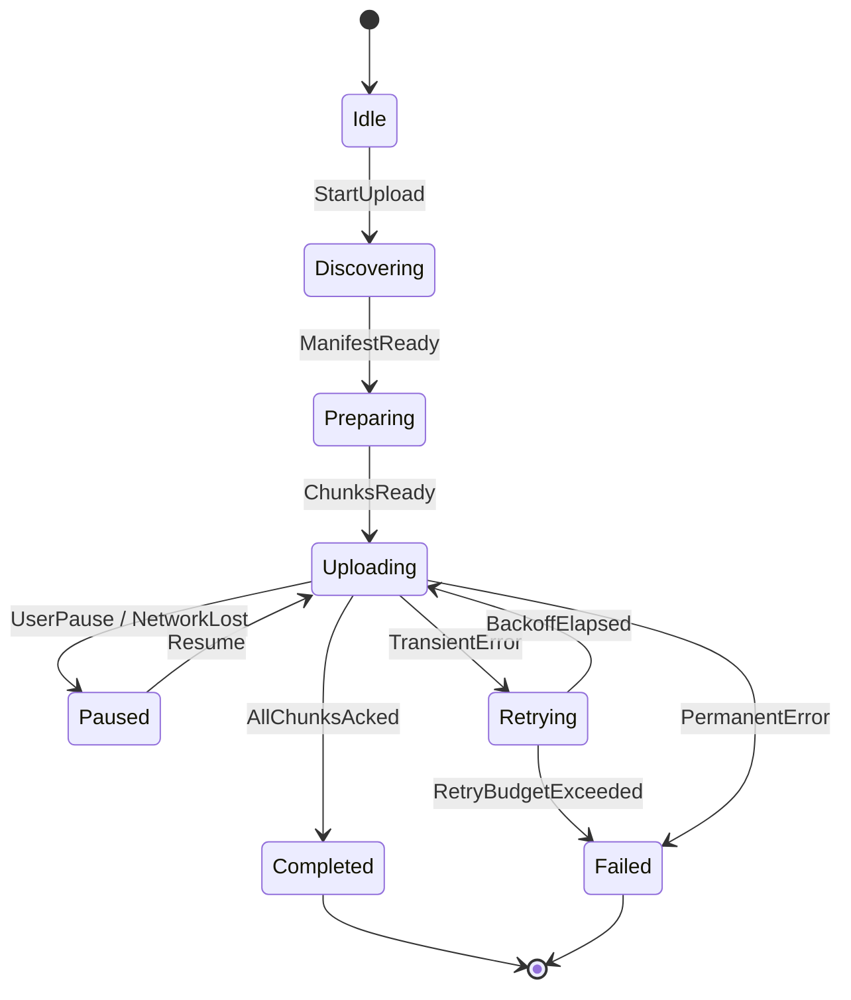

# Upload State Machine — AirBridge

## Canonical Owner

This file applies canonical concepts to AirBridge's upload pipeline. It does not redefine them.

- **State machines (mechanics):** [`../engineering-fundamentals/state-machines.md`](../engineering-fundamentals/state-machines.md)
- **Idempotency:** [`../distributed-systems/idempotency.md`](../distributed-systems/idempotency.md)
- **Determinism (heuristic):** [`../principles/determinism.md`](../principles/determinism.md)
- **Retry (pattern):** [`../patterns/retry.md`](../patterns/retry.md)
- **Structured logging:** [`../observability/structured-logging.md`](../observability/structured-logging.md)

If you find yourself reading this file and wondering "what is idempotency?", stop and read the canonical owner. This file assumes you already know.

---

## Context

AirBridge's upload pipeline is the system's hot path — the code that moves bytes from a mobile device to backend storage. It must survive: backgrounded apps, process death, network partitions, server-side throttling, partial writes, and user-initiated pause/resume. Every one of those failure modes is, in this pipeline, modeled as a state transition rather than a flag.

The state machine described here is the single source of truth for upload behavior. The UI reads it; the persistence layer serializes it; the metrics pipeline counts transitions on it. There is no parallel "is uploading" boolean anywhere in the codebase. That absence is intentional and load-bearing.

---

## Application

### States



Each state encodes both *position in the pipeline* and *the set of effects that should be running*. Crucially, every state is recoverable from persistence — no state requires "and also you must remember that this timer was running."

| State | What it means | Effects allowed in this state |
|---|---|---|
| `Idle` | No upload in flight | None |
| `Discovering` | Walking the source (files to upload) | Filesystem scan |
| `Preparing` | Server has the manifest; client awaits chunk plan | Manifest POST in flight |
| `Uploading` | Chunks streaming to server | Chunk PUTs; SSE listening for progress |
| `Paused` | Upload deliberately halted (user or network) | None; persisted progress retained |
| `Retrying` | Transient failure; backoff timer running | Backoff timer; no network calls |
| `Completed` | All chunks acknowledged by server | Cleanup; emit success event |
| `Failed` | Terminal failure (budget exceeded or permanent error) | Cleanup; emit failure event |

### Why these specific states

`Discovering` and `Preparing` are separate from `Uploading` because failure semantics differ. A failure during `Discovering` (e.g., the user deletes a file) is recoverable by retrying discovery without contacting the server. A failure during `Preparing` requires re-negotiating the manifest. A failure during `Uploading` only requires re-sending the failing chunk. Collapsing these into a single "in flight" state would lose that distinction and force the recovery logic to inspect ad-hoc fields to decide what to redo.

`Paused` and `Retrying` are separate because they encode different *intent*. `Paused` is the user's (or environment's) choice to stop; the system stays here indefinitely. `Retrying` is the system's choice to try again later; the system leaves automatically when the timer fires. Merging them would couple "did the user pause?" to "should we re-enter Uploading automatically?" and that coupling is exactly the source of the classic bug "I paused and now it's uploading again."

### Persistence rule

Every transition is written to durable storage **before** any side effect runs. The sequence is:

```text
event → compute next state → persist (state, next_chunk_index, retry_count, ...) → run effects
```

If the process dies between persist and effect, the next launch reads the persisted state and re-enters `Uploading`. Because chunk PUTs are idempotent (see [`../distributed-systems/idempotency.md`](../distributed-systems/idempotency.md)), re-running the effect is safe.

If the process dies between effect and persist, the effect ran but the state didn't advance. On next launch, we re-enter the same state and re-run the same effect — also safe because of idempotency. The system is *eventually consistent with the server* for any failure mode short of total data loss.

### Cross-machine composition

The upload pipeline runs alongside two smaller state machines as parallel regions:

- **Network availability:** `Online | Offline`. Drives `Uploading → Paused` automatically when the network drops.
- **Circuit breaker** ([`../patterns/circuit-breaker.md`](../patterns/circuit-breaker.md)): `Closed | Open | HalfOpen`. Wraps chunk PUTs. An `Open` breaker forces `Uploading → Retrying` regardless of whether the underlying request succeeded.

Composing these as separate machines instead of inlining them as states keeps the main pipeline diagram readable. The product of all three machines is the full system state.

---

## Decisions Made Here

These are the specific knob settings for AirBridge's machine. Larger decisions link to ADRs.

- **Transport for progress.** SSE over chunk-by-chunk polling. Decision recorded in [`../adr/003-sse-vs-websockets.md`](../adr/003-sse-vs-websockets.md).
- **Upload protocol.** POST per chunk rather than long-lived WebSocket. Decision recorded in [`../adr/002-post-vs-websockets.md`](../adr/002-post-vs-websockets.md).
- **Chunk size.** *TODO: pin actual chunk size (likely a function of payload size and observed mobile network MTUs).*
- **Retry budget.** Bounded retry budget per upload. *TODO: pin actual budget — number of attempts, max wallclock duration, jittered backoff schedule.*
- **Persistence frequency.** Every transition. No batching, no debouncing. The cost (a few ms of disk I/O per state change) is dwarfed by the cost of un-recoverable state.
- **Persistence format.** *TODO: confirm — append-only journal vs. overwrite-with-version-tag. Journal is preferred for debugability; overwrite is simpler.*
- **Backoff strategy.** Exponential with jitter; see canonical [`../patterns/retry.md`](../patterns/retry.md). *TODO: pin base interval and cap.*
- **Idempotency key.** A client-generated UUID per chunk, carried in a request header. Server deduplicates on this key — see [`../distributed-systems/idempotency.md`](../distributed-systems/idempotency.md).

---

## Failure Modes Observed

These are real failure modes specific to this machine, distinct from the generic failure modes in the canonical [`state-machines.md`](../engineering-fundamentals/state-machines.md#failure-modes).

**Backgrounded `Retrying` state outlives backoff window.** Android may freeze the process mid-backoff (Doze, App Standby). On unfreezing, the wall-clock check thinks the backoff has already elapsed, and the system enters `Uploading` immediately — possibly hammering the server. Mitigation: backoff timer is `max(remaining_backoff, min_post_resume_delay)`. See [`../android/doze-app-standby-and-battery-optimization.md`](../android/doze-app-standby-and-battery-optimization.md) for the platform-level constraint.

**SSE progress arrives for a stale upload.** If the user cancels and immediately starts a new upload with the same key, in-flight SSE messages for the previous attempt can race the new manifest. Mitigation: every SSE message carries a generation token; the client drops messages whose generation does not match the current state.

**`Preparing` deadlock.** Server takes the manifest but does not respond with the chunk plan. The machine stays in `Preparing` indefinitely. Mitigation: `Preparing` has a state-level timeout; on timeout, `Preparing → Retrying` with a fresh manifest attempt.

**Partial chunk write.** Server receives most of a chunk but the connection dies before the final byte. The chunk PUT is retried; the server must either accept the full retry (idempotent on the chunk's UUID) or reject it cleanly. Server-side never-partial semantics matter as much as client-side retry logic.

**Storage write fails mid-transition.** The persistence write itself can fail (disk full, encrypted storage unavailable). If the state cannot be persisted, the effect must not run. The system enters a special `Quarantine` state that exposes the underlying error to the UI; this is the one "weird" state that exists to give the user a coherent message when the device itself is the failure mode.

---

## Observability Hooks

The structured-log schema for every transition:

```json
{
  "machine": "airbridge_upload",
  "upload_id": "<uuid>",
  "from": "Uploading",
  "to": "Retrying",
  "event": "TransientError",
  "retry_count": 2,
  "error_class": "io.IOException",
  "timestamp": "2026-06-24T18:32:11.443Z"
}
```

Canonical schema rules are in [`../observability/structured-logging.md`](../observability/structured-logging.md); this file applies them.

**Metrics:**

- `airbridge.upload.transition_count{from, to, event}` — counter per edge.
- `airbridge.upload.dwell_seconds{state}` — histogram of how long uploads sit in each state.
- `airbridge.upload.retries{outcome}` — counter; outcome ∈ {`recovered`, `budget_exceeded`}.
- `airbridge.upload.illegal_event_count` — counter; should be 0 in steady state.
- `airbridge.upload.recovery_count` — counter; transitions caused by post-process-death recovery rather than live events. A non-zero rate is expected; a spike is a signal that something is killing the process.

**Traces:** every transition emits a trace span with `upload_id` as the trace ID. The full lifetime of an upload is one trace, often spanning multiple process boots. Distributed tracing canonical owner: [`../observability/distributed-tracing.md`](../observability/distributed-tracing.md).

**Dashboards:** a single panel visualizes the live distribution of in-flight uploads across states. A second panel charts the conversion funnel `StartUpload → Completed`. Sustained mass in `Retrying` is the first signal of upstream trouble.

**Alerts:**

- `illegal_event_count > 0` over any 5-minute window — paging alert. The machine and the system disagree about what's possible.
- `Retrying → Failed` rate exceeds baseline by 3σ — paging alert. Either retries are too short, the budget is too small, or upstream is broken.
- `dwell_seconds.Preparing` p95 > server SLO — non-paging alert. Symptom of slow manifest acceptance.

---

## Cross-References

Other files in this repository that exercise the same canonical concept:

- [`deterministic-resume.md`](deterministic-resume.md) — companion AirBridge application file; the resume story that makes this machine's persistence pay off.
- [`../mobile-system-design/offline-sync.md`](../mobile-system-design/offline-sync.md) — sync as a state machine; compares well to upload as a state machine.
- [`../mobile-system-design/file-downloader.md`](../mobile-system-design/file-downloader.md) — the symmetric problem; many of the same states, opposite direction.
- [`../backend-for-mobile/push-vs-poll-vs-sse-vs-websockets.md`](../backend-for-mobile/push-vs-poll-vs-sse-vs-websockets.md) — the transport choice underneath the SSE-based progress assumed here.
