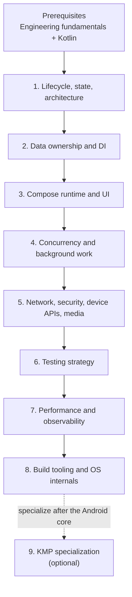

# Android

## Purpose

The Android platform, top to bottom—from app architecture down to Binder IPC. This is the most depth-heavy tree because Android constraints such as process death, background limits, battery, and ANRs shape every design above it.

## Why It Matters

Staff-level Android engineering means understanding the platform as a system, not a collection of APIs. A feature is incomplete until its lifecycle, persistence, concurrency, performance, security, testing, observability, and release behavior are understood.

## What This Folder Helps You Do

- Build features that survive lifecycle churn, configuration changes, process death, flaky networks, and OS background limits.
- Choose the right platform primitive and understand its ownership and failure behavior.
- Diagnose ANRs, jank, startup, memory, size, battery, radio, and device-specific failures.
- Review architecture proposals against platform, release, and long-tail device constraints.

## Guided Reading Sequence

Follow phases in order. Within each phase, read links top to bottom. Phases 1–8 form the Android core; Phase 9 is a specialization. If a prerequisite is already strong, answer that phase's probing questions before skipping it.

### Prerequisites

Complete [Engineering Fundamentals](engineering-fundamentals.md) and these Kotlin phases first: language core, type system, [Coroutines](kotlin/coroutines-and-flow/coroutines.md), and [Flow Operators and Backpressure](kotlin/coroutines-and-flow/flow-operators-and-backpressure.md).

The core path builds an Android feature from lifecycle and data ownership outward to UI, execution, integrations, verification, performance, and the platform underneath it. KMP is deliberately last because sharing code safely requires those boundaries first.

### Phase 1 — Lifecycle, state, and app architecture

1. [Activity](android/architecture/activity.md)
2. [Fragment](android/architecture/fragment.md) — understand for existing apps and interoperability even in a Compose-first codebase.
3. [ViewModel](android/architecture/viewmodel.md)
4. [SavedStateHandle](android/architecture/savedstatehandle.md)
5. [Process Death & State Restoration](android/architecture/process-death-and-state-restoration.md)
6. [Navigation](android/architecture/navigation.md)
7. [MVVM vs MVI](android/architecture/mvvm-vs-mvi.md)
8. [State Management](android/architecture/state-management.md)
9. [Modularization Strategies](android/architecture/modularization-strategies.md)

**Checkpoint:** design a screen that survives rotation and process death without treating `ViewModel` as durable storage.

### Phase 2 — Data ownership and dependency boundaries

1. [Repository Source of Truth](android/data-and-di/repository-source-of-truth.md)
2. [Room](android/data-and-di/room.md)
3. [DataStore](android/data-and-di/datastore.md)
4. [Room vs DataStore](android/data-and-di/room-vs-datastore.md)
5. [Storage & Content Sharing](android/data-and-di/storage-and-content-sharing.md)
6. [Paging](android/data-and-di/paging.md)
7. [Dependency Injection](android/data-and-di/dependency-injection.md)
8. [Hilt Components](android/data-and-di/components.md)
9. [Hilt and Coroutine Scopes](android/data-and-di/scopes.md)
10. [Hilt vs Koin vs Manual DI](android/data-and-di/hilt-vs-koin-vs-manual-di.md)

**Checkpoint:** identify the source of truth, persistence lifetime, transaction boundary, and DI scope for an offline-capable feature.

### Phase 3 — Compose runtime and UI architecture

1. [Compose Runtime](android/compose/compose-runtime.md)
2. [Snapshot System](android/compose/snapshot-system.md)
3. [Recomposition & State](android/compose/recomposition-and-state.md)
4. [Stability](android/compose/stability.md)
5. [Modifiers & Layout](android/compose/modifiers-and-layout.md)
6. [Custom Layout & Measurement](android/compose/custom-layout-measurement.md)
7. [Side Effects](android/compose/side-effects.md)
8. [Compose Navigation](android/compose/compose-navigation.md)
9. [Adaptive Compose & Large Screens](android/compose/adaptive-compose-large-screens.md)
10. [Form Factors Decision Matrix](android/compose/form-factors-matrix.md)
11. [Compose Accessibility](android/compose/compose-accessibility.md)
12. [View Interop & Compose Migration](android/compose/view-interop-and-migration.md)
13. [Compose Performance Tooling](android/compose/compose-performance-tooling.md)

**Checkpoint:** explain state reads, invalidation, recomposition, layout, side-effect lifetime, navigation ownership, and accessibility for one screen.

### Phase 4 — Concurrency and background execution

1. [Structured Concurrency on Android](android/architecture/structured-concurrency.md)
2. [Flow in Android Architecture](android/architecture/flow.md)
3. [Coroutines Under the Hood](android/concurrency/coroutines-under-the-hood.md)
4. [Threads & Looper](android/concurrency/threads-and-looper.md)
5. [SharedFlow & StateFlow](android/concurrency/shared-flow-and-state-flow.md)
6. [Synchronization & Mutex](android/concurrency/synchronization-and-mutex.md)
7. [Services](android/concurrency/services.md)
8. [WorkManager](android/concurrency/workmanager.md)
9. [Battery Optimizations](android/concurrency/battery-optimizations.md)

**Checkpoint:** choose the owner, dispatcher, cancellation boundary, persistence mechanism, and retry policy for work that may outlive a screen or process.

### Phase 5 — Networking, security, device APIs, and media

1. [Retrofit & OkHttp](android/networking-and-security/retrofit-and-okhttp.md)
2. [Ktor vs Retrofit](android/networking-and-security/ktor-vs-retrofit.md)
3. [GraphQL](android/networking-and-security/graphql.md)
4. [NetworkCallback, Metered Networks, VPNs & Captive Portals](android/networking-and-security/networkcallback-metered-vpn-captive-portal.md)
5. [Security & Keystore](android/networking-and-security/security-and-keystore.md) — platform application; canonical guidance lives in [Security](security.md).
6. [Device Connectivity & Location](android/networking-and-security/device-connectivity-and-location.md)
7. [Credential Manager](security/auth-on-mobile.md) — unified authentication API for passkeys, federated sign-in, and passwords; it supersedes legacy sign-in APIs such as Smart Lock for Passwords and One Tap, not the general Autofill framework.
8. [Health Connect](android/data-and-di/health-connect.md) — permissioned on-device health and fitness data exchange.
9. [WebView & Hybrid Architecture](android/networking-and-security/webview-and-hybrid.md)
10. [Media3 & ExoPlayer](android/media/media3-player-architecture.md)
11. [CameraX Capture Architecture](android/media/camerax-capture-architecture.md)

**Checkpoint:** design degraded-network, permission-denial, background, privacy, and device-compatibility behavior for a platform integration.

### Phase 6 — Testing strategy

1. [Testing Strategy at Scale](android/testing/testing-strategy.md)
2. [Unit Testing](android/testing/unit-testing.md)
3. [UI Testing](android/testing/ui-testing.md)

**Checkpoint:** build a test pyramid and device matrix that covers logic, persistence, lifecycle, UI, process death, and platform variance without making CI unusably slow.

### Phase 7: Performance and Android observability

1. [Startup](android/performance/startup.md)
2. [Jank](android/performance/jank.md)
3. [Rendering](android/performance/rendering.md)
4. [ANRs](android/performance/anrs.md)
5. [Memory Management & Leaks](android/performance/memory-management-and-leaks.md)
6. [Native Memory & Bitmaps](android/performance/native-memory-bitmaps.md)
7. [App Size & R8](android/performance/app-size-and-r8.md)
8. [Baseline Profiles](android/performance/baseline-profiles.md)
9. [Macrobenchmark & Perfetto](android/performance/macrobenchmark-and-perfetto.md)
10. [Battery & Power Profiling](android/performance/battery-power-profiling.md)
11. [Network Radio Wakeups](android/performance/network-radio-wakeups.md)
12. [Thermal & Low-End Device Strategy](android/performance/thermal-low-end-device-strategy.md)
13. [Android Logging](android/observability/logging.md)
14. [Crash Monitoring](android/observability/crash-monitoring.md)
15. [Mobile APM & RUM](android/observability/mobile-apm-and-rum.md)

Canonical signal, SLI, SLO, alert, and dashboard concepts live in [Observability](observability.md).

**Checkpoint:** diagnose a regression with measurements, segment it by device/OS/app state, and define the release gate that prevents recurrence.

### Phase 8 — Build tooling and operating-system internals

1. [Gradle & Build Systems](android/build-tooling/gradle-and-build-systems.md)
2. [Multi-Module Project Structure](android/build-tooling/multi-module.md)
3. [Convention Plugins](android/build-tooling/convention-plugins.md)
4. [KSP](android/build-tooling/ksp.md)
5. [Intent Resolution & Manifest](android/os-internals/intent-resolution-and-manifest.md)
6. [Broadcast Receivers](android/os-internals/broadcast-receivers.md)
7. [Content Providers & ContentResolver](android/os-internals/content-providers-and-contentresolver.md)
8. [Permissions & AppOps](android/os-internals/permissions-and-app-ops.md)
9. [ActivityManager & Process Lifecycle](android/os-internals/activitymanager-process-lifecycle.md)
10. [Package Manager, Installation & Class Loading](android/os-internals/package-manager-installation-classloading.md)
11. [Binder](android/os-internals/the-binder.md)
12. [Zygote](android/os-internals/the-zygote.md)
13. [ART & Dalvik](android/os-internals/art-and-dalvik.md)

**Checkpoint:** trace source code through the build graph, installation, process creation, runtime execution, and a Binder call into a system service.

### Phase 9 — Kotlin Multiplatform specialization (optional)

Start this phase only after the Android core and Kotlin runtime/concurrency material.

1. [KMP Decision Matrix](android/kotlin-multiplatform/kmp-decision-matrix.md)
2. [Overview & K1 vs K2](android/kotlin-multiplatform/foundations/overview-and-k1-vs-k2.md)
3. [Shared Domain Boundaries](android/kotlin-multiplatform/shared-domain-boundaries.md)
4. [Architecture & Module Boundaries](android/kotlin-multiplatform/foundations/architecture-and-module-boundaries.md)
5. [Build System & Source Sets](android/kotlin-multiplatform/tooling/build-system-and-source-sets.md)
6. [Libraries Ecosystem](android/kotlin-multiplatform/ecosystem/libraries-ecosystem.md)
7. [Networking with Ktor](android/kotlin-multiplatform/ecosystem/networking-with-ktor.md)
8. [Persistence](android/kotlin-multiplatform/ecosystem/persistence.md)
9. [Dependency Injection](android/kotlin-multiplatform/ecosystem/dependency-injection.md)
10. [Compose Multiplatform](android/kotlin-multiplatform/ui-sharing/compose-multiplatform.md)
11. [Resource Sharing](android/kotlin-multiplatform/ui-sharing/resource-sharing.md)
12. [Concurrency & Memory Model](android/kotlin-multiplatform/production/concurrency-and-memory.md)
13. [Swift Interop & SKIE](android/kotlin-multiplatform/tooling/swift-interop.md)
14. [iOS Distribution](android/kotlin-multiplatform/tooling/ios-distribution.md)
15. [Binary Compatibility & API Evolution](android/kotlin-multiplatform/binary-compatibility-api-evolution.md)
16. [Testing & Mocking](android/kotlin-multiplatform/production/testing-and-mocking.md)
17. [KMP Observability & Crash Symbolication](android/kotlin-multiplatform/kmp-observability-crash-symbolication.md)
18. [CI/CD for KMP](android/kotlin-multiplatform/production/ci-cd-for-kmp.md)
19. [Adoption & Migration](android/kotlin-multiplatform/production/adoption-and-migration.md)

## Continue the Complete Curriculum

After the Android core, continue to [Distributed Systems](distributed-systems.md), then [Backend for Mobile](backend-for-mobile.md) and [Mobile System Design](mobile-system-design.md).

Related topics owned elsewhere:

- [App Bundles & Dynamic Delivery](release-engineering/app-bundles.md)
- [App Startup as a system-design concern](mobile-system-design/app-startup.md)
- [Performance as a non-functional requirement](mobile-system-design/performance.md)
