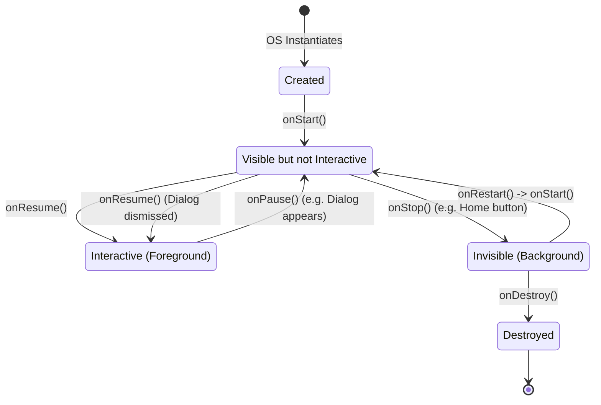

# The Activity

## Overview

An `Activity` is the fundamental building block of an Android application's user interface. It represents a single screen with a user interface. If an Android application is a stage play, the `Activity` is the stage itself. 

While modern Android development (especially with Jetpack Compose) emphasizes a "Single Activity Architecture," understanding the Activity lifecycle and its relationship with the Operating System remains absolutely critical. The OS communicates with your application *through* the Activity.

## Why It Matters

Unlike desktop applications which start at `main()` and own their entire window until closed, Android apps live in a highly constrained, hostile environment. The OS can and will kill your application at any time to reclaim memory. 

The `Activity` provides the callbacks (the Lifecycle) that allow your application to react to the OS. If you do not understand the Activity lifecycle, you will leak memory, you will drop network connections, and your app will crash when the user rotates their phone.

## Historical Context

In the early days of Android (2008-2015), developers created a new `Activity` for every single screen in their app (e.g., `LoginActivity`, `FeedActivity`, `SettingsActivity`). This was heavy. Every Activity requires IPC (Inter-Process Communication) with the OS `ActivityManager` via the Binder to start. It caused massive jank.

Today, Google strongly recommends the **Single Activity Architecture**. You have one `MainActivity`, and you swap out lightweight UI components (Fragments or Jetpack Compose functions) inside of it. However, that single `MainActivity` is still the anchor to the OS.

## First Principles

1.  **OS Bound:** An Activity is not just a Java/Kotlin object. It is a system-level component managed by the `ActivityManagerService` living inside the `system_server` process.
2.  **The Window:** Every Activity is given a `Window` by the OS to draw into. If the Activity dies, the Window dies.
3.  **The Lifecycle:** The sequence of states (Created -> Started -> Resumed -> Paused -> Stopped -> Destroyed) dictated by the OS based on user interaction and system memory.

## Mental Model

Think of an Activity as a **Rented Hotel Room**.
- **`onCreate()`:** You sign the lease and bring your luggage (UI components) into the room.
- **`onStart()`:** You unlock the door. People in the hallway can see inside, but you aren't talking to them yet.
- **`onResume()`:** You are actively standing in the doorway talking to a guest (the user).
- **`onPause()`:** The guest steps away to answer a phone call (a transparent dialog appears over your app). You pause the conversation, but you keep the door open.
- **`onStop()`:** The guest leaves. You close the door. You are still in the room, but no one can see you. You should put heavy things away (stop animations, release the camera).
- **`onDestroy()`:** The hotel manager kicks you out to give the room to someone else. You must pack up everything and leave.

## Internal Mechanics: The Lifecycle

The lifecycle is often memorized but rarely understood. A Staff engineer focuses on the *transitions*.

### 1. `onCreate()` to `onResume()` (The Setup)
- **`onCreate()`:** The Activity object is instantiated. You call `setContentView()` (or `setContent {}` in Compose). The View hierarchy is inflated, but *nothing is drawn yet*.
- **`onStart()`:** The Window becomes visible to the user.
- **`onResume()`:** The Activity gains "Input Focus." This is the exact moment the user can actually tap a button. 

### 2. `onPause()` vs `onStop()` (The Teardown)
This is the most misunderstood transition in Android.
- **`onPause()`:** The Activity loses Input Focus, but is *still partially visible*. Example: A system permission dialog pops up, or the user opens Android's split-screen mode. You must pause video playback here, but you *should not* do heavy teardown (like closing a database), because the user might just dismiss the dialog and instantly return to `onResume()`.
- **`onStop()`:** The Activity is *100% invisible*. The user pressed the Home button or navigated to a completely different Activity. This is where you release heavy resources.

### 3. Configuration Changes
When the user rotates their phone, or changes the system language, or enters Dark Mode, the OS performs a brutal action: **It instantly destroys and recreates the Activity.**
- The flow: `onPause` -> `onStop` -> `onDestroy` -> `onCreate` -> `onStart` -> `onResume`.
- *Why?* Because rotating the phone usually requires loading completely different XML layouts or dimensions (e.g., `layout-land`). The OS takes the nuclear approach to ensure the UI is drawn correctly.
- *The Fix:* You must survive this nuclear blast using [ViewModels](viewmodel.md) and [SavedStateHandle](savedstatehandle.md).

## Architecture



## Production Example

**Lifecycle-Aware Observation**

Historically, developers manually started network requests in `onStart()` and cancelled them in `onStop()`. This caused massive boilerplate and memory leaks when developers forgot the teardown.

Today, we use `LifecycleOwner`. The Activity implements `LifecycleOwner`, allowing other classes to observe its state automatically.

```kotlin
class MainActivity : AppCompatActivity() {

    override fun onCreate(savedInstanceState: Bundle?) {
        super.onCreate(savedInstanceState)
        
        // Jetpack Compose Example
        setContent {
            val viewModel: MyViewModel by viewModels()
            
            // This safely collects the Flow ONLY when the Activity is between 
            // onStart() and onStop(). It automatically pauses collection 
            // when the app goes to the background.
            val uiState by viewModel.state.collectAsStateWithLifecycle()
            
            MyScreen(uiState)
        }
    }
}
```

## Tradeoffs

**Single Activity vs Multiple Activities**

**Single Activity (Recommended):**
- **Pros:** Blistering fast navigation (swapping Fragments/Composables is purely local memory manipulation). Shared `ViewModel` scope across the entire app. Shared element transitions are much easier.
- **Cons:** The `MainActivity` can become a "God Object" if you aren't careful. Deep linking requires a complex Navigation graph routing system.

**Multiple Activities (Legacy):**
- **Pros:** The OS handles the backstack automatically. Deep linking is trivial (just launch the specific Activity via `Intent`).
- **Cons:** Heavy IPC overhead. Screen transitions are slow. Sharing data between screens requires parceling data into `Intents`, which is brittle and size-constrained.

## Failure Modes

- **The `Activity` Context Leak:**
  ```kotlin
  // DISASTER
  object SingletonManager {
      var context: Context? = null
  }
  
  class MainActivity : AppCompatActivity() {
      override fun onCreate(savedInstanceState: Bundle?) {
          super.onCreate(savedInstanceState)
          // You just leaked the entire Activity and all its Views into a GC Root.
          // When the phone rotates, the old Activity cannot be garbage collected.
          SingletonManager.context = this 
      }
  }
  ```
  *(Fix: Never pass an `Activity` context to a Singleton or long-living background thread. If a Singleton absolutely needs a Context, pass `applicationContext`).*
- **Doing heavy work in `onPause`:** `onPause` blocks the OS from rendering the *next* thing the user is trying to see (like the Home Screen). If you write to a database in `onPause`, the phone will freeze momentarily. Move heavy teardown to `onStop` or use Coroutines.

## Staff Engineer Thinking

When reviewing Activity code, a Staff engineer focuses on isolation:

1.  **Is there business logic here?** An Activity should contain almost zero code. It should call `setContent {}` and perhaps handle incredibly specific OS integrations (like requesting runtime permissions or handling raw `Intents`). If an Activity has an `if/else` statement validating a user's password, it is an architectural failure.
2.  **Are we respecting the `Window`?** The Activity owns the `Window`. Issues like drawing under the system status bar (Edge-to-Edge) or handling software keyboard insets are the responsibility of the Activity layer.
3.  **How are we handling Intents?** If this Activity is an entry point from another app (via an Implicit Intent), how are we validating the incoming `Intent.extras`? Incoming Intents are a security boundary. We must assume the incoming data is malicious or malformed.

## Common Misconceptions

- **"If I call `finish()`, `onDestroy()` is called immediately."** False. `finish()` simply asks the `ActivityManager` to destroy the Activity when it has time. The actual `onDestroy()` callback is asynchronous and happens later.
- **"`onDestroy()` is always called."** Extremely False. If the OS is critically low on memory, or if the user swipes your app away in the recents menu, the OS will brutally kill the entire Linux process (`kill -9`). `onDestroy()` will NOT be executed. Never save critical user data to a database in `onDestroy()`.

## Probing Questions

1.  Explain the exact difference between `onPause()` and `onStop()`. Give a real-world scenario where an Activity is paused but not stopped.
2.  Why did the Android community shift from a "Multiple Activity" architecture to a "Single Activity" architecture?
3.  Describe the memory leak that occurs when an anonymous inner class (like a `Runnable`) running on a background thread holds a reference to an Activity.
4.  Why does the Android OS destroy and recreate the Activity when the user rotates the device?
5.  If `onDestroy()` is not guaranteed to be called, where is the safest place to save user data before the app is backgrounded?
6.  What is the difference between `this` (Activity Context) and `applicationContext`? When must you use one over the other?
7.  Explain how `collectAsStateWithLifecycle()` in Jetpack Compose interacts with the Activity's lifecycle.
8.  Why is doing heavy disk I/O in the `onPause()` method considered a critical performance flaw?
9.  If an Activity is launched with the `singleTop` launch mode, which lifecycle method is invoked instead of `onCreate()` if the Activity is already at the top of the stack?
10. Describe how the `ActivityManagerService` uses Inter-Process Communication (IPC) to coordinate the creation of an Activity in your app's process.

## Answer Key

1. `onPause()` means the Activity has lost focus but can remain visible, such as behind a permission dialog or in multi-window mode; `onStop()` means it is no longer visible. Keep `onPause()` brief and defer visibility-dependent cleanup to `onStop()`.
2. A single Activity avoids repeated OS-managed Activity launches and centralizes navigation, shared screen scope, and transitions. The tradeoff is that navigation and deep-link routing must be kept modular so the host Activity does not become a god object.
3. A non-static inner object captures its outer Activity. If a thread, callback queue, or singleton outlives that Activity, the reference chain keeps the destroyed Activity and its View tree reachable; cancellation, lifecycle-aware scopes, or a non-capturing object breaks the chain.
4. Rotation is a configuration change, so Android recreates the Activity to let it load resources and layouts for the new configuration. Durable screen state belongs in a `ViewModel`, while the minimum restorable UI state belongs in saved-state APIs.
5. Persist important application data through the data layer when it changes; do not wait for `onDestroy()`. Use `onStop()` only as a fallback for relatively expensive shutdown persistence, and use `SavedStateHandle` or `rememberSaveable` for small transient UI state rather than durable records.
6. An Activity context is tied to that Activity and carries its theme, window, and lifecycle, so use it for UI work such as dialogs or inflating themed views. The application context lives for the process and is appropriate for long-lived non-UI dependencies; storing an Activity context in such an object leaks the Activity.
7. `collectAsStateWithLifecycle()` collects while the associated lifecycle is at least `STARTED`, stops collection below that state, and resumes it when the lifecycle becomes active again. This avoids doing off-screen collection work while still exposing the latest state to Compose.
8. `onPause()` is on the critical transition path to the next foreground UI. Blocking it with disk I/O delays that transition and can cause visible jank or, for sufficiently long work, an ANR; persist asynchronously or at the data-change boundary instead.
9. Android calls `onNewIntent()` on the existing top instance. The Activity must handle the new intent explicitly because `onCreate()` is not called for that delivery.
10. The system-side activity/task service validates and resolves the launch, starts the app process if necessary, then communicates through Binder with the app's `ApplicationThread`. `ActivityThread` schedules the launch on the app's main thread, where instrumentation creates the Activity and dispatches its lifecycle; modern Android places much task coordination in `ActivityTaskManagerService`, so “AMS creates the Activity directly” is an oversimplification.

## Further Reading

- [`viewmodel.md`](viewmodel.md) — How to survive the nuclear blast of Configuration Changes.
- [`process-death-and-state-restoration.md`](process-death-and-state-restoration.md) — What happens when the OS kills your entire process, not just the Activity.
- [Android Developers: The Activity Lifecycle](https://developer.android.com/guide/components/activities/activity-lifecycle)
- [Android Developers: Tasks and the back stack](https://developer.android.com/guide/components/activities/tasks-and-back-stack)
- [Android Developers: Recommendations for Android architecture](https://developer.android.com/topic/architecture/recommendations)
- [Android Developers: Save UI states](https://developer.android.com/topic/libraries/architecture/saving-states)
