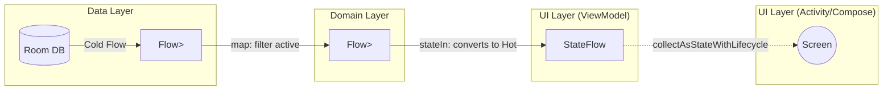

# Flow

## Overview

`Flow` is the asynchronous-stream API from the `kotlinx.coroutines` library; it is not a Kotlin language feature. Canonical operator and backpressure mechanics live in [Flow Operators and Backpressure](../../kotlin/coroutines-and-flow/flow-operators-and-backpressure.md). This page owns the Android application: repository streams, ViewModel state, and lifecycle-aware UI collection.

While standard coroutines (`suspend` functions) return a *single* value asynchronously, a `Flow` returns *multiple* values asynchronously over time. It is the modern replacement for RxJava and `LiveData` in the Android ecosystem.

## Why It Matters

Mobile applications are fundamentally reactive. The UI must react to the user tapping a button, the network returning a payload, and the database updating its cache—often all at the same time.

Before `Flow`, Android developers relied heavily on RxJava to manage these streams. RxJava is incredibly powerful but famously complex, bloated, and entirely disconnected from Kotlin's Coroutine scopes, leading to severe memory leaks if subscriptions weren't manually cleared. 

`Flow` composes with suspending functions and coroutine cancellation. A collection launched in `viewModelScope` is cancelled when that scope is cancelled; this does not imply that every upstream producer or separately-owned hot flow stops. Producer lifetime is determined by its owning scope and, for `shareIn`/`stateIn`, its `SharingStarted` policy.

## Historical Context

In the Jetpack era (2017), Google introduced `LiveData` as the standard way to push data from the ViewModel to the UI. It was lifecycle-aware and simple. 

However, `LiveData` had massive flaws:
1. It is tied to the Android framework (`android.lifecycle`), making it impossible to use in pure Kotlin Domain/Data layers or Kotlin Multiplatform (KMP).
2. It operates exclusively on the Main Thread.
3. It has extremely limited transformation operators compared to RxJava.

In 2019, Kotlin introduced `Flow`. It was pure Kotlin (platform-agnostic), thread-safe, and had operators matching RxJava. Google has not needed to remove `LiveData`, but modern Android architecture guidance strongly favors `Flow`, `StateFlow`, and lifecycle-aware collection for new Kotlin-first codebases.

## First Principles

1.  **Cold vs Hot:** 
    - **Cold Stream (Standard `Flow`):** It does nothing until someone explicitly calls `.collect()` on it. If two people collect it, the code runs twice independently. (Think: A Netflix video).
    - **Hot Stream (`StateFlow` / `SharedFlow`):** The stream exists independently of any one collector. Emission or upstream work may still start and stop according to the producer scope, subscribers, and `SharingStarted` configuration.
2.  **Suspending Iteration:** Emitting a value (`emit()`) and collecting a value (`collect()`) are both `suspend` functions. They pause execution without blocking threads.
3.  **Backpressure:** A sequential cold `flow { emit(...) }` suspends its producer until downstream is ready. Buffers, channels, `SharedFlow`, concurrency operators, and overflow policies deliberately change that behavior.

## Mental Model

Think of a **Water Treatment Plant**.
- **The Source (`flow { }`):** A mountain spring emitting dirty water.
- **The Operators (`.map`, `.filter`):** The pipes and filters. One pipe filters out rocks. Another pipe adds chlorine.
- **The Terminal Operator (`.collect`):** The faucet in the user's house. 

**Crucially:** If the user turns *off* the faucet (cancels the coroutine), the water doesn't just spill onto the floor. The backpressure instantly travels all the way up the pipes and shuts off the spring at the source. No wasted work.

## Internal Mechanics

How does a `Flow` actually work under the hood? It is just an Interface with a single method.

```kotlin
interface Flow<out T> {
    suspend fun collect(collector: FlowCollector<T>)
}

interface FlowCollector<in T> {
    suspend fun emit(value: T)
}
```

When you write `flow { emit(1) }`, you are defining an anonymous class that implements `Flow`. The block of code inside `{ }` *is not executed*. It is just saved in memory.

When the UI finally calls `.collect {}`, it passes itself in as the `FlowCollector`. Only then does the block execute, calling `emit(1)`, which triggers the lambda you provided in `collect`.

Because `emit` and `collect` are both `suspend` functions, they seamlessly hand control back and forth to each other on the same coroutine thread, avoiding the massive context-switching overhead of RxJava.

## Architecture



## Production Example

**The Flow Pipeline**

A Staff-level architecture uses Cold flows from the Database, transforms them in the Domain layer, and converts them to Hot `StateFlows` in the ViewModel.

**1. Data Layer (Room DAO)**
```kotlin
// Room naturally returns a Cold Flow. Every time the DB changes, it emits a new list.
@Query("SELECT * FROM users")
fun observeUsers(): Flow<List<UserEntity>>
```

**2. ViewModel (The Pivot)**
```kotlin
@HiltViewModel
class UserViewModel @Inject constructor(
    private val repository: UserRepository
) : ViewModel() {

    // We take the Cold flow, map it to our UI state, and convert it to a Hot StateFlow.
    val uiState: StateFlow<UserUiState> = repository.observeUsers()
        .map { users -> UserUiState.Success(users) }
        .catch { e -> emit(UserUiState.Error(e.message)) }
        // The Pivot: stateIn converts Cold to Hot.
        .stateIn(
            scope = viewModelScope, // Dies when ViewModel dies
            started = SharingStarted.WhileSubscribed(5000), // Pauses when UI is hidden
            initialValue = UserUiState.Loading
        )
}
```

## Tradeoffs

**StateFlow vs SharedFlow vs LiveData**

- **`LiveData`:** 
    - *Pros:* Deeply tied to Android lifecycle. Hard to memory leak.
    - *Cons:* Main thread only. No advanced operators. Android-specific.
- **`StateFlow`:** 
    - *Pros:* Always has a value. Conflates identical values (if you emit "A" then "A", the UI only updates once). Perfect for UI State.
    - *Cons:* Requires `collectAsStateWithLifecycle` in Compose to avoid memory leaks.
- **`SharedFlow`:** 
    - *Pros:* Can emit the exact same value twice in a row. Can have zero initial value. Useful for broadcast streams where replay, buffering, and loss behavior are explicit.
    - *Cons:* Highly complex configuration (replay caches, buffer overflow strategies). A default `MutableSharedFlow` drops values emitted with no subscribers, which makes it risky for critical one-off UI effects like navigation.

## Failure Modes

- **The Multiple Collection Trap:**
  ```kotlin
  // In the Repository
  val locationFlow = flow {
      val gps = startGpsHardware() // Heavy battery usage
      emit(gps.getLocation())
  }
  
  // In the ViewModel
  // DISASTER: Every time you call .collect() on a Cold flow, it restarts from scratch!
  // If 3 UI components observe this, you just booted up 3 separate GPS hardware trackers!
  locationFlow.collect { ... }
  locationFlow.collect { ... } 
  ```
  *(Fix: Convert the Cold flow to a Hot flow using `.shareIn()` or `.stateIn()` in the ViewModel, so the GPS is only started once, and all 3 UI components share the stream).*
- **Leaking Flows in the UI:**
  If you `lifecycleScope.launch { viewModel.state.collect {} }` in an Activity, the collection runs as long as the Activity is alive. If the Activity is merely `onStop()` (in the background), the Flow *keeps collecting data*, wasting CPU and crashing if it tries to touch a destroyed Fragment View.
  *(Fix: Always use `repeatOnLifecycle(Lifecycle.State.STARTED)` in XML/Views, or `collectAsStateWithLifecycle()` in Compose).*

## Staff Engineer Thinking

When reviewing reactive architectures, a Staff engineer focuses on the "Cold to Hot" pivot point:

1.  **Where does the flow get hot?** Data sources (Room, Retrofit, DataStore) should usually return Cold flows. The UI should usually consume Hot `StateFlow`. The default boundary where Cold turns to Hot is the ViewModel via `.stateIn()`. A repository can return hot state only when it is intentionally acting as a scoped cache or app-wide state holder.
2.  **Are we using the right `SharingStarted` strategy?** `SharingStarted.WhileSubscribed(5000)` is a strong Android default because it keeps upstream work alive across quick rotations and navigation transitions. `Eagerly`, `Lazily`, and custom `WhileSubscribed` parameters are valid when the resource and replay contract justify them.
3.  **One-off Events vs State:** I challenge `SharedFlow` for "Show Error Toast" and navigation unless loss/replay semantics are explicit. If the app is in the background when a default `SharedFlow` emits, the event is dropped. Important user-visible effects should usually be modeled as pending state that the UI displays and then explicitly dismisses.

## Common Misconceptions

- **"Flow runs on a background thread automatically."** False. A Flow executes on whatever thread called `.collect()`. If you collect on the Main thread, the `flow { }` block runs on the Main thread unless you explicitly change it using `.flowOn(Dispatchers.IO)`.
- **"I should replace all my `suspend` functions with `Flow`."** No. If a network request returns exactly *one* JSON object, use a standard `suspend fun`. `Flow` should only be used when returning *multiple* values over time (e.g., observing a database table that might change).

## Probing Questions

1.  Explain the fundamental difference between a Cold Flow and a Hot Flow (StateFlow/SharedFlow).
2.  What happens to a standard `flow { }` block if no one ever calls `.collect()` on it?
3.  Why does modern Android guidance favor `Flow`/`StateFlow` over `LiveData` for new Kotlin-first architectures? Give at least two reasons.
4.  Explain backpressure in a sequential cold Flow, then identify which buffering and hot-stream operators change that behavior.
5.  What is the `StateFlow` conflation property, and why does it make `StateFlow` inappropriate for emitting "One-off Events" like Navigation triggers?
6.  Describe the memory leak that occurs when collecting a Flow in a Fragment using `lifecycleScope.launch` instead of `viewLifecycleOwner.repeatOnLifecycle`.
7.  What is the purpose of the `SharingStarted.WhileSubscribed(5000)` parameter when converting a flow via `stateIn()`?
8.  If you have a heavy database query modeled as a Flow, and you want to ensure the query runs on a background thread regardless of where it is collected, which Flow operator must you use?
9.  Describe a scenario where multiple UI components collecting a Cold Flow would result in catastrophic battery drain or API quota exhaustion.
10. How does Structured Concurrency guarantee that an active Flow collection will be cleanly aborted when a user navigates away from a screen?

## Answer Key

1. A cold flow runs upstream work separately for each collector; a hot flow exists independently and broadcasts shared state or events.
2. Nothing: the builder is lazy and its block does not execute until collection.
3. Flow is platform-neutral Kotlin, composes through rich operators, supports structured cancellation, and works naturally with suspending repositories; Android lifecycle APIs provide safe UI collection.
4. A normal cold flow suspends the producer behind a slow collector. `buffer`, `conflate`, `collectLatest`, and hot sharing alter queueing, cancellation, or delivery semantics.
5. `StateFlow` retains and conflates the latest value. A transient event may be replayed after recreation or overwritten before observation; model durable UI state or use an explicitly designed event channel.
6. The Fragment's lifecycle can outlive its view. Collection keeps touching old view references after `onDestroyView`; collect under `viewLifecycleOwner.repeatOnLifecycle`.
7. It keeps a shared upstream alive briefly across short collector gaps, avoiding needless restart while still stopping work after sustained inactivity.
8. Use `flowOn` to move the upstream query context; downstream collection remains in the collector's context.
9. If each collector starts polling, GPS, a socket, or a metered API independently, N UI collectors multiply resource consumption; share the upstream with a deliberate lifetime.
10. Collection is a child job of the screen/lifecycle scope. Cancelling that parent propagates cancellation through suspending operators and upstream work, assuming code does not swallow cancellation.

## Further Reading

- [`structured-concurrency.md`](structured-concurrency.md) — The foundation that makes Flow cancellation safe.
- [`viewmodel.md`](viewmodel.md) — The layer where Cold flows are converted to Hot `StateFlows`.
- [Android Developers: StateFlow and SharedFlow](https://developer.android.com/kotlin/flow/stateflow-and-sharedflow)
