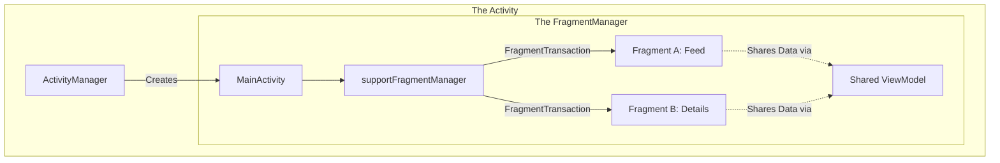

# The Fragment

## Overview

A `Fragment` represents a reusable portion of your app's user interface. If an [Activity](activity.md) is the stage, a Fragment is an actor on that stage. 

A Fragment has its own lifecycle, receives its own input events, and can be added or removed while the Activity is running. The critical distinction is that a Fragment **must always be hosted by an Activity**. It cannot exist on its own. If the host Activity dies, all its Fragments die instantly.

## Why It Matters

When Android tablets were introduced (Android 3.0 Honeycomb), Google realized that a phone app's UI (one list spanning the whole screen) looked terrible on a tablet. Developers needed a way to split the UI into modular chunks (e.g., a List chunk on the left, a Detail chunk on the right) so they could be reused across different form factors. The Fragment was born.

Fragments enable the **Single Activity Architecture**. Instead of launching heavy, OS-managed Activities for every screen, you launch one lightweight Activity and swap Fragments in and out of it using a `FragmentManager`.

## Historical Context

Fragments have a dark history in Android. For many years, they were considered the most hated API in the Android framework. 
Why? Because their lifecycle was unimaginably complex (with 13+ callbacks), and their animations were incredibly buggy. There were also *two* competing Fragment APIs for years (`android.app.Fragment` vs `android.support.v4.app.Fragment`). 

Today, the modern `androidx.fragment` library has solved almost all of these issues. However, with the rise of Jetpack Compose, the Fragment is slowly becoming obsolete. In a pure Compose app, you do not need Fragments at all; you just use `@Composable` functions. But for the millions of apps still using XML, Fragments remain the core architectural building block.

## First Principles

1.  **The Sub-Lifecycle:** A Fragment's lifecycle is tied to, but separate from, its host Activity. An Activity has one lifecycle; a Fragment actually has *two* (The Fragment instance lifecycle, and the Fragment's *View* lifecycle).
2.  **The FragmentManager:** Fragments are never instantiated and attached directly by you. You ask the `FragmentManager` to do it via a `FragmentTransaction`.
3.  **State Survival:** Fragments must have an empty constructor. When the OS kills your app and restores it, the `FragmentManager` uses reflection to recreate the Fragment using that empty constructor.

## Mental Model

Think of the `FragmentManager` as a strict **Stage Director**, and the Fragments as **Actors**.

You (the developer) cannot push an Actor onto the stage. You must write a script (a `FragmentTransaction`):
*"Director, please take Actor A off the stage, and put Actor B in the spotlight."*

You hand the script to the Director (`commit()`). The Director executes it asynchronously when the OS allows it. If the theater burns down (Process Death), the Director looks at the script, re-hires new actors that look exactly like the old ones (using the empty constructor), and puts them back in their exact positions.

## Internal Mechanics

The most critical thing for a Staff Engineer to understand about Fragments is the **Dual Lifecycle**.

### The Two Lifecycles

1.  **The Fragment Instance Lifecycle:** `onCreate()`, `onDestroy()`. This is the lifecycle of the Kotlin object in memory.
2.  **The View Lifecycle:** `onCreateView()`, `onDestroyView()`. This is the lifecycle of the UI layout attached to the Fragment.

**The Danger Zone:**
When you put a Fragment onto the Backstack (e.g., navigating from Screen A to Screen B), Screen A is no longer visible. To save memory, the `FragmentManager` **destroys Screen A's View**, but **keeps Screen A's Fragment Instance alive** in memory.

- `onDestroyView()` is called (The UI is garbage collected).
- `onDestroy()` is NOT called (The Kotlin object remains).

When the user presses the Back button, the `FragmentManager` pulls Screen A back to the front. It calls `onCreateView()` to rebuild the UI, using the data still held in the surviving Fragment instance.

### `viewLifecycleOwner`

Because the View can be destroyed and recreated while the Fragment survives, observing data (like `LiveData` or `Flow`) using `this` (the Fragment instance) as the `LifecycleOwner` causes massive memory leaks and crashes.

```kotlin
class MyFragment : Fragment() {

    override fun onViewCreated(view: View, savedInstanceState: Bundle?) {
        super.onViewCreated(view, savedInstanceState)
        
        // DISASTER: Using 'this' (The Fragment Instance). 
        // If the View is destroyed and recreated (e.g., popped from backstack),
        // onViewCreated is called again. Now you have TWO observers running!
        viewModel.data.observe(this) { ... }
        
        // GOOD: Using 'viewLifecycleOwner' (The View Instance).
        // When the View is destroyed, this observer is automatically cancelled.
        // When the View is recreated, a single new observer is created.
        viewModel.data.observe(viewLifecycleOwner) { ... }
    }
}
```

## Architecture



## Production Example

**Fragment Result API (Passing Data)**

Historically, passing data back from Fragment B to Fragment A (e.g., returning from a selection screen) required deeply coupling the Fragments using interfaces or relying on the host Activity to pass messages.

Today, we use the decoupled `FragmentResultAPI`, which routes data through the `FragmentManager`.

**Fragment A (The Receiver):**
```kotlin
override fun onCreate(savedInstanceState: Bundle?) {
    super.onCreate(savedInstanceState)
    // Register the listener BEFORE the Fragment goes to the STARTED state
    setFragmentResultListener("requestKey") { requestKey, bundle ->
        val result = bundle.getString("bundleKey")
        // Do something with the result
    }
}
```

**Fragment B (The Sender):**
```kotlin
button.setOnClickListener {
    val result = "User selected Option 2"
    // Send the result to the FragmentManager
    setFragmentResult("requestKey", bundleOf("bundleKey" to result))
    
    // Pop Fragment B off the backstack to return to Fragment A
    parentFragmentManager.popBackStack()
}
```

## Tradeoffs

**Fragments vs Jetpack Compose**

**Fragments (XML approach):**
- **Pros:** Mature ecosystem. Jetpack Navigation library was built heavily around it. Easy integration with legacy codebases.
- **Cons:** The Dual Lifecycle is a massive source of memory leaks. `FragmentTransactions` are asynchronous and can throw `IllegalStateException: Can not perform this action after onSaveInstanceState`. 

**Jetpack Compose:**
- **Pros:** No Fragments required. UI components are just functions. No Dual Lifecycle. Unprecedented developer velocity.
- **Cons:** Requires completely rethinking UI state management (UDF). Integrating Compose screens into a legacy Fragment-based Navigation graph requires wrapping the Composables in `ComposeView` inside a Fragment anyway (interoperability).

## Failure Modes

- **The Non-Empty Constructor Trap:**
  ```kotlin
  // DISASTER
  class DetailsFragment(val userId: String) : Fragment() { ... }
  ```
  *(Fix: When the OS kills the app and restarts it, the `FragmentManager` tries to recreate `DetailsFragment` using reflection: `DetailsFragment::class.java.newInstance()`. It will crash instantly because there is no empty constructor. You must pass data using `Arguments` (a Bundle) or Jetpack Navigation's `SafeArgs`).*
- **Memory Leaking Views in `onDestroyView`:**
  ```kotlin
  class MyFragment : Fragment() {
      private var binding: FragmentMyBinding? = null
      
      override fun onCreateView(...): View {
          binding = FragmentMyBinding.inflate(inflater, container, false)
          return binding!!.root
      }
      
      // If you forget to set binding to null in onDestroyView, 
      // the Fragment instance (which survives on the backstack) holds a hard 
      // reference to the entire View hierarchy. A massive memory leak!
      override fun onDestroyView() {
          super.onDestroyView()
          binding = null // MUST DO THIS
      }
  }
  ```
- **ChildFragmentManager Confusion:** If a Fragment hosts another Fragment (e.g., a ViewPager inside a Fragment), you MUST use `childFragmentManager`. If you accidentally use `parentFragmentManager`, the nested Fragment's lifecycle will be completely detached from its parent, causing ghost UI elements and crashes.

## Staff Engineer Thinking

When reviewing Fragment code, a Staff engineer focuses on lifecycle discipline:

1.  **Are we using `viewLifecycleOwner`?** I will instantly reject any PR that uses `this` as the `LifecycleOwner` inside `onViewCreated`. It is the most common cause of duplicated events and crashes in modern Android.
2.  **How is state surviving?** If I rotate the phone, does the Fragment survive? I will verify that all business state is pushed out of the Fragment and into a [ViewModel](viewmodel.md), and that any transient UI state is saved in `onSaveInstanceState`.
3.  **Are we migrating to Compose safely?** If we are mixing XML and Compose, I ensure we aren't creating a new Fragment just to host a single Composable if it isn't necessary. I prefer pushing Compose as high up the UI tree as possible to eventually delete the Fragment entirely.

## Common Misconceptions

- **"Fragments reduce the need for ViewModels."** False. Fragments are UI controllers. They should not hold business logic or raw network data. They should delegate immediately to a ViewModel.
- **"I can easily pass direct object references between Fragments."** You can, but you shouldn't. If Fragment A holds a direct reference to Fragment B, and the OS kills the process, the `FragmentManager` will restore them, but that hard reference will be broken or stale. Always communicate via Shared ViewModels or the `FragmentResultAPI`.

## Probing Questions

1.  Explain the "Dual Lifecycle" of a Fragment. Why is `onDestroyView` called while the Fragment instance remains alive?
2.  What is a `viewLifecycleOwner`, and why was it introduced to the Android framework?
3.  Describe the catastrophic crash that occurs if a Fragment does not have a default, empty constructor.
4.  How does the `FragmentManager` use `FragmentTransactions`? Why are they considered asynchronous?
5.  If Fragment A and Fragment B are on the screen at the same time (e.g., a tablet layout), what is the safest way for them to share data without holding direct references to each other?
6.  Explain the memory leak that occurs when using ViewBinding in a Fragment if you do not nullify the binding in `onDestroyView`.
7.  What is the difference between `parentFragmentManager` and `childFragmentManager`? Provide a use case for the latter.
8.  Why did Google introduce the `FragmentResultAPI` to replace `TargetFragment` for returning results between fragments?
9.  In a purely Jetpack Compose application, do you still need to use Fragments? Why or why not?
10. If an Activity is destroyed due to a Configuration Change (rotation), what exactly does the `FragmentManager` do to the Fragments attached to it?

## Further Reading

- [`viewmodel.md`](viewmodel.md) — The proper place to store data that the Fragment displays.
- [`navigation.md`](navigation.md) — The Jetpack library that manages `FragmentTransactions` for you.
- [Android Developers: Fragments](https://developer.android.com/guide/fragments)
