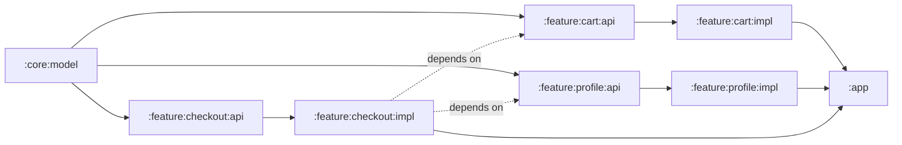

# Modularization Strategies: From Monolith to Feature-API

> A 200-module Android app build-time is the single biggest dev-productivity factor at scale. Pick the wrong slicing and a 1-line change rebuilds the world; pick the right one and the same change rebuilds 2% of the project. Staff-level mastery is knowing why **vertical slicing + api/impl split** is the modern default, what `:core` should and shouldn't hold, and how Dynamic Feature modules fit (or don't).

---

> [!NOTE]
> **Kotlin Multiplatform Deep Dive:** For a comprehensive look at how module boundaries shift when sharing code across platforms (e.g., separating shared domain logic from platform-specific UI modules), see [`../kotlin-multiplatform/foundations/architecture-and-module-boundaries.md`](../kotlin-multiplatform/foundations/architecture-and-module-boundaries.md).

---

## Why Modularize At All?

Three forcing functions:

1. **Build time.** A monolith forces Gradle to recompile every consumer when any change touches the build classpath. A modular project lets Gradle skip 95% of the work on a typical PR.
2. **Code ownership.** When everything lives in `:app`, every PR can touch every file. Module boundaries enforce *who can change what*.
3. **Coupling.** Without modules, the only thing stopping `CheckoutScreen` from depending on `ProfileScreen`'s internals is engineer discipline. Modules let the compiler enforce architecture.

The cost is real — Gradle configuration overhead, the build-logic infrastructure to maintain conventions ([`../../platform-engineering/build-graph-scaling.md`](../../platform-engineering/build-graph-scaling.md)), and discipline to keep boundaries clean. Below ~50k LOC / 10 engineers, the cost outweighs the benefit. Above it, the benefit compounds.

---

## The Four Slicing Strategies

### 1. Monolith (status quo)

Everything in `:app`. Works until ~20 screens / 5 engineers.

**Fails because:** any change rebuilds everything. A typo fix in `CheckoutScreen.kt` invalidates the entire compile classpath. Build time grows linearly with code size.

### 2. Horizontal slicing (layer-based)

Split by Clean Architecture layers: `:presentation`, `:domain`, `:data`.

```kotlin
// :presentation/build.gradle.kts
dependencies { implementation(project(":domain")) }

// :data/build.gradle.kts
dependencies { implementation(project(":domain")) }
```

**Fails because:**
- **Sequential builds.** `:presentation` waits for `:domain`. Three serial stages instead of N parallel features.
- **Context switching.** Every feature needs edits in 3 modules.
- **No feature isolation.** `CheckoutViewModel` and `ProfileViewModel` live in the same `:presentation` module — nothing stops them from depending on each other directly.

A common confusion: this *looks* like proper architecture (Clean Arch!), but it doesn't deliver the build-time benefit modularization is supposed to give.

### 3. Vertical slicing (feature-based)

Split by feature: `:feature:cart`, `:feature:profile`, `:feature:checkout`.

```kotlin
// :app/build.gradle.kts
dependencies {
    implementation(project(":feature:cart"))
    implementation(project(":feature:profile"))
}
```

**Mostly works**, but breaks when one feature needs to navigate or read from another:

```kotlin
// :feature:checkout/build.gradle.kts
dependencies {
    implementation(project(":feature:profile"))   // ❌ tight coupling
}
```

If `:feature:profile` ever needs anything from `:feature:checkout`, you get a circular dependency and the build fails outright.

### 4. Vertical + api/impl (the staff default)

Each feature splits into two modules:
- `:feature:X:api` — interfaces, navigation routes, sealed UI states. Stable, near-zero changes.
- `:feature:X:impl` — ViewModels, Composables, Repositories. High-churn.

Other features depend only on the `:api` modules:

```kotlin
// :feature:checkout:impl/build.gradle.kts
dependencies {
    implementation(project(":feature:profile:api"))   // ✅ interfaces only
}
```

No circular dependencies possible (`:api` modules never depend on `:impl` modules). And — critically — editing the `:impl` of one feature doesn't rebuild the `:impl` of another. This is the modern Android staff default.

---

## Module Taxonomy

Codify the categories. Most large Android codebases settle on something like:

| Category | Path pattern | Owns | Depends on |
|---|---|---|---|
| **App** | `:app` | `Application`, DI graph root, navigation host | All features (`:impl`), all `:core` |
| **Feature API** | `:feature:<name>:api` | Interfaces, sealed states, route types | `:core:model` only |
| **Feature Impl** | `:feature:<name>:impl` | ViewModels, Composables, Repos, DI module | Its own `:api`, other features' `:api`, `:core:*`, `:data:*` |
| **Core domain** | `:core:model` | Pure-Kotlin types (no Android) | Nothing |
| **Core utilities** | `:core:common`, `:core:logging` | Shared helpers | `:core:model` |
| **Core UI** | `:core:design-system` | Tokens, Composables, theming | `:core:model` |
| **Data layer** | `:data:network`, `:data:database`, `:data:auth` | Retrofit/Apollo client, Room DB, auth | `:core:*` |
| **Test fixtures** | `:test:fixtures`, `:test:utils` | Shared fakes, Espresso helpers | `:core:*`, `:feature:*:api` |
| **Build logic** | `:build-logic:convention` | Gradle convention plugins | `(not built into APK)` |

The taxonomy gives every new module a question: *which row do I belong to?* If the answer is "none," push back. Either it's a `:feature` (vertical slice) or it's a `:core` / `:data` (horizontal infrastructure).

### What `:core` should NOT become

The biggest anti-pattern: `:core` accumulates everything. Database helpers, network interceptors, ViewBinding extensions, business validation, custom Composables, log helpers. Suddenly every change to `:core` rebuilds the world.

Rule: **`:core:*` modules must be small, leaf, and stable**. If a `:core` module changes more than once a sprint, split it.

---

## The Module Graph — Bad vs Good Shapes

### Bad — deep chain


Critical path: 6 nodes. Even with parallelism, every node waits on the previous. Build time bound by the longest chain.

### Good — wide fan-out from a thin core



Critical path: 3 nodes. Three features compile in parallel on three cores. Adding a fourth feature = three nodes more, still parallel.

The platform team's job: keep the `:core` thin, keep the graph wide, and run a CI check that no `:impl` is on the critical path of another `:impl`.

---

## `api` vs `implementation` Gradle Configurations

A separate but related concept from `:api` / `:impl` modules. The Gradle dependency type itself decides whether your dep leaks into your consumers:

```kotlin
// :feature:cart:impl/build.gradle.kts
dependencies {
    api(project(":core:design-system"))           // leaks DS types into anyone consuming :impl
    implementation(project(":data:network"))      // hidden internal detail
}
```

Choose `implementation` by default. Use `api` only when the module's *public types* reference the dependency's types — and at the api/impl boundary, almost never. See [`../../platform-engineering/build-graph-scaling.md`](../../platform-engineering/build-graph-scaling.md) for the deeper mechanics.

Catch leaks at scale with the `com.autonomousapps.dependency-analysis` plugin in CI.

---

## DI Wiring Across Modules

Each `:impl` module ships a Hilt module that binds its `:api` interfaces:

```kotlin
// :feature:profile:impl/.../di/ProfileModule.kt
@Module
@InstallIn(SingletonComponent::class)
internal abstract class ProfileModule {
    @Binds
    abstract fun bindProfileNavigator(impl: ProfileNavigatorImpl): ProfileNavigator
}

internal class ProfileNavigatorImpl @Inject constructor(
    /* ... */
) : ProfileNavigator { /* ... */ }
```

`internal` is doing real work here — `ProfileNavigatorImpl` is invisible to other modules. They can only depend on the `ProfileNavigator` interface from `:feature:profile:api`. The implementation gets bound at runtime via Hilt.

Koin equivalent (with annotations):

```kotlin
@Module
@ComponentScan("com.app.feature.profile")
class ProfileModule
```

---

## Type-Safe Navigation Across Modules

Compose Navigation 2.7+ supports type-safe routes:

```kotlin
// :feature:profile:api/Routes.kt
@Serializable
data class ProfileRoute(val userId: String)

// :feature:profile:impl/ProfileGraph.kt
fun NavGraphBuilder.profileGraph() {
    composable<ProfileRoute> { backStackEntry ->
        val args: ProfileRoute = backStackEntry.toRoute()
        ProfileScreen(userId = args.userId)
    }
}

// :feature:checkout:impl uses the public api route
navController.navigate(ProfileRoute(userId = "u_123"))
```

Routes live in `:api`, screens in `:impl`. No string-based deeplink shenanigans. Refactoring `userId` → `accountId` is a typed compile error across the codebase.

---

## Dynamic Feature Modules (Play Feature Delivery)

Different concept: **install-time** modularization, not just build-time.

```kotlin
// :feature:reviewer/build.gradle.kts
plugins { id("com.android.dynamic-feature") }
android.dynamicFeatureModule { /* ... */ }
```

Use cases:
- **Conditional install** — instant-app slices ("try without install").
- **Large feature**, used by < 10% of users (camera, AR, video editor) — install on demand to reduce APK size for everyone.
- **Per-country feature** — locale-specific features installed only where relevant.

Trade-offs:
- Cannot bind `@HiltViewModel` from a dynamic feature directly into the main graph — DI needs reflection or entry-point bridging.
- Resource lookups can fail across the dynamic boundary if you're not careful (`SplitCompat.install`).
- Testing is harder; QA must verify both pre-install and post-install behaviors.
- Network-installed code increases support surface (rollback per-feature is harder).

**Verdict:** Dynamic features are a perf optimization, not a default. Use only if the feature is large (5+ MB), low-usage, and the APK-size win justifies the complexity. For most apps, vertical-slice modularization + `:app` is enough.

---

## Test Modules

Shared test code is itself a module. Two patterns:

```kotlin
// :test:fixtures/build.gradle.kts
plugins { id("yourorg.android.library") }
dependencies {
    // depends on :api modules so it knows the types to fake
    implementation(project(":feature:profile:api"))
}

// Fakes:
class FakeProfileNavigator : ProfileNavigator { /* no-op */ }
class FakeUserRepository(val users: MutableList<User> = mutableListOf()) : UserRepository { /* ... */ }
```

Consumers:

```kotlin
// :feature:checkout:impl/build.gradle.kts
dependencies {
    testImplementation(project(":test:fixtures"))
    androidTestImplementation(project(":test:fixtures"))
}
```

Critical rule: **test modules depend only on `:api`**, never `:impl`. Otherwise you've broken the api/impl boundary in tests.

---

## Migration Path (Monolith → Modular)

A real-world rollout, 6 months for a 200k-LOC app:

1. **Week 1–2: build-logic + version catalog.** Pull `libs.versions.toml`; introduce `:build-logic:convention`. No behavior change.
2. **Week 3–4: `:core:design-system` first.** Lowest churn, broadest reuse. Move tokens + Composables; everything else still imports from `:app`.
3. **Month 2: `:core:model` and `:data:*`.** Extract DTOs and Retrofit/Room. Use `api` Gradle dep so consumers keep compiling.
4. **Month 3–4: feature-by-feature vertical slicing.** Pick the largest, most-stable feature first (Settings is a good candidate). Move into `:feature:<x>:api` + `:feature:<x>:impl`. Test thoroughly; profile build time.
5. **Month 5: navigation refactor.** Switch to type-safe `NavHost<Route>` once two features are extracted.
6. **Month 6: DI cleanup.** Each `:impl` ships its own `@Module`; the `:app` only contains the `Application` + root navigation.

Two things that make this work:
- **Convention plugins** absorb 90% of the per-module Gradle config.
- **Dependency Analysis plugin** in CI keeps the discipline enforced.

Track build-time P90 per week. If it doesn't drop after extracting the first three features, something is wrong with the graph shape — usually `:core` got too big.

---

## Real-World Build-Time Numbers

Order-of-magnitude examples from real Android codebases:

| Project | Modules | Cold build | Warm (1-line change) |
|---|---|---|---|
| Now in Android (Google sample) | ~40 | ~90s | ~10s |
| Cash App | ~1000+ | ~3 min | ~15s |
| Reddit | ~300 | ~2 min | ~20s |
| Spotify | ~400 | ~3 min | ~15s |

The 10s warm-build target is achievable when:
- `:core` modules are small and stable.
- `:impl` modules use `implementation` (not `api`) deps everywhere possible.
- Remote build cache hits > 80% on `main`.
- KSP (not KAPT) for all annotation processors.

See [`../../platform-engineering/build-graph-scaling.md`](../../platform-engineering/build-graph-scaling.md) for the build-perf playbook.

---

## Failure Modes

| Symptom | Cause | Fix |
|---|---|---|
| Every PR rebuilds 50+ modules | `:core` mega-module changing constantly | Split `:core` along stability axes |
| Circular dependency Gradle error | `:feature:a` depends on `:feature:b:impl` | Depend on `:feature:b:api` only |
| Build time creeping up by 30s/month | `api` deps leaking into module ABIs | Run Dependency Analysis plugin; convert to `implementation` |
| Cannot share fake across feature tests | Fake lives inside one `:impl` | Extract to `:test:fixtures` |
| Hilt `[MissingBinding]` after extracting module | Forgot to install the new `@Module` | Annotate the `:impl` module's binding with `@InstallIn(SingletonComponent::class)` |
| Test in feature A breaks because feature B changed | `:test:fixtures` depended on `:impl` | Restrict fixtures to `:api` only |
| Navigation refactor breaks 30 features | String routes hardcoded | Migrate to typed `@Serializable` routes in `:api` modules |
| Dynamic feature can't access `Application` resources | `SplitCompat.install` not called in `Activity.attachBaseContext` | Add the call; verify with `bundletool` install |
| Feature engineer "just adds" a util to `:core` | No PR-gating discipline | Lint rule + named `:core` owner; require RFC for additions |
| `:app` module is back to 100k LOC | Features added to `:app` instead of new modules | Tighten code-review checklist; require modules for new screens |
| First-time `:impl` compile is slow | Heavy generated code (Room, Hilt, Compose Compiler) | Profile with `--scan`; consider splitting the module further |
| `:feature:x:api` accidentally exposes implementation type | Used a concrete class in an interface signature | Refactor: API should only expose `:api`-level types |
| `internal` classes accessible from another module | Modules in same package (rare bug) | Use distinct packages per module |
| Cannot run a single feature from Android Studio | Feature module doesn't have its own `application` test target | Add a sample `:app-sample` module that depends on just the one feature |
| Build cache misses despite no source changes | Cache key includes absolute paths or timestamps | Standardize JVM args; configure reproducible builds |

---

## Common Pitfalls

- **The `:core:common` dumping ground.** Every util ends up there. Within a year it's the most-churned module. Split aggressively: `:core:network-utils`, `:core:date-utils`, `:core:logging`. Each tiny, stable, leaf.
- **Forgetting `internal` in `:impl` modules.** Without it, all of `:impl` is public; modules can reach into each other's internals; the api/impl wall is decorative. Make `internal` the default; only export through `:api`.
- **`:api` modules that aren't pure-Kotlin.** If your `:api` imports Android types, every consumer's tests need an Android runtime. Keep `:api` modules `apply plugin: "org.jetbrains.kotlin.jvm"` whenever possible.
- **Cross-feature `:impl` dependencies "just this once."** Once allowed, it spreads. CI rule: a feature `:impl` may only depend on `:core:*`, `:data:*`, and other features' `:api`. Anything else fails the build.
- **Sharing test fixtures by copy-paste.** Two features have the same `FakeUserRepository`; they drift; tests pass on one and fail on the other. Extract once to `:test:fixtures`.
- **Generating R8 keep rules per module.** Use `consumerProguardFiles` so each module ships its rules; consumers don't think about them. See [`../../platform-engineering/sdk-distribution.md`](../../platform-engineering/sdk-distribution.md).
- **Migrating "all at once."** A 6-month modularization migration in one PR will not land. Feature-by-feature, vertical slices.
- **No `:build-logic`.** Every `build.gradle.kts` repeats the same 30 lines. Adopt convention plugins from day one.
- **Skipping the Dependency Analysis CI step.** Without it, `api` creep is invisible and build times slowly degrade. Run on every PR.

---

## Probing Questions

1. Compare horizontal slicing (Clean Architecture layers) vs vertical slicing (features) at scale. Why does vertical win for build time?
2. Walk through what happens to the build graph when `:feature:checkout:impl` accidentally depends on `:feature:profile:impl` instead of `:feature:profile:api`.
3. Why is `internal` essential in `:impl` modules? Show the failure mode if you forget it.
4. The `:core` module has grown to 30 sub-packages. How do you decide where to split?
5. Compare `api` vs `implementation` Gradle configurations. When does a leak through `api` show up as a build-time regression?
6. Walk through wiring `:feature:checkout:impl` to use `ProfileNavigator` from `:feature:profile:api` via Hilt. What goes where?
7. Type-safe Compose Navigation: where does the route data class live, and why does that placement matter?
8. Your team is debating Dynamic Feature Modules. What questions do you ask before committing?
9. You're migrating a 200k-LOC monolith to modular over six months. Sketch the order of feature extractions.
10. Build time was 90s; after extracting three features it's still 90s. What's the most likely cause?
11. A new engineer wants to add a `LoggingUtils` to `:core:common`. What's the right policy?
12. Multi-module testing: where should `FakeUserRepository` live, and why not in `:feature:profile:impl`?
13. The Dependency Analysis plugin flags an `api` leak in `:core:design-system`. Walk through the audit and fix.

---

## Further Reading

- [`mvvm-vs-mvi.md`](mvvm-vs-mvi.md) — what lives inside `:feature:X:impl`.
- [`viewmodel.md`](viewmodel.md) — ViewModel scoping inside modules.
- [`../data-and-di/hilt-vs-koin-vs-manual-di.md`](../data-and-di/hilt-vs-koin-vs-manual-di.md) — DI across modules.
- [`../data-and-di/room-vs-datastore.md`](../data-and-di/room-vs-datastore.md) — `:data` layer choice.
- [`../performance/app-size-and-r8.md`](../performance/app-size-and-r8.md) — module-level R8 keep rules.
- [`../../platform-engineering/build-graph-scaling.md`](../../platform-engineering/build-graph-scaling.md) — build-time deep dive.
- [`../../platform-engineering/internal-developer-platforms.md`](../../platform-engineering/internal-developer-platforms.md) — convention plugins as platform.
- [`../../platform-engineering/library-versioning.md`](../../platform-engineering/library-versioning.md) — `libs.versions.toml` for modular projects.
- [`../../patterns/repository.md`](../../patterns/repository.md) — repositories at module boundaries.
- [Now in Android sample](https://github.com/android/nowinandroid) — Google's reference multi-module app.
- [Cash App — Modularization at scale](https://developer.squareup.com/blog/) — Square engineering posts.
- [Dependency Analysis Gradle Plugin](https://github.com/autonomousapps/dependency-analysis-gradle-plugin) — the CI guard.
- [Android — Play Feature Delivery](https://developer.android.com/guide/playcore/feature-delivery) — Dynamic Feature Modules reference.
