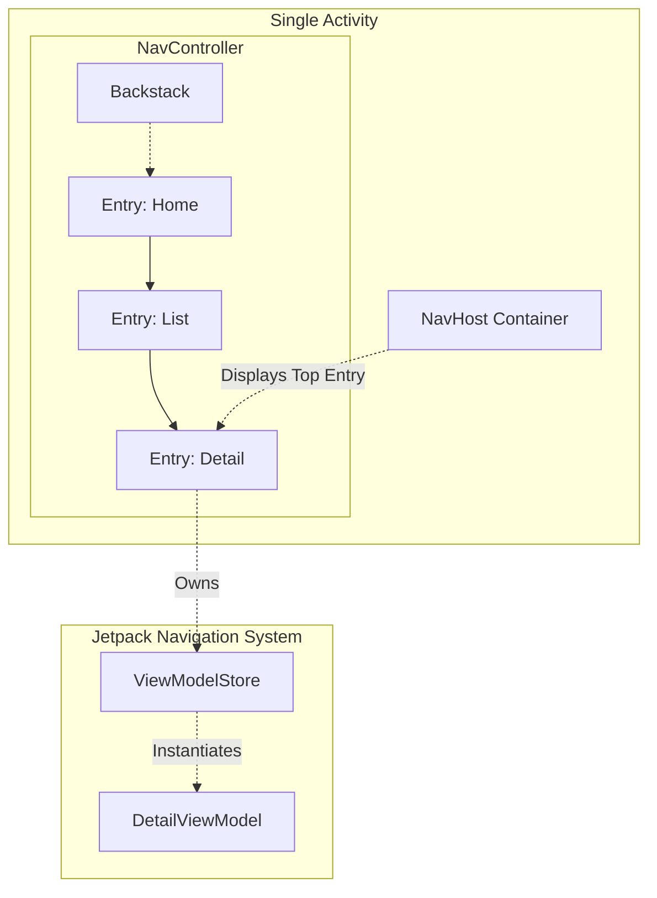

# Navigation

## Overview

Navigation is the connective tissue of an Android application. It dictates how users move between different screens, how data is passed between those screens, and how the "Back" button behaves. 

Historically, Navigation in Android was handled purely by launching `Intents` between massive `Activities`. Today, with the dominance of the Single Activity Architecture, Navigation is handled entirely by the **Jetpack Navigation Component**, whether you are using XML Fragments or Jetpack Compose.

## Why It Matters

Implementing a "Back" button sounds trivial, but on Android, it is historically one of the most bug-prone features. 

If a user opens Screen A, clicks a button to open Screen B, clicks a Deep Link from a Push Notification to open Screen C, and then clicks the Back button... where should they go? Back to B? Back to the Home Screen? Back to the app they were in before the Deep Link?

The Jetpack Navigation Component provides a standardized, mathematically sound graph structure to handle these deep linking, backstack manipulation, and transition challenges, completely replacing brittle manual `FragmentManager` transactions.

## Historical Context

In the Fragment era, developers manually called `supportFragmentManager.beginTransaction().replace(R.id.container, fragment).addToBackStack(null).commit()`. 
This was notoriously error-prone. If you committed a transaction after `onSaveInstanceState` was called, the app would crash instantly with the dreaded `IllegalStateException: Can not perform this action after onSaveInstanceState`. 

Furthermore, passing data between Fragments required creating a `Bundle`, passing it to the Fragment via `.arguments`, and then manually extracting strings and integers on the other side. This was not Type-Safe and frequently caused runtime `NullPointerExceptions` or `ClassCastExceptions`.

The Jetpack Navigation Component was introduced to solve these issues via a visual "Navigation Graph" and the `SafeArgs` plugin.

## First Principles

1.  **The Graph (`NavGraph`):** The map of your app. Every screen is a "Destination," and the lines between them are "Actions."
2.  **The Host (`NavHost`):** The empty container (usually an XML `FragmentContainerView` or a Compose `NavHost`) that lives in your single Activity. It acts as the viewport.
3.  **The Controller (`NavController`):** The orchestrator. You tell the controller where to go (`navController.navigate()`), and it automatically swaps the Destinations inside the Host and manages the Backstack.

## Mental Model

Think of Jetpack Navigation as a **Web Browser**.
- **The Graph:** The website's sitemap.
- **The Host:** The actual browser window displaying the current webpage.
- **The Controller:** The URL bar and the Back/Forward buttons. 
- **Deep Links:** A hyperlink. Clicking it instantly forces the Controller to load a specific Destination into the Host, completely bypassing the normal flow.

## Internal Mechanics

The most critical part of Jetpack Navigation is how it interacts with the OS Backstack and ViewModels.

### 1. The Backstack (`NavBackStackEntry`)
Every time you navigate to a new Destination, the `NavController` creates a `NavBackStackEntry` and pushes it onto its internal stack. 

Crucially, this `NavBackStackEntry` implements `LifecycleOwner`, `ViewModelStoreOwner`, and `SavedStateRegistryOwner`. 

This means that **every single screen in your Navigation Graph has its own independent Lifecycle and its own ViewModelStore.** When you pop a screen off the backstack, its specific `NavBackStackEntry` is destroyed, and the ViewModels scoped specifically to that screen are instantly cleared via `onCleared()`.

### 2. Nested Graphs (Sub-Routing)
For large apps, you cannot put 50 screens in one Graph. You create Nested Graphs (e.g., `login_graph`, `checkout_graph`). 

The beautiful part of Nested Graphs is that the *Graph itself* generates a `NavBackStackEntry`. You can scope a `ViewModel` to the entire `checkout_graph`. This allows 5 different checkout screens to effortlessly share the exact same `ViewModel` instance in memory, and when the user finishes checkout and the graph is popped, the shared `ViewModel` is destroyed automatically.

## Architecture



## Production Example

**Type-Safe Compose Navigation**

Historically, Jetpack Compose navigation relied on passing ugly URL-like strings: `navController.navigate("profile/42")`. 

In modern Android (Navigation 2.8+), we use purely Type-Safe Kotlin Serialization objects.

```kotlin
// 1. Define the Graph as strongly-typed Kotlin classes/objects
@Serializable object HomeRoute
@Serializable data class ProfileRoute(val userId: String, val showDetails: Boolean)

// 2. Set up the NavHost
@Composable
fun AppNavigation(navController: NavHostController) {
    NavHost(navController = navController, startDestination = HomeRoute) {
        
        // Home Screen
        composable<HomeRoute> {
            HomeScreen(
                onNavigateToProfile = { id -> 
                    // 3. Navigate passing a strongly-typed data class!
                    navController.navigate(ProfileRoute(userId = id, showDetails = true))
                }
            )
        }
        
        // Profile Screen
        composable<ProfileRoute> { backStackEntry ->
            // 4. Safely extract the arguments using reified types. No Bundles!
            val profileArgs = backStackEntry.toRoute<ProfileRoute>()
            
            ProfileScreen(userId = profileArgs.userId)
        }
    }
}
```

## Tradeoffs

**Compose Navigation vs 3rd Party Routers (Voyager / Decompose)**

**Jetpack Compose Navigation:**
- **Pros:** First-party support. Deep integration with `ViewModel` and `SavedStateHandle`. Built-in Deep Linking.
- **Cons:** It treats navigation like web URLs (Strings) under the hood, which can feel unidiomatic in Kotlin. Extracting arguments in nested graphs can be convoluted. 

**3rd Party (e.g. Voyager):**
- **Pros:** Treats navigation purely as a stack of Kotlin Data Classes. Incredibly clean API. Often supports Kotlin Multiplatform (KMP) out of the box better than Jetpack.
- **Cons:** You step outside the Google ecosystem. If Google releases a new OS-level feature for Backstack prediction (like Android 14's Predictive Back), you have to wait for the 3rd party maintainers to support it.

## Failure Modes

- **The `IllegalStateException: ViewModelStore should be set before setGraph`:**
  This usually happens when trying to manually manipulate the `NavController` or `NavHost` in XML before the Fragment lifecycle has properly initialized. *(Fix: Always use `findNavController()` inside `onViewCreated` or later, never in `onCreate` or `onCreateView`).*
- **Navigating while in the Background:**
  If you try to call `navController.navigate()` from a Coroutine or LiveData observer while the app is in the background (e.g., after the user pressed Home), it will crash if using XML Fragments because state has already been saved. *(Fix: Ensure UI events that trigger navigation are consumed properly and safely paused when the lifecycle drops below `STARTED`).*
- **The Multiple Backstack Nightmare:** Bottom Navigation bars (e.g., Home, Search, Profile). If a user taps Home, goes 3 screens deep, taps Profile, then taps Home again... they expect to see their 3-screen-deep Home stack. The Navigation component handles this automatically using `saveState` and `restoreState` flags in the `navigate()` call, but developers frequently forget to set them, resulting in a blown-out backstack.

## Staff Engineer Thinking

When reviewing Navigation architecture, a Staff engineer looks for decoupling:

1.  **Is the UI completely ignorant of the NavController?** A `@Composable` function representing a screen should *never* take a `NavController` as a parameter. It makes the screen impossible to preview and impossible to unit test. The screen should take simple lambda callbacks: `onItemClicked: (String) -> Unit`. The parent `NavHost` should supply the lambda and actually call `navController.navigate()`.
2.  **Are we using SafeArgs / TypeSafe routing?** I will reject any PR that uses hardcoded strings like `navController.navigate("details_screen?id=$id")`. This is brittle and breaks silently during refactoring.
3.  **How are Deep Links handled?** I verify that deep links are explicitly defined in the `NavGraph` and that we have a testing strategy to ensure that clicking a Push Notification routes the user to the exact nested destination, securely parsing the arguments.

## Common Misconceptions

- **"I need to pass my entire Data Object through Navigation."** Absolutely false. Never pass a `User` or `Product` object through the navigation graph, even if it is `@Serializable` or `@Parcelize`. You will hit the `TransactionTooLargeException` limit. Pass ONLY the `userId` or `productId`, and let the receiving screen's ViewModel fetch the full object from the local Database cache.
- **"Jetpack Navigation replaces the `FragmentManager`."** Under the hood for XML apps, `NavHostFragment` is literally just wrapping the `FragmentManager` and executing standard `FragmentTransactions` on your behalf. It hides the complexity, but the exact same lifecycle rules apply.

## Probing Questions

1.  Explain the concept of a `NavBackStackEntry`. Why is it so crucial that this object implements `ViewModelStoreOwner`?
2.  In Jetpack Compose Navigation, why is it considered an architectural anti-pattern to pass the `NavHostController` directly down into your low-level composable screens?
3.  Describe the catastrophic crash that can occur if you attempt to pass a massive JSON response string or a 10,000-item list as an argument in a Navigation route. What should you pass instead?
4.  How does the Jetpack Navigation Component enable multiple screens in a specific feature (like a checkout flow) to share the exact same `ViewModel` instance?
5.  What is the purpose of the `saveState` and `restoreState` flags when navigating between tabs in a Bottom Navigation Bar?
6.  Explain how Type-Safe Navigation in Compose (using Kotlin Serialization) prevents the runtime crashes common with older string-based routing.
7.  If a user opens your app via a Deep Link (e.g., clicking a web URL) that points to a screen 3 levels deep in your graph, what happens when they press the Back button?
8.  Why did the Android community shift away from launching multiple `Activities` via `Intents` in favor of using a single `Activity` and the Navigation Component?
9.  What is `SafeArgs` in the context of XML-based Jetpack Navigation, and what problem does it solve?
10. If an Android application is killed in the background by the Low Memory Killer (Process Death), how does the Navigation Component know which screen to restore when the user reopens the app?

## Further Reading

- [`viewmodel.md`](viewmodel.md) — How ViewModels are scoped to `NavBackStackEntries`.
- [`savedstatehandle.md`](savedstatehandle.md) — How Navigation arguments are automatically injected into ViewModels.
- [Android Developers: Navigation](https://developer.android.com/guide/navigation)
