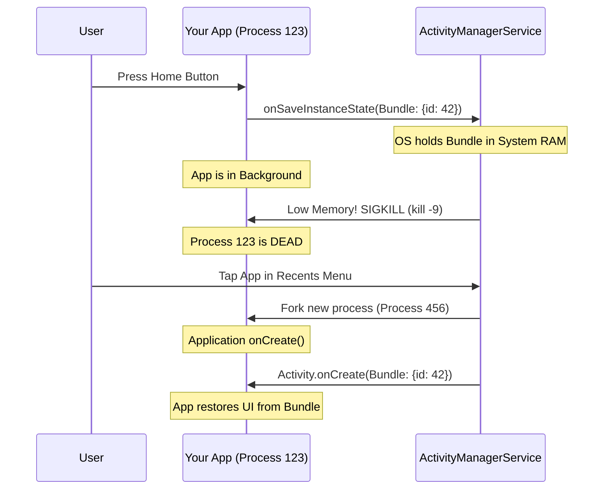

# Process Death and State Restoration

## Overview

Process Death (System-Initiated Process Death) is the most defining characteristic of the Android operating system. It is the mechanism by which Android reclaims memory to keep the device functioning smoothly.

When your app goes into the background, Android does not pause it; it places it on death row. If another app (like a heavy 3D game or the Camera) requests more RAM than is available, the Android Low Memory Killer (LMK) will brutally assassinate your app's entire Linux process without warning. 

When the user navigates back to your app via the Recents menu, they expect to see exactly what they were looking at. **State Restoration** is the architectural magic trick required to recreate the UI from ashes, giving the user the illusion that the app was running the whole time.

## Why It Matters

Failure to handle Process Death is the number one cause of 1-star reviews for "random crashes." 

If a user fills out 9 fields of a 10-field checkout form, opens their banking app to check their balance, and then returns to your app, your app will likely have been killed by the OS. If you did not implement State Restoration, the form will be blank. The user will be furious. 

If you stored the user's Auth Token in a simple Kotlin `object` (Singleton) instead of saving it properly, when the app is recreated, the token will be `null`, and the app will instantly crash with a `NullPointerException` when it tries to make a network request.

## Historical Context

In desktop operating systems (Windows, macOS), there is a swap file. When RAM fills up, idle memory is written to the hard drive (disk swapping). This keeps the app alive, but it is slow and ruins SSD lifespans. 

Mobile devices historically had terrible flash storage and tiny batteries. Disk swapping was impossible. Android's architects decided that instead of swapping, they would just mercilessly kill idle apps. To make this acceptable to users, they invented the `Bundle` and `onSaveInstanceState()`—a way for an app to serialize a few kilobytes of critical state to the OS just before it is sent to the background, so it can be resurrected later.

## First Principles

1.  **Configuration Change != Process Death:** 
    - A Configuration Change (rotating the phone) destroys the Activity, but the *Process* (and all your Singletons/ViewModels) remains perfectly alive in memory. 
    - Process Death destroys *everything*. The JVM is killed. The Singletons are gone. The ViewModels are gone.
2.  **The OS Bundle:** Android gives you a tiny `Bundle` (a key-value map). You have a brief window to shove primitives and strings into it before your app is killed.
3.  **The Illusion:** Your goal is not to keep the app alive. Your goal is to make the user *believe* the app was alive.

## Mental Model

Think of a massive library (Your App's RAM). You are reading 5 different books spread across a table.
- **Backgrounding:** You walk out of the library to get lunch. Before you leave, the Librarian hands you a tiny sticky note (`onSaveInstanceState`). You quickly write down: "Book A, Pg 42. Book B, Pg 10" (The `Bundle`). You leave the library.
- **Process Death:** While you are eating, the library runs out of space. The Librarian throws all your books back on the shelves and clears your table. (Your RAM is gone).
- **State Restoration:** You return from lunch. The table is empty. But you hand the Librarian your sticky note (`savedInstanceState`). The Librarian runs to the shelves, grabs the exact books, opens them to the exact pages, and sets the table up exactly as it was. To you, it feels like nothing happened.

## Internal Mechanics

The process relies heavily on the `ActivityManagerService` (living in the OS core).

### 1. The Save Phase
When the user presses the Home button, the OS calls `onStop()`. Shortly after, it calls `onSaveInstanceState(outState: Bundle)`. 

This `Bundle` is serialized (Parcelled) and handed over IPC (Inter-Process Communication) to the `ActivityManagerService` in the OS. The OS stores this tiny Bundle in its own memory. **Your app is now safe to kill.**

### 2. The Kill Phase
The Low Memory Killer (LMK) sends a `SIGKILL` signal to your app's Linux process. 
- There is no `onDestroy()` call.
- There is no warning.
- The process instantly evaporates.

### 3. The Restore Phase
The user clicks your app icon in the Recents menu. 
1. The OS creates a brand new Linux process for your app (The Zygote forks).
2. The `Application` class is instantiated (this is a "Cold Start").
3. The `Activity` is instantiated.
4. The OS takes the `Bundle` it saved earlier and passes it back to your app via `onCreate(savedInstanceState: Bundle?)`.

### How to Test This

You cannot test this simply by putting your app in the background. You must simulate the LMK.
1. Run your app on an Emulator or Device.
2. Press the Home button (put app in background).
3. In Android Studio Logcat, click the red **"Terminate Application"** button (or use ADB: `adb shell am kill com.your.package`).
4. Re-open the app from the Recents menu.
5. Watch it crash because you didn't implement State Restoration.

## Architecture



## Production Example

**SavedStateHandle in ViewModels**

Historically, saving state required overriding `onSaveInstanceState` in the Activity and manually managing keys. Today, Jetpack provides [SavedStateHandle](savedstatehandle.md), which injects the OS Bundle directly into your ViewModel.

```kotlin
// The ViewModel survives Configuration Changes, but dies during Process Death.
// SavedStateHandle survives BOTH.
class CheckoutViewModel(
    private val savedStateHandle: SavedStateHandle,
    private val api: PaymentApi
) : ViewModel() {

    // 1. We bind our StateFlow directly to the OS Bundle.
    // If the process dies and restarts, this will automatically initialize 
    // with the saved string instead of an empty string!
    val userDraftNotes = savedStateHandle.getStateFlow("draft_notes", "")

    fun updateNotes(notes: String) {
        // 2. We save it to the handle. It is instantly ready for the LMK.
        savedStateHandle["draft_notes"] = notes
    }
}
```

## Tradeoffs

**What to Save vs What to Re-fetch**

The OS `Bundle` is incredibly constrained. It is sent over the Binder (IPC limit of 1MB total across all apps). If you try to shove a 2MB downloaded Image or a 500-item JSON list into the `Bundle`, your app will crash with a `TransactionTooLargeException`.

**The Tradeoff:**
- **Store in Bundle:** Tiny UI state. Scroll positions, navigation IDs, draft text input, selected filter tabs.
- **Store in Database (Room):** Large business data. Downloaded lists, user profiles.
- **Re-fetch from Network:** Transient or rapidly changing data.

*Rule of Thumb:* Save the IDs required to recreate the screen (e.g., `userId: 42`), not the data itself. When the app restores, read `userId: 42` from the Bundle, show a loading spinner, and query the Database/Network for the full User object.

## Failure Modes

- **The Static Variable Nightmare:**
  ```kotlin
  // DISASTER
  object SessionManager {
      var currentUser: User? = null // Set during LoginActivity
  }
  
  class DashboardActivity : Activity() {
      override fun onCreate(savedInstanceState: Bundle?) {
          // If the app underwent Process Death, currentUser is now NULL.
          // The app instantly crashes.
          textView.text = SessionManager.currentUser!!.name 
      }
  }
  ```
  *(Fix: The `DashboardActivity` must check durable session state after process death, restore a valid session from the app's reviewed token vault when allowed, or route to re-authentication. Do not depend on an in-memory singleton.)*
- **`TransactionTooLargeException`:** Attempting to `parcel` a massive API response into the `SavedStateHandle`. *(Fix: Only save primitive IDs or tiny strings).*

## Staff Engineer Thinking

When reviewing code, a Staff engineer aggressively audits for Process Death survival:

1.  **Do we test for it?** Junior developers almost never test Process Death. They test configuration changes (rotation). I will enforce that QAs test feature flows using the "Don't keep activities" developer option, or by explicitly killing the process via ADB.
2.  **Are we relying on singletons for transient state?** If a feature relies on data passed between screens via a global `object` variable, it is fundamentally broken. I will demand the data be passed via Jetpack Navigation SafeArgs (which survive Process Death automatically) or written to a database.
3.  **Is the "Cold Start" optimized?** When recovering from Process Death, the user expects to instantly see the screen they were on. If the `Application.onCreate()` is bloated with 30 library initializations, the restoration will take 5 seconds. I will aggressively push library initialization to background threads (e.g., using Jetpack App Startup).

## Common Misconceptions

- **"ViewModels protect me from Process Death."** **FALSE.** This is the most dangerous misconception in modern Android. ViewModels ONLY survive Configuration Changes (rotation). If the process dies, the ViewModel is garbage collected along with the rest of the JVM. You MUST use `SavedStateHandle` to survive Process Death.
- **"I can just save everything to SharedPreferences in `onStop()`."** While you *can* do this, it is disk I/O on the main thread, which can cause Jank. More importantly, transient UI state (like the scroll position of a list or draft text) belongs in memory (the Bundle), not permanently on disk.

## Probing Questions

1.  What is the fundamental difference between an Android Configuration Change and System-Initiated Process Death?
2.  Explain why `TransactionTooLargeException` occurs when trying to save too much data into `onSaveInstanceState`.
3.  How do you simulate Process Death using Android Studio or ADB during development?
4.  Why is it an architectural flaw to store a fetched network response in a `Bundle`? What should you store instead?
5.  What happens to static variables (Kotlin `object` or `companion object`) during Process Death?
6.  Explain how `SavedStateHandle` bridges the gap between the OS `Bundle` and the Jetpack `ViewModel`.
7.  If a user minimizes your app while viewing "Product Details (ID 42)" and the process dies, describe the exact sequence of events required to restore the UI when the user returns.
8.  Why is it critical to handle Process Death gracefully rather than just letting the app crash? (Consider the user experience).
9.  If your `Application` class takes 3 seconds to initialize SDKs in `onCreate()`, how does this negatively impact the State Restoration user experience?
10. Describe a scenario where you would intentionally NOT want to restore the user's state after Process Death. (Hint: Banking apps, security timeouts).

## Further Reading

- [`savedstatehandle.md`](savedstatehandle.md) — The modern API used to interface with the OS Bundle.
- [`viewmodel.md`](viewmodel.md) — Understanding what the ViewModel actually does (and does not) protect you from.
- [Android Developers: Saving UI States](https://developer.android.com/topic/libraries/architecture/saving-states)
