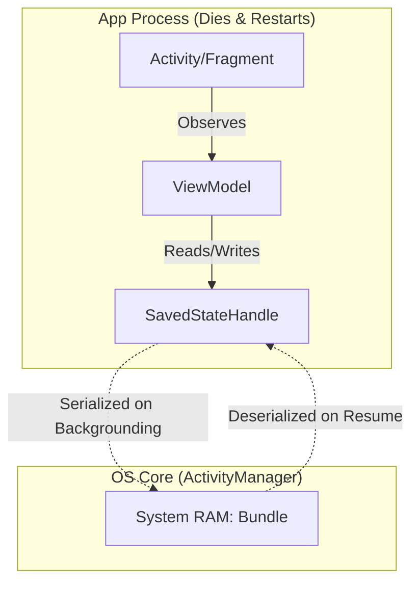

# SavedStateHandle

## Overview

`SavedStateHandle` is a Jetpack API that acts as a bridge between your `ViewModel` and the Android OS's low-level `Bundle` mechanism. It allows you to read and write state that survives both **Configuration Changes** (like screen rotations) and **System-Initiated Process Death**.

Before `SavedStateHandle`, surviving Process Death required passing state manually from the `ViewModel` back to the `Activity`'s `onSaveInstanceState()` method, which was brittle, boilerplate-heavy, and prone to memory leaks. `SavedStateHandle` pushes this responsibility entirely into the `ViewModel`, allowing the UI layer to remain completely ignorant of state persistence.

## Why It Matters

A `ViewModel` by itself **does not survive Process Death**. If the user puts your app in the background, opens a heavy game, and then returns to your app, the OS will have killed your app's process. A new `ViewModel` instance will be created. If you didn't save the user's unsaved form data or current navigation ID, the screen will be blank or in a broken state.

`SavedStateHandle` is the missing link that provides true, robust state persistence for modern Android applications.

## Historical Context

Historically, Android developers used `Activity.onSaveInstanceState(outState: Bundle)` to save data before the app went into the background. When the app restored, they read from the `savedInstanceState: Bundle` in `onCreate()`.

When Google introduced the `ViewModel` in 2017, developers rejoiced because it survived rotations. But they immediately got confused when their apps crashed after Process Death. Google had to remind everyone that `ViewModels` were just memory caches, not OS-level persistence.

To fix this architectural gap, Google released the `SavedStateRegistry` and `SavedStateHandle` in 2020. This finally allowed the `ViewModel` to hook directly into the OS's `Bundle` lifecycle automatically.

## First Principles

1.  **It is a Key-Value Map:** Under the hood, `SavedStateHandle` is just a wrapper around a standard Android `Bundle`.
2.  **OS Bound:** Data written to the handle is serialized by the OS and kept in the `ActivityManagerService` memory, completely outside your app's process.
3.  **Automatic Restoration:** When the app restarts after Process Death, the OS hands the `Bundle` back to the `ViewModelProvider.Factory`, which injects the populated `SavedStateHandle` directly into your ViewModel's constructor.

## Mental Model

Think of the `SavedStateHandle` as a **Safety Deposit Box** connected to a **Conveyor Belt**.
- The `ViewModel` is your desk. You do your work there.
- You place important documents (IDs, draft text) into the Safety Deposit Box (`SavedStateHandle`).
- When the building (the Process) catches fire, the Conveyor Belt automatically whisks the Safety Deposit Box out of the building to a secure vault (the OS).
- When the building is rebuilt, the Conveyor Belt brings the exact same Safety Deposit Box back to your new desk.

## Internal Mechanics

The `SavedStateHandle` exposes data in three primary ways:

### 1. Direct Getter/Setter (Imperative)
You can use it just like a `Map`.
```kotlin
val id: String? = savedStateHandle.get<String>("user_id")
savedStateHandle.set("user_id", "123")
```

### 2. StateFlow (Reactive - Modern Approach)
This is the recommended approach for modern, declarative UIs (Jetpack Compose). It returns a `StateFlow` that automatically emits when the handle changes.
```kotlin
// The Flow is initialized with the value from the OS Bundle. 
// If the Bundle is empty, it uses the default value ("").
val searchDraft: StateFlow<String> = savedStateHandle.getStateFlow("search_query", "")

// Updating the handle automatically emits to the StateFlow.
fun updateSearch(query: String) {
    savedStateHandle["search_query"] = query
}
```

### 3. Safe Args (Jetpack Navigation Integration)
If you use the Jetpack Navigation library, the `SavedStateHandle` is automatically populated with the arguments passed to the route.

```kotlin
// In the Navigation Graph: destination?userId=42
class UserDetailViewModel(savedStateHandle: SavedStateHandle) : ViewModel() {
    // The handle ALREADY contains the "userId" key when the ViewModel is created!
    val userId: String = checkNotNull(savedStateHandle["userId"]) {
        "userId argument must be provided!"
    }
}
```

## Architecture



## Production Example

**The Robust Form View Model**

This represents a Staff-level implementation of a form that survives process death without leaking Android framework dependencies into the ViewModel.

```kotlin
@HiltViewModel
class CheckoutViewModel @Inject constructor(
    private val savedStateHandle: SavedStateHandle,
    private val repository: OrderRepository
) : ViewModel() {

    // 1. The navigation argument (e.g. orderId=99) is automatically injected here.
    private val orderId: String = checkNotNull(savedStateHandle["orderId"])

    // 2. The user's draft input is persisted across Process Death.
    // We do NOT use MutableStateFlow here. We use the Handle as the source of truth.
    val draftNote: StateFlow<String> = savedStateHandle.getStateFlow("draft_note", "")

    // 3. UI calls this when the user types. 
    // It updates the handle, which instantly updates the StateFlow, which updates the UI.
    fun onNoteChanged(newNote: String) {
        savedStateHandle["draft_note"] = newNote
    }

    // 4. Heavy business data is NOT put in the handle. It is fetched from the DB/Network
    // based on the orderId that survived in the handle.
    val orderDetails: StateFlow<Order?> = repository.getOrderFlow(orderId)
        .stateIn(viewModelScope, SharingStarted.WhileSubscribed(5000), null)
}
```

## Tradeoffs

**What goes in the Handle vs the Database?**

The `SavedStateHandle` is bound by Android's strict `TransactionTooLargeException` limits (1MB across the *entire* OS IPC system).

**Store in `SavedStateHandle`:**
- Primitive IDs (`userId`, `productId`)
- Current scroll position index
- Transient user input (text typed into an unsaved `EditText`)
- Selected tab index or active filter state

**Do NOT store in `SavedStateHandle`:**
- A downloaded `List<Product>` (Store in Room DB)
- A 2MB Bitmap image (Store on Disk/Cache)
- The entire application state (Reconstruct it dynamically)

## Failure Modes

- **The `Parcelable` Trap:**
  You *can* put complex objects into the `SavedStateHandle` if they implement `Parcelable`. However, if that object contains a `List` of 10,000 items, your app will crash the moment it goes into the background with a `TransactionTooLargeException`. *(Fix: Never put large data structures in the handle. Flatten your state into IDs, and re-query the heavy data on startup).*
- **Desynchronized StateFlows:**
  ```kotlin
  // BAD: Two sources of truth!
  private val _note = MutableStateFlow(savedStateHandle.get<String>("note") ?: "")
  val note = _note.asStateFlow()
  
  fun update(newNote: String) {
      _note.value = newNote
      savedStateHandle["note"] = newNote // Very easy to forget to sync these!
  }
  ```
  *(Fix: Use `savedStateHandle.getStateFlow("note", "")` so the handle IS the StateFlow. Only one source of truth).*

## Staff Engineer Thinking

When reviewing state management, a Staff engineer focuses on recovery paths:

1.  **The "Kill Process" Test:** I will take a PR, put the app in the background, click "Terminate Application" in Logcat, and bring the app back to the foreground. If the screen is blank, or crashes, or loses the text I just typed, the PR is rejected. The developer must use `SavedStateHandle`.
2.  **Are we abusing `Parcelable`?** If I see `@Parcelize data class HeavyDomainModel(...)` being shoved into the handle, I will request a refactor. The ViewModel should only save the `HeavyDomainModel.id`, and re-fetch the model from the Repository upon restoration.
3.  **Hilt/Dagger Integration:** I ensure the team understands how `@HiltViewModel` automatically provides the `SavedStateHandle` to the constructor via the `SavedStateRegistryOwner`, removing the need for manual `ViewModelProvider.Factory` boilerplate.

## Common Misconceptions

- **"`SavedStateHandle` is for saving data permanently."** False. It only survives as long as the user's "Task" is alive in the Recents menu. If the user explicitly swipes the app away (force closes it), or restarts their phone, the `SavedStateHandle` is wiped completely. For permanent storage, use DataStore or Room.
- **"I don't need `SavedStateHandle` because my network requests are fast."** Even if your network is fast, if the user was typing a 5-paragraph comment and the OS killed the app, your fast network request cannot restore their unsaved text. You need the handle.

## Probing Questions

1.  What is the architectural difference between storing data in a `ViewModel` variable versus storing it in a `SavedStateHandle`?
2.  Explain the relationship between the Android OS `Bundle` and the `SavedStateHandle`.
3.  Why is it dangerous to store a large `List<User>` object inside a `SavedStateHandle`? What exception might be thrown?
4.  How does `SavedStateHandle.getStateFlow()` prevent the "Two Sources of Truth" anti-pattern in ViewModels?
5.  If a user explicitly force-closes the app by swiping it away from the Recents menu, will the data in `SavedStateHandle` be restored upon the next launch? Why or why not?
6.  How does the Jetpack Navigation library seamlessly integrate with `SavedStateHandle` to pass arguments to a ViewModel?
7.  Describe a testing strategy you would use to verify that your `SavedStateHandle` implementation correctly survives Process Death.
8.  Why did Google introduce `SavedStateHandle` when developers could already override `onSaveInstanceState()` in the Activity?
9.  In what scenario would you choose to persist data to a Room database instead of using the `SavedStateHandle`?
10. Can you put a custom, non-primitive Kotlin data class into a `SavedStateHandle`? If so, what interface must it implement?

## Further Reading

- [`process-death-and-state-restoration.md`](process-death-and-state-restoration.md) — The brutal OS mechanism that makes `SavedStateHandle` necessary.
- [`viewmodel.md`](viewmodel.md) — The container where `SavedStateHandle` lives.
- [Android Developers: Saved State module for ViewModel](https://developer.android.com/topic/libraries/architecture/viewmodel/viewmodel-savedstate)
