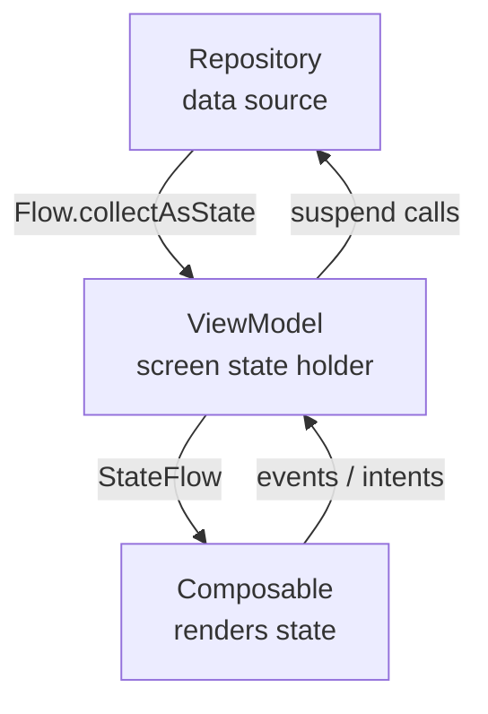

# State Management — Holders, Hoisting, and UDF

> Every Android screen has state — a list of items, a loading flag, the text in an input field. Where that state *lives* determines whether your app survives rotation, process death, and config changes. Staff-level mastery means knowing the difference between **screen state** (business logic) and **UI state** (Compose-local), which type of state holder owns each, and when to hoist state up vs let it stay local. Get this right and every screen feels reactive and bug-free; get it wrong and you ship a UI that randomly resets, double-fires, or shows stale data.

---

## What's "State Management" Cover?

This file is the **patterns canonical**. Three related deep-dives live elsewhere:

| Concern | Lives in |
|---|---|
| ViewModel lifecycle, scoping, factories | [`viewmodel.md`](viewmodel.md) |
| Process-death persistence via Bundle | [`savedstatehandle.md`](savedstatehandle.md) |
| Compose-level state (`mutableStateOf`, `remember`) | [`../compose/recomposition-and-state.md`](../compose/recomposition-and-state.md) |
| MVI atomic state updates | [`mvvm-vs-mvi.md`](mvvm-vs-mvi.md) |

Read those for the mechanics. **This file** is about *which* state holder a piece of data belongs in, and how state flows through the screen.

---

## Two Kinds of State

Google's UI Layer guide makes a critical distinction:

| Kind | What it is | Owned by | Lives across |
|---|---|---|---|
| **Screen state (UI state)** | Business data the screen renders — fetched orders, the active user, error from a network call | **ViewModel** (or a plain state holder for non-business screens) | Configuration change (rotation) |
| **UI element state** | Pure UI concerns — scroll position, animation progress, expanded/collapsed, focus | **Composable** (`remember { ... }`) | Recomposition only |

A scroll position normally **does not** belong in the ViewModel. The list of items being scrolled does.

This isn't pedantic. Putting scroll position in the ViewModel:
- Couples UI implementation details to business logic.
- Forces process-death persistence for something that's fine to lose.
- Bloats the UI state class.
- Makes the ViewModel test setup brittle.

Putting list items in `remember` (Composable-local):
- Loses them on rotation.
- Forces you to refetch when the screen recomposes.
- Defeats the point of using Compose.

The decision matters. Get it wrong in either direction and you have bugs.

---

## State Holder Types — Three Tools

### 1. ViewModel (business-logic state holder)

Survives configuration changes. Tied to a single screen or screen-group via the `ViewModelStore`. Holds business logic state and the operations on it.

```kotlin
@HiltViewModel
class CartViewModel @Inject constructor(
    private val repository: CartRepository,
    savedStateHandle: SavedStateHandle,
) : ViewModel() {

    private val _uiState = MutableStateFlow<CartUiState>(CartUiState.Loading)
    val uiState: StateFlow<CartUiState> = _uiState.asStateFlow()

    fun checkout() { /* business action */ }
}
```

Use for: data fetched from a repository, derived business state, screen-level commands (checkout, save, delete, refresh), user-flow stages.

### 2. Plain State Holder (UI-logic state holder)

A regular Kotlin class — no Android dependencies — that owns complex *UI* state. Lives only across recompositions (recreated on rotation unless used in Compose).

```kotlin
@Stable
class SnackbarController(
    private val scope: CoroutineScope,
    private val snackbarHostState: SnackbarHostState,
) {
    fun showError(message: String) {
        scope.launch {
            snackbarHostState.showSnackbar(message, duration = SnackbarDuration.Short)
        }
    }
}

@Composable
fun rememberSnackbarController(host: SnackbarHostState): SnackbarController {
    val scope = rememberCoroutineScope()
    return remember(host) { SnackbarController(scope, host) }
}
```

Use when:
- The state needs methods (more than just `mutableStateOf`).
- The state is purely UI (animations, sheet open/closed, transient errors).
- You don't need rotation survival (Composable's `remember` handles it via `rememberSaveable` for the relevant pieces).

A plain state holder is **easier to test** than testing a `@Composable` directly. Reach for one whenever a Composable has more than ~3 `remember` slots.

### 3. Composable-local State

Lives in `remember { mutableStateOf(...) }` inside a Composable. Survives recomposition; not rotation (unless wrapped in `rememberSaveable`).

```kotlin
@Composable
fun TextField() {
    var text by rememberSaveable { mutableStateOf("") }
    BasicTextField(value = text, onValueChange = { text = it })
}
```

Use for: scroll position (via `LazyListState`), expand/collapse, hover state, current text in an edit field that's not yet saved.

---

## State Hoisting — The Core Pattern

A Composable that **owns** state vs a Composable that **observes** state are different beasts. The rule:

> Hoist state to the lowest common ancestor that needs to read or write it.

```kotlin
// BAD — Counter holds its own state; parent can't react to it
@Composable
fun BadCounter() {
    var count by remember { mutableStateOf(0) }
    Button(onClick = { count++ }) { Text("Count: $count") }
}

// GOOD — Caller owns state; Counter is stateless
@Composable
fun Counter(count: Int, onIncrement: () -> Unit) {
    Button(onClick = onIncrement) { Text("Count: $count") }
}

// Caller hoists at the right level
@Composable
fun Screen() {
    var count by rememberSaveable { mutableStateOf(0) }   // hoisted
    Counter(count, onIncrement = { count++ })             // read + write via callback
}
```

Three benefits:
1. **Reusable.** The same `Counter` works for different state sources.
2. **Testable.** No internal state to mock.
3. **Predictable.** State flows down (the `count` parameter); events flow up (the `onIncrement` lambda).

This is the Unidirectional Data Flow (UDF) blueprint at the Composable level.

---

## The UDF Blueprint

Across the whole screen:



Three explicit rules:

1. **State flows DOWN.** The Composable receives state as parameters; it never reaches up to grab it.
2. **Events flow UP.** User actions become callbacks (`onIncrement`, `onCheckout`) passed down as lambdas, fired up.
3. **State is single-source.** One place owns each piece of state; everything else observes.

When something feels off (UI re-renders constantly, callbacks duplicate, state diverges), look for a UDF violation. Usually it's state that's *both* in the ViewModel and in a Composable's `remember`.

---

## Screen vs UI State — Concrete Examples

```kotlin
@HiltViewModel
class FeedViewModel @Inject constructor(
    repo: FeedRepository,
) : ViewModel() {

    // ✅ Screen state — business data
    val uiState: StateFlow<FeedUiState> = repo.observePosts()
        .map { posts -> FeedUiState.Success(posts) }
        .stateIn(viewModelScope, SharingStarted.WhileSubscribed(5_000), FeedUiState.Loading)
}

@Composable
fun FeedScreen(viewModel: FeedViewModel = hiltViewModel()) {
    val uiState by viewModel.uiState.collectAsStateWithLifecycle()

    // ✅ UI element state — purely visual
    val listState = rememberLazyListState()
    var isHeaderExpanded by rememberSaveable { mutableStateOf(true) }

    when (val state = uiState) {
        is FeedUiState.Loading -> Spinner()
        is FeedUiState.Success -> {
            LazyColumn(state = listState) {
                item { Header(isHeaderExpanded, onToggle = { isHeaderExpanded = !isHeaderExpanded }) }
                items(state.posts, key = { it.id }) { Post(it) }
            }
        }
        is FeedUiState.Error -> ErrorBanner(state.message)
    }
}
```

What's where, and why:

| State | Where | Why |
|---|---|---|
| `posts` (list of items) | ViewModel | Business data; must survive rotation |
| `isLoading`, `isError` | ViewModel | Business logic decides this |
| `listState` (scroll pos) | Composable | UI-only; OK if lost on rotation (Compose's `rememberLazyListState` actually does survive rotation via `Saver` — bonus!) |
| `isHeaderExpanded` | Composable with `rememberSaveable` | UI-only AND user expects it to survive rotation |

The decision isn't always obvious. Default test: **would the next developer expect this in `FeedUiState.Success`?** If yes, it's screen state. If they'd find a "scroll position" property in the business-logic `FeedUiState` confusing, it's UI state.

---

## `remember` vs `rememberSaveable`

| Function | Survives recomposition? | Survives rotation? | Survives process death? |
|---|---|---|---|
| `remember { ... }` | Yes | No | No |
| `rememberSaveable { ... }` | Yes | Yes (via `Saver`) | Yes (via `Bundle`) |
| Holding in a ViewModel | Yes | Yes | No (unless via `SavedStateHandle`) |
| `SavedStateHandle` | Yes | Yes | **Yes** |

Use `rememberSaveable` for:
- Anything the user expects to keep — search query, selected tab, expanded section.
- Anything that's a pain to recompute — scroll position to a specific item, animated values mid-flight.

Use plain `remember` for:
- Animation drivers and progress.
- One-time generated values (`UUID.randomUUID()`).
- Caches keyed on stable parent state.

Restriction: `rememberSaveable` requires the value to be `Parcelable`, `Serializable`, or have a custom `Saver`. Strings, Ints, Booleans work out of the box.

---

## `SavedStateHandle` — Process-Death Survival

When the OS kills your app for memory reasons (Doze, low memory, user backgrounded long enough), the process dies but the system records "you had this Activity open." When the user returns, Android restores it — but your ViewModel is gone.

`SavedStateHandle` rescues a small amount of state across that gap:

```kotlin
@HiltViewModel
class CheckoutViewModel @Inject constructor(
    savedStateHandle: SavedStateHandle,
) : ViewModel() {

    // Bundles persist across process death
    val promoCode: StateFlow<String> = savedStateHandle.getStateFlow("promoCode", "")

    fun setPromoCode(code: String) {
        savedStateHandle["promoCode"] = code
    }
}
```

Rules:
- Values must be small Bundle-storeable types (primitive, String, Parcelable).
- Don't dump giant lists in here; the Bundle has a ~1 MB limit.
- Use it for "things the user typed/selected." Reload bigger data from the repository.

Deep dive: [`savedstatehandle.md`](savedstatehandle.md).

---

## State Sharing Across Composables — `CompositionLocal`

When state needs to be read by many descendants without threading through props:

```kotlin
val LocalAppDimensions = staticCompositionLocalOf { AppDimensions.Default }

@Composable
fun App() {
    val dimensions = remember { AppDimensions.compact() }
    CompositionLocalProvider(LocalAppDimensions provides dimensions) {
        AppContent()
    }
}

@Composable
fun BadgeText() {
    val dim = LocalAppDimensions.current
    Text("Badge", fontSize = dim.badgeText)
}
```

This bypasses prop-drilling. Use sparingly — too many CompositionLocals make the screen graph implicit and hard to follow.

Rule of thumb: a CompositionLocal is right when ≥5 consumers in a sub-tree need it AND it doesn't change frequently. For 2 consumers, prop drilling is clearer.

See [`../compose/compose-runtime.md`](../compose/compose-runtime.md) for the deeper rule on `staticCompositionLocalOf` vs `compositionLocalOf`.

---

## Cross-Screen State (Shared ViewModel)

When two Fragments (or two screens in a nav graph) share state:

```kotlin
// Both Fragments scope to the host Activity
class FragmentA : Fragment() {
    private val shared: ShoppingViewModel by activityViewModels()
}

class FragmentB : Fragment() {
    private val shared: ShoppingViewModel by activityViewModels()
}
```

Or for Navigation:

```kotlin
val shared: WizardViewModel by hiltNavGraphViewModels(R.id.checkout_graph)
```

Use cases:
- Cart shared across catalog/cart/checkout fragments.
- Multi-step wizard with shared state across pages.
- A bottom nav with state needing to survive tab switches.

Cost: the longer-lived ViewModel ties up memory longer. Don't share what doesn't need sharing.

---

## When to Reach for a Plain State Holder

Build a plain Kotlin class when:

- A Composable has > 3 `remember` slots that interact.
- You want to test the UI logic without `ComposeRule`.
- The logic should be reusable across Composables.

```kotlin
@Stable
class SwipeRefreshState(
    initialIsRefreshing: Boolean = false,
) {
    var isRefreshing by mutableStateOf(initialIsRefreshing)
        private set

    private val mutex = Mutex()

    suspend fun startRefresh() = mutex.withLock {
        isRefreshing = true
    }

    suspend fun finishRefresh() = mutex.withLock {
        delay(300)   // animation grace
        isRefreshing = false
    }
}

@Composable
fun rememberSwipeRefreshState(initial: Boolean = false): SwipeRefreshState =
    remember { SwipeRefreshState(initial) }
```

Compose recognizes the `@Stable` annotation; the state holder is skippable.

This pattern is widely used in Compose libraries — `LazyListState`, `ScaffoldState`, `DrawerState`, `BottomSheetState` are all plain state holders with companion `remember*State()` factories.

---

## Decision Tree — Where Does This State Belong?

```
Is this data the user expects to survive process death?
├── Yes (user-typed text, selected tab, scroll position to a specific row)
│   → SavedStateHandle (ViewModel) or rememberSaveable (Composable)
└── No
    │
    Does it survive configuration change (rotation)?
    ├── Yes (business data, ongoing operations)
    │   ├── Is it business logic / async data?
    │   │   → ViewModel
    │   └── Pure UI state used by multiple Composables?
    │       → Plain state holder + remember
    └── No (animations, transient errors)
        → remember { mutableStateOf() } in the Composable
```

---

## Real Android Patterns

### Pattern 1: Loading-Success-Error UiState

```kotlin
sealed interface FeedUiState {
    data object Loading : FeedUiState
    data class Success(val items: ImmutableList<Post>) : FeedUiState
    data class Error(val message: String, val retryable: Boolean) : FeedUiState
}

@HiltViewModel
class FeedViewModel(repo: FeedRepository) : ViewModel() {
    val uiState: StateFlow<FeedUiState> = repo.observePosts()
        .map { FeedUiState.Success(it.toImmutableList()) as FeedUiState }
        .catch { emit(FeedUiState.Error(it.message.orEmpty(), retryable = true)) }
        .stateIn(viewModelScope, SharingStarted.WhileSubscribed(5_000), FeedUiState.Loading)
}
```

### Pattern 2: One-shot events alongside state

```kotlin
sealed interface CheckoutEffect {
    data object NavigateBack : CheckoutEffect
    data class ShowError(val msg: String) : CheckoutEffect
}

@HiltViewModel
class CheckoutViewModel : ViewModel() {
    val uiState = MutableStateFlow(CheckoutUiState())
    private val _effects = Channel<CheckoutEffect>(Channel.BUFFERED)
    val effects: Flow<CheckoutEffect> = _effects.receiveAsFlow()

    fun submit() = viewModelScope.launch {
        try {
            api.submit(uiState.value)
            _effects.send(CheckoutEffect.NavigateBack)
        } catch (e: Exception) {
            _effects.send(CheckoutEffect.ShowError(e.message.orEmpty()))
        }
    }
}
```

State (persistent) and Effects (one-shot) live separately. See [`mvvm-vs-mvi.md`](mvvm-vs-mvi.md).

### Pattern 3: SavedStateHandle for form drafts

```kotlin
@HiltViewModel
class DraftMessageViewModel @Inject constructor(
    private val handle: SavedStateHandle,
) : ViewModel() {
    val draft: StateFlow<String> = handle.getStateFlow("draft", "")

    fun update(text: String) { handle["draft"] = text }
}
```

Survives process death. The user types a long message, the OS reclaims memory, they return — message intact.

### Pattern 4: Plain state holder for animated UI

```kotlin
class FilterBarState(initialIsExpanded: Boolean = false) {
    var isExpanded by mutableStateOf(initialIsExpanded)
    val height: Dp by derivedStateOf { if (isExpanded) 200.dp else 56.dp }
}

@Composable
fun rememberFilterBarState(initial: Boolean = false) = remember { FilterBarState(initial) }
```

UI-only state, testable, reusable.

### Pattern 5: Shared ViewModel for multi-step wizard

```kotlin
@HiltViewModel
class CheckoutWizardViewModel(
    handle: SavedStateHandle,
) : ViewModel() {
    val shipping: StateFlow<String> = handle.getStateFlow("shipping", "")
    val payment: StateFlow<String> = handle.getStateFlow("payment", "")

    fun setShipping(addr: String) { handle["shipping"] = addr }
    fun setPayment(card: String) { handle["payment"] = card }
}

// Both screens scope to the same nav graph
private val wizardVm: CheckoutWizardViewModel by hiltNavGraphViewModels(R.id.checkout_graph)
```

State persists across the three wizard pages and survives process death.

---

## Failure Modes

| Symptom | Cause | Fix |
|---|---|---|
| State resets on rotation | Stored in `remember` instead of ViewModel or `rememberSaveable` | Move to ViewModel or `rememberSaveable` |
| State lost after backgrounding for a while (process death) | Stored in ViewModel without `SavedStateHandle` | Move to `SavedStateHandle` or refetch from repository |
| Scroll position lost on rotation | Used `remember` instead of `rememberLazyListState` (which is `Saver`-backed) | Use `rememberLazyListState()` |
| `LaunchedEffect(uiState) { … }` fires on every state change | Effect depends on whole state when only one field matters | Key on the specific field, not whole state |
| Two sources of truth (ViewModel + Composable both storing the same value) | UDF violation | Pick one owner; the other observes |
| Composable receives state but never reads it | Dead prop | Remove or move state owner down |
| Toast/snackbar fires twice (rotation/back) | Modeled one-shot event as state | Use `Channel<Effect>` not `StateFlow` |
| App crashes after recreation: "missing required argument" | Forgot `requireNotNull(handle["key"])` for required `SavedStateHandle` values | Provide defaults or validate at boundary |
| Two Composables share state via `viewModelScope.launch` and step on each other | No synchronization | Use `Mutex` or model as `Flow.distinctUntilChanged` |
| `LiveData` value is `null` initially even with `MutableLiveData<T>` initialized | LiveData's value can race vs first observer | Prefer `StateFlow<T>` which has a guaranteed initial value |
| ViewModel state grows to 30 fields | God-state | Decompose into composed sub-state classes |
| `@Composable` recomposes whole tree on small state change | Whole state passed to deep tree | Pass only the slice the Composable needs |
| `viewModelScope.launch { ... }` overlaps races on same field | Two intents fire concurrently | Mutex, or model as event-sourced; or `MutableSharedFlow.update` |
| `SavedStateHandle` value not persisted across process death | Set after `onStop` (savings already flushed) | Set values eagerly, not in `onDestroy` paths |
| Compose recomposes when `LiveData` value changes but should be observed via lifecycle | `observeAsState` bypasses lifecycle | Use `collectAsStateWithLifecycle` (and `StateFlow`) |
| Cross-fragment shared ViewModel resets when navigating away | Used `viewModels()` instead of `activityViewModels()` / `hiltNavGraphViewModels` | Match scope to required lifetime |

---

## Common Pitfalls

- **Putting scroll position in `FeedUiState`.** Couples business logic to UI rendering details.
- **Holding the same state in both ViewModel and a Composable's `remember`.** Now there are two sources of truth; they will diverge.
- **Treating a `MutableStateFlow.update { it.copy(...) }` as expensive.** It's not — it's an atomic CAS. Use it.
- **Putting transient UI events (snackbar messages) in `UiState`.** They replay on rotation. Use `Channel<Effect>`.
- **`SavedStateHandle` for everything.** Bundle size is limited (~1 MB). Use for small typed values; refetch lists from the repository.
- **Forgetting `WhileSubscribed(5_000)` on `stateIn`.** Without a stop policy, upstream collection runs even when no UI observes.
- **`SharingStarted.Eagerly` everywhere.** Wastes memory and battery on screens not currently visible.
- **A composable taking 14 parameters.** UDF taken too literally. Group related state into a single param object.
- **Mixing `StateFlow` and `LiveData` in the same ViewModel.** Pick one; usually `StateFlow` for modern code.
- **Composable that calls `viewModel.uiState.value` directly.** Reads outside `collectAsState` won't trigger recomposition. Always observe.
- **Manual `_uiState.value = _uiState.value.copy(...)`** when you could use `_uiState.update { it.copy(...) }`. The latter is thread-safe.

---

## Probing Questions

1. Define screen state vs UI element state. Give a concrete example of each from a feed screen.
2. Walk through state hoisting with an `if (count > 5) showWarning` example — where should `count` live?
3. `remember` vs `rememberSaveable` vs `ViewModel` vs `SavedStateHandle` — pick each for: scroll position, current form text, list of fetched posts, expand/collapse flag.
4. Your `UiState` data class has 18 fields. What's the refactor approach?
5. UDF: state flows down, events flow up. What's the smell when one is reversed?
6. When does `SharingStarted.WhileSubscribed(5_000)` make sense over `Eagerly`?
7. Multiple Fragments need shared cart state. Compare `activityViewModels()` vs `hiltNavGraphViewModels(R.id.shopping_graph)`.
8. Walk through the Channel<Effect> pattern. Why not `SharedFlow`?
9. `LiveData` vs `StateFlow` — when is each correct?
10. A Composable in a `LazyColumn` reads `viewModel.uiState.value` directly. Why doesn't the row update on changes?
11. A `SavedStateHandle` holds a 5 MB list. What goes wrong? When?
12. You see `LaunchedEffect(uiState) { ... }`. Why is this likely a bug?

---

## Further Reading

- [`viewmodel.md`](viewmodel.md) — ViewModel mechanics + factories.
- [`savedstatehandle.md`](savedstatehandle.md) — process-death persistence.
- [`mvvm-vs-mvi.md`](mvvm-vs-mvi.md) — atomic state updates via MVI.
- [`process-death-and-state-restoration.md`](process-death-and-state-restoration.md) — what survives what.
- [`flow.md`](flow.md) — `StateFlow` / `SharedFlow` mechanics.
- [`structured-concurrency.md`](structured-concurrency.md) — `viewModelScope` lifetime.
- [`../compose/recomposition-and-state.md`](../compose/recomposition-and-state.md) — Compose-level state mechanics.
- [`../compose/compose-runtime.md`](../compose/compose-runtime.md) — CompositionLocal deep dive.
- [`../compose/snapshot-system.md`](../compose/snapshot-system.md) — snapshot-based observability of state.
- [`../data-and-di/scopes.md`](../data-and-di/scopes.md) — coroutine vs Hilt scopes for state holders.
- [`../../kotlin/sealed-classes.md`](../../kotlin/sealed-classes.md) — modeling UI state.
- [`../../kotlin/data-classes.md`](../../kotlin/data-classes.md) — immutable state classes.
- [Android Developers — State and Jetpack Compose](https://developer.android.com/develop/ui/compose/state) — official.
- [Android Developers — UI Layer guidance](https://developer.android.com/topic/architecture/ui-layer) — official.
- [Android Developers — State holders](https://developer.android.com/topic/architecture/ui-layer/stateholders) — official.
- [Manuel Vivo — State holders and state production](https://medium.com/androiddevelopers/) — Google DevRel writeups.
