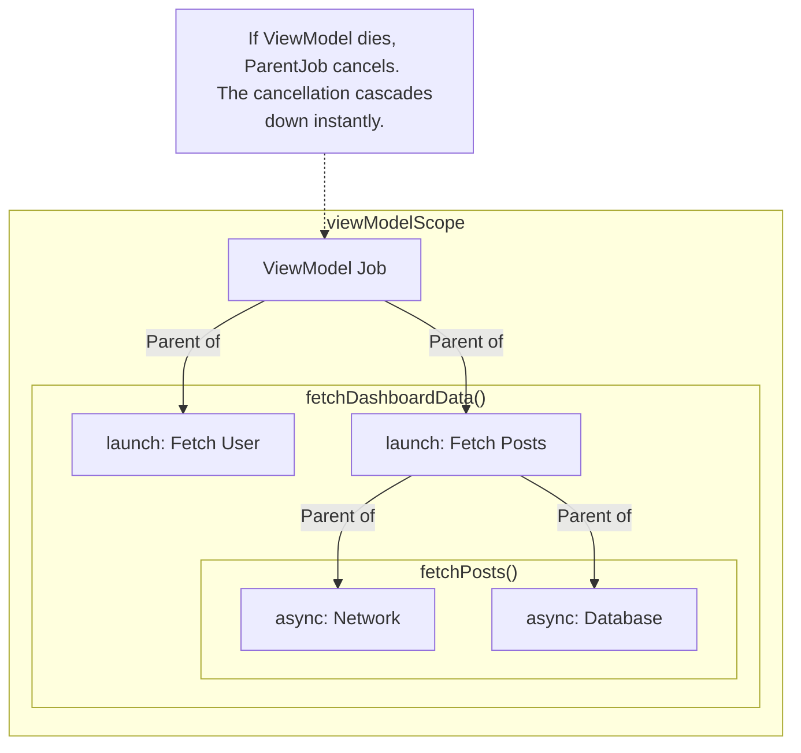

# Structured Concurrency

## Overview

Structured Concurrency is the architectural paradigm that makes Kotlin Coroutines safe and predictable, especially in the chaotic environment of Android. It guarantees that asynchronous tasks (network requests, database queries) are strictly tied to a specific lifecycle scope, and that no task can "leak" or run infinitely in the background without a parent tracking it.

In short: **If the parent dies, all its children die immediately.**

## Why It Matters

Before Structured Concurrency, Android concurrency relied on bare `Thread`s, `AsyncTask`, or raw RxJava subscriptions. These were "Fire and Forget." 

If a user opened a `ProfileActivity`, you might fire off a background thread to download a 50MB video. If the user instantly pressed the Back button, the `Activity` was destroyed, but the background thread *kept running*, downloading 50MB of data in the background, draining the user's battery, and ultimately crashing the app when it tried to hand the video back to a dead UI. This is called a **Memory Leak** or a **Zombie Task**.

Structured Concurrency mathematically eliminates Zombie Tasks.

## Historical Context

The concept of Structured Concurrency didn't originate in Kotlin; it was heavily popularized by Martin Sústrik (the creator of ZeroMQ) and implemented in languages like Go and Python (to a degree). 

The premise is simple: just as `goto` statements in early programming languages made control flow impossible to trace (leading to "Spaghetti Code"), "fire and forget" threads made asynchronous flow impossible to trace. Structured Concurrency brings `try/catch/finally` block-level scoping to asynchronous threads.

## First Principles

1.  **The Scope (`CoroutineScope`):** Every coroutine must be launched inside a Scope. The Scope dictates the lifetime of the coroutine.
2.  **The Job:** A `Job` represents the actual work. Jobs form a hierarchy (Parent Job -> Child Job).
3.  **Cancellation Propagation:** 
    - **Downward:** If you cancel a Parent Job, all its Child Jobs are instantly cancelled.
    - **Upward (Failure):** If a Child Job fails (throws an Exception), it cancels its Parent Job, which then cancels all the *other* siblings.

## Mental Model

Think of a **Corporate Structure**.
- **The CEO (The CoroutineScope):** The CEO decides the overarching mission.
- **The Managers (Parent Jobs):** The CEO delegates tasks to Managers.
- **The Workers (Child Coroutines):** Managers hire Workers (`launch` or `async`) to do the heavy lifting.

**The Rules:**
- If the CEO is fired (`viewModelScope.cancel()`), the entire company shuts down. All Managers and Workers are instantly fired (Downward Cancellation).
- If a Worker finishes their job successfully, they just report back and go home.
- If a Worker *fails catastrophically* (throws an Exception), the Manager panics, fires all the other Workers, and reports the failure up to the CEO, causing the whole mission to collapse (Upward Cancellation).

## Internal Mechanics

How does Kotlin actually link these coroutines together? Through the `CoroutineContext`.

When you write `viewModelScope.launch { ... }`, the new coroutine inherits the `CoroutineContext` of the `viewModelScope`. 

Crucially, the `launch` builder creates a brand new `Job` instance. It then looks at the inherited context, finds the parent `Job`, and physically attaches itself as a child.

```kotlin
// Simplified internal concept
val parentJob = Job()
val childJob = Job(parent = parentJob) // The linkage happens here
```

When `parentJob.cancel()` is called, it iterates through its internal list of children and calls `cancel()` on all of them. This throws a `CancellationException` inside the child coroutines, causing them to safely abort at their next `suspend` point.

## Architecture



## Production Example

**The Lifecycle-Aware ViewModel**

In Android, we use `viewModelScope`. The Android framework automatically ties this scope to the ViewModel's `onCleared()` lifecycle method.

```kotlin
class DashboardViewModel(private val api: Api) : ViewModel() {

    fun loadData() {
        // 1. We launch in the viewModelScope. 
        // If the user leaves the screen, this scope is cancelled automatically.
        viewModelScope.launch {
            try {
                // 2. We use coroutineScope to group parallel tasks.
                // This creates a new sub-scope.
                coroutineScope {
                    val userDef = async { api.getUser() }
                    val postsDef = async { api.getPosts() }
                    
                    val user = userDef.await()
                    val posts = postsDef.await()
                    
                    // Update UI State here
                }
            } catch (e: Exception) {
                // If ANY child fails (e.g. getUser throws a 404), 
                // coroutineScope instantly cancels getPosts() so we don't waste data,
                // and then throws the exception here.
            }
        }
    }
}
```

## Tradeoffs

**`coroutineScope` vs `supervisorScope`**

By default, Structured Concurrency is ruthless. If one child fails, the whole family dies.

- **`coroutineScope`:** Standard behavior. If Child A throws an exception, Parent is cancelled, Child B is cancelled. 
    - *Use Case:* Fetching an Order and its Payment Details. If Payment Details fail, showing the Order alone is useless. Fail the whole thing.
- **`supervisorScope`:** The protective shield. If Child A throws an exception, the Parent *survives*, and Child B keeps running.
    - *Use Case:* Uploading 5 independent photos. If Photo 3 fails, you still want Photos 1, 2, 4, and 5 to finish uploading.

```kotlin
// SupervisorScope Example
viewModelScope.launch {
    supervisorScope {
        // These are completely independent now!
        val upload1 = launch { api.uploadPhoto(1) } // Fails!
        val upload2 = launch { api.uploadPhoto(2) } // Succeeds!
    }
}
```

## Failure Modes

- **The `GlobalScope` Disaster:**
  ```kotlin
  // DISASTER
  fun downloadMassiveFile() {
      // GlobalScope has NO parent. It is not tied to the ViewModel or Activity.
      // If the user exits the app, this keeps running in the background until the 
      // OS kills the entire process, causing battery drain and invisible network usage.
      GlobalScope.launch { ... }
  }
  ```
  *(Fix: Never use `GlobalScope` in Android. Always use `viewModelScope`, `lifecycleScope`, or inject an Application-scoped `CoroutineScope`).*
- **Swallowing `CancellationException`:**
  ```kotlin
  viewModelScope.launch {
      try {
          api.fetchData() // A suspending function
      } catch (e: Exception) {
          // DISASTER: You just caught the CancellationException!
          // When the ViewModel dies, it tries to cancel this coroutine by throwing 
          // a CancellationException. Because you caught it globally and ignored it,
          // the coroutine will refuse to die and continue as a Zombie!
      }
  }
  ```
  *(Fix: Always catch specific exceptions like `IOException` or `HttpException`. If you must catch a generic `Exception`, you must rethrow it if it is a `CancellationException`: `if (e is CancellationException) throw e`).*

## Staff Engineer Thinking

When reviewing concurrency code, a Staff engineer looks for rogue execution and improper error propagation:

1.  **Who owns the Scope?** If I see `CoroutineScope(Dispatchers.IO).launch {}` being instantiated directly inside a Repository or Use Case, I reject the PR. The Repository should not define its own lifespan. It should expose `suspend` functions and force the caller (the ViewModel) to provide the Scope. This ensures the UI layer dictates when work should be aborted.
2.  **Are we abusing `Dispatchers`?** A `suspend` function should be *Main-Safe*. It is the responsibility of the `suspend` function (e.g., inside the Repository) to use `withContext(Dispatchers.IO)` to move off the main thread. The ViewModel should just call `viewModelScope.launch {}` (which defaults to Main) and assume the underlying functions are safe.
3.  **Graceful Degradation:** If a dashboard makes 5 parallel API calls, I check if they are wrapped in a `supervisorScope`. If one minor widget fails to load, it should not crash the entire dashboard.

## Common Misconceptions

- **"Coroutines are just lightweight threads."** Coroutines *run* on threads, but the critical difference is the hierarchical Job structure (Structured Concurrency) that threads completely lack.
- **"`Thread.sleep()` works inside Coroutines."** Never use `Thread.sleep()`. It blocks the underlying OS thread, destroying the efficiency of the coroutine dispatcher. Always use the suspending `delay()` function, which frees the thread back to the pool while it waits.

## Probing Questions

1.  What is the "Zombie Task" problem, and how does Structured Concurrency solve it?
2.  Explain the concept of "Downward Cancellation" vs "Upward Cancellation" in a Coroutine Job hierarchy.
3.  Why is it an architectural disaster to use `GlobalScope.launch` in an Android application?
4.  Describe the exact mechanism by which a parent CoroutineScope actually stops a child coroutine from executing. (Hint: What exception is thrown?)
5.  What is the critical difference between `coroutineScope` and `supervisorScope` when handling parallel asynchronous tasks?
6.  Why must you be extremely careful when writing a generic `catch (e: Exception)` block inside a coroutine?
7.  Explain the concept of a "Main-Safe" suspend function. Whose responsibility is it to change the Dispatcher?
8.  How does `viewModelScope` automatically know when to cancel all of its child coroutines? What Android lifecycle method triggers this?
9.  If you launch three `async` blocks inside a standard `coroutineScope`, and the first one throws a network error, what happens to the other two?
10. Why is passing a `CoroutineScope` down into a Repository layer considered an anti-pattern?

## Answer Key

1. A zombie task is work that continues after the UI or operation that requested it has ended, retaining resources and possibly delivering into dead state. Structured concurrency makes work a child of a bounded scope so completion and cancellation cannot escape the owner's lifetime.
2. Downward cancellation means canceling a parent cancels all descendants. Upward failure propagation means an uncaught child failure cancels its parent and therefore siblings in a regular job hierarchy; supervision changes failure propagation, not downward cancellation.
3. `GlobalScope` has no application-specific owner, so work can outlive screens, sessions, and tests and cannot be joined or canceled as part of the initiating operation. Use a lifecycle scope or an explicitly injected application scope for genuinely process-level work.
4. Cancellation marks the Job canceled and resumes a suspended child with `CancellationException`; cooperative checks such as suspension points, `ensureActive()`, or `isActive` then stop execution. Blocking or CPU loops that never cooperate will not stop promptly.
5. In `coroutineScope`, an uncaught child failure cancels the scope and its other children. In `supervisorScope`, one child failure does not automatically cancel siblings, so the caller can collect independent successes/failures while parent cancellation still cancels all children.
6. `CancellationException` is an `Exception`; swallowing it treats cancellation as a normal failure and lets cleanup/retry logic continue incorrectly. Rethrow it, or catch only the domain exceptions the code can actually handle.
7. A main-safe suspend function can be called from the main thread without blocking it. The function that performs blocking or CPU-heavy work owns the `withContext` dispatcher switch, so callers do not need to know its implementation details.
8. `viewModelScope` is owned by the ViewModel and its Job is canceled when the ViewModel is cleared. `onCleared()` occurs when the owner is permanently removed—for example, a destination is popped—not for a configuration change or process kill callback.
9. The first uncaught error cancels the enclosing `coroutineScope`; the other two children are canceled and awaiting the scope rethrows the failure. Use supervision only when their results are intentionally independent.
10. A repository should expose main-safe suspend functions or flows and let the caller own the operation lifetime. Accepting an arbitrary scope hides ownership, encourages fire-and-forget work, complicates tests, and lets data work outlive the use case that requested it.

## Further Reading

- [`viewmodel.md`](viewmodel.md) — The owner of `viewModelScope`.
- [`flow.md`](flow.md) — How Structured Concurrency applies to infinite streams of data.
- [Kotlin Docs: Coroutine Context and Dispatchers](https://kotlinlang.org/docs/coroutine-context-and-dispatchers.html)
