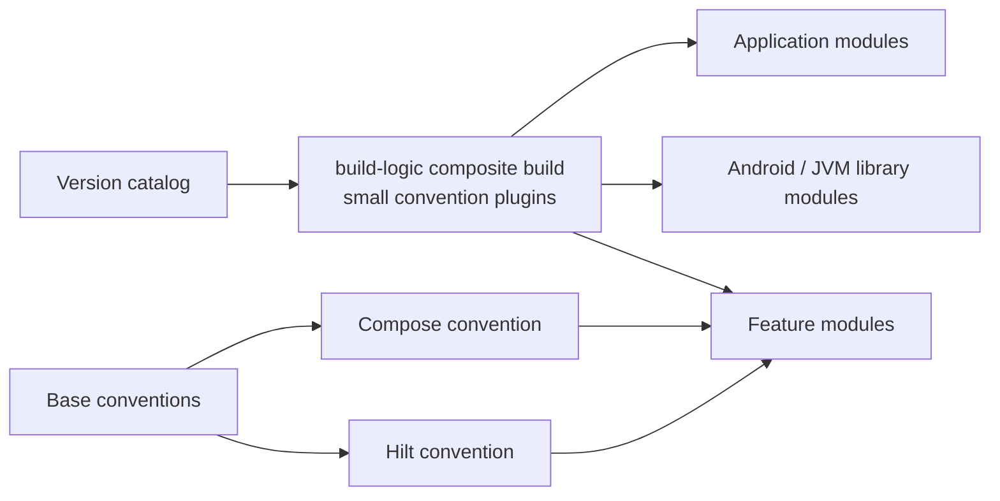

# Convention Plugins — Gradle's Build Logic as Code

> A 200-module Android project that pastes the same 50 lines of Gradle into every `build.gradle.kts` is a maintenance disaster. Convention plugins let you write that config once, in proper Kotlin, with tests, version-catalog refs, and a single upgrade path. Staff-level mastery is knowing how to set up `build-logic/`, write `Plugin<Project>` subclasses, organize plugins by responsibility, and use them to enforce build-time invariants across every module in your codebase.

---

## Why Convention Plugins

The problem they solve: a feature module's `build.gradle.kts` typically does ~30 things — Android library plugin, Kotlin, compose compiler, Hilt KSP, Room KSP, KotlinX serialization, default `compileSdk`, `minSdk`, Java 17 toolchain, lint rules, test config, ProGuard, ABI splits. Copy that into 50 feature modules and you've got 1,500 lines of duplicated config.

Worse: upgrading `compileSdk` from 34 to 35 means editing 50 files. Adding a lint rule means 50 PR threads.

**Convention plugins** centralize the config. Every module becomes a one-liner:

```kotlin
// :feature:cart:impl/build.gradle.kts
plugins {
    id("yourorg.android.feature")
}
```

The plugin applies Android, Kotlin, Compose, Hilt, lint, tests — everything. Upgrading `compileSdk`: one edit in `build-logic/`. All 50 modules upgrade simultaneously, atomically.

This is build-logic as **first-class code**, not config-file copy-paste.

---

## The Composite Build Structure



Convention plugins encode small composable capabilities; modules opt into the minimum set they need instead of inheriting one opaque plugin that couples every build feature.

**`build-logic/`** is a separate Gradle composite build. It compiles BEFORE the main project (Gradle resolves convention plugins, then uses them).

`build-logic/settings.gradle.kts`:

```kotlin
dependencyResolutionManagement {
    repositories {
        google()
        mavenCentral()
        gradlePluginPortal()
    }
    versionCatalogs {
        create("libs") {
            from(files("../gradle/libs.versions.toml"))
        }
    }
}

rootProject.name = "build-logic"
include(":convention")
```

Root `settings.gradle.kts` includes the composite build:

```kotlin
pluginManagement {
    includeBuild("build-logic")          // ← key line
    repositories {
        google()
        mavenCentral()
        gradlePluginPortal()
    }
}

rootProject.name = "yourapp"
include(":app")
include(":feature:cart:api", ":feature:cart:impl")
// ...
```

---

## A Plugin from Scratch

Tasks:
1. Implement `Plugin<Project>`.
2. Register it with a Gradle plugin ID.
3. Apply by ID in consumer module.

`build-logic/convention/build.gradle.kts`:

```kotlin
plugins {
    `kotlin-dsl`
}

dependencies {
    compileOnly(libs.android.gradlePlugin)
    compileOnly(libs.kotlin.gradlePlugin)
    compileOnly(libs.ksp.gradlePlugin)
    compileOnly(libs.compose.gradlePlugin)
}

gradlePlugin {
    plugins {
        register("androidLibrary") {
            id = "yourorg.android.library"
            implementationClass = "AndroidLibraryConventionPlugin"
        }
        register("androidApplication") {
            id = "yourorg.android.application"
            implementationClass = "AndroidApplicationConventionPlugin"
        }
        register("androidFeature") {
            id = "yourorg.android.feature"
            implementationClass = "AndroidFeatureConventionPlugin"
        }
        register("androidCompose") {
            id = "yourorg.android.compose"
            implementationClass = "AndroidComposeConventionPlugin"
        }
        register("androidHilt") {
            id = "yourorg.android.hilt"
            implementationClass = "AndroidHiltConventionPlugin"
        }
    }
}
```

The `kotlin-dsl` plugin gives you direct access to Gradle's Kotlin DSL inside the plugin (so you can write `tasks.withType<KotlinCompile> { ... }` etc.).

---

## Example: Android Library Convention

`AndroidLibraryConventionPlugin.kt`:

```kotlin
import com.android.build.gradle.LibraryExtension
import org.gradle.api.Plugin
import org.gradle.api.Project
import org.gradle.kotlin.dsl.configure
import org.gradle.kotlin.dsl.withType
import org.jetbrains.kotlin.gradle.tasks.KotlinCompile

class AndroidLibraryConventionPlugin : Plugin<Project> {
    override fun apply(target: Project) = with(target) {
        with(pluginManager) {
            apply("com.android.library")
            // AGP 9+ supplies built-in Kotlin for Android modules.
        }

        extensions.configure<LibraryExtension> {
            compileSdk = 34
            defaultConfig {
                minSdk = 26
                testInstrumentationRunner = "androidx.test.runner.AndroidJUnitRunner"
                consumerProguardFiles("consumer-rules.pro")
            }
            buildFeatures {
                buildConfig = false   // disabled by default; modules can enable
            }
            compileOptions {
                sourceCompatibility = JavaVersion.VERSION_17
                targetCompatibility = JavaVersion.VERSION_17
            }
            buildTypes {
                release {
                    isMinifyEnabled = false   // libraries don't minify
                }
            }
            packaging {
                resources {
                    excludes += "/META-INF/{AL2.0,LGPL2.1}"
                }
            }
        }

        tasks.withType<KotlinCompile>().configureEach {
            compilerOptions {
                jvmTarget.set(org.jetbrains.kotlin.gradle.dsl.JvmTarget.JVM_17)
                freeCompilerArgs.addAll(
                    "-opt-in=kotlin.RequiresOptIn",
                )
            }
        }

        dependencies {
            "testImplementation"(versionCatalogLibrary("junit"))
            "androidTestImplementation"(versionCatalogLibrary("androidx.test.ext.junit"))
        }
    }
}

// Helper to grab a versionCatalog reference at apply time
private fun Project.versionCatalogLibrary(alias: String) =
    extensions.getByType(org.gradle.api.artifacts.VersionCatalogsExtension::class.java)
        .named("libs")
        .findLibrary(alias).orElseThrow().get()
```

Now any module that wants library defaults:

```kotlin
// :core:network/build.gradle.kts
plugins {
    id("yourorg.android.library")
}

android.namespace = "com.example.network"

dependencies {
    api(libs.retrofit.core)
    implementation(libs.okhttp.logging)
}
```

Two lines and a namespace. Done.

---

## Governance Rules

Convention plugins are platform APIs. Treat them with the same care as a shared SDK.

| Rule | Why |
|---|---|
| One plugin per module type | Prevents feature teams from composing ad-hoc Gradle behavior |
| Plugin changes require build-platform review | A bad convention breaks the whole repo |
| Every convention plugin has functional tests | Gradle behavior changes across versions |
| Breaking behavior gets a migration window | Hundreds of modules may consume the plugin |
| Defaults are strict; escape hatches are explicit | Paved road stays safe without blocking rare needs |

Good escape hatches are named and searchable:

```kotlin
androidPlatform {
    enableBuildConfig = true       // explicit exception
    allowRawMaterialImports = false
}
```

Avoid "just override it in your module" culture. If many modules need the escape hatch, the convention is wrong and should be redesigned.

---

## Composing Plugins — The Feature Plugin

`AndroidFeatureConventionPlugin.kt` builds on the library plugin:

```kotlin
class AndroidFeatureConventionPlugin : Plugin<Project> {
    override fun apply(target: Project) = with(target) {
        with(pluginManager) {
            apply("yourorg.android.library")
            apply("yourorg.android.hilt")
            apply("yourorg.android.compose")
        }

        extensions.configure<LibraryExtension> {
            defaultConfig {
                testInstrumentationRunnerArguments["clearPackageData"] = "true"
            }
            testOptions {
                animationsDisabled = true
            }
        }

        dependencies {
            "implementation"(libs.findLibrary("androidx.hilt.navigation.compose").get())
            "implementation"(libs.findLibrary("androidx.lifecycle.viewmodel.compose").get())
            "implementation"(libs.findLibrary("androidx.navigation.compose").get())

            "implementation"(libs.findLibrary("kotlinx.coroutines.android").get())

            "testImplementation"(libs.findLibrary("kotlinx.coroutines.test").get())
            "testImplementation"(libs.findLibrary("turbine").get())
        }
    }
}
```

A feature module declares:

```kotlin
plugins {
    id("yourorg.android.feature")
}
```

Inherits: Android library + Hilt + Compose + all feature-specific deps. ~30 lines of Gradle reduced to one.

---

## Compose Convention Plugin

`AndroidComposeConventionPlugin.kt`:

```kotlin
class AndroidComposeConventionPlugin : Plugin<Project> {
    override fun apply(target: Project) = with(target) {
        with(pluginManager) {
            apply("org.jetbrains.kotlin.plugin.compose")
        }

        val extension = extensions.getByType<LibraryExtension>()
        extension.apply {
            buildFeatures {
                compose = true
            }
        }

        extensions.configure<ComposeCompilerGradlePluginExtension> {
            stabilityConfigurationFile.set(
                rootProject.layout.projectDirectory.file("compose-stability.txt")
            )
            // Enable strong skipping mode (Compose 1.7+ default)
            // featureFlags.add(ComposeFeatureFlag.StrongSkipping)
            
            // Enable Compose Compiler metrics in CI builds:
            if (System.getenv("ENABLE_COMPOSE_METRICS") == "true") {
                metricsDestination.set(
                    rootProject.layout.buildDirectory.dir("compose-metrics/${project.name}")
                )
                reportsDestination.set(
                    rootProject.layout.buildDirectory.dir("compose-metrics/${project.name}")
                )
            }
        }

        dependencies {
            val bom = libs.findLibrary("androidx.compose.bom").get()
            "implementation"(platform(bom))
            "androidTestImplementation"(platform(bom))

            "implementation"(libs.findLibrary("androidx.compose.material3").get())
            "implementation"(libs.findLibrary("androidx.compose.ui.tooling.preview").get())
            "debugImplementation"(libs.findLibrary("androidx.compose.ui.tooling").get())
        }
    }
}
```

Centralizes Compose compiler version, BOM, debug tooling, and a global `compose-stability.txt` for cross-module stability hints.

---

## Hilt Convention Plugin

`AndroidHiltConventionPlugin.kt`:

```kotlin
class AndroidHiltConventionPlugin : Plugin<Project> {
    override fun apply(target: Project) = with(target) {
        with(pluginManager) {
            apply("com.google.devtools.ksp")
            apply("com.google.dagger.hilt.android")
        }

        dependencies {
            "implementation"(libs.findLibrary("hilt.android").get())
            "ksp"(libs.findLibrary("hilt.compiler").get())
        }
    }
}
```

Three deps; KSP-only; consistent across every module that needs DI.

---

## Custom Tasks in Convention Plugins

Convention plugins are full Kotlin code. Define custom tasks:

```kotlin
class CodeQualityConventionPlugin : Plugin<Project> {
    override fun apply(target: Project) = with(target) {
        // Existing tasks: lint, detekt, ktlint
        with(pluginManager) {
            apply("io.gitlab.arturbosch.detekt")
        }

        // A custom task that fails the build if any TODO comment is in main sources
        tasks.register("checkNoTodos") {
            group = "verification"
            description = "Fails if any TODO comment exists in main sources."
            
            doLast {
                val todos = fileTree("src/main/kotlin")
                    .matching { include("**/*.kt") }
                    .flatMap { file ->
                        file.readLines().mapIndexedNotNull { i, line ->
                            if ("TODO" in line) "${file.relativeTo(projectDir)}:${i + 1}: $line" else null
                        }
                    }
                if (todos.isNotEmpty()) {
                    throw GradleException("TODO comments found:\n${todos.joinToString("\n")}")
                }
            }
        }

        tasks.named("check") { dependsOn("checkNoTodos") }
    }
}
```

Now every module gets `./gradlew :module:check` enforcing no-TODOs. Adding this to one place affects every consumer module.

---

## Sharing Version Catalog References

Convention plugins consume `libs.versions.toml`:

```kotlin
private val Project.libs
    get() = extensions.getByType(org.gradle.api.artifacts.VersionCatalogsExtension::class.java)
        .named("libs")
```

Then:

```kotlin
dependencies {
    "implementation"(libs.findLibrary("androidx.compose.material3").get())
}
```

Critically: **the catalog is the same one consumer modules use**. Bump a version in `libs.versions.toml` and the change propagates through convention plugins + consumer modules.

---

## Enforcing Conventions via Lint Rules

Convention plugins can register custom Lint rules:

```kotlin
class AndroidLintConventionPlugin : Plugin<Project> {
    override fun apply(target: Project) = with(target) {
        // Internal lint rules from a custom Gradle subproject
        dependencies {
            "lintChecks"(project(":lint-rules"))
        }

        // Treat lint warnings as errors in release builds
        val extension = extensions.findByType<LibraryExtension>()
        extension?.lint {
            warningsAsErrors = true
            abortOnError = true
            checkReleaseBuilds = true
            disable += "GradleDependency"
        }
    }
}
```

Combined with custom Lint rules (e.g., "no `Modifier.padding()` without `Dp` annotation"), this enforces architectural standards as code.

---

## Pre-Commit Hooks via Convention

```kotlin
class GitHooksConventionPlugin : Plugin<Project> {
    override fun apply(target: Project) = with(target) {
        if (target.rootProject == target) {
            // Only apply once at root
            target.tasks.register("installGitHooks") {
                doLast {
                    val hook = target.file(".git/hooks/pre-commit")
                    hook.writeText("""
                        #!/bin/sh
                        ./gradlew ktlintCheck detektCheck
                    """.trimIndent())
                    hook.setExecutable(true)
                }
            }
            // Run during project setup
            target.gradle.projectsLoaded {
                rootProject.tasks.named("installGitHooks").get().actions.first().execute(rootProject.tasks.named("installGitHooks").get())
            }
        }
    }
}
```

A subtle but useful pattern: every new clone of the repo gets the hooks installed automatically. Doesn't replace `pre-commit` package managers but works for simple cases.

---

## Testing Convention Plugins

Treat plugins as code; test them:

```kotlin
// build-logic/convention/src/test/kotlin/AndroidLibraryConventionPluginTest.kt
class AndroidLibraryConventionPluginTest {

    @Test
    fun `applying plugin configures compileSdk`() {
        val project = ProjectBuilder.builder().build()
        project.pluginManager.apply("yourorg.android.library")
        // assertions on the project's extensions...
    }
}
```

Use `gradle-testkit` for more end-to-end tests:

```kotlin
@Test
fun `library module builds with convention applied`() {
    val testProjectDir = Files.createTempDir()
    File(testProjectDir, "build.gradle.kts").writeText("""
        plugins { id("yourorg.android.library") }
    """.trimIndent())
    
    val result = GradleRunner.create()
        .withProjectDir(testProjectDir)
        .withArguments("build")
        .withPluginClasspath()
        .build()
    
    assertEquals(TaskOutcome.SUCCESS, result.task(":build")?.outcome)
}
```

Library-author level. App-level convention plugins usually rely on the consumer modules' CI runs as the integration test.

---

## Migration Path (Existing Project)

For a multi-module project without conventions:

1. **Pick the most copy-pasted config.** Usually Android library settings.
2. **Create `build-logic/convention/` composite build.**
3. **Move the Android library config into a `Plugin<Project>`.**
4. **Apply to ONE module first**, verify it builds identically.
5. **Roll out to all library modules.**
6. **Repeat for app plugin, feature plugin, etc.**
7. **Add convention-specific concerns** (Compose, Hilt, lint) as separate plugins, composed by feature plugin.

Pace: a senior developer can migrate a 50-module project in 2–3 days. Tests catch regressions; the bulk of effort is verifying each module's behavior is preserved.

---

## Real Patterns

### Pattern 1: A "Pure Kotlin Library" Convention

```kotlin
class KotlinLibraryConventionPlugin : Plugin<Project> {
    override fun apply(target: Project) = with(target) {
        pluginManager.apply("org.jetbrains.kotlin.jvm")
        extensions.configure<KotlinProjectExtension> {
            jvmToolchain(17)
        }
        // For shared models, validators, business logic
    }
}
```

For `:core:model`, `:core:domain`, anything that doesn't need Android.

### Pattern 2: Strict-Mode Library Convention

```kotlin
class StrictLibraryConventionPlugin : Plugin<Project> {
    override fun apply(target: Project) = with(target) {
        pluginManager.apply("yourorg.android.library")
        
        extensions.configure<KotlinProjectExtension> {
            explicitApi()   // every public API must be explicit
        }
        
        // Even more strict than base library
    }
}
```

For SDK-style libraries within the codebase that need strict ABI control.

### Pattern 3: Per-Variant Hilt Modules

```kotlin
class HiltConventionPlugin : Plugin<Project> {
    override fun apply(target: Project) = with(target) {
        pluginManager.apply("com.google.dagger.hilt.android")
        pluginManager.apply("com.google.devtools.ksp")
        
        dependencies {
            "implementation"(libs.findLibrary("hilt.android").get())
            "ksp"(libs.findLibrary("hilt.compiler").get())
            
            // Hilt testing only for instrumentation tests
            "kspAndroidTest"(libs.findLibrary("hilt.android.testing").get())
            "androidTestImplementation"(libs.findLibrary("hilt.android.testing").get())
        }
    }
}
```

### Pattern 4: Gradle Build Cache Configuration

```kotlin
class BuildCacheConventionPlugin : Plugin<Project> {
    override fun apply(target: Project) = with(target) {
        gradle.settingsEvaluated {
            buildCache {
                local { isEnabled = true }
                remote<HttpBuildCache> {
                    url = uri("https://cache.yourorg.internal")
                    isPush = System.getenv("CI") == "true"
                }
            }
        }
    }
}
```

---

## Failure Modes

| Symptom | Cause | Fix |
|---|---|---|
| `Plugin not found: yourorg.android.library` | Plugin ID typo or missing register | Verify `gradlePlugin.plugins.register("...")` matches |
| Convention plugin not applying to modules | Forgot `includeBuild("build-logic")` in root settings | Add to `pluginManagement` block |
| `Could not resolve all dependencies` | Convention plugin uses libs.versions.toml not visible | Make sure `versionCatalogs` is configured in `build-logic/settings.gradle.kts` |
| Plugin compiles but task fails at apply time | `target.extensions.configure<X>` called before extension registered | Use `pluginManager.withPlugin(...) { ... }` to defer |
| Different modules get different `compileSdk` | Some modules opt out by overriding after `apply` | Be intentional about override-vs-shared config |
| Build time increases after convention plugin migration | Plugin configures expensive things unconditionally | Use `pluginManager.apply` with care; avoid eager configuration |
| Sync fails: `Cannot compare against project property` | Wrong DSL (e.g., `project.objects.directoryProperty()` vs `layout.projectDirectory`) | Use modern provider/lazy property APIs |
| KSP compatibility warning everywhere | KSP, Kotlin, AGP, Gradle, or a processor combination is unsupported | Check current compatibility notes; pin the independently versioned KSP release and upgrade the tested toolchain together |
| `Plugin uses unsupported APIs` warning | Using deprecated Gradle APIs | Migrate to current Gradle API equivalents |
| `apply(plugin = "...")` order issue | Inter-plugin dependencies | Use `pluginManager.withPlugin("X") { ... }` to wait |
| Plugin in `build-logic` can't access `libs.versions.toml` | Catalog not configured for composite build | Configure in `build-logic/settings.gradle.kts` |
| Custom task doesn't run | Forgot to wire into `check`/`build` | `tasks.named("check") { dependsOn(...) }` |
| `kotlin-dsl` plugin missing | New `convention` module without it | Add `id("kotlin-dsl")` to `build-logic/convention/build.gradle.kts` |
| `ProjectBuilder` test fails: cannot apply Android plugin | `ProjectBuilder` doesn't load AGP | Use `GradleRunner` for full integration tests |
| Lint warnings increase after convention plugin | Stricter defaults | Either fix warnings or relax convention temporarily |
| Pre-commit hook installed but not running | File permissions on `.git/hooks/pre-commit` | `chmod +x` after writing |

---

## Common Pitfalls

- **Single mega-plugin that does everything.** Becomes a maintenance nightmare; consumers can't opt out of pieces. Split per concern (library / compose / hilt / lint).
- **Hard-coded version strings inside the plugin.** Defeats the purpose. Always read from `libs.versions.toml`.
- **Configuration-time work in `apply()`.** Heavy I/O at apply slows every build's configuration phase. Defer with `tasks.register`.
- **Not testing the plugin.** A bad plugin breaks every module's build. Test at least the happy path.
- **Single-purpose plugins that one module uses.** Just put the config in that module's `build.gradle.kts`.
- **Embedding plugin logic in `settings.gradle.kts`.** Hard to debug. Use `build-logic`.
- **Forgetting to add `kotlin-dsl` plugin to convention module.** No Kotlin DSL inside the plugin code.
- **Conventional plugin without convention name.** Use `yourorg.android.feature`, not `feature`. Avoids name collisions.
- **Plugins that depend on plugins from the same convention build.** Possible but fragile; prefer composition via `pluginManager.apply` calls.

---

## Probing Questions

1. Why do convention plugins live in `build-logic/` instead of `buildSrc/`? What's the difference?
2. Walk through what happens when Gradle sees `id("yourorg.android.feature")` in a module's `build.gradle.kts`.
3. A feature module needs Android library + Hilt + Compose. Sketch the plugin composition.
4. How do convention plugins access `libs.versions.toml`?
5. You want to enforce `explicitApi()` on certain library modules. How do you structure plugins for this?
6. A custom task in a convention plugin needs to run as part of `./gradlew :module:check`. How do you wire it?
7. Compose Compiler metrics opt-in via environment variable — sketch the plugin code.
8. What's the trade-off between "one big convention plugin" and "many small composable plugins"?
9. Migrating from `buildSrc` to `build-logic` composite build — walk through the migration.
10. A convention plugin works locally but fails on CI. Common causes?
11. How would you test that a convention plugin correctly configures `compileSdk = 34`?
12. Pre-commit hooks installed via convention plugin — when's this useful, when's it overkill?

---

## Further Reading

- [`ksp.md`](ksp.md) — KSP plugin applied from a convention plugin.
- [`multi-module.md`](multi-module.md) — convention plugins per module type.
- [`gradle-and-build-systems.md`](gradle-and-build-systems.md) — Gradle fundamentals.
- [`../architecture/modularization-strategies.md`](../architecture/modularization-strategies.md) — module taxonomy convention plugins enforce.
- [`../data-and-di/hilt-vs-koin-vs-manual-di.md`](../data-and-di/hilt-vs-koin-vs-manual-di.md) — Hilt plugin setup.
- [`../compose/stability.md`](../compose/stability.md) — Compose Compiler metrics via convention plugin.
- [`../../platform-engineering/build-graph-scaling.md`](../../platform-engineering/build-graph-scaling.md) — convention plugins as platform.
- [`../../platform-engineering/internal-developer-platforms.md`](../../platform-engineering/internal-developer-platforms.md) — convention plugins as IDP foundation.
- [`../../platform-engineering/library-versioning.md`](../../platform-engineering/library-versioning.md) — `libs.versions.toml` integration.
- [Gradle — Convention plugins guide](https://docs.gradle.org/current/userguide/sharing_build_logic_between_subprojects.html) — official.
- [Now in Android — `build-logic/`](https://github.com/android/nowinandroid/tree/main/build-logic) — Google's canonical reference.
- [Kotlin DSL — Sample projects](https://github.com/gradle/kotlin-dsl-samples) — community samples.
