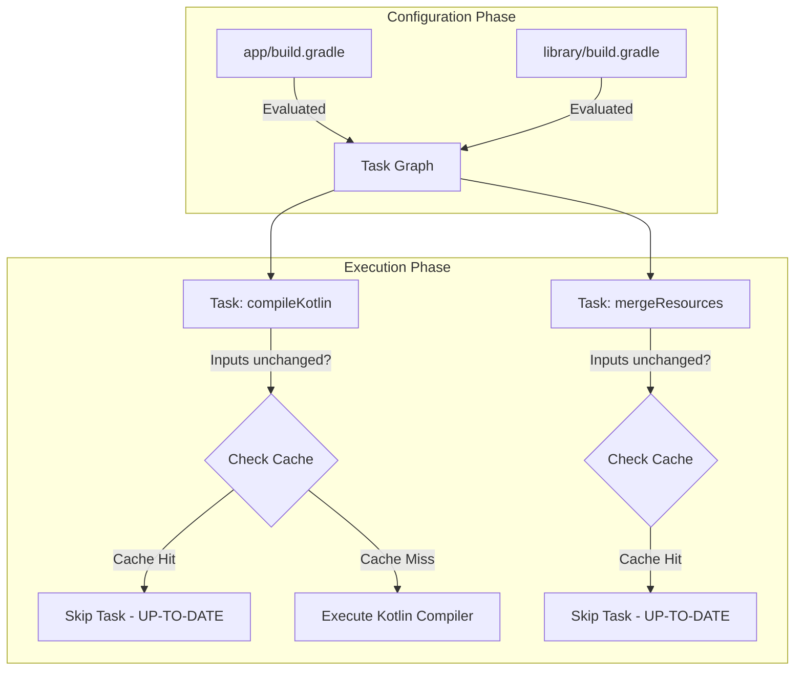

# Gradle and Build Systems

## Overview

For most engineers, Gradle is a mysterious, frustrating black box that occasionally takes 10 minutes to turn Kotlin code into an APK, and crashes with incomprehensible `Daemon` errors.

A Staff Engineer understands that Gradle is not a black box; it is a **Directed Acyclic Graph (DAG) Execution Engine**. Gradle itself knows absolutely nothing about Android, Kotlin, or Java. It is simply a task runner. It relies entirely on **Plugins** (like the Android Gradle Plugin - AGP) to provide the actual tasks (compile Kotlin, shrink resources, zip the APK) and wire them together in the correct dependency order.

Mastering the build system is critical. If your CI/CD pipeline takes 45 minutes to build a release candidate, developer velocity is crippled. A Staff Engineer architects the build graph to ensure maximum cache hits, aggressive parallelization, and strict module boundaries.

## Why It Matters

When you hit the green "Play" button in Android Studio, over 100 individual tasks execute in a highly specific mathematical order.
1. `preBuild`
2. `compileDebugKotlin`
3. `mergeDebugResources`
4. `minifyDebugWithR8`
5. `packageDebug`

If you modify a single `String` in `MainActivity.kt`, and Gradle decides it needs to completely rebuild 50 unrelated modules and re-merge 10,000 resources, your build will take 5 minutes instead of 5 seconds. This is a failure of Build Architecture. 

## Historical Context

- **Ant / Eclipse (Pre-2013):** Android originally used Eclipse and Ant. Ant was a rigid, XML-based build system. You literally wrote XML tags to define compilation steps. It was impossible to extend or maintain for large projects.
- **Maven:** Introduced Dependency Management (the ability to download libraries from the internet) and a strict lifecycle. Still XML-based and highly inflexible.
- **Gradle (2013):** Google partnered with Gradleware to build the Android Gradle Plugin (AGP). Gradle abandoned XML for a Turing-complete DSL (Domain Specific Language) originally based on Groovy, and now based on Kotlin (`build.gradle.kts`). Gradle brought the concept of the Task Graph and aggressive caching.
- **Bazel/Buck (Enterprise):** Companies with massive monorepos (Google, Uber, Airbnb) found Gradle too slow. They use Bazel/Buck, which are hermetic build systems. Gradle has spent the last 5 years adopting Bazel's hermetic caching strategies to close the performance gap.

## AGP 9 and Built-In Kotlin

Android Gradle Plugin 9.0 enables built-in Kotlin support by default for Android modules. A normal `com.android.application` or `com.android.library` module no longer also applies `org.jetbrains.kotlin.android`; doing so produces a duplicate-extension error. KMP library modules remain different: they use `org.jetbrains.kotlin.multiplatform` with `com.android.kotlin.multiplatform.library`.

An AGP 9 migration must review four areas together:

1. Remove `kotlin-android` from module plugins and version catalogs.
2. Replace `kotlin-kapt` with KSP where supported, or temporarily use AGP's legacy KAPT bridge.
3. Move obsolete `android.kotlinOptions {}` configuration to the supported compiler-options DSL.
4. Verify convention plugins and third-party Gradle plugins against AGP 9 before removing any temporary opt-out.

Do not copy an AGP 8 plugin block into an AGP 9 project and assume the extra Kotlin plugin is harmless. Build-tool examples in this repository assume built-in Kotlin unless explicitly labeled as pre-AGP-9 migration code.

## First Principles

1.  **Task:** The smallest unit of work (e.g., "Compile these 5 Kotlin files into Java bytecode").
2.  **Plugin:** A collection of Tasks and the wiring that connects them. The Android Gradle Plugin (AGP) provides the `assembleDebug` task.
3.  **Dependency Graph (DAG):** A mathematical tree showing which Tasks must run before other Tasks. (You cannot package the APK until you have compiled the Kotlin).
4.  **Configuration Phase:** The phase where Gradle reads all your `build.gradle` files to build the DAG. *No compilation happens here.*
5.  **Execution Phase:** The phase where Gradle traverses the DAG and actually runs the tasks.
6.  **Hermeticity / Caching:** If the inputs to a Task (e.g., the `.kt` files) have not changed, and the outputs (e.g., the `.class` files) are still in the `build/` directory, Gradle **must skip** executing the task. This is `UP-TO-DATE`.

## Mental Model

Think of Gradle as the **Foreman of a Construction Site**.
- The Foreman (Gradle) doesn't know how to pour concrete or wire electricity.
- The Foreman hires Subcontractors (Plugins). 
- The Foreman reads the Blueprints (`build.gradle.kts`) during the **Configuration Phase** and draws a massive flowchart: *The Electrician cannot run wires until the Framer builds the walls.*
- During the **Execution Phase**, the Foreman walks the flowchart. He tells the Framer to build the walls. 
- If the walls are already built and haven't fallen down (Cache Hit / `UP-TO-DATE`), the Foreman skips the Framer and immediately calls the Electrician.

## Internal Mechanics

### 1. `implementation` vs `api` (The ABI Boundary)

The most critical optimization a Staff Engineer enforces is strict dependency visibility.

```kotlin
// Module A
class UserRepo { val user = User() }

// Module B depends on Module A
implementation(project(":ModuleA"))
class ProfileViewModel { val repo = UserRepo() }

// Module C depends on Module B
implementation(project(":ModuleB"))
class ProfileActivity { ... }
```

If you use `implementation(project(":ModuleA"))` inside Module B, Module C **cannot** see the `UserRepo` class. The dependency is hidden. 
If you modify `UserRepo` in Module A, Gradle must recompile Module A and Module B. **It does not recompile Module C.** This saves massive amounts of time.

If you mistakenly use `api(project(":ModuleA"))`, Module C *can* see `UserRepo`. This leaks the ABI (Application Binary Interface). If you modify `UserRepo`, Gradle must now recompile Module A, Module B, *and* Module C. This is called an **Avalanche Compilation**.

### 2. The Configuration Phase Trap

The Configuration Phase runs *every single time* you interact with Gradle, even if you are just asking it for a list of available tasks.

```kotlin
// INCREDIBLY BAD build.gradle.kts
val version = URL("https://myapi.com/version").readText()

android {
    defaultConfig {
        versionCode = version.toInt()
    }
}
```
Because the `build.gradle.kts` file is evaluated during the Configuration Phase, this network call will execute and block the build thread *before* Gradle even figures out what tasks it needs to run. The Configuration Phase must be pure, instant, and devoid of I/O.

### 3. Build Cache and Build Scans

A Staff Engineer implements a Remote Build Cache. 
If Developer Alice compiles the `app` module on her laptop, Gradle creates a cryptographic hash of the input `.kt` files and uploads the resulting compiled `.class` files to a server.
If Developer Bob pulls Alice's branch and hits "Build", Bob's Gradle calculates the same hash, asks the server if it has the result, and downloads the `.class` files instantly. Bob's laptop performs *zero* compilation.

## Architecture



## Production Example

**Modularization for Build Speed**

A monolithic app (all code in one `app/` module) fundamentally breaks Gradle's ability to parallelize and cache work. If you have 500,000 lines of code in one module, and you change one string, Gradle must feed all 500,000 lines into the Kotlin compiler to ensure no references were broken.

A Staff Engineer splits the app into 100 isolated modules (e.g., `:feature:login`, `:feature:feed`, `:core:network`). 
- When `compileDebugKotlin` runs, Gradle utilizes all 10 cores of the developer's Macbook to compile 10 independent modules simultaneously in parallel.
- If you modify `:feature:login`, Gradle only recompiles `:feature:login` and the `:app` wrapper. The other 98 modules are pulled instantly from the cache.

## Tradeoffs

**Gradle vs Bazel**

- **Gradle (AGP):**
    - *Pros:* The official Google standard. 100% integration with Android Studio. Massive ecosystem of 3rd party plugins (Crashlytics, Apollo, Sqldelight).
    - *Cons:* Prone to "Configuration Drift" where developers sneak dirty scripts into `build.gradle` files. Memory hungry (The Gradle Daemon often consumes 4GB+ of RAM).
- **Bazel:**
    - *Pros:* Mathematically hermetic. A build on Machine A is guaranteed to be byte-for-byte identical to Machine B. Phenomenally fast for monorepos with 10+ million lines of code.
    - *Cons:* Extremely hostile learning curve. Breaks standard Android Studio IDE features. 3rd party Android plugins almost never support Bazel out of the box. 

*Staff Decision:* Unless your Android engineering team exceeds 50 developers and your compile times are > 30 minutes despite heavy modularization, stick with Gradle. The maintenance cost of a custom Bazel build pipeline requires dedicated Build Engineers.

## Failure Modes

- **The KAPT Bottleneck:**
  Using the Kotlin Annotation Processing Tool (KAPT) for libraries like Dagger or Room forces Gradle to generate Java "Stubs" for your Kotlin code before the real compilation can begin. This effectively doubles compilation time.
  *(Fix: Migrate aggressively from KAPT to KSP (Kotlin Symbol Processing), which parses Kotlin AST directly without generating Java stubs, running up to 2x faster).*
- **Transitive Dependency Conflicts:**
  Module A depends on `Retrofit 2.9`. Module B depends on `Retrofit 2.4`. Gradle silently resolves this by forcing the entire app to use `2.9` (the highest version). If `2.9` introduced a breaking API change, Module B will crash at runtime with a `NoSuchMethodError`.
  *(Fix: Use a Gradle Version Catalog (`libs.versions.toml`) to centralize all dependencies, or enforce strict dependency resolution strategies).*
- **Daemon Memory Leaks:**
  The Gradle Daemon is a long-running background Java process. To speed up builds, it keeps the task graph and compilers hot in memory. Over the course of a day, it can easily balloon to 8GB of RAM, starving Android Studio and causing the OS to thrash the swap file, destroying performance.
  *(Fix: Configure `org.gradle.jvmargs` with sensible limits (`-Xmx4g`) and periodically kill the daemon (`./gradlew --stop`) if the machine becomes unresponsive).*

## Staff Engineer Thinking

When auditing a slow build system, a Staff engineer does not guess. They use data.

1.  **Build Scans:** I run `./gradlew assembleDebug --scan`. This uploads the entire build trace to Gradle Enterprise. It provides a visual waterfall chart of exactly which tasks took the longest, which tasks missed the cache (and *why* their inputs changed), and how much time was spent in garbage collection.
2.  **Configuration Caching:** I enforce `org.gradle.configuration-cache=true`. This feature allows Gradle to serialize the entire Task DAG to disk. On the next build, it skips reading the `build.gradle.kts` files entirely and jumps straight to execution. It shaves 5-10 seconds off every incremental build.
3.  **Dynamic Versioning is Banned:** I actively reject any PR containing `implementation("com.squareup.retrofit2:retrofit:2.+")`. Dynamic versions force Gradle to constantly hit the network during the Configuration phase to check for new versions, destroying reproducibility and slowing down builds.

## Common Misconceptions

- **"Gradle compiles my Kotlin code."** No. The `KotlinCompile` task (provided by the Kotlin Gradle Plugin) invokes the `kotlinc` compiler. Gradle just tells it when to run and hands it the correct folder paths.
- **"Cleaning the project fixes build errors."** Calling `./gradlew clean` deletes the `build/` directory. This destroys the local build cache. If you have to `clean` to get a successful build, your build graph is mathematically corrupt (a task is failing to declare its inputs or outputs correctly). A Staff Engineer fixes the broken task; they don't accept `clean` as a workflow.

## Probing Questions

1.  What is a Directed Acyclic Graph (DAG), and how does Gradle use it to determine the order of task execution?
2.  Explain the fundamental difference between Gradle's "Configuration Phase" and "Execution Phase".
3.  Why is it an architectural disaster to execute network requests or heavy disk I/O directly inside a `build.gradle.kts` configuration block?
4.  Describe the exact difference between the `implementation` and `api` dependency configurations regarding module visibility and "Avalanche Compilation".
5.  How does a Remote Build Cache prevent a developer's laptop from executing the `KotlinCompile` task if a coworker has already compiled the exact same code on another machine?
6.  Explain why breaking a monolithic Android application into 100 smaller modules drastically improves incremental compilation speeds.
7.  What is the `KAPT` (Kotlin Annotation Processing Tool) bottleneck, and how does migrating to `KSP` (Kotlin Symbol Processing) resolve it?
8.  If Gradle resolves a transitive dependency conflict by silently choosing the highest version number (e.g., v2.9 over v2.4), how can this lead to a `NoSuchMethodError` at runtime?
9.  Why does a Staff Engineer consider the reliance on `./gradlew clean` to be a symptom of a corrupt build architecture rather than a standard development practice?
10. Describe the purpose of the Gradle Daemon, why it keeps compilers "hot" in memory, and how it can negatively impact OS performance over a long workday.

## Answer Key

1. **What is a Directed Acyclic Graph (DAG), and how does Gradle use it to determine the order of task execution?**
   A DAG is a mathematical graph of nodes (tasks) and directed edges (dependencies) with no cycles. Gradle constructs this graph during the Configuration phase to understand which tasks depend on the outputs of other tasks, ensuring they execute in the correct topological order (e.g., compile before package) and determining which independent branches can run in parallel.
2. **Explain the fundamental difference between Gradle's "Configuration Phase" and "Execution Phase".**
   The Configuration Phase evaluates all `build.gradle.kts` files to construct the task DAG, executing any top-level code in those scripts. The Execution Phase walks the constructed DAG and actually runs the actions (`doLast`, `doFirst`) of the tasks needed for the build.
3. **Why is it an architectural disaster to execute network requests or heavy disk I/O directly inside a `build.gradle.kts` configuration block?**
   Because the Configuration Phase runs every time Gradle is invoked—even for simple commands like `./gradlew tasks` or IDE syncs. Heavy I/O blocks the main build thread, drastically slowing down every interaction with the build system before any real compilation even starts.
4. **Describe the exact difference between the `implementation` and `api` dependency configurations regarding module visibility and "Avalanche Compilation".**
   `api` leaks the dependency to downstream consumers, meaning if the dependency changes, all downstream modules must be recompiled (Avalanche Compilation). `implementation` hides the dependency, strictly limiting the recompilation blast radius to only the module directly declaring it.
5. **How does a Remote Build Cache prevent a developer's laptop from executing the `KotlinCompile` task if a coworker has already compiled the exact same code on another machine?**
   Gradle hashes the exact inputs of the `KotlinCompile` task (source files, compiler version, classpath). It checks the Remote Build Cache server with this hash; if the server has the compiled outputs, Gradle downloads them instantly and marks the task as `UP-TO-DATE`, skipping local compilation.
6. **Explain why breaking a monolithic Android application into 100 smaller modules drastically improves incremental compilation speeds.**
   It splits a massive codebase into independent nodes in the DAG. When a single file changes, Gradle only recompiles that specific module and its direct dependents, pulling the rest instantly from the cache, while also allowing independent modules to compile in parallel across multiple CPU cores.
7. **What is the `KAPT` (Kotlin Annotation Processing Tool) bottleneck, and how does migrating to `KSP` (Kotlin Symbol Processing) resolve it?**
   KAPT works by generating Java stubs from Kotlin code so standard Java annotation processors can run, effectively parsing the code twice and slowing down builds. KSP resolves this by analyzing the Kotlin AST directly, avoiding stub generation and executing up to 2x faster.
8. **If Gradle resolves a transitive dependency conflict by silently choosing the highest version number (e.g., v2.9 over v2.4), how can this lead to a `NoSuchMethodError` at runtime?**
   If module A expects v2.4 and uses a specific method, but Gradle forces the app to use v2.9 which removed or altered that method (breaking API change), the compiler won't catch it for module A since it was compiled against v2.4. At runtime, the JVM will crash trying to invoke the missing method.
9. **Why does a Staff Engineer consider the reliance on `./gradlew clean` to be a symptom of a corrupt build architecture rather than a standard development practice?**
   Because Gradle's incremental build and caching are mathematically designed to be 100% reliable based on inputs/outputs. If `clean` is required to fix a build, it means a task is failing to declare its inputs/outputs correctly, polluting the cache. Fixing the broken task is the real solution.
10. **Describe the purpose of the Gradle Daemon, why it keeps compilers "hot" in memory, and how it can negatively impact OS performance over a long workday.**
    The Daemon is a long-lived background JVM process that keeps the build graph, task history, and JIT-optimized compilers (like Kotlin) hot in memory to avoid JVM startup overhead on every build. Over time, memory leaks in plugins or heavy allocations cause its heap to balloon, starving the OS and IDE of RAM and triggering system-wide swap thrashing.

## Further Reading

- [`../os-internals/art-and-dalvik.md`](../os-internals/art-and-dalvik.md) — The runtime that ultimately executes the DEX output produced by the Android build pipeline.
- [`app-size-and-r8.md`](../performance/app-size-and-r8.md) — The specific AGP task that executes during the Release build pipeline to shrink the APK.
- [Gradle Documentation: The Build Lifecycle](https://docs.gradle.org/current/userguide/build_lifecycle.html)
- [Migrate to built-in Kotlin](https://developer.android.com/build/migrate-to-built-in-kotlin) — AGP 9 migration and temporary opt-out guidance.
