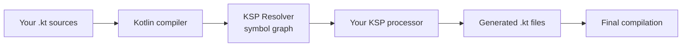

# KSP — Kotlin Symbol Processing

> KSP is the Kotlin-native replacement for KAPT. It's 2× faster, supports incremental compilation, understands Kotlin idioms (sealed classes, extension functions, nullability) that KAPT had to fake via Java stubs, and is the modern path for every annotation-processed library in Android. Staff-level mastery is knowing what KSP does at the compiler level, why it's structurally faster than KAPT, when to write a custom KSP processor, and how to migrate a legacy KAPT pipeline.

---

## What KSP Is

KSP (Kotlin Symbol Processing) is a Kotlin compiler plugin API for inspecting and generating code from Kotlin source at compile time.

The model:
1. Your code is parsed.
2. Your KSP processor receives a `Resolver` with access to the symbol graph (classes, functions, parameters, annotations).
3. Your processor reads symbols, generates new `.kt` files, returns them.
4. The compiler picks up the generated files and compiles them with the rest of your code.

This is how Hilt, Room, Moshi, Dagger, and dozens of other libraries generate the code your app actually runs.



You write the processor (or use a published one); KSP supplies the symbol API and the build integration.

---

## KSP vs KAPT — Why Migrate

KAPT (Kotlin Annotation Processing Tool) was the original way to use Java-style `javax.annotation.processing` from Kotlin.

| Property | KAPT | KSP |
|---|---|---|
| **Language** | Java annotation processing on Kotlin code | Kotlin-native API |
| **Pre-step** | Generates Java stubs from Kotlin source | None — operates directly on Kotlin symbols |
| **Kotlin idioms** | Lost (default args, sealed classes, etc. invisible) | Preserved |
| **Speed** | Baseline | ~2× faster |
| **Incremental** | Broken in many edge cases | First-class |
| **Multiplatform** | JVM only | KMP-ready |
| **Adoption** | Mature ecosystem but maintenance-oriented | Preferred for new Kotlin-aware processors |

The KAPT stub-generation step is the killer: KAPT must produce Java stubs that approximate your Kotlin source, then a Java-based annotation processor reads them. This means:
- A 50ms KAPT step turns into a 200ms KAPT step in larger modules.
- Edge cases (extension functions on inline classes, sealed hierarchies) generate stubs that mislead processors.
- Incremental compilation breaks more often.

KSP skips stub generation entirely. The Kotlin compiler exposes its own symbol resolution; KSP processors read symbols directly. Faster, more accurate, incremental.

**Migration is usually worthwhile when every required processor supports the features you use.** Verify each processor's current KSP support and incremental behavior; mixed KAPT/KSP builds can erase some of the speed benefit.

---

## Library Support Matrix

| Library | KAPT | KSP |
|---|---|---|
| Hilt | Supported, but legacy for new pipelines | Supported; verify current Dagger/Hilt limitations before migration |
| Dagger 2 | Supported, but legacy for new pipelines | Supported; verify current processor limitations |
| Room | Yes (legacy) | 2.5+ (stable) |
| Moshi | Yes (legacy) | 1.13+ (stable) |
| Glide | Yes (legacy) | Beta / Glide Compose recommended over Glide-KSP |
| Coil (compose) | n/a | Native Kotlin (no codegen) |
| Lifecycle (sources annotation processor) | n/a | n/a |
| Kotlin Symbol Processing itself | n/a | yes |

Library support is not uniform and changes independently of KSP itself. Check each processor's current documentation and test generated output before removing KAPT; do not infer compatibility from vendor or ecosystem membership.

---

## Enabling KSP in Gradle

```kotlin
// build.gradle.kts (root)
plugins {
    id("com.google.devtools.ksp") version "2.3.10" apply false
}

// :feature:cart:impl/build.gradle.kts
plugins {
    id("yourorg.android.library")
    id("com.google.devtools.ksp")
}

dependencies {
    implementation("com.google.dagger:hilt-android:<current-version>")
    ksp("com.google.dagger:hilt-android-compiler:<current-version>")

    implementation("androidx.room:room-runtime:<current-version>")
    ksp("androidx.room:room-compiler:<current-version>")  // was: kapt(...)

    implementation("com.squareup.moshi:moshi-kotlin:<current-version>")
    ksp("com.squareup.moshi:moshi-kotlin-codegen:<current-version>")
}
```

The mechanical change starts with `kapt(...)` → `ksp(...)`, but a production migration must also verify processor feature parity, generated ABI, incremental behavior, tests, and AGP compatibility.

Since KSP 2.3, the plugin uses its own version sequence rather than the old `<kotlin-version>-<ksp-version>` format. KSP2 is not a Kotlin compiler plugin and has a looser compiler dependency, but you must still check its release notes for supported Kotlin, AGP, and Gradle combinations. Check [KSP releases](https://github.com/google/ksp/releases) rather than constructing a version string.

---

## How KSP Sees Your Code

Given:

```kotlin
@JsonClass(generateAdapter = true)
data class User(
    val id: String,
    val name: String,
    val age: Int? = null,
)
```

A KSP processor receives a `KSClassDeclaration` for `User`. From it:

```kotlin
class UserProcessor : SymbolProcessor {
    override fun process(resolver: Resolver): List<KSAnnotated> {
        val symbols = resolver.getSymbolsWithAnnotation("com.squareup.moshi.JsonClass")
        symbols.filterIsInstance<KSClassDeclaration>().forEach { cls ->
            val name = cls.simpleName.asString()
            val pkg = cls.packageName.asString()
            val props = cls.getDeclaredProperties().toList()
            
            // Each property tells you:
            // - simpleName
            // - type (a KSType, with nullability + generics resolved)
            // - hasDefaultValue
            // - annotations
            
            // Generate adapter source...
            generateAdapter(cls, props)
        }
        return emptyList()
    }
}
```

The key APIs:

| API | Returns |
|---|---|
| `Resolver.getSymbolsWithAnnotation(fqn)` | All symbols annotated with the given FQN |
| `KSClassDeclaration.getDeclaredProperties()` | The properties on the class |
| `KSPropertyDeclaration.type` | The property's KSType (resolves nullability + generics) |
| `KSType.declaration` | The declaration of the type (class, type alias, etc.) |
| `KSValueParameter.hasDefault` | Whether the parameter has a default value (KAPT loses this!) |
| `Resolver.builtIns.intType` | Access to Kotlin built-in types |

The symbol graph preserves Kotlin-specific information: default arguments, sealed hierarchies, suspending functions, extension functions, inline classes, generic variance. KAPT erases most of this.

---

## Writing a Custom KSP Processor

A typical processor module structure:

```
ksp-processor/
  build.gradle.kts
  src/main/kotlin/
    com/example/MyProcessor.kt
    com/example/MyProcessorProvider.kt
  src/main/resources/META-INF/services/
    com.google.devtools.ksp.processing.SymbolProcessorProvider
```

`build.gradle.kts`:

```kotlin
plugins {
    `java-library`
    kotlin("jvm")
}

dependencies {
    implementation("com.google.devtools.ksp:symbol-processing-api:2.3.10")
    implementation("com.squareup:kotlinpoet:1.16.0")
    implementation("com.squareup:kotlinpoet-ksp:1.16.0")
}
```

Processor + provider:

```kotlin
class MyProcessor(
    private val codeGenerator: CodeGenerator,
    private val logger: KSPLogger,
) : SymbolProcessor {

    override fun process(resolver: Resolver): List<KSAnnotated> {
        val symbols = resolver
            .getSymbolsWithAnnotation("com.example.GenerateBuilder")
            .filterIsInstance<KSClassDeclaration>()
            .filter { it.validate() }

        symbols.forEach { cls ->
            generateBuilder(cls)
        }
        return emptyList()
    }

    private fun generateBuilder(cls: KSClassDeclaration) {
        val pkg = cls.packageName.asString()
        val name = cls.simpleName.asString()
        val builderName = "${name}Builder"

        val fileSpec = FileSpec.builder(pkg, builderName)
            .addType(
                TypeSpec.classBuilder(builderName)
                    // ... KotlinPoet emits a builder class ...
                    .build()
            )
            .build()

        fileSpec.writeTo(codeGenerator, Dependencies(aggregating = false, cls.containingFile!!))
    }
}

class MyProcessorProvider : SymbolProcessorProvider {
    override fun create(environment: SymbolProcessorEnvironment): SymbolProcessor =
        MyProcessor(environment.codeGenerator, environment.logger)
}
```

Service file `META-INF/services/com.google.devtools.ksp.processing.SymbolProcessorProvider`:

```
com.example.MyProcessorProvider
```

Consumed by the app module:

```kotlin
// app/build.gradle.kts
dependencies {
    implementation(project(":generate-annotation"))     // contains @GenerateBuilder
    ksp(project(":ksp-processor"))                       // the processor itself
}
```

KSP picks up the processor via the service file at compile time; generated files appear under `build/generated/ksp/<variant>/kotlin/`.

### Use KotlinPoet for code generation

Hand-writing Kotlin via string templates fails on edge cases (escaping, generics, nullability). [KotlinPoet](https://square.github.io/kotlinpoet/) gives you a typed builder. Pair with `kotlinpoet-ksp` for direct interop with KSP types (`ClassName.from(ksClassDeclaration)`).

---

## Incremental Compilation

KSP supports two modes:

| Mode | Behavior |
|---|---|
| **Aggregating** | Processor reads symbols across the whole module; any source change re-runs it |
| **Isolating** | Processor reads only the annotated symbol and its declaration; only re-runs when that symbol changes |

The `Dependencies(aggregating, sources)` you pass to `writeTo` declares the dependency graph. Aggregating is safer; isolating is faster.

```kotlin
// Isolating — recompiles only if cls.containingFile changes
fileSpec.writeTo(codeGenerator, Dependencies(false, cls.containingFile!!))

// Aggregating — recompiles on any source change
fileSpec.writeTo(codeGenerator, Dependencies(true, *sources.toTypedArray()))
```

Hilt uses aggregating (it reads the whole dependency graph). Room and Moshi use isolating per `@Entity` / `@JsonClass`.

For a custom processor: prefer isolating unless your generator inherently depends on cross-class information (e.g., generating a registry of all `@RegisterMe` types).

---

## Validation and Multi-Round Processing

KSP can run multiple "rounds" of processing — if your processor depends on symbols that don't exist until another processor generates them.

```kotlin
override fun process(resolver: Resolver): List<KSAnnotated> {
    val symbols = resolver.getSymbolsWithAnnotation("com.example.Generated")
    val (valid, invalid) = symbols.partition { it.validate() }
    
    valid.forEach { /* process it */ }
    
    return invalid  // ← deferred to next round
}
```

`validate()` returns `false` if the symbol references types that aren't resolved yet (e.g., generated by a sibling processor). Return invalid symbols and KSP re-runs `process` after the next round.

Most app-level processors don't need this. Library authors generating chains of types (annotation → builder → factory → registry) do.

---

## Debugging KSP Processors

### Print to logs

```kotlin
override fun process(resolver: Resolver): List<KSAnnotated> {
    logger.info("Found ${symbols.count()} annotated classes")
    logger.warn("Possible issue with $cls")
    logger.error("Cannot generate for $cls", symbol = cls)
    return emptyList()
}
```

Logs appear in Gradle output. `error` with `symbol` clickable in Android Studio.

### Inspect generated source

```
build/generated/ksp/<variant>/kotlin/
```

Diff against the previous build to see what changed. KSP generates real Kotlin source — readable, debuggable.

### Run a single processor

```bash
./gradlew :app:kspDebugKotlin --info | grep MyProcessor
```

Verbose logging reveals which processors ran and how long they took.

---

## Real Patterns (Library Authors)

### Pattern 1: Registry of annotated types

```kotlin
@Module
@RegisterIntoMap
class FooModule

// Generated:
// object ModuleRegistry { val all = listOf(FooModule, BarModule, ...) }
```

Aggregating processor that scans all `@RegisterIntoMap` classes across modules and generates a single registry file in the `:app` module.

### Pattern 2: Per-class generator (Room-style)

```kotlin
@Entity
data class UserEntity(@PrimaryKey val id: String)

// Generated:
// object UserEntity_Impl {
//   fun bind(stmt: SQLiteStatement, entity: UserEntity) { ... }
// }
```

Isolating processor; one generated file per `@Entity`. Fast incremental compilation.

### Pattern 3: Factory for sealed hierarchies

```kotlin
@PolymorphicFactory
sealed interface Event {
    data class Click(val id: String) : Event
    data class Scroll(val offset: Int) : Event
}

// Generated:
// object EventFactory {
//   fun fromMap(map: Map<String, Any>): Event { ... }
// }
```

Uses KSP's sealed-hierarchy traversal (KAPT couldn't see this cleanly).

### Pattern 4: Suspending function processor

```kotlin
interface Api {
    @GET("/users") suspend fun getUsers(): List<User>
}

// Generated:
// class ApiImpl(private val http: HttpClient) : Api {
//   override suspend fun getUsers(): List<User> = http.get("/users")
// }
```

KSP preserves the `suspend` modifier — Retrofit's older KAPT version had to do additional work to detect this from Java stubs.

---

## Migrating from KAPT — Step-by-Step

For a typical Android project:

1. **Update libraries** to KSP-capable versions:
   ```kotlin
   // libs.versions.toml
   hilt = "2.50"        // 2.48+ supports KSP
   room = "2.6.1"
   moshi = "1.15.0"
   ```

2. **Add KSP plugin**:
   ```kotlin
   plugins {
       id("com.google.devtools.ksp") version "2.3.10" apply false
   }
   ```

3. **Replace `kapt(...)` with `ksp(...)`** in module-level `build.gradle.kts`:
   ```kotlin
   // before
   kapt("com.google.dagger:hilt-android-compiler:2.50")
   // after
   ksp("com.google.dagger:hilt-android-compiler:2.50")
   ```

4. **Apply the KSP plugin per module**:
   ```kotlin
   plugins {
       id("com.android.library")
       id("com.google.devtools.ksp")
   }
   ```

5. **Remove KAPT plugin** (if no other libs need it):
   ```kotlin
   // delete:
   // id("kotlin-kapt")
   ```

6. **Clean + rebuild**:
   ```bash
   ./gradlew clean assembleDebug
   ```

7. **Profile**:
   ```bash
   ./gradlew assembleDebug --scan
   ```
   Verify the KAPT step is gone; KSP step is significantly faster.

Expected savings: 20–40% on cold builds in a large project. Sometimes more if KAPT was triggering full recompilations.

---

## Failure Modes

| Symptom | Cause | Fix |
|---|---|---|
| Build error "annotation processor not found" after KSP migration | Forgot to apply the KSP plugin to the module | `id("com.google.devtools.ksp")` per module |
| Generated code missing | Processor failed silently | Check Gradle output for `e:` and `w:` lines from KSP |
| Generated code references unresolved types | Annotation processing order issue (rare with KSP) | Use multi-round processing; return invalid symbols |
| KSP compatibility error | Unsupported Kotlin/AGP/KSP combination | Read KSP release notes; do not construct a compiler-prefixed version |
| Build slower after KSP migration | Processor configured as aggregating but didn't need to be | Switch to isolating mode where possible |
| `kotlinpoet-ksp` import not found | Missing dep in the processor module | Add `implementation("com.squareup:kotlinpoet-ksp:1.16.0")` |
| Service file not picked up | `META-INF/services/...` path wrong or class name typo | Path must be `META-INF/services/com.google.devtools.ksp.processing.SymbolProcessorProvider` |
| Generated files not visible in IDE | Indexing didn't pick them up | Build → Sync Project; sometimes Invalidate Caches |
| Custom processor works locally, fails in CI | Stale plugin cache | Add `--no-build-cache --rerun-tasks` to test |
| KSP claims symbol invalid every round | Bug in `validate()` logic | Audit the symbol graph manually; log what fails |
| Multi-module project: one module fails to find generated code | KSP-generated source not on consumer's classpath | The processor's `Dependencies` must include the right sources |
| App startup crashes after migration: NoClassDefFoundError | R8 stripped a generated class | Add `consumerProguardFiles` rules for the processor's outputs |
| Generated code uses experimental Kotlin features | Opt-in not propagated | Add `@OptIn(...)` or `freeCompilerArgs += "-Xopt-in=..."` |
| Multiple KSP versions in resolved graph | Different libs pull different KSP versions | Force a single version via Gradle `resolutionStrategy` |
| Build error "Type parameter 'T' has dropped resolution" | Working with generic types incorrectly | Use `KSType.declaration` carefully; consult [KSP docs] for generic handling |

---

## Common Pitfalls

- **Migrating without testing.** Hilt + Room migrations are mostly seamless; specialty libraries (Moshi with sealed types, Retrofit codegen) sometimes have edge cases. Run the full test suite.
- **Aggregating when isolating works.** Aggregating is the "safe default" but it kills incremental builds. Tune per processor.
- **Custom processor with bad `validate()` logic.** Returns invalid symbols every round → KSP loops forever (build hangs).
- **Forgetting `Dependencies`.** Every generated file must declare its dependencies so KSP knows when to re-run.
- **Hand-rolling string concatenation.** Use KotlinPoet. The generated code will be clean, formatted, and won't break on edge cases.
- **No `consumerProguardFiles` for generated code.** Reflection-using generated code (rare) might be stripped by R8.
- **Assuming KSP versions still mirror Kotlin versions.** That scheme ended with KSP 2.3. Read the KSP release compatibility notes and test the full Kotlin/AGP/processor combination.
- **Treating KSP as a black box.** Inspect `build/generated/ksp/`. The source is human-readable.

---

## Probing Questions

1. KSP vs KAPT — what's the architectural difference? Why is KSP faster?
2. Walk through what happens at compile time when KSP processes a `@JsonClass(generateAdapter = true)` annotation on a Kotlin data class.
3. What is "aggregating" vs "isolating" in KSP terms? Give an example processor of each kind.
4. Write a minimal KSP processor that generates a `Builder` class for every `@GenerateBuilder`-annotated data class. What APIs do you call?
5. Multi-round processing — when is it needed?
6. Migrate a project from KAPT to KSP. List the steps and what to verify after.
7. A KSP processor compiles fine in IntelliJ but fails on CI. What are the likely causes?
8. KAPT generates Java stubs from Kotlin source. Why is this fundamentally inferior to KSP's approach?
9. Why does Hilt use aggregating but Room uses isolating?
10. You see a KSP compatibility error. Walk through checking the independent KSP release, Kotlin, AGP, Gradle, and processor versions.
11. KotlinPoet vs hand-written string templates for code generation — when does the difference matter?
12. KSP's `validate()` — what does it check, and what happens if you misuse it?

---

## Answer Key

1. KAPT compiles Kotlin-shaped Java stubs for annotation processors; KSP exposes Kotlin symbols directly, avoiding stub generation and preserving Kotlin semantics.
2. The resolver exposes the annotated declaration, Moshi's processor validates its shape, models properties/types, and emits an adapter source that a later compilation round compiles.
3. Isolating output depends on one source and can be invalidated narrowly; aggregating output depends on many symbols and invalidates more broadly. Room entity adapters are typically isolating, while a registry over all bindings is aggregating.
4. Register a `SymbolProcessorProvider`, query `getSymbolsWithAnnotation`, filter/validate class declarations, inspect constructor properties, build output with KotlinPoet, and create it through `CodeGenerator` with accurate dependencies.
5. Defer a symbol when one of its referenced generated types is not available yet; KSP invokes another round after new files appear.
6. Apply KSP, replace supported `kapt` configurations, remove KAPT when unused, align current plugin/processor releases, clean-build, inspect generated sources, and run incremental/CI/release builds.
7. Check JDK and Gradle parity, case-sensitive paths, committed generated-code assumptions, dependency resolution, cache poisoning, version alignment, and processor nondeterminism.
8. Stubs lose or approximate Kotlin-only concepts and add a compilation phase. Direct symbols provide nullability, declarations, and types without pretending Kotlin is Java.
9. Hilt must assemble bindings/components across declarations, while Room can generate much of its output from an individual DAO/entity. Actual incrementality depends on the processor version and feature used.
10. Treat KSP 2.3+ as independently versioned: consult its compatibility notes, then verify the Kotlin compiler, AGP/Gradle/JDK matrix and each processor's declared support.
11. Typed builders matter once names, escaping, generics, nullability, annotations, or imports become nontrivial; string output is acceptable only for tightly controlled trivial files.
12. `validate()` checks whether referenced declarations are resolvable in the current round. Return unresolved symbols for a later round; generating from invalid symbols causes incomplete or nondeterministic output.

---

## Further Reading

- [`convention-plugins.md`](convention-plugins.md) — applying KSP from `build-logic`.
- [`multi-module.md`](multi-module.md) — KSP per-module application.
- [`gradle-and-build-systems.md`](gradle-and-build-systems.md) — broader Gradle context.
- [`../data-and-di/hilt-vs-koin-vs-manual-di.md`](../data-and-di/hilt-vs-koin-vs-manual-di.md) — Hilt's KSP migration path.
- [`../data-and-di/room-vs-datastore.md`](../data-and-di/room-vs-datastore.md) — Room's KSP usage.
- [`../../platform-engineering/build-graph-scaling.md`](../../platform-engineering/build-graph-scaling.md) — KAPT → KSP build time savings.
- [`../../kotlin/compiler-features/inline-functions.md`](../../kotlin/compiler-features/inline-functions.md) — `reified` types KSP processors can preserve.
- [`../../kotlin/type-system/generics.md`](../../kotlin/type-system/generics.md) — generic type representation.
- [KSP — Google official docs](https://kotlinlang.org/docs/ksp-overview.html) — overview.
- [KSP GitHub releases](https://github.com/google/ksp/releases) — version matrix.
- [KSP migration guide](https://kotlinlang.org/docs/ksp-kapt-migration.html) — current standalone plugin example.
- [KotlinPoet](https://square.github.io/kotlinpoet/) — code generation library.
- [Migrating from KAPT to KSP](https://developer.android.com/build/migrate-to-ksp) — Android Developers guide.
