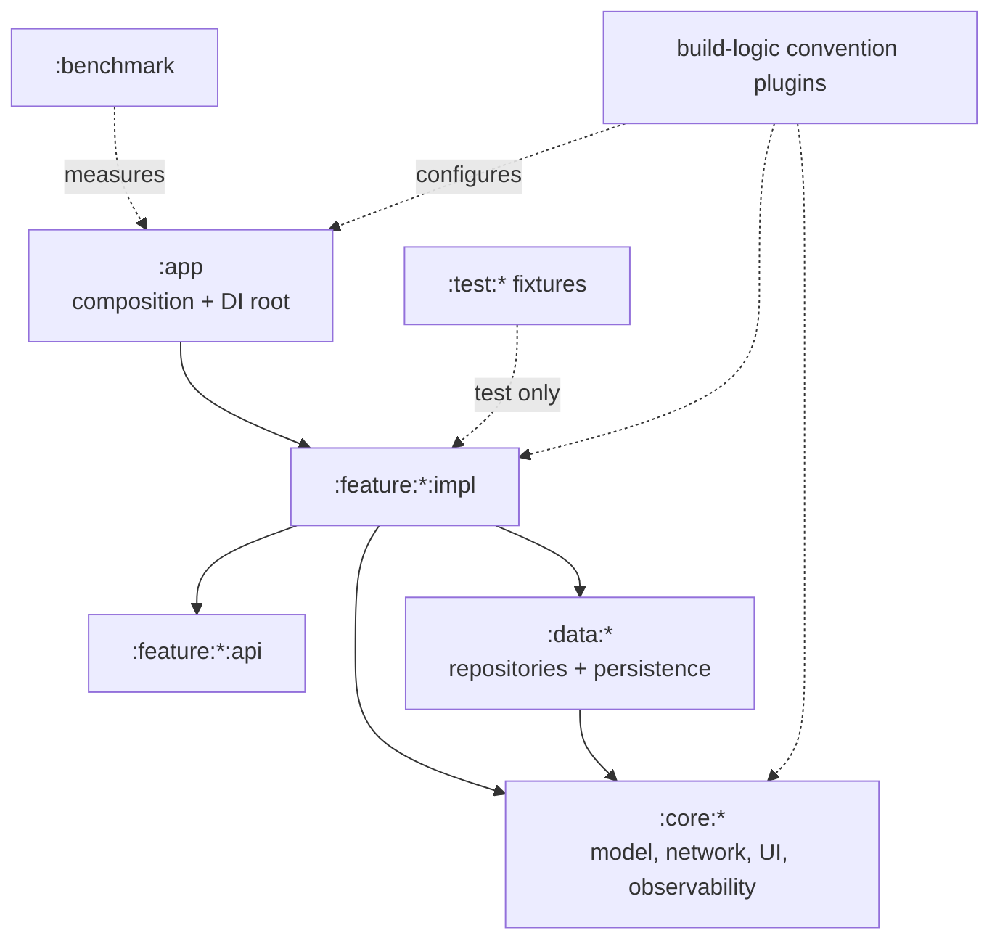

# Multi-Module Android — Project Structure at Scale

> A modern Android codebase isn't an app; it's a constellation of modules. Staff-level mastery is knowing the canonical taxonomy (`:app`, `:feature:*:api/impl`, `:core`, `:data`, `:test:fixtures`), how Gradle's variant-aware dependency model resolves cross-module deps, when Dynamic Feature modules are a fit, and how to keep the build fast as the graph grows past 200 nodes.

---

## Companion Reading

This file is the **practical operational guide** to multi-module Android. Three deeper companion files:

- **[`../architecture/modularization-strategies.md`](../architecture/modularization-strategies.md)** — the theoretical decision framework (horizontal vs vertical slicing, when each fails).
- **[`../../platform-engineering/build-graph-scaling.md`](../../platform-engineering/build-graph-scaling.md)** — build-time perf engineering.
- **[`convention-plugins.md`](convention-plugins.md)** — `build-logic/` as the implementation layer.

If you haven't read modularization-strategies.md yet, start there.

---

## The Canonical Taxonomy

A mature Android project ends up with this shape:



Module direction matters more than the folder tree: the app composes features, implementations depend on narrow APIs and shared capabilities, and build logic configures modules without entering the runtime graph.

Every Android module's `build.gradle.kts` then looks like:

```kotlin
plugins {
    id("yourorg.android.feature")          // applies library + Hilt + Compose
}

android.namespace = "com.example.feature.cart.impl"

dependencies {
    implementation(project(":feature:cart:api"))
    implementation(project(":core:design-system"))
    implementation(project(":core:network"))
    implementation(project(":data:cart"))
}
```

Ten lines instead of fifty. Convention plugin does the heavy lifting.

---

## Module Type Quick Reference

| Module type | Path | Depends on | Purpose | Apply plugin |
|---|---|---|---|---|
| App | `:app` | every `:impl`, every `:core`, every `:data` | Application class, root nav, DI graph | `yourorg.android.application` |
| Feature API | `:feature:X:api` | `:core:model` only | Public interfaces, sealed states | `yourorg.kotlin.library` (pure Kotlin if possible) |
| Feature Impl | `:feature:X:impl` | own `:api`, other `:api`s, `:core:*`, `:data:*` | ViewModels, Composables, Hilt module | `yourorg.android.feature` |
| Core model | `:core:model` | nothing | Pure-Kotlin types | `yourorg.kotlin.library` |
| Core utility | `:core:common`, `:core:logging`, etc. | `:core:model` | Shared helpers | `yourorg.kotlin.library` or `yourorg.android.library` |
| Core UI | `:core:design-system` | `:core:model` | Compose tokens + components | `yourorg.android.library` + Compose |
| Data layer | `:data:auth`, `:data:cart`, etc. | `:core:*`, `:core:network` | Repositories, DTOs, Room DAOs | `yourorg.android.library` + Hilt |
| Test fixtures | `:test:fixtures` | `:feature:*:api`, `:core:*` | Shared fakes (NOT `:impl`) | `yourorg.kotlin.library` |
| Build logic | `build-logic/convention` | n/a | Gradle plugins | `kotlin-dsl` |
| Benchmark | `:benchmark` | `:app` | Macrobenchmark tests | `yourorg.android.benchmark` |

The rule when adding a new module: **what row are you?** If none fits, push back. The taxonomy should be exhaustive.

### Module creation review

New modules are cheap to create and expensive to own forever. Require a short review before adding one.

| Question | Expected answer |
|---|---|
| What boundary does this module enforce? | Feature API, feature impl, data, core, test, benchmark, or dynamic delivery |
| Who owns it? | A team, not "platform" by default |
| What can depend on it? | Explicit allowed consumers |
| Does it expose `api` dependencies? | Only if its public ABI needs them |
| What is the build impact? | Expected affected-module count for common edits |
| Is it regular library or dynamic feature? | Dynamic only for install-time/on-demand/conditional delivery reasons |

If the answer is "we want cleaner folders," use packages. If the answer is "we need a compile-time ownership boundary," use a module.

---

## Variant-Aware Dependencies

Modern AGP uses **variant-aware dependency resolution**: when `:app` (debug variant) depends on `:feature:cart:impl`, AGP resolves to that module's `debug` variant.

```kotlin
android.buildTypes {
    debug { /* ... */ }
    release { /* ... */ }
    benchmark {
        initWith(buildTypes.release)        // benchmark = release + tweaks
        signingConfig = signingConfigs["debug"]
    }
}
```

The `benchmark` variant inherits release's compilation but uses debug signing — perfect for performance testing.

When a feature module's `benchmark` variant is missing, AGP "falls back" to a matching variant:

```kotlin
android.buildTypes {
    benchmark {
        matchingFallbacks += listOf("release")   // borrow release config from libs
    }
}
```

Without `matchingFallbacks`, you get cryptic "no matching variant" errors.

---

## Gradle Settings — Project Inclusion

`settings.gradle.kts`:

```kotlin
pluginManagement {
    includeBuild("build-logic")
    repositories {
        google()
        mavenCentral()
        gradlePluginPortal()
    }
}

@Suppress("UnstableApiUsage")
dependencyResolutionManagement {
    repositoriesMode.set(RepositoriesMode.FAIL_ON_PROJECT_REPOS)
    repositories {
        google()
        mavenCentral()
    }
}

rootProject.name = "yourapp"
enableFeaturePreview("TYPESAFE_PROJECT_ACCESSORS")

include(":app")

include(":feature:cart:api", ":feature:cart:impl")
include(":feature:checkout:api", ":feature:checkout:impl")
include(":feature:profile:api", ":feature:profile:impl")

include(":core:model")
include(":core:common")
include(":core:design-system")
include(":core:network")
include(":core:analytics")
include(":core:logging")

include(":data:auth")
include(":data:cart")
include(":data:catalog")

include(":test:fixtures")
include(":test:utils")

include(":benchmark")
```

### Type-safe project accessors

`enableFeaturePreview("TYPESAFE_PROJECT_ACCESSORS")` lets you reference projects via generated DSL:

```kotlin
dependencies {
    implementation(projects.feature.cart.api)            // instead of project(":feature:cart:api")
    implementation(projects.core.designSystem)
}
```

Slight ergonomic improvement; refactors propagate via the IDE. Still a feature preview but stable in Gradle 8+.

---

## Dynamic Feature Modules — When and When Not

Dynamic Features split the app into pieces deliverable via Play Feature Delivery:

```kotlin
// :feature:reviewer/build.gradle.kts
plugins { id("com.android.dynamic-feature") }

android {
    namespace = "com.example.reviewer"
    dynamicFeature {
        // ...
    }
}
```

```kotlin
// :app/build.gradle.kts
android {
    dynamicFeatures += setOf(":feature:reviewer")
}
```

### Use cases

| Scenario | Fit |
|---|---|
| AR feature used by 5% of users (50 MB native libs) | ✅ Strong fit |
| Onboarding tutorial (mostly install-time only) | ✅ Good fit |
| Region-specific feature (only India / only US) | ✅ Conditional install |
| Instant-app entry point | ✅ Required |
| Every screen, "to reduce APK size" | ❌ Over-engineering; complexity > benefit |
| Per-team modular ownership | ❌ Use regular modules + module-owner code reviews |
| Faster startup | ❌ Doesn't help — APK size and startup time are mostly decoupled |

### Why most apps don't need them

- Hilt DI across the dynamic boundary requires extra work (`EntryPointAccessors`).
- Navigation routing between dynamic modules is manual.
- QA matrix doubles (pre-install + post-install behavior).
- Crashes attribution becomes harder (rollbacks per module).
- AABs (App Bundle) already deliver APK splits by ABI/density/locale — the APK size win is usually already realized.

For a "normal" multi-module Android project, **use regular Android library modules**. Reach for dynamic features only when the install-time / region / instant-app reasons explicitly apply.

---

## Build Performance at Module Scale

A 200-module project where every change rebuilds 50 modules is **wrong**. A change should ideally rebuild ≤ 5 modules.

Tools to verify:

### 1. Affected module detection

```bash
./gradlew :app:projectDependencyGraph
```

(Requires the `dependency-graph-generator` plugin.)

Outputs a Mermaid/DOT graph. Look for:
- **`:core:common` at the root** with hundreds of consumers — every change to it rebuilds everything.
- **Circular dependencies** — Gradle catches them, but they indicate design problems.
- **Diamond dependencies** — multiple `:impl` modules depending on overlapping `:core:*` chains.

### 2. Build time profiling

```bash
./gradlew :app:assembleDebug --scan
```

(Or use Develocity for CI builds.) Look for:
- Long-running tasks per module.
- Cache hit rate.
- Configuration phase duration.

### 3. Module-level metrics

```bash
./gradlew :feature:cart:impl:dependencyInsight --dependency androidx.compose
```

Shows the exact resolution chain. Useful when a transitive lib gets pulled by surprise.

---

## Cross-Module DI — Hilt Patterns

A typical `:impl` module's Hilt setup:

```kotlin
// :feature:cart:impl/.../di/CartModule.kt
@Module
@InstallIn(SingletonComponent::class)
internal interface CartModule {
    @Binds
    fun bindCartRepository(impl: CartRepositoryImpl): CartRepository
}

internal class CartRepositoryImpl @Inject constructor(
    private val api: CartApi,
    private val dao: CartDao,
) : CartRepository {
    /* ... */
}
```

`CartRepository` is declared in `:data:cart` (or `:feature:cart:api`). The implementation is `internal` to `:feature:cart:impl`. No other module can construct it directly.

App-level `Hilt` walks the classpath and merges all `@Module`s automatically. As long as a module is on the classpath, Hilt sees its bindings.

---

## Cross-Module Navigation — Type-Safe Routes

```kotlin
// :feature:cart:api/Routes.kt
@Serializable
data object CartRoute

// :feature:cart:impl/CartGraph.kt
fun NavGraphBuilder.cartGraph(navController: NavController) {
    composable<CartRoute> {
        CartScreen(
            onCheckoutClick = { navController.navigate(CheckoutRoute) }
        )
    }
}

// :app/NavHost.kt
NavHost(navController, startDestination = HomeRoute) {
    homeGraph(navController)
    cartGraph(navController)
    checkoutGraph(navController)
    profileGraph(navController)
}
```

The `Route` objects live in `:api` modules. Each `:impl` exposes a `NavGraphBuilder` extension to wire its screens. `:app` composes them.

Result: no string-based routes. Refactoring a route is a typed compile error across the graph. Deep links can be derived from the route type.

---

## Test Modules — Sharing Across Features

```kotlin
// :test:fixtures/build.gradle.kts
plugins {
    id("yourorg.kotlin.library")
}

dependencies {
    implementation(projects.feature.cart.api)       // OK — depends on :api
    implementation(projects.feature.profile.api)
    implementation(projects.core.model)
    // NOT projects.feature.cart.impl              // wrong; would break encapsulation
}
```

```kotlin
// :test:fixtures/src/main/kotlin/.../FakeCartRepository.kt
class FakeCartRepository(
    initialItems: List<CartItem> = emptyList(),
) : CartRepository {
    private val items = MutableStateFlow(initialItems)
    override fun observeCart(): Flow<List<CartItem>> = items
    override suspend fun addItem(item: CartItem) {
        items.update { it + item }
    }
}
```

Consumer feature:

```kotlin
// :feature:cart:impl/build.gradle.kts
dependencies {
    testImplementation(projects.test.fixtures)
}
```

The fake is reusable across all features that test against `CartRepository`.

---

## Module Naming Conventions

Pick a convention and enforce it:

- **Kebab case for paths:** `:core:design-system`, not `:core:designSystem` (Gradle prefers kebab).
- **Singular vs plural:** `:feature:cart` (singular per feature), `:data:cart` (singular per data domain).
- **API/Impl split:** `:feature:cart:api` + `:feature:cart:impl` (kebab-cased).
- **Namespaces:** match the path. `:core:design-system` → `com.example.core.designsystem`.

The pattern matters less than the consistency. Codify in `build-logic` conventions.

---

## Module-Level Lint and Detekt

Convention plugins can apply Lint per module:

```kotlin
class LintConventionPlugin : Plugin<Project> {
    override fun apply(target: Project) = with(target) {
        with(pluginManager) {
            apply("io.gitlab.arturbosch.detekt")
        }

        val extension = target.extensions.findByType<LibraryExtension>()
        extension?.lint {
            warningsAsErrors = true
            checkReleaseBuilds = true
            baseline = file("lint-baseline.xml")
            disable += "GradleDependency"
        }
    }
}
```

Each module gets its own `lint-baseline.xml`. New violations fail the build; old ones are baselined. CI runs `./gradlew lint detekt`.

---

## Module-Level Performance — When `:app` Becomes Heavy

Even with modularization, `:app` can become slow if:

- It contains all the Hilt `@Module`s consolidating cross-module bindings.
- It depends on every `:impl` module (it must, to wire the app).
- It bundles Baseline Profiles, Macrobenchmark, R8 rules.

Mitigations:
- Move common test/lint config into convention plugins (lighter `:app`).
- Use `:app` only for Application + Navigation; everything else goes to `:impl`.
- Generate baseline profiles in a dedicated `:benchmark` module that publishes to `:app`.

A well-shaped `:app` is *small*: 5–15 Kotlin files, all about wiring.

---

## Failure Modes

| Symptom | Cause | Fix |
|---|---|---|
| Circular dependency error | A `:impl` depends on another `:impl` (not `:api`) | Refactor to `:api` only |
| Build time regression after adding a module | New module pulled into `:core:*`'s consumers | Audit; consider splitting `:core` |
| Hilt fails: `[MissingBinding]` after adding new feature | Forgot to wire the `@Module` into `SingletonComponent` | Verify `@InstallIn` |
| Variant "benchmark" not found in `:feature:cart:impl` | Library doesn't declare the variant | Add `matchingFallbacks` |
| Type-safe project accessors not generated | Feature preview not enabled | `enableFeaturePreview("TYPESAFE_PROJECT_ACCESSORS")` |
| Test fixtures can't access feature implementation | Tried to depend on `:impl` | Use `:api` only; or move type to `:api` |
| Dynamic feature module crashes on install | Resources not in dynamic feature | Verify `tools:keep` rules and resource references |
| `./gradlew :app:dependencyGraph` blows up | Plugin not applied | Add `dependency-analysis-gradle-plugin` |
| Build cache hits drop after refactor | Module path changed; cache key includes path | Expected — settles after a few builds |
| One module's lint baseline disagrees with another's | Per-module baseline drift | Standardize via convention plugin |
| Build configuration time > 60s | 200 modules, lots of plugins | Disable unused plugins; lazy task creation |
| Adding a new feature requires 10 file edits | App-level wiring not abstracted | Provide a "feature template" via `yourorg create-module` |
| Compose Compiler metrics output cluttered | Every module emits to same dir | Per-module output dir in convention plugin |
| `:app:assembleDebug` rebuilds all features | One transitive `:core:*` change | Find the consumer; consider isolating |
| Module naming inconsistency | No enforcement | Lint rule or CI check on `:.*:` paths |
| Hilt entry-point conflict between modules | Two modules export same `@EntryPoint` | Namespacing; or consolidate |
| Slow gradle sync on opening project | Too many `apply plugin` calls evaluated eagerly | Convention plugins + lazy wiring |

---

## Common Pitfalls

- **One big `:core` module.** Every change to it rebuilds the world. Split aggressively.
- **Feature module depends on another feature's `:impl`.** Encapsulation broken; rebuilds the world. Always `:api`.
- **`:app` does business logic.** Symptom of modular avoidance; refactor to feature modules.
- **Per-PR module additions without a template.** New modules end up inconsistent. Provide a scaffolder.
- **Test fixtures with logic.** Fakes should be dumb; complex test setup belongs in `:test:utils`.
- **Forgetting `internal` in `:impl`.** Public-by-default leaks the implementation.
- **Module-by-module Lint baselines that drift.** Standardize via convention plugin.
- **Dynamic Feature Modules used "just to reduce APK size."** Not the right tool.
- **No CI check for `:impl → :impl` dependencies.** Manual code review misses these.
- **Variant configurations duplicated per module.** Centralize in convention plugin.

---

## Probing Questions

1. Walk through the taxonomy: where does each module type fit?
2. Why must `:feature:cart:impl` depend on `:feature:profile:api`, not `:feature:profile:impl`?
3. Build-time perf: `./gradlew :app:assembleDebug` takes 6 minutes. Walk through your audit.
4. Dynamic Feature Modules — name three scenarios where they're a good fit and three where they're not.
5. Type-safe project accessors — what do they buy you?
6. Hilt across modules: how do bindings from `:feature:cart:impl` reach the SingletonComponent?
7. Test fixtures: why must they depend on `:api` only?
8. `:app` is doing 70k LOC of logic. What's wrong?
9. A 200-module project has 4s configuration time. What patterns are likely slowing it?
10. New engineer adds `:feature:wishlist` with config different from other features. How do you prevent this?
11. Variant-aware resolution: what's `matchingFallbacks` and when do you need it?
12. Naming convention: `:core:designSystem` or `:core:design-system`? Justify.

---

## Further Reading

- [`ksp.md`](ksp.md) — KSP per-module application.
- [`convention-plugins.md`](convention-plugins.md) — `build-logic/` implementation.
- [`gradle-and-build-systems.md`](gradle-and-build-systems.md) — Gradle fundamentals.
- [`../architecture/modularization-strategies.md`](../architecture/modularization-strategies.md) — slicing theory.
- [`../architecture/navigation.md`](../architecture/navigation.md) — cross-module navigation.
- [`../data-and-di/hilt-vs-koin-vs-manual-di.md`](../data-and-di/hilt-vs-koin-vs-manual-di.md) — DI across modules.
- [`../data-and-di/components.md`](../data-and-di/components.md) — Hilt component lifecycle across modules.
- [`../../platform-engineering/build-graph-scaling.md`](../../platform-engineering/build-graph-scaling.md) — build perf deep dive.
- [`../../platform-engineering/internal-developer-platforms.md`](../../platform-engineering/internal-developer-platforms.md) — modularization as platform.
- [Now in Android (Google sample)](https://github.com/android/nowinandroid) — canonical multi-module Android.
- [Android Developers — Modularize your app](https://developer.android.com/topic/modularization) — official.
- [Cash App — Modular at scale](https://developer.squareup.com/blog/) — practitioner blog.
