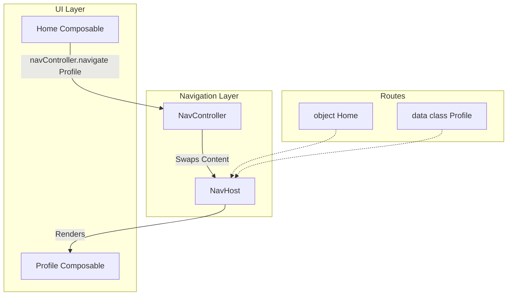

# Compose Navigation — Nav 2 and Nav 3

> Compose Navigation has two supported paradigms. **Navigation Compose 2.x** remains mature and widely deployed: declarative graph, `NavController`, `NavHost`. **Navigation 3** reached stable 1.0 in November 2025 and uses an app-owned back stack rendered by `NavDisplay`. Staff-level mastery is choosing based on architecture and migration cost, not on an obsolete stability label.

---

## Quick Decision Table

| Need | Pick |
|---|---|
| Existing production app working well on Nav 2 | **Stay on Nav 2.x**; migrate only for a concrete benefit |
| Greenfield Compose or KMP project | **Nav 3 stable** |
| Need precise control over back stack (multi-pane, custom scenes) | **Nav 3** |
| Team unfamiliar with Compose's runtime | **Nav 2.8+** (more guard rails) |
| Want least migration churn | Keep the navigation generation already in production |
| Building a fresh Compose app | **Nav 3 stable** unless a required integration is Nav 2-only |

Nav 2 remains supported and common in existing apps. Nav 3 is production-ready, Compose-first, and the better default to evaluate for greenfield Compose applications. Stable does not mean feature-identical: inventory deep links, Hilt integration, adaptive scenes, and third-party navigation tooling before migrating.

---

## The Lineage

- **Pre-2018:** Manual `FragmentTransaction` / `Intent` chaos. No central back-stack model.
- **Navigation Component (XML era):** Jetpack visual graph editor + SafeArgs generation. Stable.
- **Compose Navigation 1.x (string routes):** Pure-Kotlin DSL, but `navigate("details/${id}")` was brittle string-parsing.
- **Navigation Compose 2.8+ (typed routes):** `kotlinx.serialization`-based type-safe routes. The current stable.
- **Navigation 3 1.0 (stable since November 2025):** Compose-first rewrite. `NavController` is replaced by an app-owned back stack rendered by `NavDisplay`; adaptive scenes and KMP runtime support are first-class concerns.

---

# Part 1 — Navigation Compose 2.x (Current Stable)

## First Principles

1. **`NavController`** — central API, holds the back stack, executes navigation commands.
2. **`NavHost`** — the on-screen container that swaps Composables based on `NavController` state.
3. **The Graph (DSL)** — `NavHost { composable<MyRoute> { ... } }` block.
4. **Route** — a `@Serializable` Kotlin `data class` or `object` that identifies a destination.

---

## Mental Model

Think of Nav 2 as a **TV with a Remote Control**.

- **`NavHost`** — the TV screen.
- **Graph** — the channel guide (Channel 1 is News, Channel 2 is Sports).
- **`NavController`** — the remote.
- **Route** — the channel number you punch in.

Press a channel on the remote (`navController.navigate(Sports(gameId = 5))`); the screen swaps from News to Sports.

---

## Defining Routes (Type Safety)

```kotlin
// A screen with no arguments
@Serializable
object Home

// A screen requiring an ID
@Serializable
data class Profile(val userId: String)

// A screen with optional arguments
@Serializable
data class Search(val query: String? = null)
```

---

## Building the Graph

```kotlin
@Composable
fun MyApp() {
    val navController = rememberNavController()

    NavHost(
        navController = navController,
        startDestination = Home,
    ) {
        composable<Home> {
            HomeScreen(
                onNavigateToProfile = { id ->
                    navController.navigate(Profile(userId = id))
                },
            )
        }

        composable<Profile> { backStackEntry ->
            val route: Profile = backStackEntry.toRoute()
            ProfileScreen(userId = route.userId)
        }
    }
}
```

---

## Nested Graphs and Bottom Navigation

```kotlin
@Serializable
object HomeGraph

@Composable
fun MainGraph(navController: NavHostController) {
    NavHost(navController, startDestination = HomeGraph) {
        navigation<HomeGraph>(startDestination = HomeFeed) {
            composable<HomeFeed> { FeedScreen(...) }
            composable<ArticleDetails> { ArticleScreen(...) }
            composable<AuthorProfile> { AuthorScreen(...) }
        }
        composable<SearchTab> { SearchScreen(...) }
        composable<SettingsTab> { SettingsScreen(...) }
    }
}
```

Five screens that belong together → nested graph. Lets you scope shared ViewModels to the graph, set animations per graph, and handle deep links per graph.

---

## Architecture (Nav 2)



---

## Single-Activity vs Multi-Activity

| Approach | Pros | Cons |
|---|---|---|
| Single-Activity (Compose) | Fast navigation; shared UI (e.g., mini-player); easy state sharing | Whole-app OOM kills everything; some deep links need extra plumbing |
| Multi-Activity (Legacy) | Activity boundary = memory boundary; OS can kill non-active Activities | Slow transitions; `TransactionTooLargeException` risk with Intent extras |

Compose strongly encourages Single-Activity. Spawn a second Activity only for cross-app integration (camera, share sheets, OS auth flows).

---

## Nav 2 Failure Modes

| Symptom | Cause | Fix |
|---|---|---|
| ViewModel held for too long | `hiltViewModel()` inside a `composable<X>` scopes to the back-stack entry | If shared across screens, scope to a nested `navigation` graph's parent entry |
| Crash: massive serialized argument | Passed full `User(5MB image data)` as route arg | Pass only IDs; refetch the object in the destination's ViewModel |
| Back button returns to logged-out state | Forgot to clear the back stack on logout | `popUpTo(0) { inclusive = true }` |
| Deep link does nothing | Forgot `deepLinks` block on the `composable<X>` | Add the URI pattern explicitly |
| Animations look janky on Android 12 | `enterTransition`/`exitTransition` not specified | Provide both; framework-default may be jarring |
| Bottom-nav tab reopens fresh on every click | `restoreState`/`saveState` not configured | Use `popUpTo(graph.findStartDestination().id) { saveState = true }` + `restoreState = true` |
| Crash: "Multiple destinations match deep link" | Two routes match same URI pattern | Make URIs distinct or order them by specificity |
| `NavController` passed deep into screens | Tight coupling | Hoist; pass event callbacks instead |
| ViewModel survives across app cold-start (Process Death) | Forgot `SavedStateHandle` for arg restoration | Use `SavedStateHandle.toRoute<Profile>()` in ViewModel |
| `start{ }` lambda errors out: "destination not found" | Used Nav 2.7 syntax with Nav 2.8 type-safety | Update KSP plugin + ensure all destinations are `@Serializable` |

---

# Part 2 — Navigation 3 (The Rewrite)

## The Paradigm Shift

Nav 2 hides the back stack inside `NavController`. You navigate; the framework tracks state.

**Nav 3 inverts this.** The back stack is a `mutableStateListOf<NavKey>()` that **you own**. The framework provides a renderer; you provide the source of truth.

```kotlin
// Nav 2 mental model
navController.navigate(Profile("u_123"))      // framework appends; you don't touch the list
navController.popBackStack()                   // framework pops

// Nav 3 mental model
backStack.add(Profile("u_123"))                // YOU append to the list
backStack.removeLastOrNull()                   // YOU pop
```

The TV analogy gets inverted. **You don't have a remote anymore — you have direct access to the program list.** Push and pop items as you see fit. The screen renders whatever's at the top.

---

## Why This Rewrite

Google's stated motivations for Nav 3 (rough public summary):

1. **KMP friendliness.** `NavController` was Android-coupled. A `mutableStateListOf<NavKey>()` is pure Compose runtime — works on iOS, Desktop, Web.
2. **Multi-pane / adaptive layouts.** Nav 2 assumed single-pane phone flows. Tablets, foldables, and Wear OS need shapes (one detail pane next to a list pane) that Nav 2 awkwardly forced.
3. **Custom transitions / shared elements.** Nav 2's `enterTransition`/`exitTransition` lambdas were limited.
4. **State control.** Nav 2 hid back-stack mutation; some flows (e.g., "swipe to dismiss" with reorder) needed lower-level access.
5. **Lifecycle precision.** Nav 2's `NavBackStackEntry` lifecycle was framework-managed; Nav 3 lets you wire per-entry lifecycles explicitly.

---

## Nav 3 — Hello World

```kotlin
@Serializable
data object Home : NavKey

@Serializable
data class Profile(val userId: String) : NavKey

@Composable
fun MyApp() {
    val backStack = rememberNavBackStack(Home)

    NavDisplay(
        backStack = backStack,
        onBack = { backStack.removeLastOrNull() },
        entryProvider = entryProvider {
            entry<Home> {
                HomeScreen(
                    onNavigateToProfile = { id ->
                        backStack.add(Profile(userId = id))
                    },
                )
            }
            entry<Profile> { profile ->
                ProfileScreen(userId = profile.userId)
            }
        },
    )
}
```

The shift from Nav 2:

| Concept | Nav 2 | Nav 3 |
|---|---|---|
| Back stack | Hidden in `NavController` | `rememberNavBackStack(Home)` returns it |
| Renderer | `NavHost` | `NavDisplay` |
| Entry registration | `composable<Profile> { backStackEntry -> ... }` | `entry<Profile> { profile -> ... }` |
| Navigate | `navController.navigate(Profile("u_123"))` | `backStack.add(Profile("u_123"))` |
| Pop | `navController.popBackStack()` | `backStack.removeLastOrNull()` |
| Pop to | `popUpTo<Home> { inclusive = false }` | `while (backStack.last() != Home) backStack.removeLast()` (or helpers) |
| Clear all | `popUpTo(0) { inclusive = true }` | `backStack.clear(); backStack.add(LoginScreen)` |

You write more code in Nav 3. The trade-off is total control.

---

## Type Safety via `NavKey`

Every back-stack entry implements `NavKey`:

```kotlin
sealed interface AppKey : NavKey

@Serializable data object Home : AppKey
@Serializable data class Profile(val userId: String) : AppKey
@Serializable data class Order(val orderId: String, val tab: Tab = Tab.Details) : AppKey
@Serializable data object Settings : AppKey
```

`NavKey` is a marker. `@Serializable` + `mutableStateListOf` means the back stack survives process death automatically via `rememberSaveable` machinery.

You can keep it sealed (`sealed interface AppKey : NavKey`) for exhaustive `when` over the current entry — a powerful pattern for tracking analytics or applying global styling per screen.

---

## Per-Entry Lifecycle and ViewModel

Nav 3 gives you explicit control over `LifecycleOwner`, `ViewModelStoreOwner`, and `SavedStateRegistryOwner` per entry.

The library ships `rememberSavedStateNavEntryDecorator` and `rememberViewModelStoreNavEntryDecorator` to wire these up for typical use cases:

```kotlin
NavDisplay(
    backStack = backStack,
    onBack = { backStack.removeLastOrNull() },
    entryDecorators = listOf(
        rememberSavedStateNavEntryDecorator(),
        rememberViewModelStoreNavEntryDecorator(),
        rememberSceneSetupNavEntryDecorator(),
    ),
    entryProvider = entryProvider {
        entry<Profile> { profile ->
            val viewModel: ProfileViewModel = viewModel()   // scoped to this entry
            ProfileScreen(viewModel = viewModel)
        }
    },
)
```

Each Nav 3 entry has its own scoped ViewModel store — equivalent to Nav 2's `NavBackStackEntry` behavior, but you can opt out, replace, or extend.

---

## Scenes — Adaptive Layouts in Nav 3

Nav 3's killer feature for tablets and foldables:

```kotlin
NavDisplay(
    backStack = backStack,
    sceneStrategy = rememberListDetailSceneStrategy<AppKey>(),
    entryProvider = entryProvider {
        entry<EmailList>(
            metadata = ListDetailSceneStrategy.listPane(),
        ) { EmailListScreen(/* ... */) }
        entry<EmailDetail>(
            metadata = ListDetailSceneStrategy.detailPane(),
        ) { detail -> EmailDetailScreen(detail.emailId) }
    },
)
```

On phones, the framework shows list, then detail on tap.
On tablets / foldables, it shows list + detail side-by-side.

The same back stack drives both. You don't write two layouts; the scene strategy adapts.

Nav 2 had `androidx.navigation:navigation-compose-adaptive` but it was awkward to compose with custom UI. Nav 3 builds it into the runtime.

---

## Custom Transitions in Nav 3

```kotlin
entry<Profile>(
    metadata = NavDisplay.transitionSpec {
        slideInHorizontally { it } togetherWith slideOutHorizontally { -it }
    },
) { profile ->
    ProfileScreen(profile.userId)
}
```

Specify the `ContentTransform` directly per entry. Compare to Nav 2's lambda-based `enterTransition`/`exitTransition` block syntax — Nav 3 puts the spec next to the destination.

For shared elements, Nav 3 integrates with Compose's `SharedTransitionLayout`:

```kotlin
SharedTransitionLayout {
    NavDisplay(
        backStack = backStack,
        entryProvider = entryProvider {
            entry<ProductList> { ProductListScreen(this@SharedTransitionLayout) }
            entry<ProductDetail> { detail ->
                ProductDetailScreen(detail.productId, this@SharedTransitionLayout)
            }
        },
    )
}
```

---

## Deep Links in Nav 3

Nav 3 takes a different approach: rather than registering deep-link patterns per entry, you parse the URL yourself and translate to a back-stack state.

```kotlin
class MainActivity : ComponentActivity() {
    override fun onCreate(savedInstanceState: Bundle?) {
        super.onCreate(savedInstanceState)
        setContent {
            val backStack = rememberNavBackStack(Home)

            LaunchedEffect(intent) {
                handleDeepLink(intent.data, backStack)
            }

            NavDisplay(backStack = backStack, /* ... */)
        }
    }

    private fun handleDeepLink(uri: Uri?, backStack: SnapshotStateList<NavKey>) {
        val data = uri ?: return
        when {
            data.pathSegments.firstOrNull() == "profile" -> {
                val userId = data.pathSegments.getOrNull(1) ?: return
                backStack.clear()
                backStack.add(Home)
                backStack.add(Profile(userId))
            }
        }
    }
}
```

More code than Nav 2's `deepLinks = listOf(...)`, but you control:
- Which routes the deep link constructs (e.g., synthesize Home + Profile so back works).
- Auth gating (don't push Profile if not signed in).
- Logging and analytics inline.

---

## Nav 2 vs Nav 3 — Side by Side

| Concern | Nav 2.8+ | Nav 3 |
|---|---|---|
| Maturity | Stable and mature | Stable since 1.0.0 (November 2025) |
| Back-stack ownership | Framework | App |
| Source of truth | `NavController` (opaque) | `SnapshotStateList<NavKey>` (transparent) |
| Type safety | `@Serializable` routes | `@Serializable` + `NavKey` marker |
| Multi-pane | Add-on library, awkward | First-class via Scene strategies |
| Custom transitions | Per-call lambda | Per-entry metadata |
| KMP support | Android-only (depends on AndroidX libs) | KMP-friendly (`SnapshotStateList` is `kotlin.runtime`) |
| Deep links | Declarative `deepLinks = [...]` | Imperative parse + back-stack mutation |
| ViewModel scoping | Automatic via NavBackStackEntry | Explicit via decorators |
| Boilerplate | Lower | Higher |
| Production readiness | Existing and greenfield apps | Production-ready; strongest fit for greenfield Compose, adaptive, or KMP work |
| Migration path | Stay on it | Migrate later via incremental adapter |

---

## Migration Strategy (Nav 2 → Nav 3)

Nav 2 → Nav 3 isn't a quick rename. The mental model changes. Plan a phased approach:

**Phase 1 — Inventory.** Catalog every route. Capture deep-link URIs and arguments. Note nested graphs and shared ViewModels.

**Phase 2 — Map routes to NavKeys.** Each `@Serializable` route becomes a `NavKey`-implementing `data class`/`object`. Keep them in a `sealed interface` for cohesion.

**Phase 3 — Run both in parallel.** Wrap Nav 3 inside a Nav 2 `composable<X> { Nav3Adapter() }` block for new screens; keep existing screens on Nav 2. Migrate one screen flow at a time.

**Phase 4 — Replace top-level NavHost.** Switch the app root from `NavHost` to `NavDisplay`. Convert nested graphs into stack manipulation patterns.

**Phase 5 — Remove Nav 2 deps.** When the last `composable<X>` is gone.

Realistic timeline: a small app (10 screens) in 1 week; a 50-screen app in 1–2 months. The risk is non-zero; don't migrate without a clear reason (KMP, multi-pane, control needs).

---

## When To Pick Each

### Stay on Nav 2.8+ if

- Single-platform Android app.
- Phone-only target (no tablet/foldable adaptive layouts needed).
- Team productive on Nav 2; no specific friction.
- A required library or internal platform integration supports Nav 2 only.
- Migration cost > expected benefit.

### Adopt Nav 3 if

- KMP project (Nav 2 can't compile to iOS).
- Multi-pane / foldable / Wear OS is core UX.
- You're hitting Nav 2's limitations (custom back behavior, shared elements with state).
- Greenfield Compose app that benefits from app-owned navigation state.
- Team has Compose runtime depth (you'll work closer to the metal).

---

## Real Patterns

### Pattern 1 — Bottom navigation with state preservation (Nav 2)

```kotlin
@Composable
fun MainScreen() {
    val navController = rememberNavController()
    val current by navController.currentBackStackEntryAsState()
    val currentRoute = current?.destination?.route

    Scaffold(
        bottomBar = {
            NavigationBar {
                topLevelRoutes.forEach { route ->
                    NavigationBarItem(
                        selected = currentRoute == route.id,
                        onClick = {
                            navController.navigate(route.key) {
                                popUpTo(navController.graph.findStartDestination().id) {
                                    saveState = true
                                }
                                launchSingleTop = true
                                restoreState = true
                            }
                        },
                        icon = { Icon(route.icon, null) },
                        label = { Text(route.label) },
                    )
                }
            }
        },
    ) { padding ->
        NavHost(
            navController = navController,
            startDestination = Home,
            modifier = Modifier.padding(padding),
        ) {
            composable<Home> { HomeScreen() }
            composable<Search> { SearchScreen() }
            composable<Profile> { ProfileScreen() }
        }
    }
}
```

`saveState = true` + `restoreState = true` is what makes tabs restore their scroll position and ViewModel state.

### Pattern 2 — Nav 3 with multi-pane email

```kotlin
@Serializable sealed interface EmailKey : NavKey
@Serializable data object Inbox : EmailKey
@Serializable data class EmailDetail(val emailId: String) : EmailKey

@Composable
fun EmailApp() {
    val backStack = rememberNavBackStack(Inbox)

    NavDisplay(
        backStack = backStack,
        onBack = { backStack.removeLastOrNull() },
        sceneStrategy = rememberListDetailSceneStrategy(),
        entryProvider = entryProvider {
            entry<Inbox>(metadata = ListDetailSceneStrategy.listPane()) {
                InboxScreen(
                    onSelectEmail = { id -> backStack.add(EmailDetail(id)) },
                )
            }
            entry<EmailDetail>(metadata = ListDetailSceneStrategy.detailPane()) { detail ->
                EmailDetailScreen(detail.emailId)
            }
        },
    )
}
```

On phones: list, tap → detail.
On tablets/foldables: list + detail side-by-side.
Same code, two layouts.

### Pattern 3 — Logout that clears the back stack (Nav 2)

```kotlin
fun logout(navController: NavController) {
    navController.navigate(LoginRoute) {
        popUpTo(0) { inclusive = true }
        launchSingleTop = true
    }
}
```

### Pattern 4 — Logout in Nav 3

```kotlin
fun logout(backStack: SnapshotStateList<NavKey>) {
    backStack.clear()
    backStack.add(LoginRoute)
}
```

Notice the difference: Nav 3 is so direct it barely needs an explanation. Nav 2's `popUpTo(0) { inclusive = true }` is a workaround for the framework hiding the list.

### Pattern 5 — Shared ViewModel across a nested graph (Nav 2)

```kotlin
navigation<CheckoutGraph>(startDestination = Cart) {
    composable<Cart> {
        val parentEntry = remember(it) {
            navController.getBackStackEntry<CheckoutGraph>()
        }
        val sharedVm: CheckoutViewModel = hiltViewModel(parentEntry)
        CartScreen(sharedVm)
    }
    composable<Shipping> {
        val parentEntry = remember(it) {
            navController.getBackStackEntry<CheckoutGraph>()
        }
        val sharedVm: CheckoutViewModel = hiltViewModel(parentEntry)
        ShippingScreen(sharedVm)
    }
}
```

In Nav 3, sharing across screens is more natural — pass the ViewModel down via Composition Local or hoist it above `NavDisplay`.

---

## Staff Engineer Lens

When reviewing Compose Navigation code:

1. **`NavController` in deep UI?** Reject. Hoist to top-level; pass event callbacks (`onNavigateTo(...)`). Otherwise screens can't be previewed or tested independently.
2. **Argument size?** Reject anything > 1 KB serialized. Pass IDs; refetch from repository.
3. **Deep link without analytics?** Each major deep link should fire an analytics event. Add to the navigation observer.
4. **Logout missing `popUpTo(0)`?** Reject. Back-button bypass is a security bug.
5. **`saveState = true` missing for bottom nav?** Reject. Tab switching loses state otherwise.
6. **Choosing Nav 3 for a non-KMP, phone-only app?** Do not reject it on maturity grounds: 1.0 is stable. Ask whether app-owned state, migration cost, team familiarity, and integration support justify the choice.
7. **`@Serializable` route classes scattered across modules?** Centralize in a `:feature:X:api` module so navigation is type-safe across module boundaries.
8. **`backStack.removeLast()` (Nav 3) without null check?** Reject. Use `removeLastOrNull()`; back from root must be a no-op or a deliberate exit.

---

## Common Misconceptions

- **"Nav 3 deprecates Nav 2."** No. Nav 3 is stable, but Nav 2 remains supported; stable availability is not a forced migration.
- **"Compose Navigation is slower than Fragments."** False. Nav 2 swaps a state flag and recomposes; Fragments invoke reflection-heavy `FragmentManager` transactions on Main.
- **"`if/else` is good enough for simple apps."** No. You lose: Android back button integration, deep-link support, ViewModel scoping, process death restoration, analytics integration.
- **"I can pass any `@Serializable` as a route argument."** Theoretically yes, practically no. Serialized arguments hit the OS Bundle limit; pass IDs.
- **"Nav 3 means I have to rewrite my app."** No — Nav 2 still works. Migrate when there's a reason (KMP, multi-pane, custom back stack).
- **"Nav 3 being stable means it has every Nav 2 integration."** No. Stability protects the 1.x API contract; teams must still inventory feature and ecosystem differences before migrating.

---

## Probing Questions

1. Walk through the type-safety mechanism in Nav 2.8+. Why is `kotlinx.serialization` involved?
2. Compare Nav 2's `NavController.navigate(Profile("u1"))` with Nav 3's `backStack.add(Profile("u1"))`. What's the architectural difference?
3. In Nav 3, who owns the back stack? Why is this important for KMP?
4. A user logs out. Walk through the exact navigation code in both Nav 2 and Nav 3 to prevent back-button bypass.
5. You're passing a `User` object containing image data through navigation arguments. What goes wrong? What's the right pattern?
6. Bottom nav with state preservation in Nav 2 — explain `popUpTo(saveState = true) + restoreState = true`.
7. What's Nav 3's "Scene strategy" and what problem does it solve that Nav 2 didn't address well?
8. A team is considering Nav 3 for a phone-only Android app. Walk through your pushback (or not).
9. ViewModel scoping in Nav 3 — how is it different from Nav 2's automatic `NavBackStackEntry` behavior?
10. Migration path Nav 2 → Nav 3 — propose a phased rollout for a 50-screen app.
11. Deep links in Nav 2 vs Nav 3 — explain the philosophical difference (declarative vs imperative).
12. Custom transitions in Nav 3 — how do you add a shared-element animation between list and detail?
13. Why is `NavController` an architectural smell when passed deep into a Composable?
14. A Nav 2 nested `navigation<CheckoutGraph>` block — what does it buy you vs flat composable entries?

---

## Answer Key

1. A serializable route type supplies the route schema; Navigation encodes and decodes its fields instead of relying on hand-built strings.
2. Nav 2 asks a controller to mutate framework-owned state; Nav 3 mutates application-owned back-stack state that the UI renders.
3. The application owns a `SnapshotStateList` or equivalent state holder. That makes navigation state portable, testable, and easier to share across KMP boundaries.
4. Nav 2 navigates to the signed-out graph while popping the authenticated graph inclusively; Nav 3 clears the authenticated entries and inserts the signed-out root.
5. Large or mutable objects exceed argument limits, serialize poorly, and become stale. Pass a stable identifier and load the current object from the source of truth.
6. `saveState` preserves popped destination state and `restoreState` reattaches it when reselecting a tab, while `launchSingleTop` avoids duplicate tab roots.
7. A scene strategy maps one or more entries to an adaptive scene, enabling layouts such as list-detail without pretending every entry is a separate full-screen destination.
8. Nav 3 is stable, so alpha status is no longer a reason to reject it. Decide on migration cost, ecosystem integration, deep links, ViewModel ownership, adaptive needs, and team readiness.
9. Nav 2 supplies `NavBackStackEntry`-scoped stores automatically. Nav 3 requires the chosen entry decorator or explicit owner strategy, making lifetime policy visible.
10. Type routes first, isolate navigation behind callbacks, migrate a bounded graph, add parity tests and telemetry, then expand graph by graph with a rollback path.
11. Nav 2 declares deep links on destinations and lets the controller reconstruct a route. Nav 3 code parses an external intent into the application-owned entry list.
12. Install the appropriate scene/transition support, attach shared-element keys to corresponding content, and define the scene transition rather than smuggling animation state through routes.
13. It couples reusable UI to graph mechanics and makes previews/tests harder. Pass semantic callbacks such as `onProfileSelected(id)`.
14. The nested graph establishes a scoped flow boundary, graph-level start destination, shared ViewModel lifetime, and a single unit to pop or deep link into.

---

## Failure Modes (Nav 3 specific)

| Symptom | Cause | Fix |
|---|---|---|
| `IllegalStateException` removing from empty back stack | `removeLast()` not `removeLastOrNull()` | Always use null-safe variant; handle "back at root" |
| Deep link doesn't synthesize back stack | Forgot to `.add(Home)` before `.add(Profile)` | Explicitly construct the back stack you want |
| ViewModel recreated on every recomposition | Missing `rememberViewModelStoreNavEntryDecorator` | Add the decorator to `NavDisplay` |
| State lost on rotation | Forgot `rememberNavBackStack` (used plain `mutableStateListOf`) | Use the library helper |
| Multi-pane shows wrong content | Mistakes in scene strategy metadata | Verify each entry has correct `listPane()` / `detailPane()` |
| Tablet shows phone-style single pane | Wrong scene strategy (or default) | Use `rememberListDetailSceneStrategy()` |
| Compose recomposes the whole `NavDisplay` on entry add | Whole `backStack` passed unstably | The library's `SnapshotStateList` is observable per-change; verify with metrics |
| Type-safety lost across modules | `NavKey`-implementing class in `:impl` module | Move to `:api` module so consumers can construct routes |
| Animations don't fire | Missing `transitionSpec` metadata | Add per-entry |

---

## Further Reading

- [`compose-runtime.md`](compose-runtime.md) — `NavDisplay` uses the same recomposition engine.
- [`stability.md`](stability.md) — `SnapshotStateList` stability rules.
- [`snapshot-system.md`](snapshot-system.md) — what powers Nav 3's back-stack observability.
- [`recomposition-and-state.md`](recomposition-and-state.md) — how `NavHost` and `NavDisplay` re-render.
- [`../architecture/navigation.md`](../architecture/navigation.md) — broader Android navigation patterns (non-Compose-specific).
- [`../architecture/viewmodel.md`](../architecture/viewmodel.md) — `NavBackStackEntry` as `ViewModelStoreOwner`.
- [`../architecture/state-management.md`](../architecture/state-management.md) — state hoisting + navigation events.
- [`../data-and-di/components.md`](../data-and-di/components.md) — Hilt component lifecycle interacts with navigation.
- [`../data-and-di/scopes.md`](../data-and-di/scopes.md) — coroutine scopes per `NavBackStackEntry`.
- [`../../kotlin/language-core/sealed-classes.md`](../../kotlin/language-core/sealed-classes.md) — `sealed interface AppKey : NavKey`.
- [Navigation Compose 2.8+ (Type Safety)](https://developer.android.com/guide/navigation/design/type-safety) — official Nav 2 docs.
- [Navigation 3 stable announcement](https://developer.android.com/blog/posts/jetpack-navigation-3-is-stable) — 1.0 production-readiness announcement.
- [Navigation 3 docs](https://developer.android.com/guide/navigation/navigation-3) — official guide.
- [Navigation 3 releases](https://developer.android.com/jetpack/androidx/releases/navigation3) — current stable and prerelease channels.
- [Navigation 3 samples](https://github.com/android/nav3-recipes) — official sample patterns.
