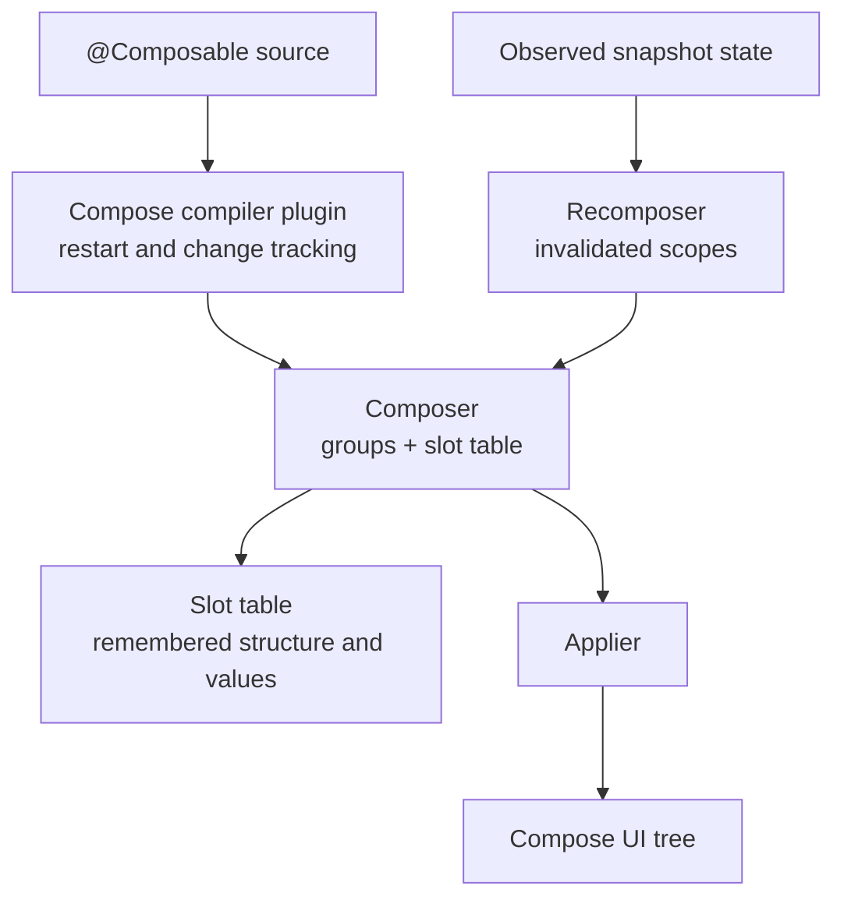

# Compose Runtime — Composer, Slot Table, and the Engine

> Compose is declarative, but it does not use a React-style virtual DOM diff. The Compose compiler rewrites `@Composable` calls to cooperate with a hidden `Composer`, which records composition groups and remembered values in a **Slot Table**. Staff-level mastery means reading compiler reports, relating state reads to invalidation, and predicting which calls can restart or skip. Exact generated calls are compiler-version details; the models in this chapter are intentionally conceptual.

---

## Compose Has Three Layers



The compiler records restart and change information, the runtime stores composition structure in the slot table, and state invalidation lets the Recomposer rerun affected scopes before the Applier updates the UI tree.

| Layer | What it is | Lives in |
|---|---|---|
| **Compose Compiler** | A Kotlin compiler plugin. Rewrites `@Composable` functions to take hidden runtime and change-tracking parameters, inserts group calls, and computes restartability/skippability. | The Compose compiler Gradle plugin shipped with Kotlin 2.x |
| **Compose Runtime** | The platform-agnostic engine: `Composer`, `Recomposer`, `Slot Table`, `Snapshot system`, `CompositionLocal`. **No Android types here.** | `androidx.compose.runtime:runtime` |
| **Compose UI** | UI primitives such as `Modifier`, `Layout`, `LayoutNode`, input, and semantics, with platform integrations and rendering backends supplied per target. | Compose UI artifacts for the target platform |

This separation is a foundation of Compose Multiplatform: common composable and runtime code can be shared while platform targets supply hosting, rendering, text, input, accessibility, and interop implementations. It is more than swapping one `Applier`, but the runtime itself remains independent of Android UI types.

---

## Why a Runtime Exists (and Not Virtual DOM)

React solves "find what changed" via a virtual DOM diff every render. Compose solves it differently:

- The **compiler** marks every `@Composable` function with positional information.
- Each execution writes into the **Slot Table** keyed by position.
- On recomposition, the runtime walks the slot table at the same positions and reuses previous outputs unless inputs changed.

This is called **positional memoization**. It's how Compose achieves React-DOM-like ergonomics without paying for a virtual DOM tree.

---

## What the Compose Compiler Does to `@Composable`

You write:

```kotlin
@Composable
fun Greet(name: String) {
    Text("Hello, $name")
}
```

The compiler rewrites it (conceptually) to:

```kotlin
fun Greet(name: String, $composer: Composer, $changed: Int) {
    $composer.startRestartGroup(0x1234ABC)               // unique key per call site
    if ($changed and 0b1 == 0 || $composer.changed(name)) {
        Text("Hello, $name", $composer, 0)
    } else {
        $composer.skipToGroupEnd()                        // SKIP if inputs unchanged
    }
    $composer.endRestartGroup()?.updateScope { c, _ ->    // remember how to re-invoke
        Greet(name, c, $changed or 0b1)
    }
}
```

Three things to internalize:

1. **Composable calls receive hidden bookkeeping** — a `Composer` plus one or more change/default masks are inserted as needed. The compiler enforces that composable calls occur in a composable context so this protocol is available.
2. **Call-site keys combine with execution position** — keys do not need to be globally unique. The runtime uses the structured call position, and explicit `key(...)` data where supplied, to distinguish repeated calls.
3. **Eligible functions get restart scopes** — a restartable function records how to invoke itself again when a state read in its scope is invalidated. Some composables are deliberately non-restartable and restart with an ancestor.

---

## The Composer — The Cursor Into the Slot Table

The `Composer` is the runtime's *cursor*. It moves through the slot table left-to-right as your `@Composable` functions execute. Its job:

| API | What it does |
|---|---|
| `startRestartGroup(key)` | Open a new restart-able group at the current position |
| `endRestartGroup()` | Close the group, capture invalidator for re-running |
| replaceable-group operations | Track control-flow structure whose contents may change |
| movable-group operations | Track content whose position can move while retaining identity |
| `cache(invalid, block)` | Memoize a value at this slot — basis of `remember` |
| `changed(value)` | Compare to last-stored value; record dirty bit |
| `skipToGroupEnd()` | Skip past this entire group — recomposition shortcut |
| `recordReadOf(state)` | Subscribe this group to a `MutableState` (snapshot system) |

You never call these directly — the compiler emits the calls. But knowing they exist explains your debug output.

---

## The Slot Table (Gap Buffer)

The slot table is **the** core data structure. Think of it as a flat array divided into:

- **Slots** — the actual stored values (group keys, remembered values, state objects).
- **Groups** — metadata records that describe parent-child relationships and skip ranges.

Implemented as a **gap buffer** — like the data structure most text editors use. Inserts/removes near the cursor are O(1); reads are O(1) by index. The gap moves with the cursor as composition proceeds.

```
slots: [grp0 | "Hello" | mutableState | grp1 | "World" | __gap__ | grp2 | ...]
                                              ↑ cursor here
```

When `Greet("Alice")` runs:

1. Composer enters at the group's slot index.
2. Reads the previous `name` value at slot +1: `"Bob"`.
3. Compares to current: changed → marks group dirty.
4. Re-executes the body. New `Text("Hello, Alice")` writes its own grouping marker + content at the same positions.
5. Closes the group; emits invalidation lambda.

If `name` didn't change:

1. Composer reads `"Bob"`, sees no change.
2. Calls `skipToGroupEnd()` — jumps the cursor to the next group **without re-executing anything inside**.
3. Work inside the skipped group is avoided.

This is why **stability matters** ([`recomposition-and-state.md`](recomposition-and-state.md)): it controls comparison semantics. With strong skipping, enabled by default since Kotlin 2.0.20, restartable composables with unstable parameters can also be skippable, but unstable values are compared by identity rather than equality.

---

## Three Useful Group Concepts

Compiler-emitted group operations evolve, so treat these as behavioral categories rather than a promise about exact generated method names.

| Group | When used | Behavior on change |
|---|---|---|
| **Restartable** | `@Composable` function with one or more params | Re-runs the function body; reuses sub-tree if inputs unchanged |
| **Replaceable** | Control flow (`if`/`when` branches) | Old slots discarded, new slots written |
| **Movable** | `LazyColumn`/`LazyRow` items with `key = { it.id }` | Item slots track by `dataKey`; reorder doesn't rebuild items |

```kotlin
@Composable
fun Container(items: List<Item>) {
    if (items.isEmpty()) {       // replaceable group
        EmptyState()              // sub-tree replaced if branch changes
    } else {
        LazyColumn {
            items(items, key = { it.id }) { item ->   // movable group
                Row(item)        // restartable group per row
            }
        }
    }
}
```

The `key = { it.id }` is the difference between "row 5 is reused when an item is inserted at top" and "every row from 0–4 rebuilds because item indexes shifted by 1."

---

## Restartable, Skippable, and Non-Restartable

The Compose Compiler classifies every `@Composable` function:

| Classification | Meaning | Implications |
|---|---|---|
| **Restartable + Skippable** | Has a restart scope and may skip its body | Can re-run independently; skips when parameter comparisons say inputs are unchanged. Under strong skipping, unstable parameters do not automatically remove skippability. |
| **Restartable, not skippable** | Has a restart scope but is opted out or otherwise ineligible for skipping | Can restart independently but executes whenever its scope is recomposed. `@NonSkippableComposable` is an explicit opt-out. |
| **Non-restartable** | The compiler does not create an independent restart scope | Re-executes with the containing restart scope. `@NonRestartableComposable` can be used for small wrappers when appropriate. |

Enable the Compose Compiler metrics:

```kotlin
composeCompiler {
    reportsDestination = layout.buildDirectory.dir("compose_compiler")
    metricsDestination = layout.buildDirectory.dir("compose_compiler")
}
```

After a release build, the reports describe inferred class stability and composable restartability/skippability. Use them after measurement identifies recomposition as a bottleneck; making every function skippable is not a goal by itself.

---

## The Recomposer

A `Recomposer` coordinates one or more compositions in its effect-coroutine context. Android normally obtains a window-scoped recomposition context for `setContent`; do not assume a strict one-to-one mapping between every `Composition` and `Recomposer`. Responsibilities include:

- Listen for snapshot invalidations (writes to `MutableState`).
- Schedule which groups need to recompose.
- Run on the appropriate dispatcher (`Dispatchers.Main` for Android UI).
- Coordinate with the choreographer for frame timing.

```kotlin
setContent {
    // This is a Composition root.
    // A Recomposer is constructed under the hood, tied to the Activity's lifecycle.
    App()
}
```

Recomposer life:

1. **Idle** — waiting for invalidations.
2. **PendingWork** — at least one group is dirty.
3. **Composing** — actively running recompose.
4. **Applying** — pushing changes to the Applier (UI tree).
5. Back to Idle.

The runtime tries to complete eligible recomposition and apply work within the available frame budget. Expensive composition, layout, or drawing can still miss that budget, so frame timing must be measured.

---

## The Applier — Bridging Runtime to UI

Compose Runtime doesn't know what a `View` is. It just calls `Applier` operations. The Android Compose UI module supplies a `UiApplier` that turns runtime operations into `LayoutNode` tree mutations:

```kotlin
interface Applier<N> {
    fun down(node: N)                 // push into a child
    fun up()                          // pop back to parent
    fun insertTopDown(index: Int, instance: N)
    fun insertBottomUp(index: Int, instance: N)
    fun remove(index: Int, count: Int)
    fun move(from: Int, to: Int, count: Int)
}
```

Compose UI uses an applier to maintain its node tree, while each target also supplies hosting, rendering, text/input integration, accessibility, and lifecycle hooks. Shared `Greet(name = "Alice")` code works where its UI APIs are available, but platform behavior is not reduced to an `Applier` type substitution.

---

## CompositionLocal — Implicit Tree Data

Sometimes you need to pass data (theme, current locale, content color) deeply through the tree without threading it through every parameter:

```kotlin
val LocalCurrentUser = compositionLocalOf<User> { error("No user") }

@Composable
fun App() {
    CompositionLocalProvider(LocalCurrentUser provides currentUser) {
        AppContent()
    }
}

@Composable
fun ProfileBadge() {
    val user = LocalCurrentUser.current   // reads from the nearest provider above
    Text(user.name)
}
```

Two flavors:

| Variant | Behavior |
|---|---|
| `compositionLocalOf { default }` | Reads are tracked. Recomposes any `@Composable` that reads it when the value changes. |
| `staticCompositionLocalOf { default }` | Reads are NOT tracked. Cheaper. But changing the value **invalidates the entire sub-tree** under the provider. Use for values that change rarely (e.g., once at app start). |

Choose based on change frequency and dependency clarity:

- `compositionLocalOf` for a frequently-changing value with many readers → every reader recomposes per change. Fine, this is what you want.
- `staticCompositionLocalOf` for a frequently-changing value → the entire provided content invalidates.
- `compositionLocalOf` for a rarely-changing value with no readers (or one reader) → wasted tracking overhead.

Use `staticCompositionLocalOf` only for values that are highly unlikely to change; use `compositionLocalOf` when provider changes should invalidate only readers. Avoid passing rapidly changing scroll state implicitly when an explicit parameter or narrower read would make dependencies clearer.

---

## `remember` Under the Hood

```kotlin
val counter = remember { mutableStateOf(0) }
```

is roughly:

```kotlin
val counter = $composer.cache(invalid = false) { mutableStateOf(0) }
```

`cache(invalid, block)`:

1. Read the slot at the current cursor position.
2. If it has a previous value AND `invalid` is false → return that value.
3. Otherwise run `block`, store the result, return it.

`remember(key1) { ... }` adds a keyed invalidation:

```kotlin
val parsed = remember(jsonString) { parseJson(jsonString) }
// = $composer.cache(invalid = $composer.changed(jsonString)) { parseJson(jsonString) }
```

When `jsonString` changes, the cache is invalidated; the block re-runs; the result is stored in the same slot. **The slot stays at the same position** — that's why positional memoization works across recompositions.

The corollary is about ownership, not a blanket ban: a `remember` inside conditional content belongs to that branch.

```kotlin
@Composable
fun OptionalCounter(show: Boolean) {
    if (show) {
        val state = remember { mutableStateOf(0) }   // scoped to this branch
        Text(state.value.toString())
    }
}
```

When `show` flips true → false, that group leaves the composition and its remembered value is forgotten. On the next `true`, a new value is created. That is correct for state whose lifetime matches the optional content. Hoist it outside when state must survive hiding; use `rememberSaveable` when supported owner recreation must also preserve it.

---

## `derivedStateOf` — Compute Once Per Real Change

```kotlin
val isLongList by remember {
    derivedStateOf { items.size > 100 }
}
```

`derivedStateOf` reads snapshot state and produces a new state that invalidates readers only when the *derived value* changes according to its mutation policy:

- `items` change from 95 → 96 → 97 → 99: `isLongList` doesn't emit (still `false`).
- `items` change from 99 → 100: `isLongList` remains `false`.
- `items` change from 100 → 101: `isLongList` changes once (`false` → `true`).

Without `derivedStateOf`, a composable that directly reads the changing source is invalidated for each observed change. With it, readers can be invalidated only when the result changes. The API itself has overhead, so use it when source state changes more often than the result needed by the UI—not merely as a general cache for expensive work.

---

## Side Effects in the Runtime

`LaunchedEffect`, `DisposableEffect`, `SideEffect`, `rememberCoroutineScope` — these are all built on top of the runtime's slot table. See [`side-effects.md`](side-effects.md) for the detailed guide; from a runtime perspective:

- **`LaunchedEffect(keys) { … }`** — stores a coroutine `Job` in a slot. When `keys` change, cancels old job + launches new one.
- **`DisposableEffect(keys) { onDispose { … } }`** — stores a disposer in a slot. Runs `onDispose` when keys change or composition exits.
- **`SideEffect { … }`** — runs the block on every successful composition. No slot allocation. Use for syncing to non-Compose state.

All three are positional-memoized like any other call.

---

## Compose Multiplatform Touch Points

Common composable code, platform hosts:

```kotlin
// Common code (KMP shared module)
@Composable
fun Greet(name: String) { Text("Hello, $name") }

// Android host
setContent { Greet("Alice") }

// iOS host
ComposeUIViewController { Greet("Alice") }

// Desktop host
application { Window { Greet("Alice") } }
```

The shared function and runtime protocol are platform-agnostic when they use common APIs. Platform hosts and UI implementations bridge to Android, desktop/iOS rendering, and target-specific input, accessibility, and interop.

---

## Failure Modes

| Symptom | Cause | Fix |
|---|---|---|
| Composable executes more often than expected | State read is too high, or parameter comparisons keep reporting change | Measure first; move reads closer; preserve instances or model real immutability |
| Function is not skippable in compiler reports | Explicit opt-out, non-restartable behavior, or compiler eligibility rules | Investigate only if measured cost points here; do not annotate around a broken contract |
| Optional state is recreated after content returns | Its conditional group left the composition | Hoist state if its desired lifetime exceeds the branch; use `rememberSaveable` for supported recreation |
| Entire screen recomposes on theme color change | `staticCompositionLocalOf` for frequently-changing value | Switch to `compositionLocalOf` |
| Tracking overhead for rarely-changing global | `compositionLocalOf` for rare-change value | Switch to `staticCompositionLocalOf` |
| `derivedStateOf` block runs constantly | Reading state outside `remember { derivedStateOf { ... } }` | Wrap in `remember` to position-memoize the derived state |
| Items in LazyColumn rebuild on insert | No `key = { it.id }` | Provide stable keys |
| Compose performance regression after upgrading compiler | Compiler/runtime behavior or generated code changed | Reproduce in a release benchmark, compare reports/traces, then minimize and report or refactor |
| `LaunchedEffect(Unit)` loop does not stop | Loop has no cooperative suspension/check, or effect never leaves | Use `isActive` plus cancellable suspension; choose keys/lifetime deliberately |
| Stale platform object retained | A remembered object or coroutine outlives the intended owner while capturing an `Activity` or listener | Align ownership with composition/lifecycle and dispose registrations explicitly |
| Two Composables with the same `key()` in LazyColumn | Duplicate keys | Make IDs globally unique within the list |
| Custom `Modifier` factory causes excess work | It reads changing state in composition or recreates unstable captures | Move reads to the appropriate phase; prefer `Modifier.Node` for new stateful modifiers; measure |

---

## Common Pitfalls

- **Treating `@Composable` like a regular function.** It's a function with a hidden `Composer` argument and positional registration; can only be called from a `@Composable` context.
- **Calling `@Composable` inside non-composable lambdas.** `list.forEach { Text(it) }` is fine because `forEach`'s lambda is inline; but `flow.collect { Text(it) }` is not — `collect`'s lambda is not `@Composable`.
- **Reading state outside `remember { derivedStateOf { ... } }`.** Re-evaluates on every recomposition.
- **Storing UI state in module-level variables.** It lives outside composition and navigation ownership, making tests and lifecycle behavior harder. Use an explicit longer-lived state owner only when global lifetime is intentional.
- **Heavy work in composition.** Compose runs your `@Composable` body many times. Filesystem I/O, network calls, JSON parsing in `@Composable` = jank. Move into `LaunchedEffect`, `ViewModel`, or `remember { ... }`.
- **Optimizing modifier allocation without evidence.** Short immutable chains are usually cheap. Reuse a chain from an appropriate scope when profiling shows allocation/comparison cost or when reuse improves clarity; do not add `remember` mechanically.
- **Side effects outside `LaunchedEffect`.** Calling `analytics.track()` in the function body fires on every recomposition. Wrap in `LaunchedEffect(key)`.
- **Misusing `key()`.** `key(unstableKey) { ... }` forces full recreation of the sub-tree every time the key changes. Useful but overuse defeats memoization.
- **`SubcomposeLayout` everywhere.** It allows composition during measurement and adds scheduling/measurement overhead. Use it for designs that genuinely need constraints or one child's result before composing later content, and measure the result.

---

## Probing Questions

1. Walk through the rewrite the Compose Compiler applies to `@Composable fun Greet(name: String)`. What hidden parameters get added, and what does each do?
2. Explain "positional memoization." How is it different from React's virtual DOM diffing?
3. The Slot Table is a gap buffer. Why a gap buffer rather than an array or linked list?
4. Compare `compositionLocalOf` vs `staticCompositionLocalOf`. Give a use case where each is right and where each is wrong.
5. Walk through what `remember { mutableStateOf(0) }` becomes after compilation. Where is the `0` actually stored?
6. What lifetime does `remember` have inside conditional content, and when should that state be hoisted outside the branch?
7. Restartable, skippable, and non-restartable — what does each classification control, and how does strong skipping affect unstable parameters?
8. The Compose Multiplatform story: how does the same `Greet("Alice")` work on Android, iOS, and Desktop? Where's the platform-specific code?
9. `derivedStateOf` — why does it need `remember { }` around it? What goes wrong without?
10. The Recomposer lifecycle — Idle → PendingWork → Composing → Applying → Idle. Where does Choreographer fit in?
11. Three group types (Restartable, Replaceable, Movable) — give a concrete example of each.
12. Compose Compiler metrics output shows your function as "not skippable." Walk through your debugging.
13. Your custom Modifier causes every Composable that uses it to recompose. How do you diagnose and fix?

## Answer Key

1. The compiler adds a `Composer` parameter and change/default masks as needed, opens composition groups, emits parameter-change checks, and records an update lambda for an eligible restart scope. The `Composer` connects the call to the current composition and slot position; masks propagate what callers already know about arguments so redundant comparisons can be avoided. Exact signatures and group calls are implementation details and can change between compiler versions.
2. Positional memoization associates remembered values and emitted structure with a call's key and location in the composable call graph. On recomposition, executing the same structure lets the composer revisit and reuse those slots, while explicit keys preserve identity across some moves. A virtual DOM approach builds a separate description tree and diffs it against a previous tree; Compose instead uses compiler-generated structure and targeted restart/skip decisions to update its maintained node tree.
3. Composition edits are usually localized near the writer's current position. A gap buffer keeps dense arrays for fast indexed traversal while making nearby insertions/removals inexpensive until the gap must move; group metadata also provides sizes for skipping subtrees. A plain array would shift many elements for edits, while a linked list would sacrifice cache locality and O(1) indexed access. The AndroidX design note warns that exact SlotTable details evolve, so this is a rationale for the documented design rather than an API guarantee.
4. `compositionLocalOf` tracks each read, so a new provided value invalidates only scopes that consumed `current`; it suits values such as a theme-derived elevation that can change. `staticCompositionLocalOf` does not track individual reads, so changing its provider recomposes the entire provided content; it suits configuration that effectively never changes. Either is wrong when used as a service locator for screen dependencies, and the static form is especially costly for frequently changing values.
5. `remember { mutableStateOf(0) }` compiles conceptually to a composer cache operation at the current slot. The slot retains the `MutableState` object across recompositions. The integer value is held in that object's snapshot `StateRecord` chain, not directly as a raw integer slot; writing it participates in snapshot observation and can invalidate readers.
6. The remembered value lives as long as the conditional group remains in the composition. When the branch disappears, Compose forgets the value and runs any relevant disposal; when it returns, initialization runs again. Keep it there when that is the intended UI lifetime, or hoist it above the condition when hiding must not reset it. `rememberSaveable` addresses supported owner recreation, not the decision about which composition group owns the state.
7. Restartable means a function has a scope that can be independently invalidated and rerun. Skippable means the runtime may omit its body when parameter comparisons report no change. Non-restartable means it reruns with a containing scope. With strong skipping enabled by default since Kotlin 2.0.20, restartable functions can be skippable even with unstable parameters; stable values use equality comparisons and unstable values use identity comparisons.
8. The compiler/runtime protocol and common Compose UI APIs are shared. Android uses an Activity/View host and Android platform integrations; iOS uses `ComposeUIViewController` plus native hosting/interoperability; desktop uses windowing and its rendering/input integrations. Platform implementations cover rendering, text, input, accessibility, lifecycle, and interop, so “only the applier changes” is too narrow.
9. `derivedStateOf` creates an observable derived-state object with cached calculation and dependency tracking. Remembering that object preserves its identity, cache, and subscriptions across recompositions; constructing a new one each time discards that benefit and adds churn, though it does not inherently make every result incorrect. Use it when inputs change more often than the derived result needed by readers.
10. A snapshot-state write notifies the recomposition machinery and makes work pending. On Android, the window recomposer uses a frame clock integrated with `Choreographer` so recomposition and apply work can be aligned with frames rather than updating pixels directly from the write. Composition calculates changes, the apply phase mutates the maintained UI tree, and later measure/layout/draw phases render it; the simplified state sequence is a mental model, not the public `Recomposer.State` enum verbatim.
11. A restart group commonly surrounds an eligible composable function such as `UserCard`; invalidating a state read in that scope can rerun it. Replaceable structure represents control flow such as switching an `if` branch, where the old group's content can leave and new content enter. Movable/keyed content represents identity that can change position, such as lazy-list items keyed by stable IDs, preserving remembered state when order changes.
12. First reproduce the cost in a release build using recomposition counts, tracing, or a benchmark; a “not skippable” label alone is not a bug. Confirm current strong-skipping configuration, inspect the composables/classes reports, find unstable or changing parameters, and check whether callers recreate collections or lambdas. Fix the ownership or data contract—preserve instances, use genuinely immutable models/collections, narrow parameters, or opt in via stability configuration only when correct—then remeasure.
13. Separate recomposition from modifier-node updates: use Layout Inspector/compiler reports for composition and tracing for layout/draw work. Check whether the factory reads state in composition, allocates changing captured lambdas, or returns a new composed modifier that invalidates consumers. Prefer plain reusable elements for stateless behavior and `Modifier.Node` for stateful custom behavior, use node update hooks where appropriate, defer rapidly changing reads to layout/draw lambdas, and verify the improvement rather than assuming allocation alone was the cause.

---

## Further Reading

- [`recomposition-and-state.md`](recomposition-and-state.md) — `MutableState`, stability, skipping rules.
- [`side-effects.md`](side-effects.md) — `LaunchedEffect`, `DisposableEffect`, `SideEffect`.
- [`modifiers-and-layout.md`](modifiers-and-layout.md) — `Modifier.Node` and the layout phase.
- [`compose-navigation.md`](compose-navigation.md) — `NavHost` builds on the same runtime.
- [`../architecture/viewmodel.md`](../architecture/viewmodel.md) — state lifting from Composables to ViewModel.
- [`../../kotlin/language-core/data-classes.md`](../../kotlin/language-core/data-classes.md) — `@Stable` / `@Immutable` for skippability.
- [`../../kotlin/language-core/sealed-classes.md`](../../kotlin/language-core/sealed-classes.md) — UI state modeling.
- [`../../kotlin/language-core/delegation.md`](../../kotlin/language-core/delegation.md) — `by remember { mutableStateOf(...) }` mechanics.
- [Compose Runtime releases](https://developer.android.com/jetpack/androidx/releases/compose-runtime) — current runtime APIs, changes, and source links.
- [Leland Richardson — Under the hood of Jetpack Compose (KotlinConf 2019)](https://www.youtube.com/watch?v=Q9MtlmmN4Q0) — Compose architect's talk.
- [AndroidX design note — How Composition Works](https://android.googlesource.com/platform/frameworks/support/+/androidx-main/compose/runtime/design/how-compose-works.md) — slot table and positional memoization, with implementation-version caveats.
- [Android Developers — Compose architecture](https://developer.android.com/develop/ui/compose/architecture) — official.
- [Compose compiler reports](https://developer.android.com/develop/ui/compose/performance/stability/diagnose) — how to generate and interpret current reports.
- [Kotlin — Compose compiler options DSL](https://kotlinlang.org/docs/compose-compiler-options.html) — current plugin configuration and feature flags.
- [Chris Banes — Composable metrics](https://chris.banes.dev/composable-metrics/) — practitioner's perf-audit guide.
- [JetBrains — Compose Multiplatform](https://www.jetbrains.com/lp/compose-multiplatform/) — same runtime, different appliers.
