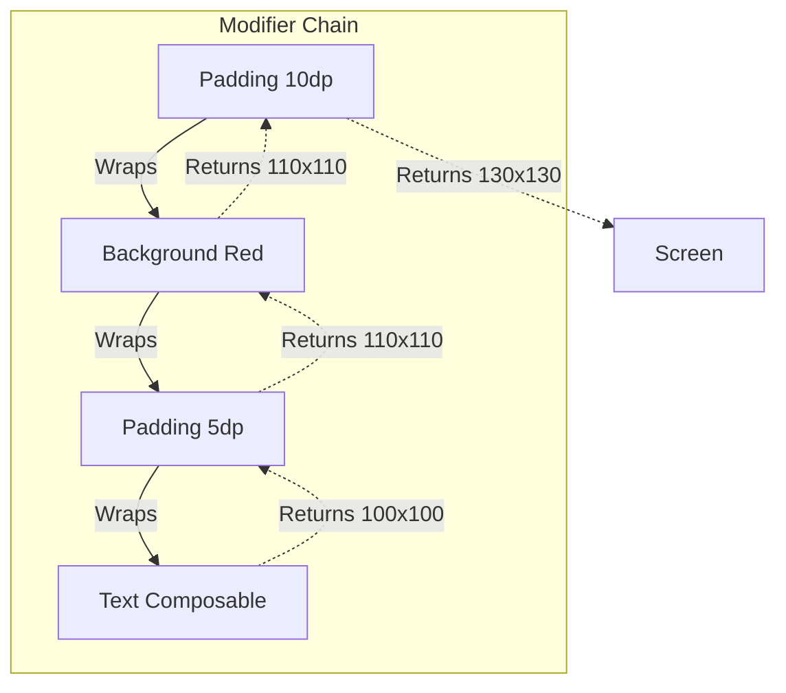

# Modifiers and Layout

## Overview

In legacy Android XML, every `View` subclass (like `TextView` or `Button`) was a massive object containing hundreds of variables for padding, margins, colors, click listeners, and layout constraints. This approach bloated memory and created insane inheritance hierarchies.

Jetpack Compose solves this by decoupling the *UI Element* from its *Decorations*. A `Text` composable only knows how to draw text. If you want padding, a background color, or a click listener, you wrap it in a `Modifier`.

A Staff Engineer understands that Modifiers are not just parameter bags; they are an ordered chain of operations that mathematically wrap the UI node. Modifiers execute strictly from outer-to-inner, meaning the **Order of Modifiers completely changes the UI output**.

## Why It Matters

If you write `<TextView android:padding="16dp" android:background="#000" />` in XML, it doesn't matter which attribute you write first; the text will have a black background, and the padding will be inside the background.

If you write this in Compose:
```kotlin
Modifier
    .padding(16.dp)
    .background(Color.Black)
```
The padding is applied *outside* the black background. If you swap the lines, the padding is applied *inside* the black background. 

Failing to understand the mathematical chaining of Modifiers leads to junior engineers frantically guessing and swapping lines of code until the UI looks right, resulting in fragile layouts and layout thrashing.

## Historical Context

- **Android XML (Pre-2021):** Relied heavily on `ViewGroup` subclasses (`LinearLayout`, `RelativeLayout`). To draw a border around a button, you had to create a separate XML `drawable` file and apply it as the background. To make something clickable, you had to set `android:clickable="true"` and find the view in Java.
- **ConstraintLayout Era:** As view hierarchies deepened, layout measurement became an exponential performance bottleneck (a nested `LinearLayout` calculates its children multiple times). `ConstraintLayout` was built to flatten the XML tree.
- **Jetpack Compose:** Modifiers eliminate the need for `ConstraintLayout` in 95% of use cases. Because Compose uses a strict **Single-Pass Measurement** algorithm, deeply nesting `Row` and `Column` is perfectly safe and highly performant. There is no exponential measurement penalty.

## First Principles

1.  **The Box Model:** Every Compose element is a box. Modifiers decorate that box.
2.  **Order Matters:** Modifiers are applied sequentially. Each modifier wraps the previous one.
3.  **Single-Pass Measurement:** Compose only measures an element *once* per frame. It measures from the parent down, and the child reports its exact size back up.
4.  **Layouts:** `Column` (Vertical), `Row` (Horizontal), and `Box` (Z-Axis overlapping) are the three fundamental building blocks.

## Mental Model

Think of Modifiers as **Wrapping a Gift**.
- The `Text` composable is the Gift (a toy car).
- If you apply `padding(16.dp)` first, you put the car in a clear plastic case that gives it 16dp of breathing room.
- If you apply `background(Color.Red)` next, you wrap the clear plastic case in Red wrapping paper. (The red is on the *outside* of the padding).
- If you applied the `background` first, you would wrap the toy car tightly in red paper, and *then* put it in the clear plastic case. (The red is on the *inside* of the padding).

## Internal Mechanics

### Modifier Chaining

Under the hood, `Modifier` is an interface. When you chain them together, you are creating a `CombinedModifier` linked list.

```kotlin
// Your Code:
Modifier
    .padding(10.dp)
    .background(Color.Red)

// What Compose sees (conceptually):
val modifier = CombinedModifier(
    outer = PaddingModifier(10.dp),
    inner = BackgroundModifier(Color.Red)
)
```

During the **Measure/Layout Phase**, Compose traverses this linked list:
1. It asks the outermost modifier (`padding`): "How big do you want to be?"
2. `padding` says: "I don't know, let me ask my inner child."
3. `padding` asks `background`: "How big do you want to be?"
4. `background` asks the `Text` composable: "How big do you want to be?"
5. The `Text` says "I am 100x100 pixels."
6. `background` says "Okay, I am drawing a 100x100 red box. My size is 100x100."
7. `padding` says "Okay, I am adding 10dp to all sides. My total size is 120x120."

## Architecture



## Production Example

**The Clickable Ripple Effect**

The order of `Modifier.clickable` dictates exactly where the Android material ripple effect appears.

```kotlin
// BAD: The ripple effect will NOT cover the padding!
Text(
    text = "Click Me",
    modifier = Modifier
        .padding(16.dp)
        .clickable { doSomething() }
)

// GOOD: The ripple effect covers the entire padding area!
Text(
    text = "Click Me",
    modifier = Modifier
        .clickable { doSomething() }
        .padding(16.dp)
)

// COMPLEX: A Button with a red background, white padding, and a ripple inside the red but outside the text.
Text(
    text = "Click Me",
    modifier = Modifier
        .padding(8.dp)             // 1. Outer Margin (Invisible)
        .background(Color.Red)     // 2. Red Box
        .clickable { doSomething() } // 3. Ripple Effect (Contained within the Red box)
        .padding(16.dp)            // 4. Inner Padding (Space between Red box edge and Text)
)
```

## Tradeoffs

**`ConstraintLayout` vs `Row`/`Column`**

In the XML era, `ConstraintLayout` was mandatory for complex UIs to avoid performance penalties. In Compose, it is an optional library.

- **`Row` / `Column` / `Box`:**
    - *Pros:* Native to Compose. Extremely fast due to single-pass measurement. Highly readable for linear flows.
    - *Cons:* Creating a complex overlapping UI with aligned centers might require nesting 4-5 Rows/Columns.
- **`ConstraintLayout` (Compose version):**
    - *Pros:* Easier to translate legacy XML layouts or iOS AutoLayout designs. Excellent for complex responsive grids.
    - *Cons:* It is a massive dependency. It is slightly slower than native Row/Column. The DSL (Domain Specific Language) for defining `createRefs()` and `linkTo()` is clunky.

*Staff Note:* A Staff Engineer pushes teams to use `Row`, `Column`, and `Box` for 95% of Compose screens. We only import `ConstraintLayout` if the UI specifically requires elements to be mathematically anchored to the baselines or guidelines of sibling elements across complex axes.

## Failure Modes

- **The Shared Modifier Trap:**
  ```kotlin
  val sharedModifier = Modifier.padding(16.dp).clickable { /* ... */ }
  
  // BAD: We use the exact same Modifier instance on two different UI nodes!
  Text("A", modifier = sharedModifier)
  Text("B", modifier = sharedModifier)
  ```
  *(Fix: `Modifier` instances maintain internal state (like the ripple animation bounds or focus state). Sharing a single instance across multiple UI nodes will cause bizarre visual bugs where clicking A triggers a ripple on B. Always pass `Modifier` as a parameter or recreate it).*
- **`fillMaxSize()` inside a `Scrollable`:**
  If you put a `Column(modifier = Modifier.verticalScroll().fillMaxHeight())` inside another scrolling container, Compose will crash with a `java.lang.IllegalStateException: Vertically scrollable component was measured with an infinity maximum height constraints`.
  *(Fix: A scrolling container has infinite height. You cannot ask a child to "fill" infinity. You must give the child a specific height or use `weight`).*
- **Recomposing Modifiers:**
  ```kotlin
  // BAD: We create a new lambda object on every single frame!
  Box(modifier = Modifier.offset { IntOffset(x, y) }) 
  ```
  *(Fix: As discussed in the [Jank](../performance/jank.md) module, use lambda modifiers to defer state reads to the Layout phase, avoiding Composition phase thrashing).*

## Staff Engineer Thinking

When reviewing UI code, a Staff engineer focuses on Reusability and the "Modifier Parameter" rule.

1.  **The Golden Rule of Compose:** Every single custom `@Composable` function MUST accept an optional `modifier` parameter, and it MUST default to `Modifier`, and it MUST be applied to the top-level layout node within that function.
    ```kotlin
    // PERFECT API DESIGN
    @Composable
    fun UserCard(user: User, modifier: Modifier = Modifier) {
        Card(modifier = modifier.fillMaxWidth()) { ... }
    }
    ```
    If you don't do this, the parent screen cannot add padding, click listeners, or size constraints to your `UserCard`. The parent is stripped of its layout authority.
2.  **Modifier Reordering:** If a junior engineer complains that their `background` color is overriding their `clip(CircleShape)` modifier, I explain the wrapping model. `clip` must come *before* `background` so that the background is drawn inside the clipped bounds.
3.  **Custom Layouts:** If a team is struggling to build a Staggered Grid or a Honeycomb layout using `Row` and `Column`, I guide them to build a `CustomLayout`. Compose makes it trivially easy to write your own `MeasurePolicy` directly in Kotlin, bypassing standard layouts entirely.

## Common Misconceptions

- **"Compose `Column` is just `LinearLayout`."** Conceptually, yes. Mechanically, no. `LinearLayout` required multiple passes if you used `layout_weight`, killing performance. `Column` mathematically calculates weights in a single pass.
- **"I should use `padding` for margins."** In XML, we had `layout_margin` and `padding`. In Compose, we only have `padding`. To create a "margin", you apply `padding` *before* the background or border. To create "padding", you apply `padding` *after* the background or border.

## Probing Questions

1.  Explain why the order of operations in a Compose `Modifier` chain drastically alters the visual output of the UI.
2.  What is the "Single-Pass Measurement" algorithm in Compose, and why does it make deep nesting of `Row` and `Column` safe compared to XML?
3.  Demonstrate how to achieve the exact visual equivalent of XML `layout_margin` and XML `padding` using only the Compose `Modifier.padding()` function.
4.  Why is it an architectural requirement that every custom `@Composable` function accepts an optional `modifier: Modifier = Modifier` parameter?
5.  What catastrophic UI bug occurs if you share a single instantiated `Modifier` variable (like `val myMod = Modifier.clickable {}`) across two distinct `Text` nodes?
6.  Explain why placing a `Modifier.fillMaxHeight()` inside a `LazyColumn` or `verticalScroll` container crashes the Android application.
7.  Describe the exact ordering of `Modifier.clip(CircleShape)` and `Modifier.background(Color.Red)` required to draw a red circle. What happens if you reverse them?
8.  Why is `ConstraintLayout` significantly less necessary in Jetpack Compose compared to legacy Android XML?
9.  How does a `Modifier` execute its measurement phase from the outer wrapper down to the inner UI node?
10. Describe the performance tradeoff of recreating Modifiers with inline lambdas (e.g., `Modifier.offset { ... }`) versus reading State variables directly in the Composition phase.

## Further Reading

- [`recomposition-and-state.md`](recomposition-and-state.md) — How state changes trigger the Modifiers to re-measure.
- [`jank.md`](../performance/jank.md) — How passing unstable data to Modifiers causes dropped frames.
- [Android Developers: Compose Modifiers](https://developer.android.com/jetpack/compose/modifiers)
