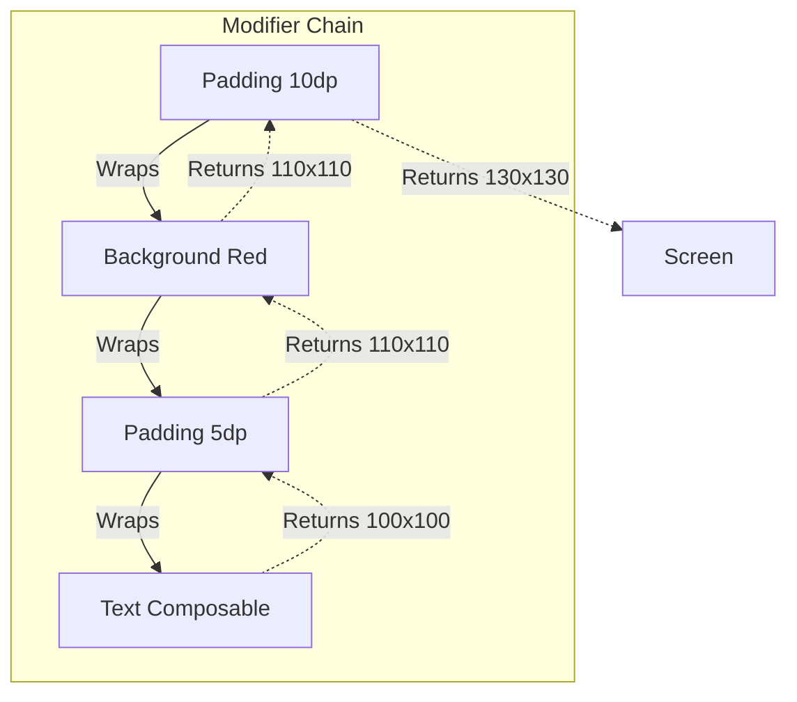

# Modifiers and Layout

## Overview

In the View system, a UI widget combines rendering, input, semantics, and layout behavior through the `View` API and its subclasses. Compose separates a composable's content from optional behavior such as sizing, drawing, input, and semantics.

Jetpack Compose separates a composable's core content from optional layout, drawing, input, and semantics behavior. A `Text` call defines text content and style; a `Modifier` chain can add padding, a background, click handling, and more.

A Staff Engineer understands that Modifiers are not just parameter bags; they are an ordered chain of operations that mathematically wrap the UI node. Modifiers execute strictly from outer-to-inner, meaning the **Order of Modifiers completely changes the UI output**.

## Why It Matters

If you write `<TextView android:padding="16dp" android:background="#000" />` in XML, it doesn't matter which attribute you write first; the text will have a black background, and the padding will be inside the background.

If you write this in Compose:
```kotlin
Modifier
    .padding(16.dp)
    .background(Color.Black)
```
The padding is applied *outside* the black background. If you swap the lines, the padding is applied *inside* the black background. 

Failing to understand the chain makes layouts fragile because a change in order can alter constraints, drawing bounds, hit targets, and semantics.

## Historical Context

- **Android XML (Pre-2021):** Relied heavily on `ViewGroup` subclasses (`LinearLayout`, `RelativeLayout`). To draw a border around a button, you had to create a separate XML `drawable` file and apply it as the background. To make something clickable, you had to set `android:clickable="true"` and find the view in Java.
- **ConstraintLayout Era:** Some nested View layouts—especially weighted `LinearLayout` combinations—could require repeated measurement. `ConstraintLayout` provided a flatter way to express sibling relationships and complex positioning.
- **Jetpack Compose:** `Row`, `Column`, `Box`, and custom layouts cover many cases that previously required `ConstraintLayout`. Compose normally requires a layout node to measure each child once; custom measurement code that measures a child more than once is rejected. This avoids several costly multi-pass patterns, but deep trees and intrinsic measurements still have costs and should be measured rather than assumed free.

## First Principles

1.  **The Box Model:** Every Compose element is a box. Modifiers decorate that box.
2.  **Order Matters:** Modifiers are applied sequentially. Each modifier wraps the previous one.
3.  **Single-Pass Measurement:** During a measure pass, constraints travel from parent to child and measured sizes travel back up. A parent normally measures each child once, although a node can be measured again when a later layout pass is requested.
4.  **Layouts:** `Column` (Vertical), `Row` (Horizontal), and `Box` (Z-Axis overlapping) are the three fundamental building blocks.

## Mental Model

Think of Modifiers as **Wrapping a Gift**.
- The `Text` composable is the Gift (a toy car).
- If you apply `padding(16.dp)` first, you put the car in a clear plastic case that gives it 16dp of breathing room.
- If you apply `background(Color.Red)` next, you wrap the clear plastic case in Red wrapping paper. (The red is on the *outside* of the padding).
- If you applied the `background` first, you would wrap the toy car tightly in red paper, and *then* put it in the clear plastic case. (The red is on the *inside* of the padding).

## Internal Mechanics

### Modifier Chaining

`Modifier` is an immutable, ordered chain of elements. Compose materializes the applicable elements into modifier nodes attached to the layout node; current custom modifiers should prefer the `Modifier.Node` APIs when they need stateful or multi-phase behavior.

```kotlin
// Your Code:
Modifier
    .padding(10.dp)
    .background(Color.Red)

// Conceptually: an ordered chain whose padding element wraps the
// drawing element for measurement, layout, drawing, and input traversal.
```

During the **Measure/Layout Phase**, Compose traverses this linked list:
1. It asks the outermost modifier (`padding`): "How big do you want to be?"
2. `padding` says: "I don't know, let me ask my inner child."
3. `padding` asks `background`: "How big do you want to be?"
4. `background` asks the `Text` composable: "How big do you want to be?"
5. The `Text` says "I am 100x100 pixels."
6. `background` says "Okay, I am drawing a 100x100 red box. My size is 100x100."
7. `padding` says "Okay, I am adding 10dp to all sides. My total size is 120x120."

## Architecture



## Production Example

**The Clickable Ripple Effect**

The order of `Modifier.clickable` dictates exactly where the Android material ripple effect appears.

```kotlin
// BAD: The ripple effect will NOT cover the padding!
Text(
    text = "Click Me",
    modifier = Modifier
        .padding(16.dp)
        .clickable { doSomething() }
)

// GOOD: The ripple effect covers the entire padding area!
Text(
    text = "Click Me",
    modifier = Modifier
        .clickable { doSomething() }
        .padding(16.dp)
)

// COMPLEX: A Button with a red background, white padding, and a ripple inside the red but outside the text.
Text(
    text = "Click Me",
    modifier = Modifier
        .padding(8.dp)             // 1. Outer Margin (Invisible)
        .background(Color.Red)     // 2. Red Box
        .clickable { doSomething() } // 3. Ripple Effect (Contained within the Red box)
        .padding(16.dp)            // 4. Inner Padding (Space between Red box edge and Text)
)
```

## Tradeoffs

**`ConstraintLayout` vs `Row`/`Column`**

In the View era, `ConstraintLayout` often helped flatten complex hierarchies. In Compose it remains an optional tool, not a default requirement.

- **`Row` / `Column` / `Box`:**
    - *Pros:* Built into Compose and readable for linear or stacked flows.
    - *Cons:* Creating a complex overlapping UI with aligned centers might require nesting 4-5 Rows/Columns.
- **`ConstraintLayout` (Compose version):**
    - *Pros:* Easier to translate legacy XML layouts or iOS AutoLayout designs. Excellent for complex responsive grids.
    - *Cons:* Adds another DSL and dependency; it can obscure simpler parent-child layout relationships when used unnecessarily.

*Staff Note:* Start with the simplest layout primitive that clearly expresses the design. Reach for `ConstraintLayout` when sibling constraints or guidelines make the result clearer, and use a custom `Layout` when the measurement policy itself is domain-specific.

## Failure Modes

- **Unsafe assumptions about shared modifiers:**
  ```kotlin
  val sharedModifier = Modifier.padding(16.dp).clickable { /* ... */ }
  
  // Safe: unscoped Modifier chains are immutable and may be reused.
  Text("A", modifier = sharedModifier)
  Text("B", modifier = sharedModifier)
  ```
  Reusing an unscoped chain is safe and can reduce allocation and comparison work. The actual restriction is scope: a `ColumnScope` modifier such as `weight` is meaningful only for a direct child in the matching scope, and a modifier containing a callback intentionally gives every consumer the same callback behavior.
- **Unbounded same-axis nested scrolling:**
  A vertically scrollable parent gives its content an unbounded maximum height. Placing another vertical lazy or scrollable container inside it without a finite height can throw `IllegalStateException` because the child cannot establish a viewport. `fillMaxHeight()` by itself is not universally a crash; under an unbounded height it cannot manufacture a finite maximum.
  *(Fix: flatten the content into one `LazyColumn`, give the nested scroller a finite height, or nest scrolling in the other axis when the design calls for it.)*
- **Recomposing Modifiers:**
  ```kotlin
  // BAD: We create a new lambda object on every single frame!
  Box(modifier = Modifier.offset { IntOffset(x, y) }) 
  ```
  *(Fix: As discussed in the [Jank](../performance/jank.md) module, use lambda modifiers to defer state reads to the Layout phase, avoiding Composition phase thrashing).*

## Staff Engineer Thinking

When reviewing UI code, a Staff engineer focuses on Reusability and the "Modifier Parameter" rule.

1.  **Reusable component API rule:** UI-emitting reusable composables should generally accept `modifier: Modifier = Modifier` as the first optional parameter and apply it once to their root UI element. Leaf helpers that emit no UI, fixed internal implementation details, and tightly scoped private composables can be exceptions.
    ```kotlin
    // PERFECT API DESIGN
    @Composable
    fun UserCard(user: User, modifier: Modifier = Modifier) {
        Card(modifier = modifier.fillMaxWidth()) { ... }
    }
    ```
    If you don't do this, the parent screen cannot add padding, click listeners, or size constraints to your `UserCard`. The parent is stripped of its layout authority.
2.  **Modifier Reordering:** If a junior engineer complains that their `background` color is overriding their `clip(CircleShape)` modifier, I explain the wrapping model. `clip` must come *before* `background` so that the background is drawn inside the clipped bounds.
3.  **Custom Layouts:** If standard primitives make a domain-specific arrangement difficult to express, use `Layout` with a reviewed `MeasurePolicy`. Measurement code is powerful, but constraint handling, intrinsic behavior, accessibility, and testing still require care.

## Common Misconceptions

- **"Compose `Column` is just `LinearLayout`."** Conceptually, yes. Mechanically, no. `LinearLayout` required multiple passes if you used `layout_weight`, killing performance. `Column` mathematically calculates weights in a single pass.
- **"I should use `padding` for margins."** In XML, we had `layout_margin` and `padding`. In Compose, we only have `padding`. To create a "margin", you apply `padding` *before* the background or border. To create "padding", you apply `padding` *after* the background or border.

## Probing Questions

1.  Explain why the order of operations in a Compose `Modifier` chain drastically alters the visual output of the UI.
2.  What is Compose's normal single-pass measurement rule, and which costs can still make a deeply nested layout slow?
3.  Demonstrate how to achieve the exact visual equivalent of XML `layout_margin` and XML `padding` using only the Compose `Modifier.padding()` function.
4.  Why should reusable UI-emitting composables usually accept an optional `modifier: Modifier = Modifier`, and what are reasonable exceptions?
5.  Is it safe to reuse one `Modifier` instance across two `Text` nodes? Explain immutability, callback behavior, and scoped modifiers.
6.  Which same-axis nested scrolling arrangement causes an infinite-constraint exception, and why is `fillMaxHeight()` alone not the root cause?
7.  Describe the exact ordering of `Modifier.clip(CircleShape)` and `Modifier.background(Color.Red)` required to draw a red circle. What happens if you reverse them?
8.  Why is `ConstraintLayout` significantly less necessary in Jetpack Compose compared to legacy Android XML?
9.  How does a `Modifier` execute its measurement phase from the outer wrapper down to the inner UI node?
10. Describe the performance tradeoff of recreating Modifiers with inline lambdas (e.g., `Modifier.offset { ... }`) versus reading State variables directly in the Composition phase.

## Answer Key

1. A modifier chain is ordered because each element can wrap the constraints, size, drawing, input, or semantics produced by elements after it. For example, `padding().background()` leaves the padding outside the painted bounds, while `background().padding()` paints behind both the content and its inner padding. The same principle changes click targets and clipping, not only appearance.
2. In the normal layout pass, parents pass constraints down, children return measured sizes, and each parent places its children. Compose prevents a custom parent from measuring the same child multiple times in one pass, avoiding common multi-pass measurement patterns. It does not make arbitrary nesting free: every node still participates in applicable phases, intrinsic measurements can add work, and complex modifier or subcomposition chains should be profiled in release builds.
3. Put outer spacing before the element that establishes its visible bounds and inner spacing after it: `Modifier.padding(margin).background(color).padding(contentPadding)`. Compose has no separate margin primitive because spacing is expressed by where `padding` appears in the wrapper chain. Parent arrangements such as `Arrangement.spacedBy` may be clearer for repeated sibling spacing.
4. Accepting `modifier: Modifier = Modifier` gives the caller control over placement, size, input, and semantics without forcing the component to predict every context. Apply the caller's chain once to the root element, then append component defaults as appropriate. A non-UI helper or a small private implementation detail may not need this public customization point.
5. Yes, reusing an unscoped modifier chain is safe because modifiers are immutable, data-like values; the official guidance explicitly recommends reuse where useful. Each consumer materializes its own runtime nodes, so ripple and focus state are not shared merely because the chain instance is shared. All consumers do invoke the same captured callback, and scope-specific elements such as `ColumnScope.weight` must be reused only in the scope where their parent data is valid.
6. The failure occurs when a same-axis scrollable child, such as an unconstrained `LazyColumn`, is measured inside a vertical scroller that gives it an infinite maximum height. A lazy container needs a finite viewport, so Compose rejects that measurement. `fillMaxHeight()` uses an available bounded maximum; when none exists it cannot create one, so flatten the hierarchy or provide a real finite height.
7. Use `Modifier.clip(CircleShape).background(Color.Red)`: the outer clip constrains drawing performed by the inner background. Reversing the order lets the outer background draw its rectangular bounds before the inner clip affects later content, so the red area is not clipped into a circle.
8. Compose's standard containers are cheap, composable building blocks, and custom `Layout` gives direct control when their policies are insufficient. That removes much of the hierarchy-flattening motivation that made `ConstraintLayout` common in Views. Compose `ConstraintLayout` is still useful when sibling constraints, baselines, barriers, or guidelines express a design more clearly.
9. Measurement-affecting elements receive parent constraints from the outer end of the chain, transform them, and measure the next element or content. The measured size then returns outward, allowing each element to adjust its own size and placement. Drawing and pointer-input traversals have their own direction and behavior, so “outer to inner” should be applied to the specific phase being analyzed.
10. Building a short modifier chain is usually cheap, and premature hoisting can reduce clarity. For rapidly changing state, a lambda-based modifier such as `offset { ... }` can defer the read to layout, skipping composition and limiting invalidation to a later phase; the lambda and chain should still be stable where practical. Reading the value in composition may be simpler but invalidates composition whenever it changes, so choose based on the required phase and confirm with tracing or benchmarks.

## Further Reading

- [`recomposition-and-state.md`](recomposition-and-state.md) — How state changes trigger the Modifiers to re-measure.
- [`jank.md`](../performance/jank.md) — How passing unstable data to Modifiers causes dropped frames.
- [Android Developers: Compose modifiers](https://developer.android.com/develop/ui/compose/modifiers)
- [Android Developers: Constraints and modifier order](https://developer.android.com/develop/ui/compose/layouts/constraints-modifiers)
- [Android Developers: Lazy layouts and nested scrolling](https://developer.android.com/develop/ui/compose/lists#avoid-nesting-scrollable)
