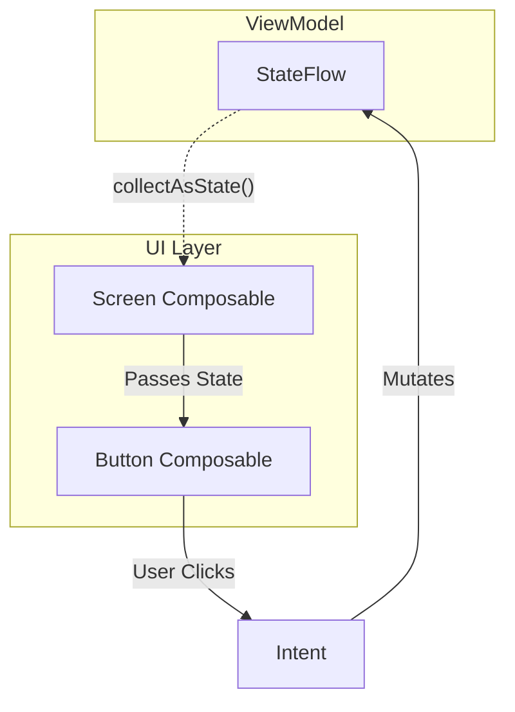

# Recomposition and State

## Overview

Jetpack Compose moves Android UI development from primarily mutating `View` instances to describing UI from current state with composable Kotlin functions.

A Staff Engineer understands that Compose combines compiler-generated restart groups with runtime snapshot observation. The compiler adds composition bookkeeping, while the runtime records snapshot-state reads and invalidates the scopes that observed changed state. Recomposition can then rerun affected scopes and skip eligible calls whose inputs are unchanged.

## Why It Matters

In the View system, a `TextView` stores its current text and application code can mutate it directly. When several code paths update widgets independently from model state, the two can drift—for example, stale welcome text may remain after authentication state changes.

Compose supports **Unidirectional Data Flow (UDF)**: state flows down and events flow up. Screen/business state commonly lives in a state holder such as a `ViewModel`, while local UI-element state can legitimately live in `remember` or `rememberSaveable`. Observable state must be read through a Compose-aware adapter for changes to invalidate the right UI scopes.

## Historical Context

- **View/XML era:** XML layouts are inflated into a mutable View tree, and screen state was often split across controllers and widget instances. Deep hierarchies and repeated measurement could be costly in particular layouts.
- **React/Flutter:** Declarative UI systems popularized deriving UI descriptions from state and sending events back to state owners.
- **Jetpack Compose (2021):** Compose uses compiler-assisted positional memoization rather than a React-style virtual DOM diff. Call-site keys, execution position, restart scopes, and snapshot observation let the runtime target work without mapping identity to source-code line numbers.

## First Principles

1.  **State:** Any value that can change over time.
2.  **`MutableState<T>`:** Compose's observable data holder. If a `@Composable` reads a `State` object, it subscribes to it.
3.  **Composition:** The initial execution of your `@Composable` functions. It builds the UI tree.
4.  **Recomposition:** The re-execution of specific `@Composable` functions when the State they read changes.
5.  **Smart Recomposition:** The compiler marks eligible restartable calls as skippable, and the runtime compares their current parameters with previous parameters before deciding whether to execute the body.

## Mental Model

Think of Compose as a **Fast-Food Kitchen Screen**.
- The Kitchen Screen (UI) is dumb. It only shows what the Cashier Register (State) tells it to show.
- When an order changes from "Pending" to "Cooking", the Register updates its State.
- The Kitchen Screen doesn't recreate the entire list of 50 orders. It looks at the exact row for Order #12 and changes the color to Green (Smart Recomposition).

## Internal Mechanics

### The Magic of the Compiler Plugin

When you annotate a function with `@Composable`, the Kotlin compiler completely rewrites it.

```kotlin
// Your Code:
@Composable
fun Greeting(name: String) {
    Text(text = "Hello $name")
}

// What the Compiler generates (Conceptually):
fun Greeting(name: String, $composer: Composer, $changed: Int) {
    $composer.startRestartGroup(123)
    // Compose checks if 'name' changed since the last execution
    if ($changed or $composer.changed(name)) {
        Text("Hello $name", $composer)
    } else {
        $composer.skipToGroupEnd() // SMART SKIP!
    }
    $composer.endRestartGroup()?.updateScope { 
        Greeting(name, it, $changed) 
    }
}
```
If `name` hasn't changed, the entire execution of `Text()` is physically skipped. 

### `remember` vs `State`

```kotlin
@Composable
fun Counter() {
    // 1. Just a variable. Recomposition resets it to 0. Useless.
    var count = 0 
    
    // 2. Remembered, but not State. Compose doesn't know when it changes. 
    // Changing this local does not schedule recomposition.
    var count2 = remember { 0 } 
    
    // 3. The Correct Way. 
    // 'remember' survives recomposition.
    // 'mutableStateOf' tells Compose to redraw when it changes.
    var count3 by remember { mutableStateOf(0) } 
    
    Button(onClick = { count3++ }) {
        Text("Count is $count3")
    }
}
```

## Architecture


*Unidirectional Data Flow: State flows down, Events flow up.*

## Production Example

**State Hoisting**

A Staff Engineer enforces "State Hoisting". A component should not manage its own internal state if that state is relevant to the rest of the application.

```kotlin
// BAD: The CustomTextField is "Stateful". 
// The parent screen cannot read the text, clear the text, or validate it.
@Composable
fun StatefulTextField() {
    var text by remember { mutableStateOf("") }
    TextField(value = text, onValueChange = { text = it })
}

// GOOD: The CustomTextField is "Stateless".
// The state is hoisted up to the caller (The Screen or ViewModel).
@Composable
fun StatelessTextField(
    text: String, // State flows in
    onTextChanged: (String) -> Unit // Events flow out
) {
    TextField(value = text, onValueChange = onTextChanged)
}

// Usage in the Parent
@Composable
fun LoginScreen(viewModel: LoginViewModel) {
    val text by viewModel.emailFlow.collectAsStateWithLifecycle()
    StatelessTextField(text = text, onTextChanged = viewModel::onEmailChanged)
}
```

## Tradeoffs

**`StateFlow` vs `LiveData` vs Compose `State`**

In the ViewModel, how should we hold state?

- **`LiveData`:** Still supported and lifecycle-aware, especially in existing Android code. Its operator model is smaller than Flow's and `setValue` is main-thread-only, while `postValue` schedules from a background thread.
- **Compose `MutableState` in ViewModel:** Some developers put `var text by mutableStateOf("")` directly in the ViewModel. 
    - *Pros:* No need to call `collectAsState()` in the UI. 
    - *Cons:* It permanently ties your ViewModel to the Compose framework dependency (`androidx.compose.runtime`). You cannot share this ViewModel with a KMP iOS app.
- **`StateFlow`:** A common choice for screen state when the surrounding architecture already uses coroutines and Flow.
    - *Pros:* Pure Kotlin. Cross-platform. Thread-safe. Rich operators (`map`, `combine`).
    - *Cons:* You must explicitly convert it to Compose state in the UI using `collectAsStateWithLifecycle()`.

## Failure Modes

- **The List Mutation Trap:**
  ```kotlin
  val items = remember { mutableStateListOf("A", "B") }
  // OR
  var list by remember { mutableStateOf(listOf("A", "B")) }
  ```
  If a `MutableState<ArrayList<T>>` holds a list and code calls `state.value.add(item)`, the state setter is never invoked and the `ArrayList` is not snapshot-aware, so Compose receives no change notification.
  *(Fix: expose an immutable `List` and assign a new value, or use `mutableStateListOf` when an observable mutable collection matches the ownership model.)*
- **Treating instability as an automatic performance failure:**
  The compiler infers whether parameters are stable. With strong skipping, enabled by default since Kotlin 2.0.20, restartable composables can still be skipped with unstable parameters; unstable values are compared by instance identity (`===`) rather than `equals`. A freshly allocated but equivalent instance can therefore prevent a skip, but that matters only when measurement shows the recomposition is expensive.
  *(Fix: first measure. Then make models genuinely immutable, use supported immutable collections, preserve instances, or configure stability deliberately. Do not add `@Stable`/`@Immutable` unless the type actually satisfies the annotation's contract.)*
- **Infinite Recomposition Loops:**
  ```kotlin
  @Composable
  fun InfiniteLoop() {
      var count by remember { mutableStateOf(0) }
      // DISASTER: We mutate state directly in the composition phase!
      count++ 
      Text("Count: $count")
  }
  ```
  1. Compose runs `InfiniteLoop`. 
  2. `count` becomes 1. 
  3. Because `count` changed, Compose says "I need to recompose `InfiniteLoop`." 
  4. It runs again. `count` becomes 2. 
  5. Repeat infinitely until the app crashes or freezes.
  *(Fix: drive state changes from events or a controlled effect/state owner, never as an unconditional write during composition.)*

## Staff Engineer Thinking

When reviewing Compose architecture, a Staff engineer focuses relentlessly on Recomposition boundaries.

1.  **Layout Inspector:** Use recomposition and skip counts as a diagnostic signal, then correlate them with frame traces. A frequently recomposing `TopAppBar` may indicate that rapidly changing scroll state is read too high in the tree, but counts alone do not prove user-visible cost.
2.  **`derivedStateOf`:** For a "Scroll to Top" button, `remember { derivedStateOf { listState.firstVisibleItemIndex > 5 } }` prevents readers from recomposing while the derived Boolean remains unchanged. `firstVisibleItemIndex` changes at item boundaries; `firstVisibleItemScrollOffset` can change on nearly every scroll step. Use derived state only when the source changes more often than the UI-relevant result.
3.  **Coherent UI state:** Related fields that must change atomically often belong in one immutable `UiState` exposed from a `StateFlow`. Independent, high-frequency, or differently scoped data does not have to be forced into one object. Choose boundaries that prevent inconsistent combinations without making every small update invalidate the whole screen.

## Common Misconceptions

- **"Compose recreates the entire UI on every state change."** False. Recomposition updates a maintained composition/UI tree and can restart or skip scopes selectively. Whether a Compose or View implementation is faster depends on the screen, build mode, and measured work; do not infer performance from the programming model alone.
- **"I don't need ViewModels anymore, I can just use `remember`."** False. State inside `remember` dies if the configuration changes (device rotation) or if the Composable is removed from the screen (navigating away). ViewModels survive configuration changes.

## Probing Questions

1.  What is the fundamental difference between an Imperative UI framework (like XML/Views) and a Declarative UI framework (like Compose) regarding State?
2.  Explain the concept of "Smart Recomposition" and how the Compose compiler achieves it.
3.  Why does assigning a value to a standard variable (`var count = 0`) inside a `@Composable` fail to update the UI when the variable changes?
4.  Describe the difference between `remember { }` and `mutableStateOf()`. Why do you usually need both together?
5.  What is "State Hoisting," and why is it critical for building reusable, testable Compose components?
6.  If you add an item to a standard Kotlin `ArrayList` that is wrapped in a `mutableStateOf`, why does the UI fail to recompose?
7.  What does it mean for a parameter type to be inferred as unstable, and how does strong skipping change the performance implications?
8.  Explain how mutating a `MutableState` value directly inside the body of a `@Composable` function (outside of a callback) creates an infinite loop.
9.  Why is `StateFlow` generally preferred over putting `MutableState` directly inside a `ViewModel`?
10. How does the `derivedStateOf` function help prevent unnecessary recompositions when dealing with rapidly changing values like scroll positions?

## Answer Key

1. In an imperative View UI, application code mutates long-lived widgets and must keep those mutations synchronized with model state. In Compose, a composable describes the UI for its current inputs; state changes invalidate observed scopes, which are executed again to update the composition. Local UI state still exists, but the rendered result should be derived from an explicit source of truth rather than hidden widget mutations.
2. The compiler adds a `Composer`, change-mask parameters, groups, and restart callbacks to composable calls. Snapshot reads associate state objects with restart scopes, and a write invalidates scopes that observed the changed state. During recomposition, skippable calls compare current and previous parameters; if all comparisons report unchanged, Compose skips the body and keeps the existing subtree.
3. A local `var count = 0` is recreated whenever the composable executes, and changing it is not observable to the snapshot system. No invalidation is scheduled, so the composition has no reason to run again; if another event does cause recomposition, the variable returns to `0`. Put observable local state in a remembered state holder or hoist it to a caller.
4. `remember` retains an object at a position in the composition but does not make that object observable. `mutableStateOf` creates an observable snapshot state holder but, by itself inside a composable, a new holder would be created on every execution. `remember { mutableStateOf(initial) }` combines identity retention with observable writes; use `rememberSaveable` when the value must also survive supported recreation.
5. State hoisting replaces internal state with a value plus events, moving ownership to the lowest common owner that needs to read or change it. The stateless component becomes easier to reuse, preview, and test because callers can supply any state source and verify emitted events. Hoist only as high as ownership and coordination require; purely local element state can stay local.
6. `mutableStateOf` observes assignments to its `value`, not arbitrary internal mutation of the object it currently references. Calling `arrayList.add` keeps the same reference and bypasses snapshot notification, so readers are not invalidated. Assign a new immutable list (`state.value = state.value + item`) or use `SnapshotStateList` when in-place collection operations are the desired state API.
7. Unstable means the compiler cannot guarantee that equality captures every observable change to the value. Under strong skipping, restartable composables remain skippable, but unstable parameters are compared by identity while stable parameters use equality. Recreating unstable instances can therefore cause more executions; it is not automatically severe, so confirm cost with compiler reports, Layout Inspector, tracing, or benchmarks before changing the model.
8. Composition reads `count`, increments it, and writes a different value before the composition settles. That write invalidates the same scope, the next recomposition repeats the write, and the cycle continues. Mutations should be driven by events or controlled effects; an effect must also have keys and termination conditions that do not recreate the same loop.
9. `StateFlow` keeps the domain or screen state independent of Compose UI, integrates with Flow operators, and works naturally with `viewModelScope` and non-Compose collectors. On Android, collect it with `collectAsStateWithLifecycle`; platform-agnostic Compose code can use `collectAsState`. Compose `MutableState` in a `ViewModel` is still valid when that runtime dependency and state model are intentional, so this is an architectural tradeoff rather than a universal rule.
10. `derivedStateOf` observes its inputs but invalidates its readers only when the derived result changes according to its mutation policy. A scroll position may update frequently while a Boolean such as `index > 0` changes only at the threshold, so readers avoid intermediate recompositions. Creating the derived state with `remember` preserves its cache and dependency tracking across recompositions; do not use it when the output changes as often as the inputs or the calculation is trivial and already appropriately scoped.

## Further Reading

- [`jank.md`](../performance/jank.md) — How Unstable classes and bad state reads cause dropped frames.
- [`side-effects.md`](side-effects.md) — How to safely execute non-composable code (like Snackbar popups) from within the Compose state machine.
- [Android Developers: State and Jetpack Compose](https://developer.android.com/develop/ui/compose/state)
- [Android Developers: Stability in Compose](https://developer.android.com/develop/ui/compose/performance/stability)
- [Android Developers: Strong skipping](https://developer.android.com/develop/ui/compose/performance/stability/strongskipping)
