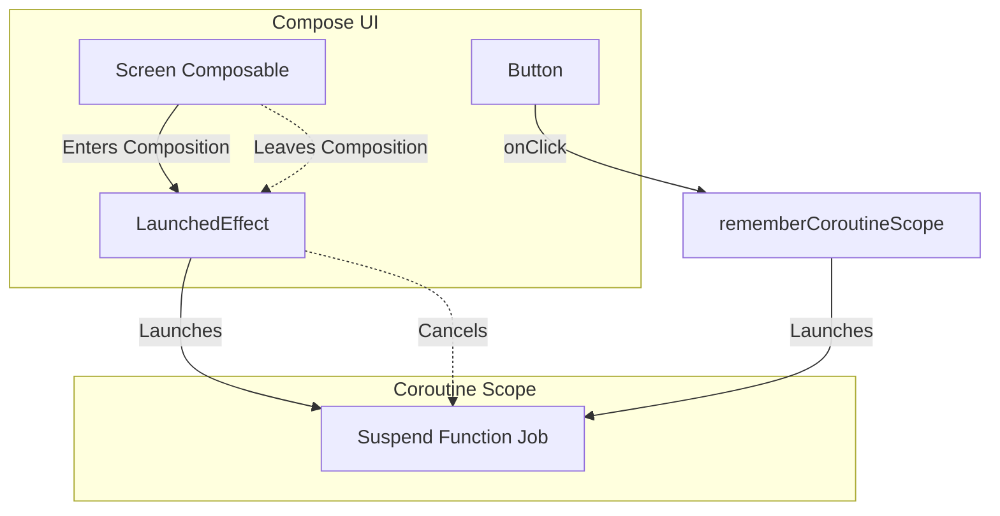

# Side Effects in Compose

## Overview

A "Side Effect" in Jetpack Compose is any change to the state of the app that happens *outside* the scope of a composable function. 

A Staff Engineer understands that Compose functions must be **Pure** and **Side-Effect Free**. Because Compose can re-execute a function 60 times a second, or execute functions in parallel on different threads, or completely skip executing a function if it thinks the UI hasn't changed, running non-UI logic (like making a network call or writing to a database) directly inside a `@Composable` will destroy the application.

To safely execute non-UI logic from the UI layer, you must use Compose's highly specific **Effect Handlers** (`LaunchedEffect`, `DisposableEffect`, `SideEffect`).

## Why It Matters

Imagine you want to track an analytics event every time the User Profile screen is opened.

```kotlin
// DISASTER: 
@Composable
fun UserProfile(userId: String) {
    // This will fire 60 times a second if the user scrolls!
    // It might also fire on a background thread!
    Analytics.track("Profile Opened") 
    
    Text("User $userId")
}
```

Because `UserProfile` can be recomposed rapidly during animations or scrolling, you will send thousands of identical analytics events, crashing your backend and draining the user's battery. You must wrap the tracking call in a Side Effect handler so Compose knows *when* to execute it safely.

## Historical Context

- **XML Era:** We relied heavily on Activity Lifecycles (`onCreate`, `onResume`, `onStop`). If we wanted to trigger an animation or an analytics event, we put it in `onResume()`. 
- **Compose Era:** Composables do not have `onResume`. They only have three lifecycle states: **Enter the Composition**, **Recompose**, and **Leave the Composition**. Effect Handlers bridge the gap, allowing us to tie standard Kotlin Coroutines to this new, UI-driven lifecycle.

## First Principles

1.  **Pure Function:** A function that, given the same inputs, always returns the same UI, and does absolutely nothing else.
2.  **Effect Handler:** A special Composable that executes code safely in response to the Compose lifecycle.
3.  **The `key`:** Effect handlers use "keys" (variables) to determine if they should cancel their current work and restart. If the key changes, the effect restarts.

## The Toolbelt (Mental Models)

### 1. `LaunchedEffect` (The Coroutine Bridge)
- **Use Case:** You want to launch a `suspend` function (a Coroutine) when the Composable enters the screen.
- **Mental Model:** Tying a rope from the UI node to a Coroutine. If the UI node is removed from the screen, Compose automatically cuts the rope, cancelling the Coroutine.
- **Example:** Showing a `Snackbar`, or triggering a one-off entrance animation.

### 2. `rememberCoroutineScope` (The User Action Bridge)
- **Use Case:** You want to launch a Coroutine in response to a user action (like clicking a button), not in response to the UI rendering.
- **Mental Model:** A pocket-sized Coroutine Scope that is tied to the UI lifecycle, but only activates when the user presses the button.

### 3. `DisposableEffect` (The Cleanup Crew)
- **Use Case:** You are interacting with a legacy system that requires an explicit `unregister` or `dispose` call (like a BroadcastReceiver, or a SensorManager).
- **Mental Model:** Renting a car. You must explicitly return the keys when you leave the city (when the Composable leaves the screen).

### 4. `SideEffect` (The Synchronizer)
- **Use Case:** You want to publish Compose state to non-Compose code, but *only* if the recomposition was mathematically successful.
- **Mental Model:** A final stamp of approval. It only runs after the frame has successfully drawn to the screen.

## Internal Mechanics

### How `LaunchedEffect` Cancels Work

```kotlin
@Composable
fun ProfileScreen(userId: String) {
    // 1. LaunchedEffect enters the composition.
    // 2. The key is `userId`.
    LaunchedEffect(key1 = userId) {
        // 3. This runs on a Coroutine!
        viewModel.fetchData(userId) 
    }
}
```

If the user clicks "Next Profile" and the `userId` parameter changes from `"UserA"` to `"UserB"`:
1. Compose recomposes `ProfileScreen`.
2. It hits `LaunchedEffect`. It checks the key: `"UserA" == "UserB"`? **False**.
3. Compose instantly cancels the Coroutine running for `"UserA"`.
4. Compose starts a brand new Coroutine for `"UserB"`.

If the user hits the Back Button and leaves the screen, Compose cancels the Coroutine automatically. No memory leaks!

## Architecture



## Production Example

**The `Snackbar` Architecture**

In traditional Android, you just called `Toast.makeText().show()`. In Compose, a `Snackbar` must be hosted in a `Scaffold`, and showing it is a `suspend` function.

```kotlin
@Composable
fun SettingsScreen(viewModel: SettingsViewModel) {
    val scaffoldState = rememberScaffoldState()
    val errorMessage by viewModel.errorFlow.collectAsState()

    // We MUST use LaunchedEffect because scaffoldState.snackbarHostState.showSnackbar() 
    // is a suspend function. We cannot call suspend functions directly in a Composable!
    LaunchedEffect(key1 = errorMessage) {
        if (errorMessage != null) {
            scaffoldState.snackbarHostState.showSnackbar(
                message = errorMessage,
                duration = SnackbarDuration.Short
            )
            viewModel.onErrorShown() // Clear the state!
        }
    }

    Scaffold(scaffoldState = scaffoldState) {
        // UI ...
    }
}
```

## Tradeoffs

**`LaunchedEffect` vs ViewModel `init` block**

Where should you fetch data for a screen?

- **ViewModel `init` block:**
    - *Pros:* Survives configuration changes (rotation). Fetching starts immediately before the UI even renders.
    - *Cons:* If the ViewModel is shared across multiple screens (e.g. via an Activity-scoped ViewModel), the `init` block fires too early, fetching data for a screen the user hasn't opened yet.
- **`LaunchedEffect(Unit)`:**
    - *Pros:* Strictly tied to the exact moment the UI node appears on the screen. Excellent for analytics.
    - *Cons:* Every time the user rotates the phone, the Composable leaves and re-enters the composition. `LaunchedEffect` will cancel the network call and restart it from scratch on rotation, destroying battery life and API quotas.

*Staff Note:* Never use `LaunchedEffect` to fetch primary screen data if that data needs to survive rotation. Data fetching belongs in the ViewModel, triggered by Navigation intents or lazy `StateFlow` subscriptions (`SharingStarted.WhileSubscribed`). Use `LaunchedEffect` strictly for UI-specific side effects (Animations, Snackbars, Analytics).

## Failure Modes

- **The `Unit` Key Trap:**
  ```kotlin
  @Composable
  fun SearchScreen(searchQuery: String) {
      // BAD: key1 is Unit. Unit never changes!
      LaunchedEffect(key1 = Unit) {
          api.search(searchQuery)
      }
  }
  ```
  If the user types a new letter, `SearchScreen` recomposes, but `LaunchedEffect` sees `Unit == Unit`. It ignores the new `searchQuery` and does absolutely nothing. The UI never updates.
  *(Fix: Always pass the variable you are reading inside the block as the `key` to `LaunchedEffect`).*
- **Click Listener Suspend Crashes:**
  ```kotlin
  // ERROR: Kotlin compiler will reject this.
  Button(onClick = { 
      scaffoldState.snackbarHostState.showSnackbar("Saved!") 
  })
  ```
  `onClick` is a standard `() -> Unit` lambda. You cannot call `suspend` functions inside it.
  *(Fix: Wrap the `showSnackbar` call inside `val scope = rememberCoroutineScope()`, then call `scope.launch { ... }` inside the `onClick`).*

## Staff Engineer Thinking

When reviewing Compose code, a Staff engineer heavily interrogates the use of Effect Handlers.

1.  **Is it truly a UI side effect?** I frequently see PRs where `LaunchedEffect` is used to trigger a database write when a variable changes. This violates Unidirectional Data Flow. The UI should not be making database decisions. I enforce that the UI fires an Intent (`viewModel.onDataChanged()`) and the ViewModel executes the database write in its own `viewModelScope`.
2.  **`DisposableEffect` Validation:** If a developer wraps a classic `BroadcastReceiver` or a GPS `LocationManager` in a Compose screen, I explicitly verify that the `onDispose { ... }` block perfectly unregisters the listener. If it doesn't, we have a massive memory and battery leak.
3.  **`rememberUpdatedState`:** When passing a lambda into a `LaunchedEffect` that takes a long time to run, the lambda might capture a stale value. I ensure the team uses `rememberUpdatedState` to guarantee the Coroutine always reads the absolute newest value from the composition.

## Common Misconceptions

- **"I should put all my coroutines inside `LaunchedEffect`."** False. Business logic coroutines belong in the `ViewModel` using `viewModelScope`. `LaunchedEffect` is strictly for UI-layer coroutines.
- **"I can just use `CoroutineScope(Dispatchers.Main).launch` in Compose."** Catastrophic mistake. If you manually create a CoroutineScope inside a Composable, it is not tied to the Compose lifecycle. When the user navigates away, the Coroutine will keep running forever, leaking memory and crashing the app when it tries to update a UI node that no longer exists.

## Probing Questions

1.  Why is it architecturally dangerous to place non-UI logic (like a database write) directly into the body of a `@Composable` function?
2.  Explain the exact lifecycle of a `LaunchedEffect` regarding when its internal Coroutine is started and when it is automatically cancelled.
3.  What is the purpose of the `key` parameter in `LaunchedEffect`? What happens to the running Coroutine if the key changes?
4.  Why must you use `rememberCoroutineScope()` to show a Snackbar in response to a Button click, rather than using a `LaunchedEffect`?
5.  Describe a scenario where you absolutely must use a `DisposableEffect` instead of a `LaunchedEffect`.
6.  Explain the "Unit Key Trap" when dealing with search queries in Compose.
7.  If you trigger a network request inside a `LaunchedEffect(Unit)`, what happens to that network request when the user rotates their Android device?
8.  Why is a ViewModel's `init` block often superior to `LaunchedEffect` for loading the primary data of a screen?
9.  Describe the memory leak that occurs if you manually use `CoroutineScope(Dispatchers.Main).launch` inside a Composable instead of an Effect Handler.
10. If a `LaunchedEffect` contains a `while(true)` loop (e.g., for a custom animation ticker), what stops the loop from running infinitely and freezing the app?

## Further Reading

- [`recomposition-and-state.md`](recomposition-and-state.md) — How state changes trigger the Effect Handlers to re-evaluate their keys.
- [`structured-concurrency.md`](../concurrency/coroutines-under-the-hood.md) — The underlying Coroutine mechanics that power `LaunchedEffect` cancellation.
- [Android Developers: Side-effects in Compose](https://developer.android.com/jetpack/compose/side-effects)
