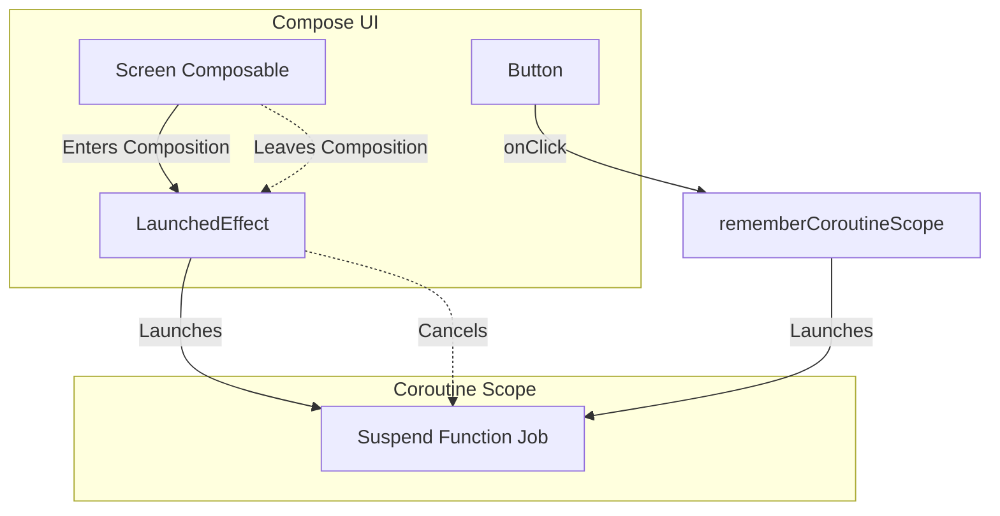

# Side Effects in Compose

## Overview

A side effect is a change that is visible outside the execution of a composable, such as starting a request, registering a listener, showing a snackbar, or publishing analytics.

A Staff Engineer keeps composable bodies free of uncontrolled effects because their execution frequency and order are not business-lifecycle guarantees: a call can be recomposed, skipped, or abandoned. Effect APIs tie necessary UI-layer work to composition lifecycle and successful application.

Use Compose **effect APIs** (`LaunchedEffect`, `DisposableEffect`, `SideEffect`, and related tools) for necessary work whose lifetime belongs to the UI. Business operations should normally be triggered as events and owned outside the composable.

## Why It Matters

Imagine you want to track an analytics event every time the User Profile screen is opened.

```kotlin
// DISASTER: 
@Composable
fun UserProfile(userId: String) {
    // This runs whenever this scope recomposes, not once per screen visit.
    Analytics.track("Profile Opened") 
    
    Text("User $userId")
}
```

Because `UserProfile` can recompose, the inline call can send duplicate analytics events. Tie the event to the intended identity/lifetime—for example, `LaunchedEffect(userId)` for one event per entry/key—or move screen analytics to the navigation/lifecycle owner when that is the real semantic boundary.

## Historical Context

- **XML Era:** We relied heavily on Activity Lifecycles (`onCreate`, `onResume`, `onStop`). If we wanted to trigger an animation or an analytics event, we put it in `onResume()`. 
- **Compose Era:** A composable call has a lifecycle relative to a composition location: it enters, may recompose, and eventually leaves. Android lifecycle events such as `ON_RESUME` still exist and can be observed when they are the required signal; effect APIs bridge composition lifecycle to coroutines and listener APIs.

## First Principles

1.  **Pure Function:** A function that, given the same inputs, always returns the same UI, and does absolutely nothing else.
2.  **Effect Handler:** A special Composable that executes code safely in response to the Compose lifecycle.
3.  **The `key`:** Effect handlers use "keys" (variables) to determine if they should cancel their current work and restart. If the key changes, the effect restarts.

## The Toolbelt (Mental Models)

### 1. `LaunchedEffect` (The Coroutine Bridge)
- **Use Case:** You want to launch a `suspend` function (a Coroutine) when the Composable enters the screen.
- **Mental Model:** Tying a rope from the UI node to a Coroutine. If the UI node is removed from the screen, Compose automatically cuts the rope, cancelling the Coroutine.
- **Example:** Showing a `Snackbar`, or triggering a one-off entrance animation.

### 2. `rememberCoroutineScope` (The User Action Bridge)
- **Use Case:** You want to launch a Coroutine in response to a user action (like clicking a button), not in response to the UI rendering.
- **Mental Model:** A pocket-sized Coroutine Scope that is tied to the UI lifecycle, but only activates when the user presses the button.

### 3. `DisposableEffect` (The Cleanup Crew)
- **Use Case:** You are interacting with a legacy system that requires an explicit `unregister` or `dispose` call (like a BroadcastReceiver, or a SensorManager).
- **Mental Model:** Renting a car. You must explicitly return the keys when you leave the city (when the Composable leaves the screen).

### 4. `SideEffect` (The Synchronizer)
- **Use Case:** You want to publish Compose state to non-Compose code only after a successful recomposition has applied.
- **Mental Model:** A final stamp of approval. It runs after a successful recomposition has applied its changes; it is not a guarantee that pixels have already been drawn.

## Internal Mechanics

### How `LaunchedEffect` Cancels Work

```kotlin
@Composable
fun ProfileScreen(userId: String) {
    // 1. LaunchedEffect enters the composition.
    // 2. The key is `userId`.
    LaunchedEffect(key1 = userId) {
        // 3. This runs on a Coroutine!
        viewModel.fetchData(userId) 
    }
}
```

If the user clicks "Next Profile" and the `userId` parameter changes from `"UserA"` to `"UserB"`:
1. Compose recomposes `ProfileScreen`.
2. It hits `LaunchedEffect`. It checks the key: `"UserA" == "UserB"`? **False**.
3. Compose cancels the coroutine job running for `"UserA"`; cancellation is cooperative.
4. Compose starts a brand new Coroutine for `"UserB"`.

If the user navigates back and the effect leaves the composition, Compose cancels its job. Resources used by the block must still cooperate with cancellation or be cleaned up by the API they require.

## Architecture



## Production Example

**The `Snackbar` Architecture**

In Compose Material, a `SnackbarHostState` is commonly displayed through a `SnackbarHost` in a `Scaffold`, and `showSnackbar` is a suspending function.

```kotlin
@Composable
fun SettingsScreen(viewModel: SettingsViewModel) {
    val snackbarHostState = remember { SnackbarHostState() }
    val errorMessage by viewModel.errorFlow.collectAsStateWithLifecycle()

    // Use a composition-scoped effect because showSnackbar()
    // is a suspend function. We cannot call suspend functions directly in a Composable!
    LaunchedEffect(key1 = errorMessage) {
        if (errorMessage != null) {
            snackbarHostState.showSnackbar(
                message = errorMessage,
                duration = SnackbarDuration.Short
            )
            viewModel.onErrorShown() // Clear the state!
        }
    }

    Scaffold(snackbarHost = { SnackbarHost(snackbarHostState) }) {
        // UI ...
    }
}
```

## Tradeoffs

**`LaunchedEffect` vs ViewModel `init` block**

Where should you fetch data for a screen?

- **ViewModel `init` block:**
    - *Pros:* Survives configuration changes (rotation). Fetching starts immediately before the UI even renders.
    - *Cons:* If the ViewModel is shared across multiple screens (e.g. via an Activity-scoped ViewModel), the `init` block fires too early, fetching data for a screen the user hasn't opened yet.
- **`LaunchedEffect(Unit)`:**
    - *Pros:* Strictly tied to the exact moment the UI node appears on the screen. Excellent for analytics.
    - *Cons:* If recreation disposes and rebuilds this composition, the old effect is cancelled and the new one starts again. Without idempotency or a retained data owner, that can duplicate work.

*Staff Note:* Durable screen data usually belongs in a `ViewModel` or repository so it survives UI recreation and can be cached or retried deliberately. `LaunchedEffect` is appropriate for work whose lifetime truly matches a composition location, including UI actions and forwarding a current key to a state owner; make the operation idempotent when re-entry is possible.

## Failure Modes

- **The `Unit` Key Trap:**
  ```kotlin
  @Composable
  fun SearchScreen(searchQuery: String) {
      // BAD: key1 is Unit. Unit never changes!
      LaunchedEffect(key1 = Unit) {
          api.search(searchQuery)
      }
  }
  ```
  If the user types a new letter, `SearchScreen` recomposes, but the constant key keeps the existing effect. A block that captured the initial query does not launch a new search, so results can remain stale.
  *(Fix: pass values whose change must restart the work as keys. For a value that must stay current without restarting a long-lived effect, use `rememberUpdatedState`.)*
- **Calling a suspend function from a click lambda:**
  ```kotlin
  // ERROR: Kotlin compiler will reject this.
  Button(onClick = { 
      scaffoldState.snackbarHostState.showSnackbar("Saved!") 
  })
  ```
  `onClick` is a standard `() -> Unit` lambda. You cannot call `suspend` functions inside it.
  *(Fix: Wrap the `showSnackbar` call inside `val scope = rememberCoroutineScope()`, then call `scope.launch { ... }` inside the `onClick`).*

## Staff Engineer Thinking

When reviewing Compose code, a Staff engineer heavily interrogates the use of Effect Handlers.

1.  **Is it truly a UI side effect?** I frequently see PRs where `LaunchedEffect` is used to trigger a database write when a variable changes. This violates Unidirectional Data Flow. The UI should not be making database decisions. I enforce that the UI fires an Intent (`viewModel.onDataChanged()`) and the ViewModel executes the database write in its own `viewModelScope`.
2.  **`DisposableEffect` validation:** If a screen registers a `BroadcastReceiver`, lifecycle observer, or location callback, verify that `onDispose` unregisters the exact registered object. Missing cleanup can retain the screen or continue resource-consuming callbacks.
3.  **`rememberUpdatedState`:** When a long-lived effect needs a changing callback without restarting, use `rememberUpdatedState` so the running coroutine reads the latest value supplied by composition.

## Common Misconceptions

- **"I should put all my coroutines inside `LaunchedEffect`."** False. Business logic coroutines belong in the `ViewModel` using `viewModelScope`. `LaunchedEffect` is strictly for UI-layer coroutines.
- **"I can just use `CoroutineScope(Dispatchers.Main).launch` in Compose."** A manually created scope has no automatic relationship to this composition location. Its jobs can outlive the UI, retain captured objects, or publish obsolete results. Use a composition-aware scope/effect for UI work or a longer-lived owner such as a `ViewModel` when the work should outlive the screen.

## Probing Questions

1.  Why is it architecturally dangerous to place non-UI logic (like a database write) directly into the body of a `@Composable` function?
2.  Explain the exact lifecycle of a `LaunchedEffect` regarding when its internal Coroutine is started and when it is automatically cancelled.
3.  What is the purpose of the `key` parameter in `LaunchedEffect`? What happens to the running Coroutine if the key changes?
4.  Why is `rememberCoroutineScope()` usually the direct tool for showing a Snackbar from a Button click, and when might state plus `LaunchedEffect` still be appropriate?
5.  Describe a scenario where `DisposableEffect` is more appropriate than `LaunchedEffect`.
6.  Explain the "Unit Key Trap" when dealing with search queries in Compose.
7.  If you trigger a network request inside a `LaunchedEffect(Unit)`, what happens to that network request when the user rotates their Android device?
8.  Why is a ViewModel's `init` block often superior to `LaunchedEffect` for loading the primary data of a screen?
9.  What lifecycle and retention risks arise if you manually use `CoroutineScope(Dispatchers.Main).launch` inside a Composable instead of an Effect Handler?
10. If a `LaunchedEffect` contains a loop for a custom ticker, how does cooperative cancellation stop it, and what coding mistake can still freeze the UI thread?

## Answer Key

1. A composable body can execute again for reasons unrelated to the business event, so an inline database write or request can be duplicated, reordered, or run for a composition that is later abandoned. It also hides ownership and breaks unidirectional data flow. Emit an event to the state owner for business work, or use the appropriate effect API when the work genuinely belongs to this UI lifecycle.
2. `LaunchedEffect` launches its coroutine when that effect enters the composition. It keeps the job while the effect remains at the same position with equal keys, cancels it when the effect leaves, and also cancels it before launching a replacement when a key changes. Cancellation is cooperative, so suspend functions and explicit cancellation checks must be allowed to run.
3. Keys define the identity of the effect's current work. When any key compares unequal, Compose cancels the existing coroutine and launches the block again with the new inputs. Include values whose change requires a restart; use `rememberUpdatedState` for changing values or callbacks that the existing long-lived operation should read without restarting.
4. A button click is an event, not a state of entering composition. `rememberCoroutineScope` returns a scope whose jobs are cancelled when that call leaves the composition, and the click handler can launch `showSnackbar` exactly when the user acts. A `LaunchedEffect` can also react to modeled event state, but using it merely to convert every click into a changing key adds state and makes repeated-event handling harder.
5. Use `DisposableEffect` when setup has a mandatory synchronous teardown, such as registering a lifecycle observer, broadcast receiver, sensor listener, or callback API. Register inside the effect and unregister the same object in `onDispose`. `LaunchedEffect` is better for suspending work whose cancellation performs cleanup; it does not provide the explicit `onDispose` contract required by registration APIs.
6. `LaunchedEffect(Unit)` has a constant identity, so recomposition with a new search query does not restart its coroutine. If the block captured the original query, later text is ignored. Key the effect by `searchQuery` when each change should cancel and restart (usually with debounce), or send queries to a `ViewModel` Flow and use `flatMapLatest`/`mapLatest` there.
7. Rotation commonly destroys and recreates the Activity composition. The old `LaunchedEffect` job is cancelled when it leaves, and the new composition launches another `LaunchedEffect(Unit)`. Whether network I/O actually stops depends on cooperative cancellation in that stack; durable loading should be owned or cached outside the recreated UI and made safe to repeat.
8. A screen-scoped `ViewModel` survives configuration change, so its `init` work and state are not restarted merely because the Activity UI is recreated. It is suitable when loading is intrinsic to creation of that state owner. It is not always superior: shared ViewModels can initialize too early, parameters may arrive later, and explicit events or subscription-driven loading can express the desired lifetime better.
9. A newly constructed scope is not cancelled when its composable call leaves. A running job can retain the Activity, callbacks, or other captured objects, continue unnecessary work, and deliver stale results after navigation. The issue is an uncontrolled lifetime—not a guaranteed permanent leak—so choose `LaunchedEffect`, `rememberCoroutineScope`, or a longer-lived structured owner according to who should own cancellation.
10. Leaving the composition or changing a key cancels the effect's job. A loop using cancellable suspension points such as `delay`, `withFrameNanos`, or `yield`, or checking `isActive`, observes cancellation and exits. A tight `while (true)` with no suspension or cancellation check monopolizes the composition coroutine's dispatcher and can freeze the UI before cancellation gets a chance to run.

## Further Reading

- [`recomposition-and-state.md`](recomposition-and-state.md) — How state changes trigger the Effect Handlers to re-evaluate their keys.
- [`structured-concurrency.md`](../architecture/structured-concurrency.md) — The underlying Coroutine mechanics that power `LaunchedEffect` cancellation.
- [Android Developers: Side-effects in Compose](https://developer.android.com/develop/ui/compose/side-effects)
- [Android Developers: State and event hoisting](https://developer.android.com/develop/ui/compose/state-hoisting)
