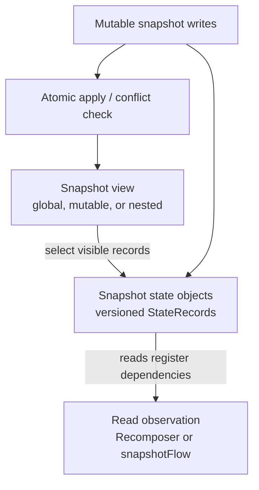

# The Snapshot System — Compose's MVCC for UI State

> Every `mutableStateOf` you write is backed by a piece of machinery older than Compose itself: the **Snapshot system**. It's a Kotlin-native, multi-version concurrency control (MVCC) implementation that lets thread A write state while thread B safely reads a consistent older view. Staff-level mastery means understanding how Compose tracks which state your `@Composable` *read*, how `snapshotFlow` bridges to coroutines, and how `MutableSnapshot` lets you batch UI updates atomically without locks.

---

## The Problem Snapshots Solve

A Compose UI has two unforgiving constraints:

1. **Consistent versioned reads.** Snapshot state may be read from different execution contexts, and an explicit snapshot presents the versions visible to that snapshot.
2. **Atomic publication when requested.** If two states must agree (`{count, total}` where `total = count * price`), an explicit mutable snapshot can publish both compatible writes together instead of exposing an intermediate pair.

Coarse locking across composition would introduce contention and make consistent observation difficult to integrate with fine-grained invalidation.

The Snapshot system replaces locks with **versioned data**. Every `MutableState<T>` doesn't hold a value — it holds a *list of versioned values*. Each read sees its assigned snapshot's version. Writes go into a private snapshot, then *apply* atomically.

This is the same pattern PostgreSQL uses internally (MVCC). Compose adapted it for in-process UI state.

---

## The Three Conceptual Layers



State objects retain versioned records, a snapshot selects the visible version, and observation connects reads to invalidation; applying a mutable snapshot publishes compatible writes atomically.

- A `MutableState<T>` is backed by a `SnapshotMutableState<T>` (or similar `SnapshotStateObject`).
- It maintains a linked chain of `StateRecord` versions. Records can be reused; do not assume a permanent one-record-per-snapshot allocation.
- A read of `state.value` looks up the right `StateRecord` for the *current snapshot*.

---

## `mutableStateOf` Under the Hood

```kotlin
val counter = mutableStateOf(0)

counter.value = 1
println(counter.value)   // 1
```

Looks trivial. A simplified sketch of the internal shape follows; concrete class names and notification plumbing can change between runtime versions:

```kotlin
class SnapshotMutableStateImpl<T>(initialValue: T) : MutableState<T> {
    private var next: StateStateRecord<T> = StateStateRecord(initialValue)
        // pointer to a linked-list head of versioned records

    override var value: T
        get() {
            val readRecord = next.readable(this)   // find the StateRecord visible in current Snapshot
            return readRecord.value
        }
        set(value) {
            val current = next.readable(this).value
            if (current != value) {
                val writeRecord = next.writable(this)   // get a writable record for current snapshot
                writeRecord.value = value
                Snapshot.current.notifyWrite()  // tell observers there's a new value
            }
        }
}
```

Two key operations:

- **`readable`** — walks the linked list of `StateRecord`s and returns the most recent one that's *visible* to the current snapshot.
- **`writable`** — either reuses the record from the current snapshot or allocates a new one.

This versioning supports isolated reads and writes, but a coroutine on `Dispatchers.IO` does **not** automatically receive a private mutable snapshot. Without `Snapshot.enter`/`withMutableSnapshot`, it operates in the current (normally global) snapshot context. Use an explicit mutable snapshot when a group of writes needs isolation and atomic apply, and coordinate concurrent writers at the architecture level when ordering matters.

---

## The Global Snapshot

There's always a **global snapshot** — `Snapshot.current` when no other snapshot is active. Most reads and writes happen in it:

```kotlin
fun main() {
    val state = mutableStateOf(0)
    state.value = 5            // writes to global snapshot
    println(state.value)       // reads from global snapshot → 5
}
```

The global snapshot has no apply/commit semantics. Writes immediately become visible to other readers in the global snapshot.

---

## `MutableSnapshot` — Atomic Multi-State Updates

When you need to write **multiple states atomically** (no observer sees an intermediate inconsistent state):

```kotlin
val count = mutableStateOf(0)
val total = mutableStateOf(0.0)

Snapshot.withMutableSnapshot {
    count.value = 5
    total.value = 5 * 19.99
}
```

Mechanics:

1. `withMutableSnapshot` creates a new `MutableSnapshot` and runs the block inside it.
2. Writes inside the block go to records private to this snapshot — observers in the global snapshot still see the old values.
3. When the block returns, the snapshot is **applied** atomically: all writes become visible at the same instant.
4. Snapshot observers are notified of the applied set; UI readers see the consistent pair when their scheduled recomposition runs.

Without an atomic state transition, another snapshot observer can in principle observe or react to an intermediate logical state, even when frame batching often hides it visually.

Use `withMutableSnapshot` when multiple snapshot-state writes truly require atomic visibility. In application architecture, a single immutable `UiState` update is often simpler and makes the invariant explicit without exposing several independently writable fields.

---

## Snapshot Observation — How Compose Tracks Reads

This is the magic that makes Compose feel reactive. When a `@Composable` runs:

1. The Recomposer enters a *snapshot observer scope*.
2. The Composable body runs; every `state.value` read calls `Snapshot.current.readObserver?.invoke(state)`.
3. The observer records: *this group depends on this state.*
4. When that state is later written, the Recomposer's notification fires: *invalidate the groups that depend on it.*

You never write this code; the Recomposer + Compose Compiler do it implicitly.

But the API is public:

```kotlin
val state = mutableStateOf(0)

val observer = Snapshot.registerApplyObserver { stateObjects, _ ->
    println("These states were written: $stateObjects")
}

// Later:
state.value = 1   // observer sees the state when apply notifications are sent

observer.dispose()
```

Apply observation is one low-level ingredient used by Compose's snapshot state observers. The runtime maps changed state objects back to scopes that recorded reads, invalidates those scopes, and lets the Recomposer schedule work; an apply notification is not itself a UI frame.

---

## `snapshotFlow` — Bridging to Coroutines

The bridge from Compose's snapshot world to coroutines:

```kotlin
val counter = mutableStateOf(0)

// Observe state changes as a coroutine Flow
launch {
    snapshotFlow { counter.value }
        .filter { it > 10 }
        .collect { value ->
            log("Counter exceeded 10: $value")
        }
}
```

`snapshotFlow { block }`:

1. Runs `block` once initially to capture which states it reads.
2. Subscribes to those states via `Snapshot.registerApplyObserver`.
3. On any of those states being written, re-runs `block` and emits the new result.
4. De-duplicates: only emits when the result actually changes.

Critical for: feeding state into analytics, persistence, side effects that shouldn't live in Composables. Inverse of `collectAsState` (which bridges Flow → Compose state).

---

## `derivedStateOf` — Computed State

```kotlin
val items = mutableStateOf<List<Item>>(emptyList())
val total = derivedStateOf { items.value.sumOf { it.price } }
```

`derivedStateOf` works via the same snapshot mechanism:

1. Computes the value lazily; reads any state inside.
2. Tracks which states the computation depends on.
3. When any of those states change, marks the derived value dirty.
4. Next read re-runs the block.

The difference vs `snapshotFlow`:

- `derivedStateOf` is a `State<T>` — reads can be done inside `@Composable` and participate in recomposition.
- `snapshotFlow` is a `Flow<T>` — for non-Compose consumers.

```kotlin
@Composable
fun CartSummary(items: State<List<Item>>) {
    val total by remember(items) {
        derivedStateOf { items.value.sumOf { it.price } }
    }
    Text("Total: $total")
}
```

Changes to `items.value` invalidate readers of `total` only when the computed total changes. If `items` were an ordinary parameter instead of observable snapshot state, `remember(items) { items.sumOf(...) }` would be the appropriate cache; wrapping non-state inputs in `derivedStateOf` adds no observation benefit.

---

## `mutableStateListOf` / `mutableStateMapOf` / `mutableStateSetOf`

Collections that are themselves snapshot-aware:

```kotlin
val items = mutableStateListOf<Item>()

items.add(Item("apple", 1.0))   // observers notified
items.remove(items[0])          // observers notified
```

Internally each operation is implemented as a snapshot read+write. Use these when you need a mutable list that Compose can observe (e.g., a todo list backed by state).

Don't confuse this with `mutableStateOf(listOf(...))`, which commonly replaces the immutable list value for each logical update. Snapshot collections expose observable structural mutations without replacing the list reference and suit mutation-oriented APIs; one immutable list in `State` often makes unidirectional reductions and atomic replacement clearer. Performance depends on observation and mutation patterns, so measure rather than assuming either representation always wins.

---

## Snapshot State in Non-Compose Code

You can use the snapshot system outside `@Composable`. It's pure Kotlin:

```kotlin
class TodoManager {
    val todos = mutableStateListOf<Todo>()

    fun add(todo: Todo) { todos.add(todo) }
    fun remove(todo: Todo) { todos.remove(todo) }
}
```

Pair with `snapshotFlow` from a ViewModel:

```kotlin
class TodoViewModel(private val manager: TodoManager) : ViewModel() {
    val todos: StateFlow<List<Todo>> = snapshotFlow { manager.todos.toList() }
        .stateIn(viewModelScope, SharingStarted.WhileSubscribed(5_000), emptyList())
}
```

This keeps the class independent of `@Composable` and Compose UI, but it still depends on `androidx.compose.runtime`. Prefer `StateFlow` directly when the state owner should also be independent of the Compose runtime.

---

## Apply vs Dispose Semantics

A `MutableSnapshot` has three terminal operations:

| Operation | What happens |
|---|---|
| `snapshot.apply()` | Attempts to publish all writes atomically and returns `Success` or `Failure`; apply observers are notified for successful changes. |
| `snapshot.dispose()` | Snapshot torn down. Used when applying isn't needed. |
| `Snapshot.withMutableSnapshot { … }` | Runs a non-suspending block, applies on normal return, and throws `SnapshotApplyConflictException` if publication fails. |

```kotlin
val snapshot = Snapshot.takeMutableSnapshot()
try {
    snapshot.enter { state.value = newValue }
    val applyResult = snapshot.apply()
    if (applyResult is SnapshotApplyResult.Failure) {
        // Another snapshot wrote conflicting state; handle the conflict
    }
} finally {
    snapshot.dispose()
}
```

`SnapshotApplyResult.Failure` can happen when:

- a state changed after this mutable snapshot was taken, and
- the pending record cannot be merged according to the state's mutation policy.

Do not assume every concurrent write is a simple first-writer-wins rule. A library can retry from a fresh snapshot when the operation is safe to repeat, serialize ownership, or surface the conflict.

Almost always you'll use `withMutableSnapshot { … }` — the manual path is rare and reserved for transactional semantics in libraries.

---

## Real Android Patterns

### Pattern 1: Atomic multi-field form submission

```kotlin
class FormViewModel : ViewModel() {
    val email = mutableStateOf("")
    val password = mutableStateOf("")
    val isLoading = mutableStateOf(false)
    val error = mutableStateOf<String?>(null)

    fun submit() = viewModelScope.launch {
        Snapshot.withMutableSnapshot {
            isLoading.value = true
            error.value = null
        }
        try {
            api.signIn(email.value, password.value)
            Snapshot.withMutableSnapshot {
                isLoading.value = false
                // Navigate elsewhere
            }
        } catch (e: Exception) {
            Snapshot.withMutableSnapshot {
                isLoading.value = false
                error.value = "Invalid credentials"
            }
        }
    }
}
```

Without `withMutableSnapshot`, observers could see `isLoading=true, error="..."` for one frame — confusing UI flicker.

### Pattern 2: `snapshotFlow` for analytics

```kotlin
@Composable
fun ProductScreen(productId: String) {
    LaunchedEffect(productId) {
        snapshotFlow { productState.value }
            .filterNot { it.isLoading }
            .first()
            .let { state ->
                analytics.track("product_viewed", "product_id" to state.product?.id)
            }
    }
}
```

Track when the state settles, not every emission. Snapshot-aware.

### Pattern 3: `derivedStateOf` for a lower-frequency UI result

```kotlin
@Composable
fun ScrollAwareActions(listState: LazyListState) {
    val showButton by remember(listState) {
        derivedStateOf {
            listState.firstVisibleItemIndex > 0
        }
    }
    AnimatedVisibility(showButton) { ScrollToTopButton() }
}
```

Scroll position can change frequently, while the threshold result changes only when the first item enters or leaves the leading position. The derived state prevents its readers from being invalidated while the Boolean stays the same.

### Pattern 4: Snapshot state in DI-injected singletons

```kotlin
@Singleton
class FeatureFlags @Inject constructor() {
    val flags = mutableStateMapOf<String, Boolean>()

    fun isEnabled(key: String): Boolean = flags[key] ?: false
}

@Composable
fun FeatureGated(featureKey: String, content: @Composable () -> Unit) {
    val featureFlags: FeatureFlags = LocalFeatureFlags.current
    if (featureFlags.isEnabled(featureKey)) content()
}
```

Updates to `flags[key]` re-trigger any Composable that called `isEnabled(key)`. Reactive feature flags without a Flow chain.

### Pattern 5: Hand-rolled `SnapshotStateObject` (rare)

For library code: implement your own state object subclass:

```kotlin
class CounterState(initialValue: Int = 0) : StateObject {
    private var record = CounterStateRecord(initialValue)

    override val firstStateRecord: StateRecord get() = record
    override fun prependStateRecord(value: StateRecord) {
        @Suppress("UNCHECKED_CAST")
        record = value as CounterStateRecord
    }

    var value: Int
        get() = readable(record, this).value
        set(value) {
            writable(record, this) { this.value = value }
        }
}
```

Almost no app developer needs this. Useful only if you're building a Compose-aware custom state container.

---

## Failure Modes

| Symptom | Cause | Fix |
|---|---|---|
| State change in IO coroutine never reflects in UI | Wrote to non-snapshot state (plain field) | Use `mutableStateOf` / `mutableStateListOf` |
| Multi-state UI exposes intermediate combinations | One logical transition is split across independent state writes | Prefer one immutable `UiState`, or use `Snapshot.withMutableSnapshot { … }` when separate state objects require atomic publication |
| `snapshotFlow` produces unexpected emissions | Result equality does not represent the semantic change you care about | Return a value with correct `equals`, then apply Flow operators for domain filtering |
| Derived-state cache is repeatedly discarded | A new `derivedStateOf` object is created on each recomposition | Give the derived state stable ownership, commonly with `remember` inside composition |
| Snapshot conflict failure on apply | A mutable snapshot cannot merge its writes with changes applied since it was taken | Retry from fresh state when safe, serialize the transaction, or redesign ownership; `withMutableSnapshot` can also throw a conflict |
| `snapshotFlow` doesn't emit when state changes | Block doesn't actually read the state object | Read `state.value`, not a captured local |
| Recomposition triggered for unrelated state changes | Reading too many states inside the Composable | Move reads closer to the consumer; use `derivedStateOf` |
| Observation outlives its consumer | `snapshotFlow` collector is launched in an owner that lives too long | Collect in the intended lifecycle/composition scope and cancel that scope appropriately |
| `mutableStateListOf` not observed | Read the list as a captured local outside Composable | Read inside `@Composable` or `snapshotFlow` |
| Production app: state changes from background threads silently ignored | Object stored is not a snapshot state | Migrate to `mutableStateOf` |
| Snapshot exception "Reading a state that is not in the current snapshot" | Captured snapshot leaked across scope | Don't pass `Snapshot` references across coroutines |
| `derivedStateOf` always returns initial value | Body reads a `var` instead of a state | Use `mutableStateOf` for the source state |
| Compiler reports a snapshot-state wrapper as unstable | The wrapper's public behavior does not satisfy an inferred stability contract | Make the contract genuinely stable; annotate only when all stability guarantees are true |
| Performance regression from `mutableStateListOf` | Many small mutations triggering recomposition | Batch with `withMutableSnapshot` |

---

## Common Pitfalls

- **Splitting one logical transition across independent observable fields.** Prefer one immutable `UiState` when practical; use `withMutableSnapshot` when separate snapshot-state objects genuinely require atomic publication.
- **Recreating `derivedStateOf` in composition.** Preserve the derived-state object with `remember` unless another owner already provides stable identity.
- **`snapshotFlow` block that captures non-state locals.** The Flow won't re-emit because it doesn't see changes.
- **Reading state inside a non-snapshot scope.** A coroutine launched without `Dispatchers.Main` and reading `state.value` is fine, but the read doesn't subscribe — it just gets a snapshot. Subsequent changes won't propagate unless you use `snapshotFlow`.
- **Treating `mutableStateOf` as a replacement for coroutine ownership.** Snapshot state provides versioned observation, but it does not define which concurrent writer should win or encode business ordering. Keep one state owner or serialize transitions where order matters.
- **Choosing a state container by object size alone.** Immutable replacement gives simple ownership; snapshot collections give observable mutation. Choose from update/read patterns and measure allocation or invalidation cost.
- **Duplicating one source of truth in both `MutableState` and `StateFlow`.** Bridging between them is legitimate; independently writable copies are the problem. Keep one owner and derive adapters for consumers.
- **Manual snapshot management.** Almost never needed. Use `withMutableSnapshot` or `snapshotFlow`.

---

## Probing Questions

1. Walk through what happens at the snapshot level when you call `state.value = newValue`. Where does the value go?
2. Explain why `state.value = 1; state.value = 2` from two different coroutines doesn't cause `ConcurrentModificationException`.
3. What's the difference between writing to state inside `withMutableSnapshot` vs writing directly?
4. Walk through how `snapshotFlow { state.value }` knows when to emit.
5. Why is `derivedStateOf` normally wrapped in `remember { }`, and is omission automatically a correctness failure?
6. `mutableStateListOf` vs `mutableStateOf(listOf(...))` — when to use each, and what's the perf difference?
7. Explain how Compose's Recomposer subscribes to state reads inside a `@Composable` function. How does this connect to the snapshot system?
8. A coroutine in your ViewModel sets 4 state fields in sequence. The UI shows visible flicker between updates. Diagnose and fix.
9. `Snapshot.registerApplyObserver` — when would you use it directly, and when is it overkill?
10. Snapshot conflict on apply — give an example scenario where this happens and how to recover.
11. How does the snapshot system enable `mutableStateOf` to be used **outside** `@Composable` code (e.g., in plain Kotlin libraries)?
12. Compare `snapshotFlow { x.value }.stateIn(scope)` vs reading `x.value` inside `LaunchedEffect`. When pick each?

## Answer Key

1. The setter first checks the state's mutation policy; an equivalent value may be ignored. Otherwise it obtains or creates a writable `StateRecord` for the current snapshot and stores the new value there, then records a write so snapshot/apply observers can be notified. In the global snapshot the change participates in global advancement; in an explicit mutable snapshot it remains isolated until a successful `apply`. Readers select the record visible to their current snapshot.
2. `MutableState` is a versioned snapshot state object, not a fail-fast collection iterator, so competing writes use state records and snapshot publication rather than modifying an `ArrayList` structure being iterated. That prevents `ConcurrentModificationException`, but it does not define business ordering: two global writes can race logically, and two explicit mutable snapshots that change the same state can conflict when applied. Use one owner, synchronization, or retryable snapshot transactions when “which write wins” matters.
3. A direct write normally updates the current/global snapshot context and becomes part of the next global notification cycle; sequential direct writes are separate observable mutations. `withMutableSnapshot` gives the block an isolated mutable snapshot and attempts to publish all compatible changes atomically when the non-suspending block returns. Other snapshots see either the old set or the successfully applied set, and a conflict is reported by exception instead of partially applying the block.
4. `snapshotFlow` runs its read-only block in a snapshot while recording which snapshot state objects are read. Apply notifications for those objects schedule the block to run again; if the result is unequal to the last emitted result, the Flow emits it. The observed dependency set can change on each run. The block must not mutate snapshot state, and normal Flow cancellation stops observation.
5. `derivedStateOf` is itself an object that caches a result and tracks dependencies. `remember` preserves that object across recompositions, retaining its cache and avoiding new observation objects. Omitting `remember` is not automatically wrong when the derived object is created outside composition or otherwise has stable ownership, and creating one inline may still produce correct values, but repeated reconstruction usually defeats the intended optimization.
6. `mutableStateListOf` provides an observable mutable collection: structural operations notify readers and are convenient when the API naturally performs individual insertions, removals, or replacements. `mutableStateOf(listOf(...))` models the list as one immutable value and notifies when a new list is assigned, which fits reducers and atomic screen-state updates. Snapshot lists can reduce whole-list copying but may trigger fine-grained or repeated observations; immutable replacement can allocate more but gives simple ownership. Measure the actual workload.
7. Composition runs with snapshot read observation. When a composable reads `state.value`, the runtime associates that state object with the current recomposition scope. After a successful state change is applied and notifications are processed, scopes that observed the changed object are invalidated; the Recomposer schedules them, and a later recomposition refreshes their dependency set. Reads lower in the tree therefore create narrower invalidation boundaries.
8. First verify that the four fields are independent snapshot states and that intermediate combinations are actually observed; recomposition may batch writes in one frame, so the visible flicker could also come from asynchronous operations or separate emissions. Prefer reducing all related values into one immutable `UiState` assignment. If the fields must remain separate snapshot objects and atomic visibility is required, update them in a non-suspending `Snapshot.withMutableSnapshot` block, with one owner and an explicit conflict strategy.
9. A runtime or state-library author might use `registerApplyObserver` to integrate a custom scheduler, diagnostic tool, or observer that needs the set of changed snapshot objects after apply. The callback is global/low-level and requires correct disposal, filtering, and notification assumptions. Application UI should normally use composition reads, `snapshotFlow`, derived state, or Flow APIs, which provide lifecycle and value semantics without coupling to snapshot internals.
10. Two mutable snapshots can start from the same visible record, both write the same state, and then apply after one has already published a change. If the mutation policy cannot merge the second record, `apply` returns failure (or `withMutableSnapshot` throws). Dispose the failed snapshot; retry the whole deterministic transaction from fresh state when safe, serialize the writer, or redesign around a single reducer. Never publish side effects from a block that may be retried.
11. Snapshot observation belongs to the state objects and `Snapshot` runtime, not to `@Composable`. Plain Kotlin code that depends on `androidx.compose.runtime` can create and mutate snapshot state, enter explicit snapshots, or expose changes through `snapshotFlow`. It gains versioning and observation but not composition-scoped lifecycle automatically; the caller still owns collectors, concurrency policy, and disposal.
12. `snapshotFlow { x.value }.stateIn(scope)` creates a shared coroutine `StateFlow` whose lifetime, replay, and sharing policy belong to `scope`; choose it when multiple non-Compose or Compose consumers need a Flow-shaped adapter. Reading `x.value` inside `LaunchedEffect` is just a one-time read unless an enclosing `snapshotFlow` or another suspending observation mechanism is used; recomposition alone does not restart a constant-key effect. Use direct reads in composition for rendering, `snapshotFlow` for a stream of snapshot changes, and keys for effect identity—not as an observation substitute.

---

## Further Reading

- [`compose-runtime.md`](compose-runtime.md) — the runtime that uses the snapshot system.
- [`recomposition-and-state.md`](recomposition-and-state.md) — state management at the API level.
- [`stability.md`](stability.md) — `@Stable`/`@Immutable` for snapshot-state-holding wrappers.
- [`side-effects.md`](side-effects.md) — `LaunchedEffect` + `snapshotFlow` patterns.
- [`../../kotlin/coroutines-and-flow/coroutines.md`](../../kotlin/coroutines-and-flow/coroutines.md) — bridging snapshot world to Flow.
- [`../../kotlin/runtime-and-jvm/memory-model.md`](../../kotlin/runtime-and-jvm/memory-model.md) — JMM concurrency that snapshots build on.
- [`../architecture/viewmodel.md`](../architecture/viewmodel.md) — snapshot-state ViewModels.
- [Android Developers — State and Jetpack Compose](https://developer.android.com/develop/ui/compose/state) — observable state overview.
- [Android Developers — `Snapshot` API](https://developer.android.com/reference/kotlin/androidx/compose/runtime/snapshots/Snapshot) — mutable snapshots, apply semantics, and observers.
- [Android Developers — snapshot runtime package](https://developer.android.com/reference/kotlin/androidx/compose/runtime/snapshots/package-summary) — current API and source links.
- [Leland Richardson — The State of State (Android Dev Summit)](https://www.youtube.com/results?search_query=leland+richardson+compose+state) — Compose architect's talk.
