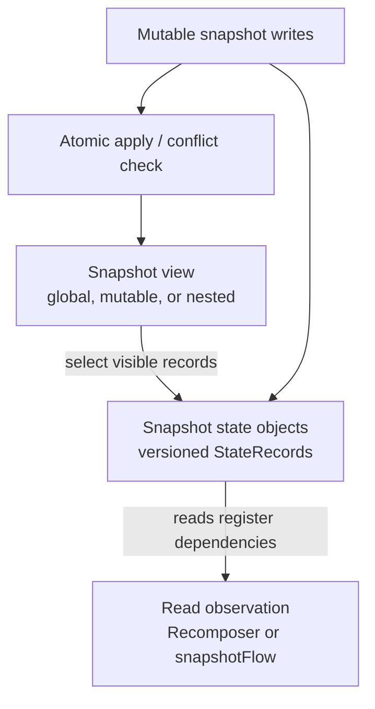

# The Snapshot System — Compose's MVCC for UI State

> Every `mutableStateOf` you write is backed by a piece of machinery older than Compose itself: the **Snapshot system**. It's a Kotlin-native, multi-version concurrency control (MVCC) implementation that lets thread A write state while thread B safely reads a consistent older view. Staff-level mastery means understanding how Compose tracks which state your `@Composable` *read*, how `snapshotFlow` bridges to coroutines, and how `MutableSnapshot` lets you batch UI updates atomically without locks.

---

## The Problem Snapshots Solve

A Compose UI has two unforgiving constraints:

1. **Many readers, many writers.** A `MutableState<Int>` can be written from a coroutine on `Dispatchers.IO` while the recomposer is reading it on `Dispatchers.Main`.
2. **No tearing.** If two states must agree (`{count, total}` where `total = count * price`), readers must see a consistent pair — never `count=new, total=old`.

The naive solution — `synchronized` blocks — destroys frame budgets. Locks held across recomposition mean contention. Locks held during recomposition mean even worse contention.

The Snapshot system replaces locks with **versioned data**. Every `MutableState<T>` doesn't hold a value — it holds a *list of versioned values*. Each read sees its assigned snapshot's version. Writes go into a private snapshot, then *apply* atomically.

This is the same pattern PostgreSQL uses internally (MVCC). Compose adapted it for in-process UI state.

---

## The Three Conceptual Layers



State objects retain versioned records, a snapshot selects the visible version, and observation connects reads to invalidation; applying a mutable snapshot publishes compatible writes atomically.

- A `MutableState<T>` is backed by a `SnapshotMutableState<T>` (or similar `SnapshotStateObject`).
- It holds a linked list of `StateRecord` instances — one per concurrent snapshot that has written to it.
- A read of `state.value` looks up the right `StateRecord` for the *current snapshot*.

---

## `mutableStateOf` Under the Hood

```kotlin
val counter = mutableStateOf(0)

counter.value = 1
println(counter.value)   // 1
```

Looks trivial. Underneath:

```kotlin
class SnapshotMutableStateImpl<T>(initialValue: T) : MutableState<T> {
    private var next: StateStateRecord<T> = StateStateRecord(initialValue)
        // pointer to a linked-list head of versioned records

    override var value: T
        get() {
            val readRecord = next.readable(this)   // find the StateRecord visible in current Snapshot
            return readRecord.value
        }
        set(value) {
            val current = next.readable(this).value
            if (current != value) {
                val writeRecord = next.writable(this)   // get a writable record for current snapshot
                writeRecord.value = value
                Snapshot.current.notifyWrite()  // tell observers there's a new value
            }
        }
}
```

Two key operations:

- **`readable`** — walks the linked list of `StateRecord`s and returns the most recent one that's *visible* to the current snapshot.
- **`writable`** — either reuses the record from the current snapshot or allocates a new one.

This is what lets a coroutine on `IO` write `state.value = newData` without blocking the Main thread's recomposer. The IO thread writes into its own snapshot's record; the Main thread continues reading the previous record until the IO snapshot is applied.

---

## The Global Snapshot

There's always a **global snapshot** — `Snapshot.current` when no other snapshot is active. Most reads and writes happen in it:

```kotlin
fun main() {
    val state = mutableStateOf(0)
    state.value = 5            // writes to global snapshot
    println(state.value)       // reads from global snapshot → 5
}
```

The global snapshot has no apply/commit semantics. Writes immediately become visible to other readers in the global snapshot.

---

## `MutableSnapshot` — Atomic Multi-State Updates

When you need to write **multiple states atomically** (no observer sees an intermediate inconsistent state):

```kotlin
val count = mutableStateOf(0)
val total = mutableStateOf(0.0)

Snapshot.withMutableSnapshot {
    count.value = 5
    total.value = 5 * 19.99
}
```

Mechanics:

1. `withMutableSnapshot` creates a new `MutableSnapshot` and runs the block inside it.
2. Writes inside the block go to records private to this snapshot — observers in the global snapshot still see the old values.
3. When the block returns, the snapshot is **applied** atomically: all writes become visible at the same instant.
4. Observers re-read on the next frame and see the new consistent pair.

Without this, a recomposer running between `count.value = 5` and `total.value = ...` could observe `count=5, total=0` for a microsecond — a "tearing" frame.

Use `withMutableSnapshot` whenever multiple state writes must be atomically visible (cart updates, profile saves, multi-field forms).

---

## Snapshot Observation — How Compose Tracks Reads

This is the magic that makes Compose feel reactive. When a `@Composable` runs:

1. The Recomposer enters a *snapshot observer scope*.
2. The Composable body runs; every `state.value` read calls `Snapshot.current.readObserver?.invoke(state)`.
3. The observer records: *this group depends on this state.*
4. When that state is later written, the Recomposer's notification fires: *invalidate the groups that depend on it.*

You never write this code; the Recomposer + Compose Compiler do it implicitly.

But the API is public:

```kotlin
val state = mutableStateOf(0)

val observer = Snapshot.registerApplyObserver { stateObjects, _ ->
    println("These states were written: $stateObjects")
}

// Later:
state.value = 1   // observer fires with [state]

observer.dispose()
```

`registerApplyObserver` is how the Recomposer learns "frame N modified states X, Y, Z." It then asks each frame's snapshot which Composables depend on those states and re-runs only those.

---

## `snapshotFlow` — Bridging to Coroutines

The bridge from Compose's snapshot world to coroutines:

```kotlin
val counter = mutableStateOf(0)

// Observe state changes as a coroutine Flow
launch {
    snapshotFlow { counter.value }
        .filter { it > 10 }
        .collect { value ->
            log("Counter exceeded 10: $value")
        }
}
```

`snapshotFlow { block }`:

1. Runs `block` once initially to capture which states it reads.
2. Subscribes to those states via `Snapshot.registerApplyObserver`.
3. On any of those states being written, re-runs `block` and emits the new result.
4. De-duplicates: only emits when the result actually changes.

Critical for: feeding state into analytics, persistence, side effects that shouldn't live in Composables. Inverse of `collectAsState` (which bridges Flow → Compose state).

---

## `derivedStateOf` — Computed State

```kotlin
val items = mutableStateOf<List<Item>>(emptyList())
val total = derivedStateOf { items.value.sumOf { it.price } }
```

`derivedStateOf` works via the same snapshot mechanism:

1. Computes the value lazily; reads any state inside.
2. Tracks which states the computation depends on.
3. When any of those states change, marks the derived value dirty.
4. Next read re-runs the block.

The difference vs `snapshotFlow`:

- `derivedStateOf` is a `State<T>` — reads can be done inside `@Composable` and participate in recomposition.
- `snapshotFlow` is a `Flow<T>` — for non-Compose consumers.

```kotlin
@Composable
fun CartSummary(items: List<Item>) {
    val total by remember {
        derivedStateOf { items.sumOf { it.price } }
    }
    Text("Total: $total")
}
```

Compose recomposes `CartSummary` only when `total` actually changes — not on every recomposition of the parent. Big win for expensive derivations.

---

## `mutableStateListOf` / `mutableStateMapOf` / `mutableStateSetOf`

Collections that are themselves snapshot-aware:

```kotlin
val items = mutableStateListOf<Item>()

items.add(Item("apple", 1.0))   // observers notified
items.remove(items[0])          // observers notified
```

Internally each operation is implemented as a snapshot read+write. Use these when you need a mutable list that Compose can observe (e.g., a todo list backed by state).

Don't confuse with `mutableStateOf(listOf(...))` — the latter wraps an immutable List and rewrites the whole list on every change. The collection variants are better when you do many small mutations.

---

## Snapshot State in Non-Compose Code

You can use the snapshot system outside `@Composable`. It's pure Kotlin:

```kotlin
class TodoManager {
    val todos = mutableStateListOf<Todo>()

    fun add(todo: Todo) { todos.add(todo) }
    fun remove(todo: Todo) { todos.remove(todo) }
}
```

Pair with `snapshotFlow` from a ViewModel:

```kotlin
class TodoViewModel(private val manager: TodoManager) : ViewModel() {
    val todos: StateFlow<List<Todo>> = snapshotFlow { manager.todos.toList() }
        .stateIn(viewModelScope, SharingStarted.WhileSubscribed(5_000), emptyList())
}
```

This is the trick that makes ViewModels Compose-friendly without depending on Compose. The snapshot system is in `androidx.compose.runtime` but doesn't require the UI layer.

---

## Apply vs Dispose Semantics

A `MutableSnapshot` has three terminal operations:

| Operation | What happens |
|---|---|
| `snapshot.apply()` | All writes become visible. Observers fire. |
| `snapshot.dispose()` | Snapshot torn down. Used when applying isn't needed. |
| `Snapshot.withMutableSnapshot { … }` | Automatically applies on success, disposes on exception |

```kotlin
val snapshot = Snapshot.takeMutableSnapshot()
try {
    snapshot.enter { state.value = newValue }
    val applyResult = snapshot.apply()
    if (applyResult is SnapshotApplyResult.Failure) {
        // Another snapshot wrote conflicting state; handle the conflict
    }
} finally {
    snapshot.dispose()
}
```

`SnapshotApplyResult.Failure` happens when:

- Multiple `MutableSnapshot`s wrote to the same state, and both tried to apply.
- The first to apply wins; the second gets the failure result.

Almost always you'll use `withMutableSnapshot { … }` — the manual path is rare and reserved for transactional semantics in libraries.

---

## Real Android Patterns

### Pattern 1: Atomic multi-field form submission

```kotlin
class FormViewModel : ViewModel() {
    val email = mutableStateOf("")
    val password = mutableStateOf("")
    val isLoading = mutableStateOf(false)
    val error = mutableStateOf<String?>(null)

    fun submit() = viewModelScope.launch {
        Snapshot.withMutableSnapshot {
            isLoading.value = true
            error.value = null
        }
        try {
            api.signIn(email.value, password.value)
            Snapshot.withMutableSnapshot {
                isLoading.value = false
                // Navigate elsewhere
            }
        } catch (e: Exception) {
            Snapshot.withMutableSnapshot {
                isLoading.value = false
                error.value = "Invalid credentials"
            }
        }
    }
}
```

Without `withMutableSnapshot`, observers could see `isLoading=true, error="..."` for one frame — confusing UI flicker.

### Pattern 2: `snapshotFlow` for analytics

```kotlin
@Composable
fun ProductScreen(productId: String) {
    LaunchedEffect(productId) {
        snapshotFlow { productState.value }
            .filterNot { it.isLoading }
            .first()
            .let { state ->
                analytics.track("product_viewed", "product_id" to state.product?.id)
            }
    }
}
```

Track when the state settles, not every emission. Snapshot-aware.

### Pattern 3: `derivedStateOf` for expensive list operations

```kotlin
@Composable
fun FilteredList(items: List<Item>, query: String) {
    val filtered by remember(items, query) {
        derivedStateOf {
            items.filter { it.name.contains(query, ignoreCase = true) }
        }
    }
    LazyColumn { items(filtered) { ItemRow(it) } }
}
```

The filter runs only when `items` or `query` actually changes. Other recompositions (e.g., theme change) skip the filtering.

### Pattern 4: Snapshot state in DI-injected singletons

```kotlin
@Singleton
class FeatureFlags @Inject constructor() {
    val flags = mutableStateMapOf<String, Boolean>()

    fun isEnabled(key: String): Boolean = flags[key] ?: false
}

@Composable
fun FeatureGated(featureKey: String, content: @Composable () -> Unit) {
    val featureFlags: FeatureFlags = LocalFeatureFlags.current
    if (featureFlags.isEnabled(featureKey)) content()
}
```

Updates to `flags[key]` re-trigger any Composable that called `isEnabled(key)`. Reactive feature flags without a Flow chain.

### Pattern 5: Hand-rolled `SnapshotStateObject` (rare)

For library code: implement your own state object subclass:

```kotlin
class CounterState(initialValue: Int = 0) : StateObject {
    private var record = CounterStateRecord(initialValue)

    override val firstStateRecord: StateRecord get() = record
    override fun prependStateRecord(value: StateRecord) {
        @Suppress("UNCHECKED_CAST")
        record = value as CounterStateRecord
    }

    var value: Int
        get() = readable(record, this).value
        set(value) {
            writable(record, this) { this.value = value }
        }
}
```

Almost no app developer needs this. Useful only if you're building a Compose-aware custom state container.

---

## Failure Modes

| Symptom | Cause | Fix |
|---|---|---|
| State change in IO coroutine never reflects in UI | Wrote to non-snapshot state (plain field) | Use `mutableStateOf` / `mutableStateListOf` |
| Multi-state UI flickers between intermediate states | Sequential writes outside `withMutableSnapshot` | Wrap with `Snapshot.withMutableSnapshot { … }` |
| `snapshotFlow` emits multiple times for one change | Block reads multiple states, change-detect on values not detected | Ensure final `Equals` correctness on the result |
| `derivedStateOf` block re-runs on every recomposition | Used without `remember { ... }` | Always `remember { derivedStateOf { ... } }` |
| Snapshot conflict failure on apply | Two `MutableSnapshot`s wrote same state | Serialize writes; or use `withMutableSnapshot` (auto-applies) |
| `snapshotFlow` doesn't emit when state changes | Block doesn't actually read the state object | Read `state.value`, not a captured local |
| Recomposition triggered for unrelated state changes | Reading too many states inside the Composable | Move reads closer to the consumer; use `derivedStateOf` |
| Memory grows over time | `snapshotFlow` collector never cancelled | Cancel via lifecycle scope; use `flowOn` for downstream filters |
| `mutableStateListOf` not observed | Read the list as a captured local outside Composable | Read inside `@Composable` or `snapshotFlow` |
| Production app: state changes from background threads silently ignored | Object stored is not a snapshot state | Migrate to `mutableStateOf` |
| Snapshot exception "Reading a state that is not in the current snapshot" | Captured snapshot leaked across scope | Don't pass `Snapshot` references across coroutines |
| `derivedStateOf` always returns initial value | Body reads a `var` instead of a state | Use `mutableStateOf` for the source state |
| Compose Compiler shows `MutableState` field as unstable | Wrapped state in a non-`@Stable` class | Mark the wrapper `@Stable` |
| Performance regression from `mutableStateListOf` | Many small mutations triggering recomposition | Batch with `withMutableSnapshot` |

---

## Common Pitfalls

- **Not using `withMutableSnapshot` for multi-write updates.** Subtle tearing bugs that only appear under load.
- **Forgetting `remember { }` around `derivedStateOf`.** Without it, the derived computation rebuilds on every recomposition — defeating its purpose.
- **`snapshotFlow` block that captures non-state locals.** The Flow won't re-emit because it doesn't see changes.
- **Reading state inside a non-snapshot scope.** A coroutine launched without `Dispatchers.Main` and reading `state.value` is fine, but the read doesn't subscribe — it just gets a snapshot. Subsequent changes won't propagate unless you use `snapshotFlow`.
- **Treating `mutableStateOf` as a coroutine-safe primitive.** It is, for reads/writes. But ordering across threads is not guaranteed unless wrapped in `withMutableSnapshot`.
- **Storing massive objects in `mutableStateOf`.** Every "write" replaces the whole value. Use `mutableStateMapOf` / `mutableStateListOf` for collections.
- **Mixing `MutableState` with `StateFlow`.** Pick one. Either Compose-first (`mutableStateOf`) or coroutine-first (`StateFlow.collectAsState()`). Mixing creates two sources of truth.
- **Manual snapshot management.** Almost never needed. Use `withMutableSnapshot` or `snapshotFlow`.

---

## Probing Questions

1. Walk through what happens at the snapshot level when you call `state.value = newValue`. Where does the value go?
2. Explain why `state.value = 1; state.value = 2` from two different coroutines doesn't cause `ConcurrentModificationException`.
3. What's the difference between writing to state inside `withMutableSnapshot` vs writing directly?
4. Walk through how `snapshotFlow { state.value }` knows when to emit.
5. Why does `derivedStateOf` need to be wrapped in `remember { }`?
6. `mutableStateListOf` vs `mutableStateOf(listOf(...))` — when to use each, and what's the perf difference?
7. Explain how Compose's Recomposer subscribes to state reads inside a `@Composable` function. How does this connect to the snapshot system?
8. A coroutine in your ViewModel sets 4 state fields in sequence. The UI shows visible flicker between updates. Diagnose and fix.
9. `Snapshot.registerApplyObserver` — when would you use it directly, and when is it overkill?
10. Snapshot conflict on apply — give an example scenario where this happens and how to recover.
11. How does the snapshot system enable `mutableStateOf` to be used **outside** `@Composable` code (e.g., in plain Kotlin libraries)?
12. Compare `snapshotFlow { x.value }.stateIn(scope)` vs reading `x.value` inside `LaunchedEffect`. When pick each?

---

## Further Reading

- [`compose-runtime.md`](compose-runtime.md) — the runtime that uses the snapshot system.
- [`recomposition-and-state.md`](recomposition-and-state.md) — state management at the API level.
- [`stability.md`](stability.md) — `@Stable`/`@Immutable` for snapshot-state-holding wrappers.
- [`side-effects.md`](side-effects.md) — `LaunchedEffect` + `snapshotFlow` patterns.
- [`../../kotlin/coroutines-and-flow/coroutines.md`](../../kotlin/coroutines-and-flow/coroutines.md) — bridging snapshot world to Flow.
- [`../../kotlin/runtime-and-jvm/memory-model.md`](../../kotlin/runtime-and-jvm/memory-model.md) — JMM concurrency that snapshots build on.
- [`../architecture/viewmodel.md`](../architecture/viewmodel.md) — snapshot-state ViewModels.
- [Compose Snapshot System (Android Developers)](https://developer.android.com/develop/ui/compose/state) — overview.
- [Snapshot APIs in Compose Runtime](https://developer.android.com/reference/kotlin/androidx/compose/runtime/snapshots/package-summary) — reference.
- [Zach Klippenstein — Snapshots in Compose](https://dev.to/zachklipp) — engineer's deep dive.
- [Compose snapshot API reference](https://developer.android.com/reference/kotlin/androidx/compose/runtime/snapshots/package-summary) — current platform API and source links.
- [Leland Richardson — The State of State (Android Dev Summit)](https://www.youtube.com/results?search_query=leland+richardson+compose+state) — Compose architect's talk.
