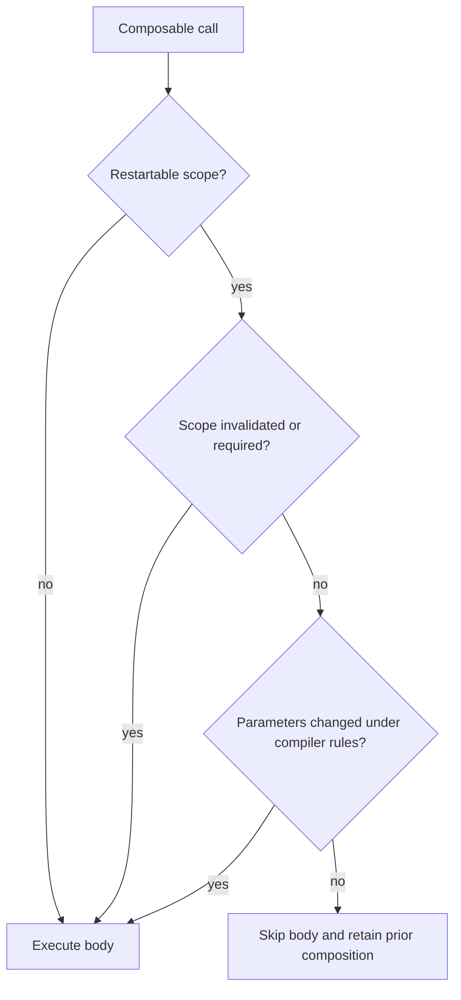

# Compose Stability — `@Stable`, `@Immutable`, and Why Your UI Recomposes

> Compose can skip eligible work when inputs compare unchanged. Stability, identity reuse, state observation and the compiler mode determine that decision. Learn to read compiler reports, choose honest `@Immutable`/`@Stable` contracts and measure the work that actually affects a frame.

---

## Why Stability Matters

With strong skipping enabled (the default since Kotlin 2.0.20), restartable composables can be skipped even with unstable parameters. Stable arguments compare with `equals()`; unstable arguments compare by reference identity (`===`). An invalidated scope still runs.

A list recreated on each parent recomposition is a different reference even when its contents are equal. Reusing an unchanged instance can permit skipping; it does not make mutation observable. Under the older non-strong-skipping model, unstable parameters made a composable unskippable.

Use compiler reports and runtime measurements to distinguish input changes, state invalidation and expensive work. Stability alone does not establish a frame-rate outcome.
---

## The Skipping Decision — Compose Compiler Output



Stability affects how parameter changes are evaluated; it does not make mutable data observable. A composable runs whenever its scope is invalidated or its inputs are considered changed.

Every `@Composable` function ends up in one of these classifications (visible in `compose-metrics/<module>-classes.txt`):

| Classification | Re-runs when parent recomposes? | Re-runs when own state changes? |
|---|---|---|
| **Restartable + Skippable** | When required by invalidation or changed inputs (stable: `equals`; unstable with strong skipping: `===`) | Yes |
| **Restartable, NOT Skippable** | **Always** (any time parent runs) | Yes |
| **Not Restartable / Inline** | When call site recomposes | n/a — inlined into parent |

The goal: **every `@Composable` with parameters should be both restartable AND skippable**.

Without strong skipping, an unstable parameter makes the composable unskippable. With strong skipping, restartable composables remain eligible for skipping, subject to invalidation and argument comparison.

---

## What's Inferred Stable

The Compose compiler classifies these as stable **without any annotation**:

### Primitives + `String`

```kotlin
@Composable fun Greet(name: String, age: Int, active: Boolean) { /* skippable ✅ */ }
```

`Int`, `Long`, `Double`, `Float`, `Boolean`, `Char`, `Byte`, `Short`, `String` — all stable. `String` is included because it's immutable.

### Function types without captures

```kotlin
@Composable fun Button(onClick: () -> Unit) { /* depends */ }
```

Lambda types are stable. With strong skipping enabled, the compiler remembers lambdas inside composables using stable captures with equality and unstable captures with identity. Older compiler modes had narrower memoization rules. Audit captures and toolchain mode rather than assuming callback syntax determines allocation.

What matters is **what the lambda captures**, not lambda-vs-reference syntax. Method references (`vm::processIntent`) behave equivalently on current compilers — but note they were historically the *buggy* case: the Compose compiler failed to memoize (adapted) function references until fixes landed in Compose compiler 1.5.1 and 1.5.5, so on older toolchains `vm::processIntent` allocated a new instance every recomposition while the equivalent lambda did not. If you're on a pre-1.5.5 compiler, prefer lambdas; on anything current, pick whichever reads better and audit the captures instead.

### Data classes where every property is stable

```kotlin
data class User(val id: String, val name: String, val age: Int)
// → Inferred STABLE
```

Two strict requirements:
- All properties are `val` (not `var`).
- All property types are themselves stable (primitives, `String`, other stable classes).

### Objects

```kotlin
object Constants { const val PI = 3.14 }
// → Stable; no state to track
```

### `MutableState<T>` and `State<T>`

The state holders themselves are annotated `@Stable`. Their wrapped values are tracked separately via the snapshot system.

---

## What's Inferred Unstable

### Interfaces and abstract types

```kotlin
@Composable fun ItemRow(items: List<Item>) { /* unstable; identity compared with strong skipping */ }
@Composable fun Lookup(map: Map<String, User>) { /* unstable; identity compared with strong skipping */ }
```

The compiler can't see the implementation of `List`, `Map`, `Set`. Anything could be a mutable subclass. Conservatively classified as unstable.

An unstable collection type affects how arguments are compared. With strong skipping, passing the same unchanged instance can skip a child; rebuilding an equal list changes identity. Measure the actual workload before attributing a performance problem to the type alone.

### `var` properties

```kotlin
data class User(val id: String, var name: String)   // NOT stable due to `var name`
```

A mutable property means the value can change at any time — compose can't trust `equals()` returns will stay consistent. The entire class becomes unstable.

### Mutable collections

```kotlin
data class Cart(val items: MutableList<Item>)   // NOT stable
```

`MutableList`, `MutableMap`, `MutableSet`, `mutableSetOf()`, etc. — all unstable.

### Types from other modules (sometimes)

If User is defined in a separate module that was not processed by the Compose compiler, its stability may not be inferred in the UI module. This concerns compiler participation and the type's actual contract, not which module happened to compile first.

Options include processing the model module with the Compose compiler, wrapping genuinely immutable models at the UI boundary, or using a narrowly justified stability declaration/configuration. Verify the contract before adding an annotation; under strong skipping an unstable parameter can still skip by identity.

### Lambda that captures unstable

```kotlin
@Composable
fun Row(item: Item, onClick: () -> Unit) { /* depends on onClick */ }

// At call site:
Row(item, onClick = { items.add(item); save() }) // function type is stable; captures affect memoization
```

Under strong skipping, this callback is remembered using its captures, including identity for unstable captures. Audit capture identity and observable mutation; do not rewrite a correct callback solely to remove a mutable capture.

---

## The Two Annotations

### `@Immutable`

```kotlin
@Immutable
data class User(val id: String, val tags: List<String>)
```

**Tells the compiler:** "Every property here, even though it might look unstable to you, can be treated as immutable. Trust me."

When to use:
- The class has a `List<T>` / `Set<T>` / `Map<K, V>` that you *promise* never to mutate after construction.
- You construct new instances with new lists rather than mutating existing ones.
- You can guarantee `equals()` is consistent across recompositions.

If you lie — e.g., you annotate `@Immutable` but your code mutates the internal list — you'll get stale UI and Compose won't recompose when you want.

### `@Stable`

```kotlin
@Stable
interface State<out T> {
    val value: T
}
```

**Tells the compiler:** "Properties may change, but the change is observable through the snapshot system. `equals()` returns are still reliable."

When to use:
- An interface or class that *does* have mutable state, but the mutation is tracked properly (via `MutableState` or similar).
- A function that returns a stable value (e.g., `@Stable fun Modifier.padding(8.dp)` declares the resulting modifier as stable).

`@Stable` is a weaker guarantee than `@Immutable`. Most app code wants `@Immutable`; framework / library code uses `@Stable` for stateful but observable interfaces.

### Pick by table

| Annotation | Guarantees | Use when |
|---|---|---|
| `@Immutable` | All properties never change after construction | You have a UI state class with `List<T>` you don't mutate |
| `@Stable` | `equals()` is reliable; mutation is properly observed by Compose | You have a custom state holder interface |
| (neither) | Compose infers from the structure | All properties are primitives + `String` + stable types |

---

## Strong Skipping Mode

Modern Compose Compiler ships with **Strong Skipping Mode**, enabled by default starting with Kotlin 2.0.20. For older Compose Compiler configurations it was an opt-in, so key the advice to the compiler/Kotlin toolchain rather than the Compose UI artifact version.

Key change: **Composable functions become skippable even with unstable parameters — but unstable parameters are compared with instance equality (`===`), not `equals()`.** Stable parameters keep the `equals()` comparison.

What this means in practice:

| Before Strong Skipping | After Strong Skipping |
|---|---|
| `@Composable fun List(items: List<Item>)` — never skips | Skips when `items === previousItems` (same instance) |
| Lambdas capturing unstable state — never memoized | Memoized, keyed on the captured values (compared with `===` for unstable captures) |
| Required `@Immutable` annotations for `List<T>` use cases | Often unnecessary — *if* you pass the same instance across recompositions |
| Deep `equals()` on large stable lists on every recomposition | Unstable params get a cheap identity check instead |

This is a huge improvement and significantly reduces the need for `@Immutable` annotations on every domain type. **Verify your Compose Compiler version supports it before relying on it.**

The `===` detail is the practical catch: a structurally-equal-but-freshly-allocated `List` (e.g., rebuilt from a `.map { }` in the parent on every recomposition) is a **new instance**, fails the identity check, and never skips. Strong Skipping rewards *instance reuse*, not structural equality. If you can't guarantee the same instance flows through, stability annotations and `ImmutableList` still earn their keep — a stable parameter gets the `equals()` comparison, which a structurally-equal new instance *does* pass.

---

## Collections: `ImmutableList` and `PersistentList`

kotlinx.collections.immutable provides immutable collection structure. Compose recognizes its supported collection types, but generic element stability and the surrounding model's other properties still matter. An immutable container does not make mutable elements stable:

```kotlin
import kotlinx.collections.immutable.ImmutableList
import kotlinx.collections.immutable.PersistentList
import kotlinx.collections.immutable.persistentListOf
import kotlinx.collections.immutable.toImmutableList

@Composable
fun TagList(tags: ImmutableList<String>) {   // ← guaranteed-stable parameter
    LazyRow { items(tags) { Text(it) } }
}

// Usage
val tags = persistentListOf("urgent", "review", "draft")
TagList(tags = tags)
```

| Type | Use when |
|---|---|
| `ImmutableList<T>` (interface) | API surface |
| `PersistentList<T>` (subtype) | Need efficient `add`/`remove` returning new instances |
| `List<T>` annotated `@Immutable` parent class | Domain types where you control all construction |
| Plain `List<T>` | App-internal code where Strong Skipping covers you |

```kotlin
dependencies {
    implementation("org.jetbrains.kotlinx:kotlinx-collections-immutable:0.5.1")  // check for the latest release
}
```

For core model properties, an immutable collection can remove one source of uncertain stability. The full class still needs an honest mutability contract and stable/observable member types; verify the compiler report rather than assuming the collection settles the whole class.

---

## Stability Config Files

For third-party types you can't annotate (Java types, libraries without Compose support), use a stability config file:

```
// app/compose_stability_config.conf
java.time.LocalDate
java.time.LocalDateTime
java.util.UUID
com.somelibrary.OpaqueType
```

```kotlin
android {
    composeCompiler {
        stabilityConfigurationFiles.addAll(
            project.layout.projectDirectory.file("compose_stability_config.conf")
        )
    }
}
```

Listed types are treated as stable. Use for value-types from libraries that you've verified are immutable but the Compose Compiler can't see.

---

## Reading the Compose Compiler Metrics

Enable per-module metrics. On Kotlin 2.0+ (Compose Compiler Gradle plugin), use the DSL:

```kotlin
// build.gradle.kts (per module, or centralized in a convention plugin)
composeCompiler {
    metricsDestination = layout.buildDirectory.dir("compose_compiler")
    reportsDestination = layout.buildDirectory.dir("compose_compiler")
}
```

On pre-2.0 toolchains, the same outputs are enabled via raw compiler flags:

```kotlin
// build-logic/convention/.../ComposeMetrics.kt (legacy, Kotlin < 2.0)
tasks.withType<KotlinCompile>().configureEach {
    if (System.getenv("ENABLE_COMPOSE_METRICS") == "true") {
        kotlinOptions.freeCompilerArgs += listOf(
            "-P", "plugin:androidx.compose.compiler.plugins.kotlin:metricsDestination=${rootDir.path}/compose-metrics/${project.name}",
            "-P", "plugin:androidx.compose.compiler.plugins.kotlin:reportsDestination=${rootDir.path}/compose-metrics/${project.name}",
        )
    }
}
```

Run a **release** build (debug builds skip optimizations and skew the reports). Inspect:

### `<module>-classes.txt`

```
stable class User {
  stable val id: String
  stable val name: String
}

unstable class Cart {
  stable val id: String
  unstable val items: List<CartItem>  ← culprit
}
```

### `<module>-composables.txt`

```
restartable skippable scheme("[androidx.compose.ui.UiComposable]") fun Greet(
  stable name: String
)

restartable skippable fun CartScreen(   ← representative strong-skipping output
  unstable cart: Cart            ← compared by identity with strong skipping
)
```

Inspect the actual compiler mode and reports. A missing skippable marker needs investigation, but it is not by itself proof of a performance defect or an unstable-parameter cause. Measure invalidation and expensive work on representative call paths.

### `<module>-module.json`

Track composable counts and stability/skipping classifications across comparable toolchains. A changed count can reflect compiler mode, source changes or report format; inspect the diff before attributing it to an unstable parameter.

---

## Real Android Patterns

### Pattern 1: UI state as `@Immutable` data class with `ImmutableList`

```kotlin
@Immutable
data class CartUiState(
    val items: ImmutableList<CartItem> = persistentListOf(),
    val total: Money = Money.ZERO,
    val isLoading: Boolean = false,
    val error: String? = null,
)

@Composable
fun CartScreen(state: CartUiState) {
    // ← fully skippable; state.equals() compared on every recomposition
}
```

### Pattern 2: Method reference for `onClick`

```kotlin
@Composable
fun CartScreen(vm: CartViewModel) {
    val state by vm.state.collectAsStateWithLifecycle()
    CartContent(
        state = state,
        onAddItem = vm::addItem,    // ← stable & memoized (Compose compiler ≥ 1.5.5; use lambdas on older toolchains)
        onRemoveItem = vm::removeItem,
    )
}
```

Pre-allocating the lambdas in the parent and passing references through stays skippable.

### Pattern 3: Stable accessor function

```kotlin
@Stable
fun formatPrice(cents: Long): String = NumberFormat.getCurrencyInstance().format(cents / 100.0)
```

Marks the return as stable so wrap-then-pass patterns don't break skipping.

### Pattern 4: Wrapper for inherently-unstable third-party types

```kotlin
// Wrap a 3rd-party type you can't annotate
@Immutable
data class OkHttpRequestWrapper(val request: Request)
```

Crude but effective. Or use the stability config file.

---

## Failure Modes

| Symptom | Cause | Fix |
|---|---|---|
| Rows execute more often than expected | Changed arguments, observed-state invalidation, or work in the row | Inspect actual comparison/identity rules and traces before changing collection APIs |
| Compose metrics show unexpected non-skippable functions | Compiler mode, non-restartable functions or API shape | Check compiler reports and strong-skipping configuration; measure affected call sites |
| Frame rate drops after upgrading Compose Compiler | New stability rules made previously-stable types unstable | Re-run metrics; check `var` properties and 3rd-party deps |
| UI stays stale after an @Immutable object mutates | The annotation promise was violated | Use an actually immutable object graph or observable mutable state; annotations do not enforce immutability |
| Performance regression after migrating to `kotlinx.collections.immutable` | Excessive copying when building lists | Use `PersistentList` builder pattern |
| Compose metrics output is empty | Plugin args not added to module's kotlinc | Verify `freeCompilerArgs` in build-logic |
| Strong Skipping Mode doesn't kick in | Compiler version/configuration too old | Use Kotlin 2.0.20+ or explicitly enable it on an older supported compiler |
| State change in ViewModel doesn't update UI | Used `@Stable` annotation but class isn't truly stable | Re-audit — `@Stable` is a contract you must keep |
| Type from a minified library AAR shows unstable downstream | Library author's own R8 pass stripped stability annotations before publishing | Library must keep annotations in its published AAR; consumers can use the stability config file as a workaround |
| `LocalContext.current` reads cause cascading recomposition | Reading too high in the tree | Move read closer to the consuming Composable |
| `derivedStateOf` doesn't reduce recomposition | Block accessed mutable state outside it | Move all reads inside `derivedStateOf { }` |
| `@Composable` with `Modifier` param recomposes every frame | Custom modifier creates new instance per recomposition | Use `Modifier.composed { }` carefully; `remember { }` static modifiers |
| Cross-module type shows unstable | `@Immutable` not present on the model | Annotate in the `:api` module or use stability config |
| Callback identity changes unexpectedly | Captures or compiler configuration changed | Inspect remembered captures and toolchain mode; do not infer lambda type stability from its captures |

---

## Common Pitfalls

- **Annotating `@Immutable` without enforcing it.** If your "immutable" `User` has a `MutableList<String>` you populate later — Compose's assumption breaks; UI shows stale state.
- **Adding `@Stable` to fix metrics output.** Don't bandage. Ask: *why* is this unstable? Often the fix is `var` → `val` or `List` → `ImmutableList`.
- **Mutating an `ImmutableList`.** It's actually immutable — operations return new instances. `list.add(x)` doesn't exist; use `list + x` or `PersistentList.Builder`.
- **Per-row inline `onClick = { onItem(item) }` with unstable captures.** When `item` and `onItem` are stable, the compiler memoizes this lambda keyed on its captures — it's fine. But if `item` is unstable on a pre-Strong-Skipping compiler, the lambda reallocates on every recomposition and the row never skips. Fix the capture's stability rather than the lambda syntax.
- **Reading `vm` properties inside a `@Composable` instead of `by state.collectAsStateWithLifecycle()`.** Direct ViewModel reads cause leaks and don't participate in recomposition properly.
- **Putting state directly in a `var` field.** Compose can't observe non-`State` mutations.
- **Forgetting to instrument compose-metrics in CI.** Without trend tracking, stability regressions go unnoticed for months.
- **Trusting Strong Skipping Mode to fix everything.** It helps, but truly recomputed-every-time values (a freshly allocated `List`) still won't skip.
- **Stability config file for types you don't control + then those types change.** You promised stability; the type now mutates; you have a latent bug. Re-audit after every upgrade.
- **Annotating every type `@Immutable` "just to be safe."** Confuses readers; provides false security if any property is actually `var`.

---

## Probing Questions

1. Walk through Compose's smart recomposition decision flow. What happens at each step when a parent recomposes?
2. Why is `List<T>` inferred as unstable but `String` is stable? Walk through the reasoning.
3. Compare `@Immutable` vs `@Stable`. Give an example where you'd pick each.
4. Strong Skipping Mode (default since Kotlin 2.0.20) — what changed, and where does it still fall short?
5. `ImmutableList` vs `@Immutable data class Foo(val items: List<T>)` — both work. When pick each?
6. Read this `<module>-composables.txt` snippet and identify the perf bug: `restartable fun Row(stable id: String, unstable tags: List<String>)`.
7. Why is `onClick = { vm.process(item) }` worse than `onClick = vm::process` in a `LazyColumn`?
8. A `@Composable` recomposes 60 times per second despite no apparent input changes. Walk through your debugging.
9. Stability config file — when do you reach for it instead of `@Immutable`?
10. `MutableState<T>` is `@Stable` even though it's mutable. Explain why this is consistent.
11. Why does `data class User(val id: String, var name: String)` (note the `var`) ruin stability for the entire class?
12. Track skippability % over time in CI. Walk through your dashboard design and what regression looks like.

---

## Answer Key

1. Compose compares stable parameters at a restartable group; unchanged inputs allow skipping, while changed/unstable inputs execute the group and record new state reads.
2. `String` is immutable with stable equality. The `List` interface does not guarantee immutability, so the compiler cannot trust that its contents stayed unchanged.
3. Use `@Immutable` when every observable property is deeply immutable; use `@Stable` for a type whose mutations are observable by Compose and whose equality contract is stable.
4. Strong skipping makes restartable composables skippable even with unstable parameters and memoizes many lambdas. In-place mutation, expensive equality, changing captures, and incorrectly annotated types can still produce bugs or work.
5. Prefer immutable collections when the data model really needs an immutable collection contract. Annotate a wrapper only when you own and can enforce its entire immutability promise.
6. `tags` prevents ordinary stability inference and may cause avoidable work; use an immutable collection or a correctly enforced stable wrapper, then verify compiler reports.
7. A capturing lambda may create a new object for every item/recomposition; a stable method reference is more likely to retain identity. Measure before treating the syntax as a universal rule.
8. Inspect recomposition/highlight tooling, compiler reports, changing parameters, state reads, lambda captures, keys, and in-place mutations; then benchmark the smallest suspected group.
9. Use the configuration file for external types whose stability contract you have verified but cannot annotate. Prefer modeling the contract in owned types.
10. `MutableState` reports changes through the snapshot system, so Compose can safely observe mutation instead of assuming the object never changes.
11. A public `var` can change without an immutable value contract, so the compiler cannot infer that equal-looking instances remain stable.
12. Publish restartable/skippable counts by module and compiler version, normalize for generated code, alert on meaningful deltas, and correlate regressions with frame metrics rather than optimizing a percentage alone.

---

## Further Reading

- [`compose-runtime.md`](compose-runtime.md) — the runtime that uses stability decisions.
- [`recomposition-and-state.md`](recomposition-and-state.md) — the state side of the system.
- [`side-effects.md`](side-effects.md) — interactions between effects and stability.
- [`modifiers-and-layout.md`](modifiers-and-layout.md) — `Modifier` stability.
- [`../../kotlin/language-core/data-classes.md`](../../kotlin/language-core/data-classes.md) — stable `data class` requirements.
- [`../../kotlin/language-core/null-safety.md`](../../kotlin/language-core/null-safety.md) — `var` traps that ruin stability.
- [`../architecture/mvvm-vs-mvi.md`](../architecture/mvvm-vs-mvi.md) — UI state design with stability in mind.
- [Compose Compiler — Stability documentation](https://developer.android.com/jetpack/compose/performance/stability) — official.
- [Strong Skipping Mode](https://developer.android.com/develop/ui/compose/performance/stability/strongskipping) — official behavior and configuration.
- [Chris Banes — Composable metrics](https://chrisbanes.me/posts/composable-metrics/) — practitioner's audit guide.
- [kotlinx.collections.immutable](https://github.com/Kotlin/kotlinx.collections.immutable) — `ImmutableList` / `PersistentList`.
- [Compose stability guide](https://developer.android.com/develop/ui/compose/performance/stability) — current compiler stability model and remediation guidance.

### Official verification references

- [Primary documentation or owning implementation](https://developer.android.com/develop/ui/compose/performance/stability/fix)
