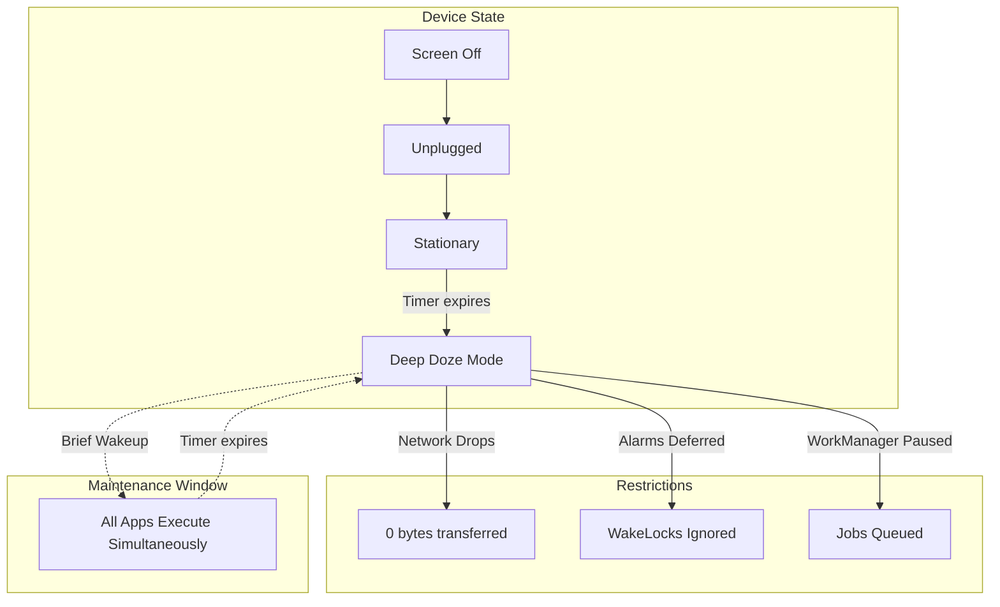

# Battery Optimizations: Doze and App Standby

## Overview

A Staff Android Engineer must architect applications under the assumption that the Operating System is actively hostile towards background execution. 

Google's primary goal is to preserve the user's battery life. To achieve this, the Android OS utilizes two aggressive power-saving systems: **Doze Mode** and **App Standby Buckets**. These systems will arbitrarily delay your alarms, drop your network requests, and kill your processes if you do not understand the rules of engagement.

## Why It Matters

Developers test their apps while the phone is plugged into their computer, with the screen on, actively tapping buttons. In this scenario, all alarms fire instantly and network requests are instantaneous.

The moment the user unplugs the phone, turns off the screen, and puts it in their pocket, the OS changes the rules. If you do not architect your app around Doze mode, push notifications will arrive 2 hours late, location tracking will silently fail, and `WorkManager` jobs will back up until the device melts down.

## Historical Context

In the early days of Android (Android 4.x), battery life was notoriously terrible. Any app could declare an `AlarmManager` to wake up the CPU every 30 seconds to check for new messages. If you had 50 apps installed, the CPU would wake up 50 times a minute. The battery would drain from 100% to 0% while the phone was sitting unused on a desk.

- **Android 6.0 (Marshmallow):** Introduced **Doze Mode** (system-wide sleep) and **App Standby** (per-app sleep).
- **Android 9.0 (Pie):** Introduced **App Standby Buckets** (Prioritizing apps based on how often the user opens them).
- **Android 12/13/14:** Introduced aggressive "Phantom Process Killers" and restricted `startForegroundService` to prevent apps from escaping these buckets.

## First Principles

1.  **Doze Mode (System-Wide):** Applies to the *entire device*. If the screen is off, the device is unplugged, and the device is completely stationary, the entire OS goes to sleep.
2.  **App Standby Buckets (Per-App):** Applies to *individual apps*. If a user hasn't opened your specific app in a week, the OS throws your app into a "Rare" bucket and severely limits its background network and execution quotas, even if the user is actively using the phone for other things.
3.  **Maintenance Windows:** During Doze, the OS occasionally wakes up for a brief "Maintenance Window." It lets all apps run their deferred jobs, syncs, and alarms at the exact same time, then immediately goes back to sleep.

## Mental Model

Think of Doze Mode as a **Long-Haul Flight**.
- **Active:** Passengers are boarding, walking around, using the Wi-Fi. (Screen is on).
- **Light Doze:** The seatbelt sign is on, lights are dimmed. You can read, but you can't walk around much. (Screen is off, but in pocket).
- **Deep Doze:** It's 2 AM over the Atlantic. Everyone is asleep. The flight attendants (the OS) refuse to serve food or Wi-Fi.
- **Maintenance Window:** The flight attendants briefly wake everyone up to serve breakfast. Everyone eats at exactly the same time (Batched Execution). Then everyone goes back to sleep until landing.

## Internal Mechanics

### 1. Doze Mode Restrictions
When the device enters Deep Doze:
- Network access is completely suspended.
- The system ignores `PowerManager.WakeLock`.
- Standard `AlarmManager` alarms (including `setExact`) are deferred until the next maintenance window.
- Wi-Fi scans do not run.
- Sync adapters and `JobScheduler` (`WorkManager`) jobs are deferred.

### 2. App Standby Buckets
The OS uses Machine Learning to place your app into one of five buckets:
1.  **Active:** App is currently open, or was just open. No restrictions.
2.  **Working Set:** App runs often (e.g., a social media app checked daily). Mild restrictions. Jobs run every few hours.
3.  **Frequent:** App used regularly, but not every day (e.g., a workout tracking app). Jobs deferred for 8+ hours.
4.  **Rare:** App rarely used (e.g., a hotel booking app). Strict restrictions. No internet access allowed in the background. Jobs deferred for 24+ hours.
5.  **Restricted:** App consumes too much battery or user explicitly restricted it in settings. App is completely dead in the background.

## Architecture



## Production Example

**FCM High Priority Messages (Escaping Doze)**

If you are building a chat application, you cannot wait for a 2-hour maintenance window to deliver a "Hello" message. You must wake the app up using Firebase Cloud Messaging (FCM).

The only way to pierce through Doze Mode is to send an FCM message from your backend with `priority = "high"`.

```json
// FCM Payload from your Backend
{
  "message": {
    "token": "device_token_xyz",
    "data": {
      "chat_id": "12345"
    },
    "android": {
      "priority": "high"
    }
  }
}
```

When the Android OS receives a High Priority FCM message during Doze:
1. It temporarily grants your app network access.
2. It grants your app a partial wakelock.
3. You have exactly **10 to 30 seconds** to process the message (e.g., download the text) and post a local Notification.
4. *Critical Staff Knowledge:* If you send High Priority messages but do *not* display a user-visible Notification, Google will detect this via heuristics and automatically "de-prioritize" your future messages to "Normal" priority, plunging your app back into Doze mode.

## Tradeoffs

**`setExactAndAllowWhileIdle` vs Standard Alarms**

If you are building an Alarm Clock or a Calendar reminder app, you need an alarm to fire at exactly 8:00 AM, even in Deep Doze.

- **Standard (`setExact`):** Will be deferred until 9:30 AM when the maintenance window opens.
- **While Idle (`setExactAndAllowWhileIdle`):** Will pierce Doze mode and wake the device at exactly 8:00 AM. 

**Tradeoff:** `setExactAndAllowWhileIdle` is incredibly heavy on the battery. Google restricts you to firing this a maximum of **once every 9 minutes**. Furthermore, starting in Android 14, you must explicitly declare the `SCHEDULE_EXACT_ALARM` permission in your manifest, and Google Play will reject your app if you are not a legitimate Alarm Clock or Calendar app.

## Failure Modes

- **The Wakelock Leak:**
  ```kotlin
  val wakeLock = powerManager.newWakeLock(PowerManager.PARTIAL_WAKE_LOCK, "MyApp::MyWakelockTag")
  wakeLock.acquire(10 * 60 * 1000L /*10 minutes*/)
  
  try {
      doWork()
  } catch(e: Exception) {
      // DISASTER: An exception is thrown, wakeLock.release() is never called!
      // The CPU is forced to stay awake for 10 straight minutes, draining the battery.
      // Google Play Console will flag your app as "Stuck Wakelock" and penalize your store ranking.
  }
  wakeLock.release()
  ```
  *(Fix: Always use a `finally` block to release wakelocks, or vastly prefer `WorkManager` which handles wakelocks automatically).*
- **Testing in a Vacuum:**
  A developer writes a daily sync job using `WorkManager`. They test it. It works. They ship it. In production, the sync never happens. Why? Because on the developer's phone, the app was in the "Active" bucket. In production, users haven't opened the app in a week, so it's in the "Rare" bucket, and the OS defers the job indefinitely.
  *(Fix: Test App Standby Buckets using ADB commands: `adb shell am set-standby-bucket <package> rare`).*

## Staff Engineer Thinking

1.  **Embrace Deferral:** I actively look for code that tries to fight the OS. If a developer uses `AlarmManager` to sync analytics data, I reject the PR. I enforce the rule: "If it's not a chat message or a literal alarm clock, it goes into `WorkManager`."
2.  **Quota Management:** I check if the team understands FCM limits. You cannot send 500 High-Priority FCM messages a day just to sync background data. You will exhaust your App Standby quota, and the OS will shadow-ban your notifications. High Priority is for user-facing alerts *only*.
3.  **Observability under Doze:** When debugging why a push notification "arrived late," I immediately check the `adb shell dumpsys deviceidle` logs. 99% of the time, the network request wasn't slow; the OS intentionally held the message hostage because the device was Dozing.

## Common Misconceptions

- **"If I use a Foreground Service, Doze Mode doesn't apply to me."** False. While a Foreground Service prevents your app from being killed, if the device goes into Deep Doze, the OS will *still* cut off your network access. Your Foreground Service will stay alive, but it won't be able to download anything until the maintenance window.
- **"I can request the `REQUEST_IGNORE_BATTERY_OPTIMIZATIONS` permission to bypass all this."** You can, and it will work. However, if you upload an app to the Google Play Store with this permission, and you are not an MDM (Mobile Device Management) app or an automation tool like Tasker, Google will instantly suspend your app for policy violation.

## Probing Questions

1.  What is the core difference in scope between "Doze Mode" and "App Standby Buckets"?
2.  Explain what a "Maintenance Window" is and why it is critical for battery conservation.
3.  If your app is in the "Rare" App Standby Bucket, how does that affect the execution frequency of your `WorkManager` jobs?
4.  Why did Google restrict the use of the `SCHEDULE_EXACT_ALARM` permission in Android 14?
5.  If you send a High-Priority FCM message to wake up a Dozing device, what specific action must your app take to prevent being penalized by the OS?
6.  Explain the danger of a "Stuck Wakelock" and how it affects the user's device.
7.  Why is `WorkManager` the recommended solution for background work considering the existence of Doze Mode?
8.  How can you test how your app behaves in Deep Doze mode using the ADB command line?
9.  If your Foreground Service is running and the user leaves their phone unplugged and stationary on a desk overnight, what will happen to the Service's network access?
10. Describe the architectural tradeoff between using standard FCM "Normal" priority versus "High" priority for a background data sync.

## Answer Key

1. **What is the core difference in scope between "Doze Mode" and "App Standby Buckets"?**
   Doze Mode is a system-wide sleep state when the device is idle, unplugged, and stationary. App Standby Buckets restrict individual apps based on their usage frequency, even if the device is actively in use.
2. **Explain what a "Maintenance Window" is and why it is critical for battery conservation.**
   It's a brief period during Doze Mode where the OS wakes up to allow all deferred jobs, syncs, and alarms from all apps to run simultaneously in a batched manner, maximizing battery efficiency.
3. **If your app is in the "Rare" App Standby Bucket, how does that affect the execution frequency of your `WorkManager` jobs?**
   It places severe restrictions on the app, preventing background internet access and deferring `WorkManager` jobs for 24+ hours at a time.
4. **Why did Google restrict the use of the `SCHEDULE_EXACT_ALARM` permission in Android 14?**
   Developers abused it to bypass Doze Mode and run exact background work, draining battery. Now, Google Play restricts it to legitimate Alarm Clock and Calendar apps.
5. **If you send a High-Priority FCM message to wake up a Dozing device, what specific action must your app take to prevent being penalized by the OS?**
   The app must display a user-visible Notification within seconds. Failing to do so causes Google to silently de-prioritize future messages.
6. **Explain the danger of a "Stuck Wakelock" and how it affects the user's device.**
   A Stuck Wakelock forces the CPU to remain active indefinitely, rapidly draining the battery to 0% while the phone is idle, causing Google Play to penalize the app's store ranking.
7. **Why is `WorkManager` the recommended solution for background work considering the existence of Doze Mode?**
   `WorkManager` natively respects Doze Mode and App Standby, automatically pausing, queuing, and resuming jobs during Maintenance Windows without requiring you to write manual battery logic.
8. **How can you test how your app behaves in Deep Doze mode using the ADB command line?**
   By using `adb shell dumpsys deviceidle force-idle` to force the device into Deep Doze, or changing standby buckets with `adb shell am set-standby-bucket`.
9. **If your Foreground Service is running and the user leaves their phone unplugged and stationary on a desk overnight, what will happen to the Service's network access?**
   The device enters Deep Doze, and the OS will completely cut off the Foreground Service's network access until the next maintenance window, though the service process itself stays alive.
10. **Describe the architectural tradeoff between using standard FCM "Normal" priority versus "High" priority for a background data sync.**
    High Priority pierces Doze but burns quota and mandates a user notification. Normal Priority respects Doze Mode and is delayed to maintenance windows, which is appropriate for silent data syncs.

## Further Reading

- [`workmanager.md`](workmanager.md) — The system designed to play nicely with Doze.
- [`services.md`](services.md) — How Foreground Services interact with battery limits.
- [Android Developers: Optimize for Doze and App Standby](https://developer.android.com/training/monitoring-device-state/doze-standby)
