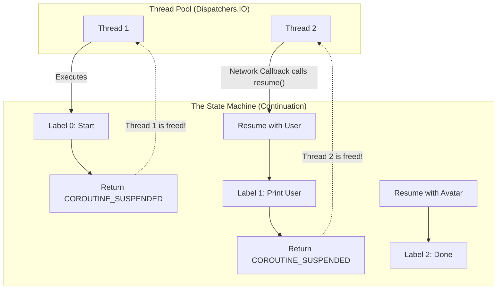

# Coroutines Under the Hood

## Overview

Kotlin Coroutines provide a paradigm for writing asynchronous, non-blocking code in a sequential style. While most developers know how to use `launch`, `async`, and `suspend`, a Staff Engineer must understand exactly what the Kotlin compiler is doing behind the scenes. 

Coroutines are not "lightweight threads" in the OS sense. They are state machines generated by the compiler at build time. Understanding this state machine—specifically the `Continuation` interface—is the key to mastering Kotlin concurrency, debugging race conditions, and understanding performance profiles.

## Why It Matters

If you believe a coroutine is a thread, you will write buggy, leaking code. 

When you call a `suspend` function, the current thread is *not* blocked. It is completely freed to do other work. But how does the JVM know where to resume your code when the network request finishes? Where are your local variables stored while the thread is doing something else? 

If you do not understand the `Continuation` and the `CoroutineContext`, you cannot properly implement [Structured Concurrency](../architecture/structured-concurrency.md), and you will not understand why `ThreadLocal` variables (like MDC logging contexts) disappear when crossing suspension points.

## Historical Context

Concurrency in Java originally relied entirely on OS Threads (`java.lang.Thread`). Threads map 1:1 to OS threads. They are incredibly heavy, requiring ~1MB of memory for the call stack, and context switching between them requires a trip to the OS kernel.

To solve this, developers moved to Callbacks, which resulted in "Callback Hell." RxJava solved Callback Hell using functional streams, but the learning curve was immense, and the stack traces were unreadable.

Kotlin solved this using **Continuation-Passing Style (CPS)**, a concept from the 1970s. The Kotlin compiler rewrites your sequential code into a series of callbacks automatically, completely hiding the complexity from you.

## First Principles

1.  **The `suspend` Modifier:** It is just a compiler flag. It tells `kotlinc`: "Please rewrite this function into a State Machine and inject a `Continuation` parameter."
2.  **The `Continuation`:** The core interface of coroutines. It is a callback that holds the current state of the function (which step of the state machine we are on) and the result (success or exception).
3.  **The `CoroutineContext`:** A map of metadata attached to the coroutine. It holds the `Job` (for cancellation), the `Dispatcher` (for thread routing), and the `CoroutineName` (for debugging).

## Mental Model

Think of a `suspend` function as a **Complex Recipe cooked by multiple Chefs**.
- You (the compiler) write a recipe with three steps: 1. Chop onions. 2. Wait for oven to preheat. 3. Bake.
- Chef A (Thread 1) chops the onions. 
- Chef A hits Step 2. Instead of standing in front of the oven doing nothing (blocking), Chef A writes a sticky note: *"Onions chopped. Waiting on oven. When ready, go to Step 3."* This sticky note is the **Continuation**.
- Chef A puts the sticky note on the fridge and goes to chop carrots for a different dish.
- When the oven "dings" (the async task completes), Chef B (Thread 2) is walking by. Chef B grabs the sticky note, reads it, sees the onions are already chopped, and instantly executes Step 3 (Bake).

## Internal Mechanics

This is where the magic happens. Let's look at the actual bytecode transformation.

### 1. The Kotlin Code
```kotlin
suspend fun fetchAndShowUser() {
    println("Start")                    // State 0
    val user = api.fetchUser()          // Suspend point 1
    println(user.name)                  // State 1
    val avatar = api.fetchAvatar()      // Suspend point 2
    println("Done")                     // State 2
}
```

### 2. The Compiler Transformation (CPS)

The Kotlin compiler changes the signature of the function. It adds a `Continuation<Any>` parameter to the end, and changes the return type to `Any` (because it might return the real value, or a special `COROUTINE_SUSPENDED` flag).

*Conceptual Decompiled Java:*
```java
public Object fetchAndShowUser(Continuation completion) {
    // 1. Create or retrieve the State Machine object
    StateMachine sm = (StateMachine) completion;
    
    // 2. The massive switch statement
    switch (sm.label) {
        case 0:
            System.out.println("Start");
            sm.label = 1; // Update state for next time
            
            // Call the network. Pass the State Machine down as the callback!
            Object result1 = api.fetchUser(sm); 
            
            // If the network isn't instantly done, RETURN and free the thread!
            if (result1 == COROUTINE_SUSPENDED) return COROUTINE_SUSPENDED;
            
            // Fallthrough if it returned instantly
        case 1:
            // Extract local variables from the State Machine
            User user = (User) sm.result; 
            System.out.println(user.name);
            
            sm.label = 2; // Update state
            Object result2 = api.fetchAvatar(sm);
            if (result2 == COROUTINE_SUSPENDED) return COROUTINE_SUSPENDED;
            
        case 2:
            System.out.println("Done");
            return Unit.INSTANCE;
    }
}
```

### 3. The Re-Entry

When `api.fetchUser()` finishes its background network call, it takes the `StateMachine` (the `Continuation`) it was handed, populates `sm.result` with the downloaded `User` object, and calls `.resume()`.

Calling `.resume()` literally just calls `fetchAndShowUser(sm)` *again*. But because `sm.label` is now `1`, the `switch` statement jumps instantly to `case 1`, picking up exactly where it left off, but potentially on a completely different OS thread!

## Architecture



## Production Example

**Bridging Callbacks to Coroutines**

A Staff engineer must frequently bridge legacy Java Callback APIs into the modern Coroutine world. We do this using `suspendCancellableCoroutine`, which gives us raw, manual access to the `Continuation` object.

```kotlin
// Legacy Java API
interface LocationCallback {
    fun onLocationFound(location: Location)
    fun onError(e: Exception)
}

// Modern Kotlin Wrapper
suspend fun getCurrentLocation(): Location {
    // This gives us the Continuation object manually
    return suspendCancellableCoroutine { continuation ->
        
        val listener = object : LocationCallback {
            override fun onLocationFound(location: Location) {
                // We manually feed the result back into the State Machine
                continuation.resume(location)
            }
            
            override fun onError(e: Exception) {
                // We manually throw an exception into the State Machine
                continuation.resumeWithException(e)
            }
        }
        
        LocationManager.requestLocation(listener)
        
        // If the coroutine is cancelled (e.g. user leaves the screen)
        // while we are waiting for GPS, we MUST unregister the listener to prevent leaks!
        continuation.invokeOnCancellation {
            LocationManager.removeListener(listener)
        }
    }
}
```

## Tradeoffs

**Coroutines vs Threads**

**Coroutines:**
- **Pros:** Massively scalable. You can launch 100,000 coroutines and the JVM won't care, because it's just instantiating 100,000 tiny `StateMachine` objects on the heap, not 100,000 actual OS threads. Perfect for I/O bound work.
- **Cons:** The State Machine allocations do cost heap memory and trigger the Garbage Collector. For hyper-optimized, real-time gaming or audio processing loops, creating `Continuation` objects in a tight loop causes GC stutter.

**Threads:**
- **Pros:** Truly parallel execution. Zero state machine overhead.
- **Cons:** Creating a thread takes ~1MB of memory. Context switching between threads is handled by the OS kernel and takes microseconds. You cannot scale them.

## Failure Modes

- **Blocking a Dispatcher:**
  ```kotlin
  withContext(Dispatchers.Main) {
      // DISASTER: Thread.sleep() does not return COROUTINE_SUSPENDED.
      // It physically halts the OS Thread. Because this is the Main Thread,
      // the entire Android UI freezes, drops frames, and causes an ANR.
      Thread.sleep(5000) 
      
      // FIX: delay() returns COROUTINE_SUSPENDED and frees the thread.
      delay(5000)
  }
  ```
- **ThreadLocal Leaks:** In standard Java, developers use `ThreadLocal` to store contextual data (like MDC tags for logging or User IDs) specific to the current thread. In Coroutines, a single `suspend` function might jump across 3 different threads as it moves through its state machine! A `ThreadLocal` set in `State 0` will be missing in `State 1`. *(Fix: You must use `ThreadContextElement` or the built-in `asContextElement()` to force the `CoroutineContext` to carry the `ThreadLocal` data across thread boundaries).*

## Staff Engineer Thinking

When interviewing or reviewing low-level concurrency, a Staff engineer focuses on the physical execution bounds:

1.  **Do they know where the thread goes?** If a developer thinks `delay(1000)` "puts the coroutine to sleep," they do not understand the underlying system. I look for the phrasing "suspends the coroutine and frees the underlying thread back to the Dispatcher pool."
2.  **`suspendCancellableCoroutine` vs `suspendCoroutine`:** I always check if developers are handling cancellation. If you wrap a legacy callback using `suspendCoroutine`, and the user navigates away, the network request finishes 5 seconds later and tries to call `resume()`. This might crash or memory leak. `suspendCancellableCoroutine` forces you to handle the `.invokeOnCancellation` block to unregister the listener.
3.  **The Dispatcher Contract:** A `suspend` function should be safe to call from the Main thread. The function itself must invoke `withContext(Dispatchers.IO)` if it touches disk or network. I reject PRs where the UI layer (`ViewModel`) has to explicitly wrap repository calls in `Dispatchers.IO`.

## Common Misconceptions

- **"Coroutines run in parallel."** A single coroutine runs sequentially. Multiple coroutines *can* run in parallel if the `Dispatcher` has multiple threads (like `Dispatchers.IO`), but if you launch 500 coroutines on `Dispatchers.Main`, they will all execute concurrently (interleaved) on exactly ONE thread. They will not run in parallel.
- **"Coroutines are faster than Threads."** No. Doing 2+2=4 takes the exact same amount of CPU cycles. Coroutines are *more efficient* with resources. They allow you to reuse 1 thread for 1,000 tasks instead of creating 1,000 threads.

## Probing Questions

1.  What is "Continuation-Passing Style" (CPS), and how does the Kotlin compiler use it to implement the `suspend` keyword?
2.  If you decompile a `suspend` function into Java bytecode, what happens to the function signature? What parameter is added?
3.  Explain the "State Machine" generated by the Kotlin compiler. How are local variables preserved across suspension points?
4.  What is the `COROUTINE_SUSPENDED` flag, and why must the generated state machine return it?
5.  Why does `Thread.sleep()` freeze the Android UI when called inside a `launch`, but `delay()` does not?
6.  How does `suspendCancellableCoroutine` allow you to bridge legacy Java callback APIs into the Kotlin Coroutine ecosystem?
7.  Why is using Java's `ThreadLocal` highly dangerous inside a Kotlin Coroutine, and how do you fix it using the `CoroutineContext`?
8.  Explain the difference between Concurrency and Parallelism in the context of `Dispatchers.Main` versus `Dispatchers.Default`.
9.  If a coroutine is suspended waiting for a network request, where does the physical OS thread go? What is it doing?
10. Describe the performance tradeoff of the State Machine allocation when compared to raw JVM threads in a hyper-optimized game loop.

## Further Reading

- [`structured-concurrency.md`](../architecture/structured-concurrency.md) — How these state machines are organized into a strict hierarchy.
- [`threads-and-looper.md`](threads-and-looper.md) — The legacy OS threads that these Coroutines actually run on top of.
- [Kotlin Docs: Coroutines Under the Hood](https://kotlinlang.org/docs/coroutines-under-the-hood.html)
