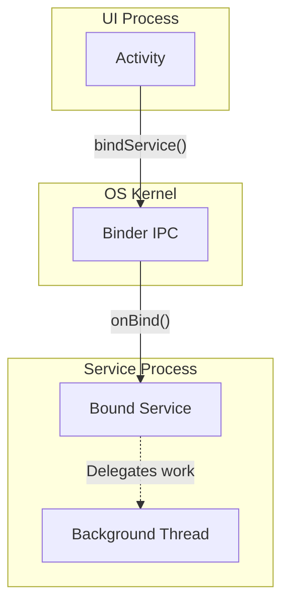

# Services

## Overview

A `Service` is an Android application component that can perform long-running operations in the background. It does not provide a user interface. 

Crucially, **a Service runs on the Main Thread** of its hosting process. It is not a separate thread. It is simply a lifecycle container that signals to the Android Operating System: *"I am doing important work right now, please do not kill my app process."*

A Staff Engineer must track OS version, target SDK, service type and the applicable start/permission prerequisites. Foreground-service types predate Android 14; Android 14 adds stricter requirements for apps targeting API 34+.

## Why It Matters

If your app is in the background (no Activities are visible) and you launch a background Coroutine to download a 50MB file, the Android Low Memory Killer (LMK) will likely instantly kill your app process to free up RAM. The OS has no idea your coroutine is running.

To tell the OS about your background work, you must use a `Service` or `WorkManager`. If you use a `Service` incorrectly in modern Android, the OS will instantly crash your app with a `ForegroundServiceStartNotAllowedException` or `SecurityException`.

## Historical Context

In Android 4.0, a developer could start a `Service`, put the app in the background, and the Service would run indefinitely, polling a server every 5 seconds, completely destroying the user's battery.

Google fought back:
- **Android 8.0 (Oreo):** Background-execution limits constrain background services for apps targeting API 26+, with documented temporary exemptions; this is not a deprecation of Service.
- **Android 12:** Apps targeting API 31+ generally cannot start a foreground service from the background, with documented exemptions such as qualifying high-priority FCM messages.
- **Android 14:** Apps targeting API 34+ must declare appropriate foreground-service types and permissions and satisfy type-specific prerequisites. Failure to meet those checks can raise an exception; not requesting a GPS update is not the stated validation rule.

## First Principles

There are three distinct types of Services:

1. **Background Service:** A started service subject to OS and target-SDK background-execution limits. Prefer an appropriate scheduled-work API for deferrable work.
2. **Foreground Service:** User-visible ongoing work with a notification and elevated process importance, subject to start, permission, type and timeout rules. It does not guarantee process survival.
3.  **Bound Service:** A client-server model. Another component (like an `Activity` or another App) "binds" to the service. The service lives exactly as long as clients are bound to it. Often used for IPC (Inter-Process Communication) via [The Binder](../os-internals/the-binder.md).

## Mental Model

Think of the Android OS as an **Office Building Manager**.
- **The Activity:** The reception desk. Visible, active, high priority.
- **The Background Service:** An employee hiding in a cubicle reading a book. If the building gets crowded (Low Memory), the Manager kicks them out immediately.
- **The Foreground Service:** An employee wearing a massive neon vest (The Notification) actively carrying heavy boxes. The Manager sees the vest and leaves them alone because they are doing obvious, critical work.
- **The Bound Service:** A specialized IT consultant. They only stay in the building as long as someone specifically requested them. The minute the requester leaves, the consultant leaves.

## Internal Mechanics

### 1. The Main Thread Trap
```kotlin
class BadMusicService : Service() {
    override fun onStartCommand(intent: Intent?, flags: Int, startId: Int): Int {
        // DISASTER: This runs on the MAIN THREAD! 
        // If you do heavy I/O here, the entire UI of the app freezes, even if 
        // the app is in the background. It will trigger an ANR.
        downloadMassiveMusicFile() 
        return START_STICKY
    }
}
```
*(Fix: A Service must internally launch its own Thread or Coroutine Scope to do actual work).*

### 2. Foreground Service Types (Android 14+)
To start a Foreground Service today, you must explicitly define its type in the `AndroidManifest.xml` and request specific permissions.

```xml
<!-- Manifest -->
<uses-permission android:name="android.permission.FOREGROUND_SERVICE" />
<uses-permission android:name="android.permission.FOREGROUND_SERVICE_LOCATION" />

<service
    android:name=".TrackingService"
    android:foregroundServiceType="location" />
```

```kotlin
// In the Service
override fun onStartCommand(intent: Intent?, flags: Int, startId: Int): Int {
    val notification = createNotification()
    
    // You must pass the specific type, and you MUST have already obtained
    // the ACCESS_COARSE_LOCATION runtime permission from the user!
    ServiceCompat.startForeground(
        this, 
        NOTIFICATION_ID, 
        notification, 
        ServiceInfo.FOREGROUND_SERVICE_TYPE_LOCATION
    )
    return START_NOT_STICKY
}
```

## Architecture



## Production Example

**The Coroutine-Powered Bound Service**

Often, we want to expose a Service to another app via IPC, or simply isolate heavy work. We use a Bound Service returning a local `Binder`.

```kotlin
class AudioProcessingService : LifecycleService() { // Extends LifecycleService to use lifecycleScope

    // The interface given to clients
    inner class LocalBinder : Binder() {
        fun getService(): AudioProcessingService = this@AudioProcessingService
    }

    private val binder = LocalBinder()

    override fun onBind(intent: Intent): IBinder {
        super.onBind(intent) // Required for LifecycleService
        return binder
    }

    // Public API for the Activity to call
    fun processAudioFile(fileUri: Uri): Flow<Int> = flow {
        for (progress in 1..100) {
            delay(100) // Illustrative processing
            emit(progress)
        }
    }.flowOn(Dispatchers.IO) // import kotlinx.coroutines.flow.flowOn
}
```
*Note: The Activity binds to this service, gets the `LocalBinder`, calls `processAudioFile()`, and collects the Flow. If the Activity unbinds, the Service is destroyed, and the `lifecycleScope` is cancelled automatically.*

## Tradeoffs

**Foreground Service vs WorkManager**

This is the most common architectural debate in Android background execution.

- **Use Foreground Service when:** 
    - The work is user-initiated, critical, and must begin *instantly*.
    - The user must explicitly know it is happening (Music Player, GPS tracking, Active Phone Call).
    - It represents ongoing user-visible work that meets the selected service type and start prerequisites; process survival and uninterrupted execution are not guaranteed.
- **Use `WorkManager` when:**
    - The work is deferrable (can happen an hour from now).
    - The work requires constraints (e.g., "Only run when connected to unmetered Wi-Fi and charging").
    - The work is a massive, multi-step data sync.
    - *Note:* `WorkManager` can actually delegate to a Foreground Service under the hood using Expedited Jobs, making it the preferred API for almost everything except media playback and live navigation.

## Failure Modes

- **The `ForegroundServiceStartNotAllowedException`:**
  On Android 12+ with target API 31+, a background start without an applicable exemption can throw ForegroundServiceStartNotAllowedException. Check the delivered FCM priority: high-priority delivery can qualify for an exemption, but a message may be downgraded.
  *(Choose WorkManager for deferrable work; for a legitimate foreground-service case, verify the current exemption and all type/permission prerequisites.)*
- **Leaking the Service:**
  Returning `START_STICKY` from `onStartCommand` tells the OS: "If you kill me for memory, restart me as soon as possible." If you do this but fail to re-initialize your background threads properly upon restart, the Service sits in memory forever doing nothing.
  *(Fix: Default to `START_NOT_STICKY` unless you have an explicit strategy for state restoration upon OS-initiated restarts).*
- **Missing `stopSelf()`:**
  If you start a Service (not bound), it will run forever until you explicitly call `stopSelf()`. If you finish downloading a file and forget to call it, the Service stays active, consuming RAM and keeping the app priority artificially high.

## Staff Engineer Thinking

When reviewing background execution logic, a Staff engineer focuses strictly on OS compliance and battery life:

1.  **Do we even need a Service?** I actively reject PRs adding Services for simple file downloads or network syncs. 95% of background work should be routed through `WorkManager`. Services should be reserved exclusively for continuous user-facing tasks (audio, VoIP, active location tracking).
2. **Android 14 validation:** For target API 34+, verify declared service types, their permissions and applicable runtime prerequisites before starting foreground work.
3.  **Process Isolation:** Sometimes, developers put a Service in a separate process (`android:process=":background"` in the Manifest) thinking it will prevent the Main app from lagging. I remind them that the new process *still has a Main Thread*, and IPC overhead usually makes performance worse. Multi-process architecture must be heavily justified.

## Common Misconceptions

- **"Services run in the background, so they are thread-safe."** A catastrophic misunderstanding. A Service runs on the Main UI Thread of its process. If you put a `while(true)` loop inside `onStartCommand()`, your app freezes instantly.
- **"If I use `WorkManager`, I don't need to know how Services work."** False. Under the hood, `WorkManager` spins up its own `SystemJobService` and `Room` databases to guarantee execution. Understanding the Service lifecycle is critical for debugging why `WorkManager` jobs get killed.

## Probing Questions

1.  Why does putting heavy network logic directly inside a Service's `onStartCommand()` cause an Application Not Responding (ANR) crash?
2. Explain foreground-service types and the additional requirements on Android 14 for apps targeting API 34+.
3.  Describe the difference between a "Started" Service and a "Bound" Service in terms of lifecycle management.
4. Under what conditions can an FCM-triggered foreground-service start fail on Android 12+?
5.  What is the architectural purpose of returning `START_STICKY` versus `START_NOT_STICKY` from `onStartCommand()`?
6.  How does the Android OS distinguish between a Background Service it can kill immediately and a Foreground Service it should keep alive?
7.  In modern Android development, what is the primary alternative to using a Service for deferrable, long-running tasks like database synchronization?
8.  Explain the memory implications of defining a Service to run in an entirely separate process via the `android:process` manifest attribute.
9.  If an `Activity` binds to a `Service`, and then the user presses the Back button destroying the `Activity`, what happens to the `Service`?
10. Describe a scenario where you would absolutely choose to build a raw Foreground Service instead of using `WorkManager`.

## Answer Key

1. **Why does putting heavy network logic directly inside a Service's `onStartCommand()` cause an Application Not Responding (ANR) crash?**
   A Service runs on the Main UI Thread of its hosting process by default. Heavy synchronous I/O blocks the thread, preventing the UI from responding to input and causing an ANR.
2. **What additional type requirements apply on Android 14 with target API 34+?**
   Declare the appropriate foreground-service type and permissions and meet its type-specific prerequisites. Types existed before Android 14; the target-34 checks strengthen enforcement for the declared use case.
3. **Describe the difference between a "Started" Service and a "Bound" Service in terms of lifecycle management.**
   A "Started" service runs indefinitely until `stopSelf()` is called explicitly. A "Bound" service's lifecycle is tied to its clients; it is destroyed automatically when all clients unbind.
4. **When can an FCM-triggered foreground-service start fail?**
   With target API 31+, the background-start restriction applies unless a documented exemption is satisfied. A genuinely high-priority FCM message can qualify, but delivery can be downgraded; type-specific permissions and prerequisites still apply.
5. **What is the architectural purpose of returning `START_STICKY` versus `START_NOT_STICKY` from `onStartCommand()`?**
   `START_STICKY` tells the OS to restart the service automatically if it was killed for memory, but without redelivering the original intent. `START_NOT_STICKY` tells the OS not to restart it, which is safer if you can't guarantee a clean state restoration.
6. **How does the Android OS distinguish between a Background Service it can kill immediately and a Foreground Service it should keep alive?**
   A Foreground Service must call `startForeground()` and provide an ongoing, un-dismissible Notification that proves to the user the app is doing active work.
7. **In modern Android development, what is the primary alternative to using a Service for deferrable, long-running tasks like database synchronization?**
   `WorkManager` is the modern standard. It handles OS constraints, Doze mode, and process restarts automatically without risking illegal foreground service exceptions.
8. **Explain the memory implications of defining a Service to run in an entirely separate process via the `android:process` manifest attribute.**
   It creates an entirely new OS process with its own memory footprint and its own Main Thread. While it isolates crashes, the massive IPC overhead and duplicated memory make performance worse for most use cases.
9. **If an `Activity` binds to a `Service`, and then the user presses the Back button destroying the `Activity`, what happens to the `Service`?**
   If the Activity was the only bound client, the OS will automatically call `onUnbind()` and then `onDestroy()` on the Service, shutting it down.
10. **Describe a scenario where you would absolutely choose to build a raw Foreground Service instead of using `WorkManager`.**
    For continuous, strictly user-initiated tasks that cannot be deferred and require constant user visibility, such as a live music player, an active VoIP call, or a real-time GPS navigation tracker.

## Further Reading

- [`workmanager.md`](workmanager.md) — The modern replacement for 90% of Service use cases.
- [`battery-optimizations.md`](battery-optimizations.md) — The strict rules that govern when Services are killed.
- [`the-binder.md`](../os-internals/the-binder.md) — The IPC mechanism that powers Bound Services.

### Official verification references

- [Primary documentation or owning implementation](https://developer.android.com/about/versions/14/changes/fgs-types-required)
- [Primary documentation or owning implementation](https://developer.android.com/develop/background-work/services/fgs/restrictions-bg-start)
- [Primary documentation or owning implementation](https://kotlinlang.org/api/kotlinx.coroutines/kotlinx-coroutines-core/kotlinx.coroutines.flow/flow.html)
