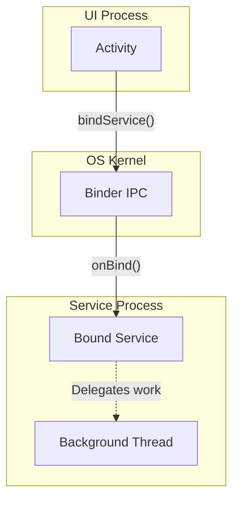

# Services

## Overview

A `Service` is an Android application component that can perform long-running operations in the background. It does not provide a user interface. 

Crucially, **a Service runs on the Main Thread** of its hosting process. It is not a separate thread. It is simply a lifecycle container that signals to the Android Operating System: *"I am doing important work right now, please do not kill my app process."*

A Staff Engineer must understand the strict evolution of Services. Over the last 5 years, Google has aggressively restricted what a Service can do to prevent battery drain, culminating in the strict Foreground Service Types introduced in Android 14.

## Why It Matters

If your app is in the background (no Activities are visible) and you launch a background Coroutine to download a 50MB file, the Android Low Memory Killer (LMK) will likely instantly kill your app process to free up RAM. The OS has no idea your coroutine is running.

To tell the OS about your background work, you must use a `Service` or `WorkManager`. If you use a `Service` incorrectly in modern Android, the OS will instantly crash your app with a `ForegroundServiceStartNotAllowedException` or `SecurityException`.

## Historical Context

In Android 4.0, a developer could start a `Service`, put the app in the background, and the Service would run indefinitely, polling a server every 5 seconds, completely destroying the user's battery.

Google fought back:
- **Android 8.0 (Oreo):** Introduced Background Execution Limits. Standard "Background Services" were essentially banned. If the app goes to the background, the Service is killed within minutes. Developers were forced to use **Foreground Services** (which require a sticky notification) for long-running work.
- **Android 12:** Banned starting a Foreground Service from the background entirely. You can only launch one while the app is actively visible to the user.
- **Android 14:** Mandated that every Foreground Service explicitly declare a strict "Type" (e.g., `camera`, `location`, `mediaPlayback`) in the Manifest. If the OS catches you declaring `location` but you don't actually request GPS updates, it crashes your app.

## First Principles

There are three distinct types of Services:

1.  **Background Service:** Almost entirely deprecated. Banned from running when the app is in the background. Do not use.
2.  **Foreground Service:** The highest priority component in Android. The OS promises to almost never kill it. Requires a persistent Notification. Examples: Spotify playing music, Google Maps navigation, Strava tracking a run.
3.  **Bound Service:** A client-server model. Another component (like an `Activity` or another App) "binds" to the service. The service lives exactly as long as clients are bound to it. Often used for IPC (Inter-Process Communication) via [The Binder](../os-internals/the-binder.md).

## Mental Model

Think of the Android OS as an **Office Building Manager**.
- **The Activity:** The reception desk. Visible, active, high priority.
- **The Background Service:** An employee hiding in a cubicle reading a book. If the building gets crowded (Low Memory), the Manager kicks them out immediately.
- **The Foreground Service:** An employee wearing a massive neon vest (The Notification) actively carrying heavy boxes. The Manager sees the vest and leaves them alone because they are doing obvious, critical work.
- **The Bound Service:** A specialized IT consultant. They only stay in the building as long as someone specifically requested them. The minute the requester leaves, the consultant leaves.

## Internal Mechanics

### 1. The Main Thread Trap
```kotlin
class BadMusicService : Service() {
    override fun onStartCommand(intent: Intent?, flags: Int, startId: Int): Int {
        // DISASTER: This runs on the MAIN THREAD! 
        // If you do heavy I/O here, the entire UI of the app freezes, even if 
        // the app is in the background. It will trigger an ANR.
        downloadMassiveMusicFile() 
        return START_STICKY
    }
}
```
*(Fix: A Service must internally launch its own Thread or Coroutine Scope to do actual work).*

### 2. Foreground Service Types (Android 14+)
To start a Foreground Service today, you must explicitly define its type in the `AndroidManifest.xml` and request specific permissions.

```xml
<!-- Manifest -->
<uses-permission android:name="android.permission.FOREGROUND_SERVICE" />
<uses-permission android:name="android.permission.FOREGROUND_SERVICE_LOCATION" />

<service
    android:name=".TrackingService"
    android:foregroundServiceType="location" />
```

```kotlin
// In the Service
override fun onStartCommand(intent: Intent?, flags: Int, startId: Int): Int {
    val notification = createNotification()
    
    // You must pass the specific type, and you MUST have already obtained
    // the ACCESS_COARSE_LOCATION runtime permission from the user!
    ServiceCompat.startForeground(
        this, 
        NOTIFICATION_ID, 
        notification, 
        ServiceInfo.FOREGROUND_SERVICE_TYPE_LOCATION
    )
    return START_NOT_STICKY
}
```

## Architecture



## Production Example

**The Coroutine-Powered Bound Service**

Often, we want to expose a Service to another app via IPC, or simply isolate heavy work. We use a Bound Service returning a local `Binder`.

```kotlin
class AudioProcessingService : LifecycleService() { // Extends LifecycleService to use lifecycleScope

    // The interface given to clients
    inner class LocalBinder : Binder() {
        fun getService(): AudioProcessingService = this@AudioProcessingService
    }

    private val binder = LocalBinder()

    override fun onBind(intent: Intent): IBinder {
        super.onBind(intent) // Required for LifecycleService
        return binder
    }

    // Public API for the Activity to call
    fun processAudioFile(fileUri: Uri): Flow<Int> = flow {
        // Run on background thread
        withContext(Dispatchers.IO) {
            for (progress in 1..100) {
                delay(100) // Fake processing
                emit(progress)
            }
        }
    }
}
```
*Note: The Activity binds to this service, gets the `LocalBinder`, calls `processAudioFile()`, and collects the Flow. If the Activity unbinds, the Service is destroyed, and the `lifecycleScope` is cancelled automatically.*

## Tradeoffs

**Foreground Service vs WorkManager**

This is the most common architectural debate in Android background execution.

- **Use Foreground Service when:** 
    - The work is user-initiated, critical, and must begin *instantly*.
    - The user must explicitly know it is happening (Music Player, GPS tracking, Active Phone Call).
    - It needs to run completely uninterrupted for a long period.
- **Use `WorkManager` when:**
    - The work is deferrable (can happen an hour from now).
    - The work requires constraints (e.g., "Only run when connected to unmetered Wi-Fi and charging").
    - The work is a massive, multi-step data sync.
    - *Note:* `WorkManager` can actually delegate to a Foreground Service under the hood using Expedited Jobs, making it the preferred API for almost everything except media playback and live navigation.

## Failure Modes

- **The `ForegroundServiceStartNotAllowedException`:**
  Since Android 12, if your app receives a Push Notification while in the background, and you try to call `startForegroundService()`, the app will immediately crash.
  *(Fix: You can no longer start Foreground Services from the background. You must use `WorkManager` for background-triggered tasks).*
- **Leaking the Service:**
  Returning `START_STICKY` from `onStartCommand` tells the OS: "If you kill me for memory, restart me as soon as possible." If you do this but fail to re-initialize your background threads properly upon restart, the Service sits in memory forever doing nothing.
  *(Fix: Default to `START_NOT_STICKY` unless you have an explicit strategy for state restoration upon OS-initiated restarts).*
- **Missing `stopSelf()`:**
  If you start a Service (not bound), it will run forever until you explicitly call `stopSelf()`. If you finish downloading a file and forget to call it, the Service stays active, consuming RAM and keeping the app priority artificially high.

## Staff Engineer Thinking

When reviewing background execution logic, a Staff engineer focuses strictly on OS compliance and battery life:

1.  **Do we even need a Service?** I actively reject PRs adding Services for simple file downloads or network syncs. 95% of background work should be routed through `WorkManager`. Services should be reserved exclusively for continuous user-facing tasks (audio, VoIP, active location tracking).
2.  **Android 14 Validation:** I verify that every single Foreground Service has an explicit type declared in the Manifest, and that the code checks for the exact runtime permissions required by that specific type *before* calling `startForeground()`.
3.  **Process Isolation:** Sometimes, developers put a Service in a separate process (`android:process=":background"` in the Manifest) thinking it will prevent the Main app from lagging. I remind them that the new process *still has a Main Thread*, and IPC overhead usually makes performance worse. Multi-process architecture must be heavily justified.

## Common Misconceptions

- **"Services run in the background, so they are thread-safe."** A catastrophic misunderstanding. A Service runs on the Main UI Thread of its process. If you put a `while(true)` loop inside `onStartCommand()`, your app freezes instantly.
- **"If I use `WorkManager`, I don't need to know how Services work."** False. Under the hood, `WorkManager` spins up its own `SystemJobService` and `Room` databases to guarantee execution. Understanding the Service lifecycle is critical for debugging why `WorkManager` jobs get killed.

## Probing Questions

1.  Why does putting heavy network logic directly inside a Service's `onStartCommand()` cause an Application Not Responding (ANR) crash?
2.  Explain the concept of a "Foreground Service Type" introduced in Android 14. Why did Google implement this restriction?
3.  Describe the difference between a "Started" Service and a "Bound" Service in terms of lifecycle management.
4.  If your app is in the background and receives an FCM Push Notification, why will calling `startForegroundService()` cause a fatal crash on Android 12+?
5.  What is the architectural purpose of returning `START_STICKY` versus `START_NOT_STICKY` from `onStartCommand()`?
6.  How does the Android OS distinguish between a Background Service it can kill immediately and a Foreground Service it should keep alive?
7.  In modern Android development, what is the primary alternative to using a Service for deferrable, long-running tasks like database synchronization?
8.  Explain the memory implications of defining a Service to run in an entirely separate process via the `android:process` manifest attribute.
9.  If an `Activity` binds to a `Service`, and then the user presses the Back button destroying the `Activity`, what happens to the `Service`?
10. Describe a scenario where you would absolutely choose to build a raw Foreground Service instead of using `WorkManager`.

## Further Reading

- [`workmanager.md`](workmanager.md) — The modern replacement for 90% of Service use cases.
- [`battery-optimizations.md`](battery-optimizations.md) — The strict rules that govern when Services are killed.
- [`the-binder.md`](../os-internals/the-binder.md) — The IPC mechanism that powers Bound Services.
