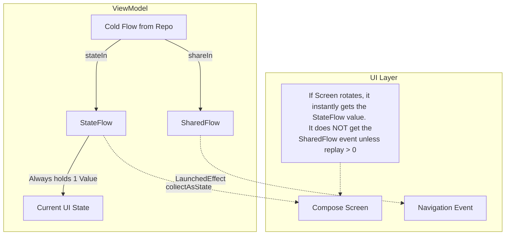

# SharedFlow and StateFlow

## Overview

In the [Flow architecture](../architecture/flow.md), we established the difference between Cold streams (which only run when collected) and Hot streams (which run constantly). 

`SharedFlow` and `StateFlow` are the two concrete implementations of Hot streams in Kotlin. They are the absolute standard for managing UI State and Unidirectional Data Flow (UDF) in modern Android. 

A Staff Engineer must deeply understand the nuanced differences between the two, particularly around *Conflation*, *Replay Caches*, and why using `SharedFlow` for one-off events (like Toasts or Navigation) is an architectural minefield.

## Why It Matters

If you use a standard Cold `Flow` in your UI, every single screen rotation will re-trigger the underlying database query or network request, destroying battery life and API quotas.

To solve this, we must pivot from Cold to Hot in the `ViewModel`. But which Hot flow do we choose? 
- Choose `StateFlow` incorrectly, and your "Show Error Toast" event might trigger 5 times.
- Choose `SharedFlow` incorrectly, and your UI might never render because the event fired while the screen was in the background and was permanently lost.

## Historical Context

Before Kotlin Flow, the standard for Android UI state was `LiveData`. `LiveData` is inherently a state holder: it always holds the "latest" value, and new observers instantly receive that latest value upon subscription. 

When Google pushed the community to migrate from `LiveData` to `Flow`, they needed a direct replacement. `StateFlow` was created explicitly to replace `LiveData`. 

However, `LiveData` had a famous flaw: the "Single Live Event" problem. Developers hacked `LiveData` to send one-off events (like "Navigate to Checkout"), but because `LiveData` holds state, rotating the screen caused the "Navigate" event to fire *again*. `SharedFlow` was introduced as a highly configurable broadcast channel that could solve these event-routing problems without holding permanent state.

## First Principles

1.  **`StateFlow` (The Current Truth):** 
    - It ALWAYS has a value (requires an initial value).
    - It conflates identical emissions (if you emit `Loading` and then emit `Loading` again, the observers are only notified *once*).
    - It acts exactly like a variable that you can observe.
2.  **`SharedFlow` (The Broadcast Tower):** 
    - It does NOT require an initial value.
    - It does NOT conflate (if you emit `"Error"` twice, observers receive `"Error"` twice).
    - Highly configurable: you can set the `replay` cache size (how many past events a new subscriber receives) and `extraBufferCapacity` (how many events to queue if the subscribers are slow).

## Mental Model

**`StateFlow` is a Thermostat on a wall.**
- It always displays a temperature (initial value).
- If you walk into the room (subscribe), you instantly see the current temperature.
- If the temperature changes from 70° to 71°, it updates.
- If the heater tries to change it from 70° to 70° (conflation), the display doesn't change.

**`SharedFlow` is a Radio Station.**
- It broadcasts songs. If no one is tuned in, the song is played to an empty room and is lost forever.
- If you tune in halfway through a song, you only hear the rest of the song; you don't hear the start (unless the station has a `replay` cache).
- If the station plays "Stairway to Heaven" twice in a row (no conflation), you hear it twice in a row.

## Internal Mechanics

### StateFlow

Under the hood, `StateFlow` is actually just a highly specific configuration of a `SharedFlow`. 

```kotlin
// The literal source code of MutableStateFlow inside the Kotlin Coroutines library
public fun <T> MutableStateFlow(value: T): MutableStateFlow<T> = 
    StateFlowImpl(value ?: NULL)
```
A `StateFlow` is functionally equivalent to a `SharedFlow` created with:
- `replay = 1` (Always remembers the last emitted value)
- `onBufferOverflow = BufferOverflow.DROP_OLDEST` (If a new value comes in, drop the old one instantly)
- An internal check that ignores `emit(x)` if `x == currentValue`.

### SharedFlow

A `SharedFlow` maintains an internal `Array` buffer. 
- The **Replay Cache** determines how many items are kept in memory for *new* subscribers.
- The **Extra Buffer Capacity** determines how many items are kept in memory for *slow* active subscribers.

If the buffer is totally full and a new emission occurs, the `onBufferOverflow` strategy dictates what happens:
- `SUSPEND`: (Default) The producer (the `emit()` call) suspends and waits for the subscribers to catch up.
- `DROP_OLDEST`: The oldest event is deleted to make room. (The producer never suspends).
- `DROP_LATEST`: The new event is ignored. (The producer never suspends).

## Architecture



## Production Example

**The Pivot in the ViewModel**

We almost never instantiate `MutableSharedFlow` directly if we are reading from a database. We use the `.stateIn()` and `.shareIn()` operators to pivot Cold streams to Hot streams.

```kotlin
class ProfileViewModel(private val repository: UserRepository) : ViewModel() {

    // 1. STATEFLOW: For the UI State (Thermometer)
    // We use WhileSubscribed(5000) so that if the user rotates the screen,
    // the Flow stays alive for 5 seconds, preventing the upstream DB from restarting.
    val uiState: StateFlow<ProfileState> = repository.getUserProfile()
        .map { ProfileState.Success(it) }
        .stateIn(
            scope = viewModelScope,
            started = SharingStarted.WhileSubscribed(5000),
            initialValue = ProfileState.Loading
        )

    // 2. SHAREDFLOW: For a continuous stream of background updates (Radio Station)
    // Example: A WebSocket ticker of live prices. We don't need an initial value,
    // but we want the last 5 prices to be replayed if the user rotates the phone.
    val priceTicker: SharedFlow<Price> = repository.getLivePrices()
        .shareIn(
            scope = viewModelScope,
            started = SharingStarted.WhileSubscribed(5000),
            replay = 5 // Keep the last 5 prices for new subscribers
        )
}
```

## Tradeoffs

**The Single-Event Dilemma (The Anti-Pattern)**

A very common pattern is using `SharedFlow` for one-off events (Toasts, Navigation):

```kotlin
// THE DANGEROUS APPROACH
private val _events = MutableSharedFlow<String>()
val events = _events.asSharedFlow()

fun login() {
    viewModelScope.launch {
        _events.emit("NavigateToHome")
    }
}
```

**Why this is dangerous:**
If the user clicks "Login", and immediately backgrounds the app, the UI is `onStop()`. The UI is no longer collecting the `SharedFlow` (because we use `repeatOnLifecycle`).
The ViewModel calls `_events.emit("NavigateToHome")`. Because `SharedFlow` has no replay cache (by default), it broadcasts the event to an empty room. The event is **permanently lost**. When the user re-opens the app, they are stuck on the Login screen forever.

**The Staff Engineer Fix:**
Never model one-off events as streams. Model them as State.

```kotlin
// THE SAFE APPROACH (State)
data class UiState(
    val isLoading: Boolean = false,
    val errorMessages: List<String> = emptyList() // Events are state!
)

// UI Layer (Compose):
val error = state.errorMessages.firstOrNull()
if (error != null) {
    LaunchedEffect(error) {
        Toast.makeText(context, error, Toast.LENGTH_SHORT).show()
        // Explicitly tell the ViewModel the event was consumed!
        viewModel.onErrorConsumed(error)
    }
}
```

## Failure Modes

- **Suspension on `SharedFlow` with slow collectors:**
  By default, `MutableSharedFlow` has a buffer of 0 and `onBufferOverflow = SUSPEND`.
  If you call `_sharedFlow.emit(data)` from a coroutine, and *there are zero subscribers*, the emission is dropped immediately. However, if there is an *active subscriber but it is slow* to process the data, the `emit()` function will suspend. The emitting coroutine freezes until the subscriber catches up, causing a massive logic bug.
  *(Fix: If you cannot tolerate blocking the emitter, use `tryEmit()`, or configure the `SharedFlow` with `extraBufferCapacity = 1, onBufferOverflow = BufferOverflow.DROP_OLDEST`).*
- **Accidental Conflation with Data Classes:**
  ```kotlin
  data class ScreenState(val list: List<Item>)
  
  // If you mutate the list in-place and re-emit the EXACT SAME ScreenState object instance...
  val mutableList = state.value.list as MutableList
  mutableList.add(newItem)
  _state.value = ScreenState(mutableList) 
  ```
  `StateFlow` checks `oldValue == newValue`. Because it is the exact same object instance in memory, `equals()` returns true. The `StateFlow` conflates the emission. The UI never updates.
  *(Fix: Never mutate data classes. Always use `.copy()` with immutable lists (`toList()`)).*

## Staff Engineer Thinking

1.  **State vs Events:** I actively reject PRs that use `SharedFlow` to trigger Navigation or Toasts unless the engineer can prove they have perfectly handled the background-drop scenario (which is nearly impossible). Events should be modeled as consumable state inside the `StateFlow`.
2.  **The Pivot Boundary:** I verify that `stateIn` or `shareIn` is only used at the exact boundary between the Domain/Data layer and the UI layer (inside the ViewModel). If a `Repository` uses `stateIn`, it is caching data globally in an Application Scope, creating an immortal memory leak unless explicitly designed as a global cache.
3.  **Buffer Overflow Strategies:** If I see a custom `MutableSharedFlow`, I interrogate the `onBufferOverflow` strategy. Does the developer actually want the producer to suspend if the consumer is slow? Usually, they want `DROP_OLDEST` (e.g., dropping old GPS coordinates in favor of new ones).

## Common Misconceptions

- **"I should use `SharedFlow` because I have multiple UI subscribers."** False. You can have 10 different Compose screens collect the exact same `StateFlow`. "Shared" just means the upstream flow is shared, not that it is specifically designed for multiple distinct UI elements.
- **"I can check the current value of a `SharedFlow`."** False. Unlike `StateFlow`, `SharedFlow` has no `.value` property. It does not hold state. If you need to check the current value synchronously without suspending, you must use `StateFlow`.

## Probing Questions

1.  What is the fundamental difference between `StateFlow` and `SharedFlow` regarding how they handle new subscribers?
2.  Explain what "Conflation" means in the context of `StateFlow`. Why is this behavior desirable for UI State?
3.  Why is it dangerous to emit a "Navigate" event into a standard `MutableSharedFlow` if the Android application is currently in the background?
4.  If you configure a `SharedFlow` with `replay = 1` and `onBufferOverflow = BufferOverflow.DROP_OLDEST`, how does its behavior differ from a `StateFlow`?
5.  What happens if you call `emit()` on a default `MutableSharedFlow` and the single UI collector is currently blocked doing heavy computation?
6.  Explain why mutating an underlying list and re-emitting the same `data class` instance into a `StateFlow` will fail to trigger a UI recomposition in Jetpack Compose.
7.  What is the purpose of the `SharingStarted.WhileSubscribed(5000)` parameter when converting a Cold flow to a Hot flow in an Android ViewModel?
8.  Why did Google deprecate the use of `LiveData` in modern Android architectures in favor of `StateFlow`?
9.  Describe the architectural pattern of "Consumable State" and how it solves the Single-Event Dilemma without relying on `SharedFlow`.
10. If a repository needs to expose a continuous stream of GPS coordinates to the entire app, but you want to drop older coordinates if the UI is slow to process them, how would you configure the flow?

## Further Reading

- [`flow.md`](../architecture/flow.md) — The Cold flow foundation.
- [`viewmodel.md`](../architecture/viewmodel.md) — The owner of the `stateIn` transformation.
- [Android Developers: StateFlow and SharedFlow](https://developer.android.com/kotlin/flow/stateflow-and-sharedflow)
