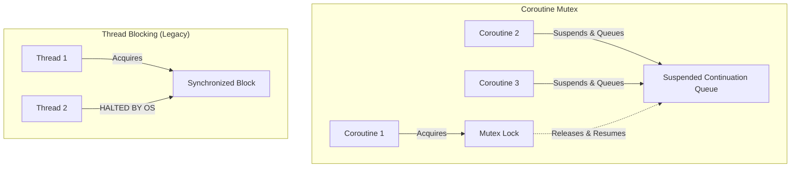

# Synchronization and Mutex

## Overview

Whenever multiple threads attempt to read and write to the same location in memory simultaneously, you have a **Race Condition**. The result is corrupted data, unpredictable behavior, and crashes that are impossible to reproduce.

Solving race conditions requires Synchronization. A Staff Engineer must understand the JVM's synchronization primitives (`@Volatile`, `synchronized`, `AtomicReference`) and how they fundamentally clash with Kotlin Coroutines, necessitating the use of `Mutex`.

## Why It Matters

Mobile apps are highly concurrent. If you increment an analytics counter from a background thread while the Main Thread is trying to read it to update the UI, you will experience a tearing read (reading the value halfway through its mutation).

If you attempt to fix this using standard Java `synchronized` blocks inside a Coroutine, you will block the underlying `Dispatcher` thread. If that thread happens to be `Dispatchers.Main`, your entire application will freeze. You must understand when to use standard thread-locking vs coroutine-suspension locking.

## Historical Context

In Java, the `synchronized` keyword was the standard tool for thread safety. It uses an intrinsic lock (a "monitor") tied to the object's memory address. If Thread A enters the `synchronized` block, Thread B is physically halted by the OS kernel until Thread A leaves.

This was fine when we had hundreds of threads. But in Kotlin, we have millions of Coroutines multiplexed onto a tiny pool of threads (often just 64 threads in `Dispatchers.IO`). If you `synchronized` a coroutine, you don't just pause the coroutine—you pause the *entire OS thread*, preventing any other coroutines from using it. 

## First Principles

To understand synchronization, we must understand the three problems of concurrency:

1.  **Atomicity:** An operation must happen entirely or not at all. (e.g., `count++` is actually three operations: read, increment, write. It is not atomic).
2.  **Visibility:** If Thread A changes a variable, Thread B must see the change immediately. (Modern CPUs cache variables in L1/L2 caches; Thread B might read a stale cache).
3.  **Ordering:** The compiler and CPU are allowed to reorder your code for optimization if it doesn't change single-threaded logic. In multi-threaded logic, this reordering breaks everything.

## The Toolbelt

### 1. `@Volatile` (Visibility Only)
Adding `@Volatile` to a variable forces the JVM to skip the CPU cache and read/write directly to main RAM.
- **Solves:** Visibility and Ordering.
- **Does NOT solve:** Atomicity. `count++` is still broken with `@Volatile`.
- **Use Case:** A simple boolean flag (e.g., `isShuttingDown`) read by many threads but written by one.

### 2. `Atomic` Classes (Atomicity & Visibility)
Classes like `AtomicInteger` or `AtomicReference` use CPU-level Compare-And-Swap (CAS) instructions. They are completely non-blocking and incredibly fast.
- **Solves:** Atomicity, Visibility, Ordering.
- **Use Case:** Simple counters or atomically swapping a single data object.

### 3. `synchronized` / `ReentrantLock` (Thread Blocking)
A physical barrier. Only one Thread can pass.
- **Solves:** Everything.
- **Danger:** It blocks the underlying OS thread. Do NOT use inside Coroutines.
- **Use Case:** Legacy Java code, or very short, non-suspending synchronous operations.

### 4. `Mutex` (Coroutine Suspension)
Mutual Exclusion for Coroutines. Instead of blocking the OS thread, it *suspends* the coroutine, freeing the thread to do other work until the lock is available.
- **Solves:** Everything (for Coroutines).
- **Use Case:** Any critical section inside a `suspend` function.

## Internal Mechanics

How does `Mutex` actually work without blocking the thread?

```kotlin
// The Kotlin Mutex implementation concept
val mutex = Mutex()

suspend fun doWork() {
    mutex.withLock {
        // Critical section
    }
}
```

Under the hood, `Mutex` maintains a Queue of `Continuations`. 
1. Coroutine 1 arrives, acquires the lock, and executes.
2. Coroutine 2 arrives. The lock is taken. Instead of calling `Thread.sleep()` (which would block the thread), Coroutine 2 adds its `Continuation` (state machine callback) to the Mutex's queue and returns `COROUTINE_SUSPENDED`. The underlying OS thread is instantly freed!
3. Coroutine 1 finishes and releases the lock. The Mutex looks at its queue, pulls Coroutine 2's `Continuation`, and calls `.resume()`. Coroutine 2 wakes up and executes.

## Architecture



## Production Example

**The Analytics Cache**

Imagine an analytics tracker that batches events before sending them to the network. Multiple threads might try to add events simultaneously.

```kotlin
class AnalyticsTracker {
    // 1. Thread-safe Mutex for Coroutines
    private val mutex = Mutex()
    private val batch = mutableListOf<Event>()

    // 2. Thread-safe Atomic Boolean for a simple flag
    private val isUploading = AtomicBoolean(false)

    suspend fun trackEvent(event: Event) {
        val snapshotToUpload = mutex.withLock {
            batch.add(event)
            // Snapshot the batch inside the lock, but DO NOT upload here!
            // Suspending inside a Mutex is a massive anti-pattern that blocks all other callers.
            if (batch.size >= 50 && isUploading.compareAndSet(false, true)) {
                val copy = batch.toList()
                batch.clear()
                copy
            } else {
                null
            }
        }

        // Upload OUTSIDE the lock
        snapshotToUpload?.let { 
            uploadBatch(it) 
            isUploading.set(false)
        }
    }

    private suspend fun uploadBatch(events: List<Event>) {
        // ... network call ...
    }
}
```

## Tradeoffs

**Single-Thread Confinement vs Mutex**

There is a completely different way to solve race conditions: don't share memory. 
If you force all reads and writes to happen on a single thread, you don't need locks at all.

```kotlin
// The Mutex approach (Shared Memory)
suspend fun add() = mutex.withLock { count++ }

// The Actor/Confinement approach (Message Passing)
// We create a custom Dispatcher that only has ONE thread.
val singleThreadDispatcher = Executors.newSingleThreadExecutor().asCoroutineDispatcher()

suspend fun add() = withContext(singleThreadDispatcher) { 
    count++ // Safe! Only 1 thread can ever touch this.
}
```

**Tradeoff:** `Mutex` is usually better for small, infrequent critical sections. Single-Thread confinement is much better for massive amounts of data manipulation (like managing a complex local cache) because acquiring and releasing a `Mutex` thousands of times per second carries significant overhead.

## Failure Modes

- **The Deadlock:**
  ```kotlin
  suspend fun badDesign() {
      mutex.withLock {
          // If doSomething() internally tries to acquire the EXACT SAME mutex,
          // the coroutine will suspend forever waiting for itself.
          doSomething() 
      }
  }
  ```
  *(Fix: Kotlin `Mutex` is NOT Reentrant by default. If a coroutine holds a lock and tries to acquire it again, it deadlocks. You must architect your code so locks do not nest, or pass the lock state explicitly).*
- **Using `synchronized` in a Coroutine:**
  If you use `synchronized(this) { networkCall() }` inside a `Dispatchers.Main` coroutine, the moment the network call suspends, the coroutine yields the thread, BUT it still holds the JVM `synchronized` monitor! No other code can enter that block, potentially freezing the UI thread permanently. *(Fix: Never suspend inside a `synchronized` block).*

## Staff Engineer Thinking

When reviewing synchronization code, a Staff engineer looks for performance bottlenecks and deadlocks:

1.  **Granularity:** Are we locking the whole database, or just one row? A massive `mutex.withLock {}` around an entire file-read operation prevents any other part of the app from progressing. The critical section should be as tiny as physically possible.
2.  **Is it truly atomic?** I often see developers use `AtomicInteger`, but then write `if (atomic.get() == 5) { atomic.set(6) }`. This is a classic "Check-Then-Act" race condition. Thread B could change the value between the `get()` and the `set()`. I enforce the use of `atomic.compareAndSet(5, 6)`.
3.  **Read-Write Asymmetry:** If a variable is read 10,000 times a second but written once an hour, using a `Mutex` slows down the 10,000 reads unnecessarily. In these cases, we should use a `StateFlow` (which handles concurrent reads beautifully) or a `ReentrantReadWriteLock` if outside of coroutines.

## Common Misconceptions

- **"Kotlin Collections are thread-safe."** `listOf()` is immutable and safe, but `mutableListOf()` is fundamentally unsafe. If Thread A adds an item while Thread B is iterating over the list, the app will crash with a `ConcurrentModificationException`. You must synchronize access or use `ConcurrentHashMap` / `CopyOnWriteArrayList`.
- **"Coroutines don't need synchronization because they run on the Main Thread."** If your coroutines *only* ever use `Dispatchers.Main`, you do not need synchronization. However, the moment a single `withContext(Dispatchers.Default)` touches your variables, the entire system becomes concurrently unsafe.

## Probing Questions

1.  What are the three fundamental guarantees required for thread safety? (Hint: Atomicity, Visibility, Ordering).
2.  Explain why `count++` is not a thread-safe operation, even if `count` is marked with `@Volatile`.
3.  Describe the exact difference between a JVM `synchronized` block and a Kotlin `Mutex`. What happens to the underlying OS thread in both scenarios?
4.  Why is it extremely dangerous to call a `suspend` function from inside a `synchronized` block?
5.  What is a "Check-Then-Act" race condition, and how does the `Compare-And-Swap` (CAS) instruction solve it?
6.  Explain the concept of Single-Thread Confinement as an alternative to using `Mutex` locks.
7.  What does it mean that Kotlin's `Mutex` is not "Reentrant" by default, and how does this lead to deadlocks?
8.  If you have a critical section that is read continuously but only updated rarely, why might a standard `Mutex` be a massive performance bottleneck?
9.  Why does iterating over a standard `ArrayList` from one thread while another thread adds an item cause a `ConcurrentModificationException`?
10. Describe a scenario where you would use an `AtomicReference` instead of a `Mutex` to update an object safely.

## Answer Key

1. **What are the three fundamental guarantees required for thread safety? (Hint: Atomicity, Visibility, Ordering).**
   Atomicity (operations complete entirely or not at all), Visibility (changes by one thread are seen instantly by others), and Ordering (instructions are not reordered in ways that break concurrency).
2. **Explain why `count++` is not a thread-safe operation, even if `count` is marked with `@Volatile`.**
   `count++` involves three separate operations: read, increment, write. `@Volatile` ensures visibility but not atomicity; two threads can read the same initial value and overwrite each other.
3. **Describe the exact difference between a JVM `synchronized` block and a Kotlin `Mutex`. What happens to the underlying OS thread in both scenarios?**
   `synchronized` physically halts the OS thread at the kernel level until the lock is released. `Mutex` suspends the coroutine, freeing the OS thread to do other work while the coroutine waits in a queue.
4. **Why is it extremely dangerous to call a `suspend` function from inside a `synchronized` block?**
   When the coroutine suspends, the OS thread is freed to run other tasks, but the physical `synchronized` monitor lock is still held, potentially freezing any other threads trying to enter the block.
5. **What is a "Check-Then-Act" race condition, and how does the `Compare-And-Swap` (CAS) instruction solve it?**
   It happens when you check a condition (e.g., `if (val == 5)`) and act on it (`set(6)`), but the value changes between the check and act. CAS solves this by doing both as a single, uninterrupted atomic CPU instruction.
6. **Explain the concept of Single-Thread Confinement as an alternative to using `Mutex` locks.**
   Instead of using locks for shared memory, you force all reads and writes to happen sequentially on a single dedicated thread (like a specific CoroutineDispatcher), removing the possibility of race conditions.
7. **What does it mean that Kotlin's `Mutex` is not "Reentrant" by default, and how does this lead to deadlocks?**
   A non-reentrant lock cannot be acquired twice by the same owner. If a coroutine holds a `Mutex` and calls a function that tries to acquire the exact same `Mutex`, it will suspend forever waiting for itself to release the lock.
8. **If you have a critical section that is read continuously but only updated rarely, why might a standard `Mutex` be a massive performance bottleneck?**
   A `Mutex` suspends or locks all readers, serializing them. For high-frequency reads, the overhead of locking is immense; a `ReentrantReadWriteLock` or `StateFlow` allows concurrent reads efficiently.
9. **Why does iterating over a standard `ArrayList` from one thread while another thread adds an item cause a `ConcurrentModificationException`?**
   Standard collections are fundamentally unsafe for concurrent mutation. The iterator detects structural modifications during traversal (via a `modCount` internal tracker) and throws an exception to fail fast.
10. **Describe a scenario where you would use an `AtomicReference` instead of a `Mutex` to update an object safely.**
    When you need to atomically swap a single immutable data class instance without the overhead of suspending or allocating Mutex state machine objects (e.g., atomically updating an immutable config state).

## Further Reading

- [`coroutines-under-the-hood.md`](../concurrency/coroutines-under-the-hood.md) — How the Mutex utilizes the Continuation state machine to yield threads.
- [`shared-flow-and-state-flow.md`](shared-flow-and-state-flow.md) — How `StateFlow` acts as a thread-safe atomic reference for UI state.
- [Kotlin Docs: Shared mutable state and concurrency](https://kotlinlang.org/docs/shared-mutable-state-and-concurrency.html)
