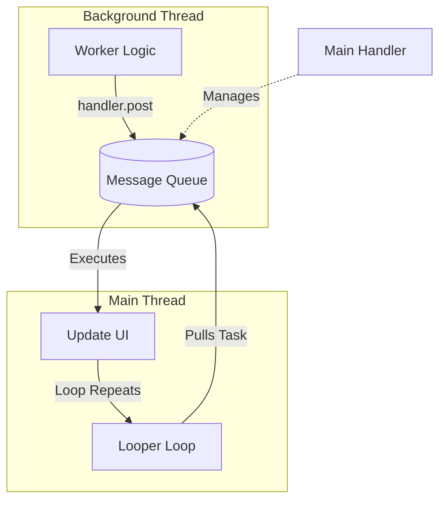

# Threads, Loopers, and Handlers

## Overview

While Kotlin Coroutines are the modern standard for concurrency in Android, Coroutines are just an abstraction. Under the hood, they run on physical OS threads. 

A Staff Android Engineer must understand the legacy concurrency primitives: `Thread`, `Looper`, `Handler`, and `HandlerThread`. These classes form the absolute backbone of the Android operating system. The Main Thread (UI Thread) itself is simply a standard Java thread that has an infinite `Looper` attached to it.

If you do not understand these primitives, you cannot debug legacy codebases, you will not understand how the UI renders, and you will struggle to comprehend the lower-level Android OS source code (AOSP).

## Why It Matters

Android UI toolkits (both XML Views and Jetpack Compose) are **not thread-safe**. You can only modify the UI from the exact thread that originally created the View hierarchy: The Main Thread.

If a background thread downloads an image and tries to set it on an `ImageView` directly, the app will instantly crash with a `CalledFromWrongThreadException`. The background thread must find a way to "send a message" to the Main Thread, asking *it* to update the UI. The `Handler` and `Looper` system is the exact mechanism that enables this inter-thread communication.

## Historical Context

In the early days of Java, developers created raw `Thread`s. However, creating a thread is incredibly expensive (memory overhead for the stack, OS kernel context switching). Furthermore, once a `Thread` finishes its `run()` method, it dies. You cannot reuse it. 

To prevent constantly destroying and recreating threads, the "Message Queue" pattern was born. You create a thread, keep it alive forever using an infinite `while(true)` loop, and feed it a queue of tasks. Android codified this exact pattern into the OS using the `Looper` and `MessageQueue` classes.

## First Principles

1.  **The `MessageQueue`:** A priority queue of tasks (`Message` or `Runnable` objects) waiting to be executed.
2.  **The `Looper`:** The infinite loop. It attaches to a single thread, continuously checks the `MessageQueue`, pulls the next task, and executes it on its thread.
3.  **The `Handler`:** The mailbox. Other threads use the `Handler` to post messages *into* the `MessageQueue` of the thread that owns the `Looper`.
4.  **The `HandlerThread`:** A convenience class. It is just a standard `Thread` that comes pre-configured with a `Looper`.

## Mental Model

Think of a **Busy Restaurant Kitchen**.
- **The Thread:** The Chef.
- **The `MessageQueue`:** The ticket rail where incoming food orders are placed.
- **The `Looper`:** The Chef's routine: looking at the rail, grabbing the oldest ticket, cooking it, and checking the rail again.
- **The `Handler`:** The Waiter. The Waiter takes an order from a customer (a background thread) and places the ticket onto the Chef's rail.

If you don't have a `Looper`, the Chef cooks one meal, declares his shift over, and goes home (the thread dies).

## Internal Mechanics

### 1. The Main Thread is Just a Looper
When your app process starts (via the Zygote), the Android OS calls `ActivityThread.main()`.

```java
// Simplified AOSP Source Code for ActivityThread.java
public static void main(String[] args) {
    // 1. Prepare the Main Looper
    Looper.prepareMainLooper();
    
    ActivityThread thread = new ActivityThread();
    thread.attach(false, startSeq);

    // 2. Start the infinite loop! This blocks forever.
    Looper.loop();

    // 3. If we ever get here, the app has crashed or exited.
    throw new RuntimeException("Main thread loop unexpectedly exited");
}
```
The UI thread never dies because it is trapped in `Looper.loop()`. Every time you click a button, the OS hardware sends an interrupt, which posts a `Message` to the Main Thread's `MessageQueue`. The Main `Looper` pulls it and executes your `onClick` listener.

### 2. Creating a Custom Worker Thread
If you want to create a background thread that stays alive and accepts tasks:

```kotlin
val thread = Thread {
    // 1. Create a Looper and MessageQueue for THIS thread
    Looper.prepare() 
    
    // 2. Create a Handler attached to THIS thread's Looper
    val handler = Handler(Looper.myLooper()!!) 
    
    // 3. Start the infinite loop
    Looper.loop() 
}
thread.start()
```

### 3. Communicating Between Threads
To send a task from a background thread back to the UI thread, you need a `Handler` that is attached to the Main Thread's `Looper`.

```kotlin
// Get the Main Thread's Looper
val mainHandler = Handler(Looper.getMainLooper())

Thread {
    // 1. We are on a background Thread
    val data = downloadData() 
    
    // 2. We POST a runnable to the Main Thread's MessageQueue
    mainHandler.post {
        // 3. This block executes ON THE MAIN THREAD
        textView.text = data 
    }
}.start()
```

## Architecture



## Production Example

**The `HandlerThread`**

Creating raw `Thread`s and calling `Looper.prepare()` is tedious. Android provides `HandlerThread`, which encapsulates it safely. It is heavily used in Android's low-level camera and sensor APIs, which require continuous polling on a dedicated thread to avoid blocking the UI.

```kotlin
class CameraSensorManager {
    private val sensorThread = HandlerThread("SensorThread").apply { start() }
    // We attach the Handler to the background thread's Looper
    private val sensorHandler = Handler(sensorThread.looper)

    fun startPolling() {
        // Post a task to the background thread
        sensorHandler.post {
            // Read hardware sensor (Heavy I/O)
            val data = readSensor()
            
            // Post result back to Main Thread
            Handler(Looper.getMainLooper()).post {
                updateUi(data)
            }
        }
    }

    fun stop() {
        // MUST call quitSafely() to kill the Looper and let the thread die,
        // otherwise it causes a massive memory leak!
        sensorThread.quitSafely()
    }
}
```

## Tradeoffs

**Coroutines vs HandlerThread vs ExecutorService**

- **`HandlerThread`:** 
    - *Pros:* Perfect for sequential, continuous operations (like a queue of camera frames). Strictly guarantees order of execution (FIFO).
    - *Cons:* It uses 1 dedicated OS thread. If you `Thread.sleep()` inside it, the entire queue backs up. It doesn't scale.
- **`ExecutorService` (Thread Pools):**
    - *Pros:* Manages a pool of threads automatically. Great for firing off 10 parallel independent tasks (like downloading 10 images).
    - *Cons:* Heavy memory footprint. Hard to manage lifecycle (cancelling tasks is difficult).
- **Coroutines:**
    - *Pros:* Scales to millions. Re-uses a shared `ExecutorService` under the hood (`Dispatchers.IO`). Handles lifecycle cancellation perfectly via Structured Concurrency.
    - *Cons:* Extremely steep learning curve (understanding CPS and State Machines).

## Failure Modes

- **Leaking the Activity via Handler:**
  ```kotlin
  class MainActivity : Activity() {
      // DISASTER: An anonymous inner class holds a hard reference to the outer Activity.
      private val handler = Handler(Looper.getMainLooper())
      
      override fun onCreate() {
          // If you rotate the phone, the Activity is destroyed.
          // But the MessageQueue holds this Runnable for 10 minutes!
          // The old Activity cannot be Garbage Collected. Massive leak.
          handler.postDelayed({ textView.text = "Done" }, 600000) 
      }
  }
  ```
  *(Fix: Always clear handlers in `onDestroy`: `handler.removeCallbacksAndMessages(null)`).*
- **Blocking the Looper:** Calling `Thread.sleep(5000)` inside a `Handler.post {}` block on the Main Thread. The Looper is physically halted. It cannot process the next message in the queue (e.g., a touch event). The app ANRs (Application Not Responding).

## Staff Engineer Thinking

When reviewing raw threading code, a Staff engineer focuses on lifecycle and synchronization:

1.  **Do we really need a Thread?** I actively deprecate `HandlerThread` and `ExecutorService` in modern codebases. Kotlin Coroutines (`Dispatchers.Default` for CPU, `Dispatchers.IO` for Network) are vastly superior and less leak-prone. If someone introduces a raw `Thread`, they must justify why Coroutines cannot solve the problem.
2.  **Thread Confinement:** If we *must* use a `HandlerThread` (e.g., for a legacy SDK integration), I ensure all access to the underlying hardware is strictly confined to that specific thread. Unsynchronized access across threads will cause race conditions and corrupted memory.
3.  **The Shutdown Sequence:** If a developer creates a `HandlerThread`, they MUST override the parent component's `onDestroy()` and call `handlerThread.quitSafely()`. If they forget, that OS thread lives in the background forever.

## Common Misconceptions

- **"A Handler runs on a background thread."** False. A `Handler` runs on the thread of the `Looper` you provided in its constructor. If you do `Handler(Looper.getMainLooper()).post {}`, that code runs on the UI thread, regardless of where the `post` was called from.
- **"Coroutines replace the Main Looper."** False. When you use `Dispatchers.Main` in Coroutines, under the hood, the Coroutine library literally creates a `Handler(Looper.getMainLooper())` and posts the continuation State Machine as a `Runnable` into the Main Thread's Message Queue! The Looper is inescapable on Android.

## Probing Questions

1.  What is the relationship between a `Looper`, a `MessageQueue`, and a `Handler`?
2.  Explain why `Thread.sleep()` inside a Main Thread `Handler.post` block causes an Application Not Responding (ANR) error.
3.  Why does the Android Main Thread not simply exit its `main()` function and die after the app finishes launching? What keeps it alive?
4.  Describe the memory leak that occurs when posting a delayed `Runnable` using a `Handler` in an Activity without clearing it in `onDestroy()`.
5.  What is a `HandlerThread`, and how does it differ from a standard Java `Thread`?
6.  Why is it mathematically impossible to modify an Android XML `View` from a background thread? What exception is thrown?
7.  If you have an intensive CPU task (parsing a 10MB JSON file), would you use a `HandlerThread` or a Thread Pool (`ExecutorService`)? Why?
8.  How does Kotlin's `Dispatchers.Main` actually integrate with Android's legacy `Looper` system under the hood?
9.  What is the difference between `handlerThread.quit()` and `handlerThread.quitSafely()`?
10. Describe the "Message Queue" architectural pattern and why it is vastly superior to creating a new OS thread for every individual asynchronous task.

## Further Reading

- [`coroutines-under-the-hood.md`](../concurrency/coroutines-under-the-hood.md) — How modern Kotlin builds its state machines on top of these raw thread pools.
- [`anrs.md`](../performance/anrs.md) — What happens when the Main Looper gets blocked.
- [Android Developers: Processes and Threads](https://developer.android.com/guide/components/processes-and-threads)
