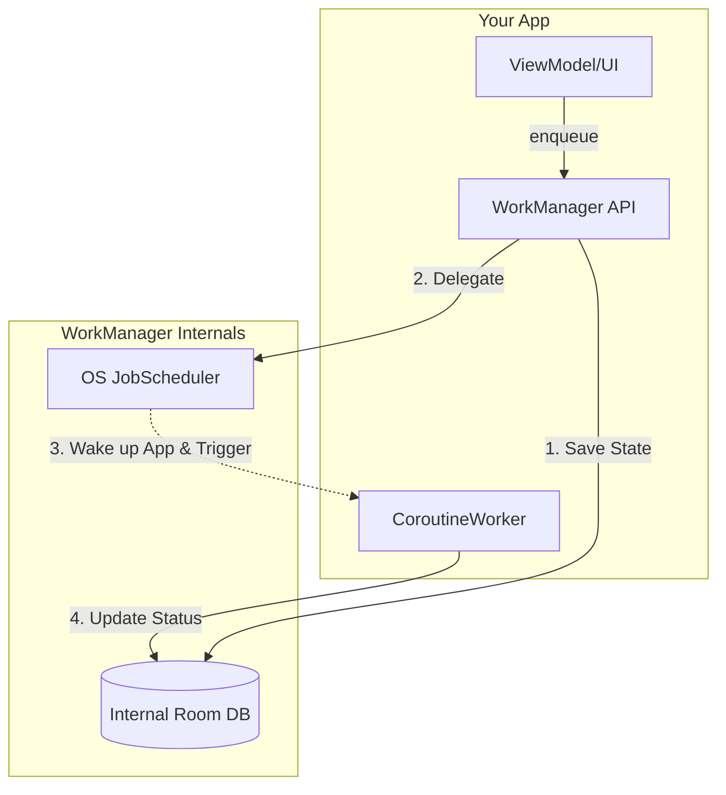

# WorkManager

## Overview

`WorkManager` is the Google-recommended architectural component for persistent, deferrable background work. 

If your application needs to ensure a task completes even after the app process exits, the app leaves the visible state, or the device reboots, you should use `WorkManager`. It abstracts away the massive fragmentation of Android background execution (JobScheduler, AlarmManager, BroadcastReceivers) into a single, clean API that strictly respects device battery constraints.

A Staff Engineer must understand that `WorkManager` is not just a thread pool; it is a persistent database-backed execution engine.

## Why It Matters

Before `WorkManager`, background execution was a nightmare of OS fragmentation.
- On Android 4.x, developers used `AlarmManager` to wake up the phone, completely destroying battery life.
- On Android 5.0, Google introduced `JobScheduler`, which grouped network requests to save battery, but it wasn't backwards compatible.
- Developers used libraries like Evernote's `Android-Job` or Firebase `JobDispatcher` to bridge the gap.

Today, `WorkManager` is the singular standard. If you attempt to build your own persistent background queue using a Service and a database, you are wasting company money and violating Android OS constraints.

## Historical Context

When Android 8.0 (Oreo) aggressively killed standard background Services, the community panicked. How do we upload logs? How do we sync the local SQLite database?

`WorkManager` was introduced as the definitive answer. It shifted the mental model of developers from "I need this to run right now" to "I need this to run eventually, when the conditions are perfect." This shift was necessary to preserve smartphone battery life on a global scale.

## First Principles

1.  **Deferrable:** The work doesn't need to happen the exact millisecond the user clicks a button. (Uploading analytics).
2.  **Persistent:** If the app process dies, the OS remembers the work and executes it later.
3.  **Constraints:** The work can declare prerequisites (e.g., "Only run when the phone is charging and connected to Unmetered Wi-Fi").
4.  **Chaining:** Work can be chained hierarchically (e.g., "Download Image" -> "Compress Image" -> "Upload Image").

## Mental Model

Think of `WorkManager` as an **Automated Logistics Warehouse**.
- **The WorkRequest:** A shipping label with instructions ("Fragile," "Deliver when Sunny").
- **The WorkManager:** The Warehouse Manager.
- **The Worker:** The robot that actually does the task.

When you enqueue work, you hand the shipping label to the Warehouse Manager. The Manager stores it in a filing cabinet (Room Database). 
Even if the warehouse loses power (Device Reboot), when the power comes back, the Manager checks the cabinet, sees pending labels, waits for the constraints to be met, and sends out the robots.

## Internal Mechanics

How does `WorkManager` guarantee execution across reboots? It uses an internal SQLite database (via Room).

1.  When you call `WorkManager.enqueue()`, it immediately writes a row to its internal Room database. 
2.  It then looks at the OS version. 
    - On Android 6.0+, it delegates the scheduling to the OS `JobScheduler`.
    - It passes the `WorkRequest` ID to the OS.
3.  When the OS determines the conditions are right (e.g., Wi-Fi is connected), it wakes up your app process and tells `WorkManager` to execute that specific ID.
4.  `WorkManager` spins up a background thread, instantiates your `Worker` class, and calls `doWork()`.
5.  When `doWork()` finishes, `WorkManager` updates the Room database row to `SUCCEEDED`.

## Architecture



## Production Example

**The CoroutineWorker**

The most common Worker type in modern Android is the `CoroutineWorker`, which natively supports `suspend` functions and integrates perfectly with [Structured Concurrency](../concurrency/coroutines-under-the-hood.md).

```kotlin
// 1. Define the Work
class DataSyncWorker(
    context: Context,
    workerParams: WorkerParameters,
    private val api: Api, // Injected via HiltWorker
    private val db: Database
) : CoroutineWorker(context, workerParams) {

    // Runs on Dispatchers.Default automatically
    override suspend fun doWork(): Result {
        return try {
            val data = api.fetchData()
            db.save(data)
            Result.success() // Updates DB, tells OS we are done
        } catch (e: HttpException) {
            // If the server returns 500, tell WorkManager to retry later
            // using exponential backoff!
            Result.retry()
        } catch (e: Exception) {
            // Fatal error, do not retry
            Result.failure()
        }
    }
}

// 2. Schedule the Work (e.g., in a ViewModel or Application class)
fun scheduleSync(context: Context) {
    // Define constraints
    val constraints = Constraints.Builder()
        .setRequiredNetworkType(NetworkType.UNMETERED) // Wi-Fi only
        .setRequiresBatteryNotLow(true)
        .build()

    // Build the request
    val syncRequest = OneTimeWorkRequestBuilder<DataSyncWorker>()
        .setConstraints(constraints)
        .setBackoffCriteria(
            BackoffPolicy.EXPONENTIAL,
            WorkRequest.MIN_BACKOFF_MILLIS,
            TimeUnit.MILLISECONDS
        )
        .build()

    // Enqueue it uniquely (don't queue 5 syncs if the user clicks 5 times)
    WorkManager.getInstance(context).enqueueUniqueWork(
        "UniqueDataSync",
        ExistingWorkPolicy.REPLACE,
        syncRequest
    )
}
```

## Tradeoffs

**WorkManager vs Foreground Services**

- **WorkManager:** 
    - *Pros:* Survives reboots. Handles constraints perfectly. Built-in retries and exponential backoff.
    - *Cons:* Execution is at the mercy of the OS. Even if constraints are met, the OS might delay execution for 10+ minutes to batch it with other apps to save battery.
- **Foreground Service:**
    - *Pros:* Executes *instantly*. Bypasses Doze mode almost completely.
    - *Cons:* Massive developer overhead. Requires user-visible notification. Crashes app on Android 12+ if launched from background.

*Staff Note:* Since Android 12, `WorkManager` introduced **Expedited Jobs** (`setExpedited(true)`). This allows a WorkRequest to instantly execute within seconds, even if the app is in the background. The OS internally grants the app a temporary exemption or automatically converts it to a Foreground Service under the hood.

## Failure Modes

- **The `IllegalStateException` on Initialization:**
  If you attempt to use Dependency Injection (like Dagger/Hilt) with WorkManager, you must disable the default WorkManager initializer in the `AndroidManifest.xml` and initialize it manually in your `Application.onCreate()`. If you miss this, WorkManager will try to instantiate your Workers using reflection (empty constructor), failing to inject the API/Database, and crashing immediately.
- **The 10-Minute Timeout:**
  A `Worker` has a strict maximum execution time limit imposed by the OS (historically 10 minutes). If your `doWork()` method takes 11 minutes (e.g., downloading a massive 4K movie on 3G), the OS will abruptly kill the worker. 
  *(Fix: Break massive tasks into smaller chunks, or use a Foreground Service for unbounded execution times).*
- **The Force-Stop Misconception:**
  WorkManager is persistent, but it is not a way to override explicit user intent. If the user force-stops the app from system settings, Android places the package into a stopped state and background work will not continue running as if nothing happened.
  *(Fix: Design WorkManager for app exits, process death, constraints, retries, and reboot persistence. Do not promise execution after a user force-stop; reconcile pending server/client state the next time the app is opened).*
- **Testing Nightmare:**
  Testing asynchronous, persistent OS jobs is notoriously difficult. Developers often resort to `Thread.sleep` in tests to wait for WorkManager.
  *(Fix: Use `TestListenableWorkerBuilder` to instantiate the Worker directly in unit tests and call `doWork()` synchronously).*

## Staff Engineer Thinking

1.  **Unique Work Policies:** I constantly check PRs for `ExistingWorkPolicy`. If an app calls `enqueue()` every time the user opens the Main Screen without a Unique ID, the WorkManager database will fill up with 10,000 duplicate Sync tasks, causing the device to melt down when it connects to Wi-Fi. It must use `enqueueUniqueWork` with `KEEP` or `REPLACE`.
2.  **Observability:** Because WorkManager runs in the background, failures are silent to the user. I ensure that a `Result.failure()` explicitly logs to our crash monitoring system (Crashlytics/NewRelic) with the specific Worker name and failure reason.
3.  **Data Passing:** You can pass data into a Worker using `Data.Builder`. However, the limit is 10KB. I reject any PR attempting to serialize a massive JSON object into the `Data` bundle. You pass the `ID` (an integer), and the Worker reads the full JSON from the local database.

## Common Misconceptions

- **"WorkManager executes instantly if my constraints are met."** False. It executes *opportunistically*. The OS might decide to wait 5 minutes to see if any other apps also want to use the network, batching the radio wakeups to save battery.
- **"I don't need WorkManager because Coroutines run in the background."** If the user swipes your app away from the Recents screen, your Coroutines die instantly. WorkManager survives.

## Probing Questions

1.  Explain the fundamental difference in use-case between a Coroutine launched in `viewModelScope` and a `CoroutineWorker` scheduled via `WorkManager`.
2.  How does `WorkManager` guarantee that a task will execute even if the device completely loses power and is rebooted?
3.  What is `ExistingWorkPolicy`, and why is it critical when enqueuing work from a high-traffic area of your application (like `MainActivity.onCreate`)?
4.  Describe the 10-minute execution limit of `WorkManager`. What architectural pattern should you use if you need to download a 5GB file?
5.  What are "Expedited Jobs" in WorkManager, and what specific Android 12+ restriction were they introduced to bypass?
6.  Explain how `WorkManager` handles the concept of "Constraints" and how this differs from manually checking the Wi-Fi state before launching a Coroutine.
7.  If a `CoroutineWorker` returns `Result.retry()`, how does `WorkManager` decide when to execute the job again?
8.  Why must you disable the default `WorkManager` initializer in the `AndroidManifest.xml` when using Dependency Injection frameworks like Hilt?
9.  Explain the concept of Work Chaining. How do you pass output data from the first Worker into the second Worker?
10. If an Android device enters "Doze Mode", what happens to all pending `WorkManager` jobs?

## Further Reading

- [`services.md`](services.md) — The legacy mechanism WorkManager replaces for 90% of tasks.
- [`battery-optimizations.md`](battery-optimizations.md) — How the OS decides when to actually run the enqueued WorkRequests.
- [Android Developers: WorkManager](https://developer.android.com/topic/libraries/architecture/workmanager)
