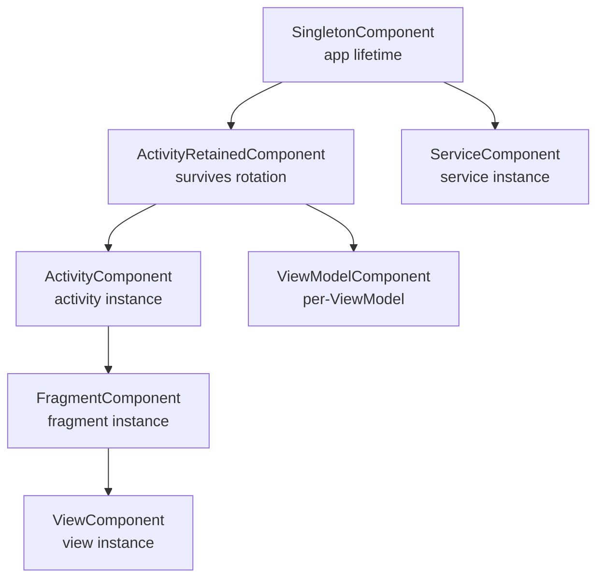

# Hilt Components — Hierarchy, Lifetimes, and Scope

> Hilt's killer feature isn't `@Inject` — it's the component hierarchy that matches Android's lifecycle. Pick the wrong component and you either leak an Activity for the app's lifetime, or your `@ViewModelScoped` cache resets every screen rotation. Staff-level mastery means knowing all seven standard components, when subcomponents inherit, where to install which `@Module`, and how to define custom components for things Hilt doesn't predict.

---

## What's a "Component"?

In Dagger (and Hilt), a **Component** is a generated class that holds the object graph for a particular lifetime. Each `@Inject`-able class lives inside a component; the component is created and destroyed by the Android lifecycle.

```
Application starts → SingletonComponent created
   ↓
Activity created → ActivityRetainedComponent created (rotation-safe)
   ↓
Activity ready → ActivityComponent created (lost on rotation)
   ↓
Fragment created → FragmentComponent created
   ↓
Fragment view ready → ViewComponent created
```

When the corresponding Android object is destroyed, its component is too — and every `@Scoped` dependency inside dies with it.

Hilt pre-generates this hierarchy for you. Dagger required you to write `@Subcomponent` annotations by hand; Hilt eliminates that boilerplate.

---

## The Seven Standard Components

| Component | Created | Destroyed | Scope annotation | Default for |
|---|---|---|---|---|
| **`SingletonComponent`** | `Application.onCreate` | Process death | `@Singleton` | Retrofit, Room DB, app-wide caches |
| **`ActivityRetainedComponent`** | First Activity created | Activity finished (NOT rotation) | `@ActivityRetainedScoped` | ViewModels (via `@HiltViewModel`), session-scoped state |
| **`ActivityComponent`** | Activity created | Activity destroyed (incl. rotation) | `@ActivityScoped` | Per-Activity helpers, ActionBar/Toolbar state |
| **`ViewModelComponent`** | ViewModel created | ViewModel cleared | `@ViewModelScoped` | Per-screen repositories, use-cases |
| **`FragmentComponent`** | Fragment created | Fragment destroyed | `@FragmentScoped` | Fragment-specific helpers |
| **`ViewComponent`** | View created | View destroyed | `@ViewScoped` | Custom view dependencies |
| **`ServiceComponent`** | Service created | Service destroyed | `@ServiceScoped` | Service-local resources |

There's also `ViewWithFragmentComponent` (rarely needed) — for views created inside fragments that need Fragment-scoped dependencies.

---

## The Hierarchy (Visualized)



Children inherit bindings from their parents. A `@Singleton`-scoped `Analytics` is accessible from `@ActivityScoped`, `@FragmentScoped`, and `@ViewScoped` consumers. Reverse is impossible — an `@ActivityScoped` `ToolbarController` cannot be injected into a `@Singleton`-scoped service.

---

## How Components Get Created

The chain of events when you launch your app:

```kotlin
@HiltAndroidApp
class MyApp : Application()
```

1. `@HiltAndroidApp` triggers Hilt's annotation processor to generate `Hilt_MyApp` (a subclass).
2. `Hilt_MyApp.onCreate()` creates the `SingletonComponent` via the generated `DaggerSingletonComponent`.
3. The Singleton component holds all `@InstallIn(SingletonComponent::class)` modules' graphs.

```kotlin
@AndroidEntryPoint
class MainActivity : AppCompatActivity()
```

4. `@AndroidEntryPoint` generates `Hilt_MainActivity`.
5. `Hilt_MainActivity.onCreate()` asks the `SingletonComponent` for an `ActivityRetainedComponentBuilder` and creates an `ActivityRetainedComponent`.
6. Same step builds `ActivityComponent` on top of `ActivityRetainedComponent`.

Each component's "Builder" is a generated class. The hierarchy of subcomponents is captured at compile time, not via runtime reflection.

---

## `@InstallIn` — Where to Put a Module

```kotlin
@Module
@InstallIn(SingletonComponent::class)
object NetworkModule {
    @Provides @Singleton
    fun provideRetrofit(client: OkHttpClient): Retrofit = /* … */
}
```

The `@InstallIn` annotation declares which component holds this module's bindings. If a module's `@Provides` returns a type with `@Singleton` scope, the module **must** be installed in `SingletonComponent`.

### Decision table

| Binding's scope annotation | Install module in |
|---|---|
| `@Singleton` or unscoped (app-wide types like `Context`) | `SingletonComponent` |
| `@ActivityRetainedScoped` | `ActivityRetainedComponent` |
| `@ViewModelScoped` | `ViewModelComponent` |
| `@ActivityScoped` | `ActivityComponent` |
| `@FragmentScoped` | `FragmentComponent` |
| `@ViewScoped` | `ViewComponent` |
| `@ServiceScoped` | `ServiceComponent` |

Get this wrong → compile error: "scope annotation not allowed in this component."

A module can be installed in multiple components if its bindings work everywhere:

```kotlin
@Module
@InstallIn(ActivityComponent::class, FragmentComponent::class)
abstract class NavigationBindingsModule { /* … */ }
```

---

## Scopes Are Optional

A `@Provides` method **without** a scope annotation creates a **new instance per request**:

```kotlin
@Provides
fun provideUuid(): UUID = UUID.randomUUID()   // unscoped — new UUID every injection point
```

With scope:

```kotlin
@Provides @Singleton
fun provideClock(): Clock = Clock.systemUTC()   // one instance for the whole app
```

The general rule: **scope only when sharing matters**. Stateless transient objects don't need a scope.

---

## Drill-Down on Each Component

### `SingletonComponent`

Lives for the entire application process. Anything stateful and shared across the whole app lives here.

Typical contents:
- `Retrofit` / `Apollo` clients.
- `OkHttp` client (with interceptors).
- `Room` database.
- `DataStore<UserPrefs>` instance.
- `Application`-context-bound services.
- Analytics SDK initialization.
- `WorkManager` (if managed by Hilt).

```kotlin
@Module
@InstallIn(SingletonComponent::class)
object DataModule {
    @Provides @Singleton
    fun provideRoomDb(@ApplicationContext ctx: Context): AppDatabase =
        Room.databaseBuilder(ctx, AppDatabase::class.java, "app.db").build()

    @Provides @Singleton
    fun provideOkHttp(@ApplicationContext ctx: Context): OkHttpClient = /* … */
}
```

**Rule:** never store `Activity` or `View` references in `@Singleton`-scoped objects — that's a leak forever.

### `ActivityRetainedComponent` — Rotation-Surviving

The component that powers `@HiltViewModel`. Created the first time an Activity is created; lives until that Activity is permanently finished (NOT recreated on rotation).

```kotlin
@HiltViewModel
class CartViewModel @Inject constructor(
    private val repo: CartRepository,
) : ViewModel()   // automatically @ActivityRetainedScoped via the @HiltViewModel macro
```

You can also explicitly scope a non-ViewModel object to this lifetime:

```kotlin
@ActivityRetainedScoped
class SessionState @Inject constructor() {
    val cart = MutableStateFlow<List<Item>>(emptyList())
}
```

Useful for "I want this state to survive rotation but die when the user backs out of the screen." Cleaner than a ViewModel for shared per-screen state.

### `ActivityComponent` — Tied to Activity Instance

Created when an Activity is created; destroyed (and recreated) on every rotation. Use for things that are inherently view-instance-specific.

```kotlin
@ActivityScoped
class ToolbarController @Inject constructor(@ActivityContext ctx: Context) {
    // OK: a new ToolbarController on rotation is fine
}
```

Rarely needed. Most "Activity-scoped" things are better off `@ActivityRetainedScoped` (so they survive rotation) or `@ViewModelScoped`.

### `ViewModelComponent` — Per-ViewModel

Created when each ViewModel is created; destroyed when that ViewModel is cleared. Used for per-screen helpers that should die with the screen.

```kotlin
@ViewModelScoped
class CheckoutAnalytics @Inject constructor(
    private val tracker: Analytics,
) {
    fun trackStep(step: Int) {
        tracker.track("checkout_step", step.toString())
    }
}

@HiltViewModel
class CheckoutViewModel @Inject constructor(
    private val analytics: CheckoutAnalytics,   // re-created per ViewModel
) : ViewModel()
```

The advantage over `@Singleton`: the `CheckoutAnalytics` instance is unique per checkout flow. Step counters reset cleanly between flows.

### `FragmentComponent` — Per-Fragment

Created when a Fragment is created; destroyed when the Fragment is destroyed (which means re-created on rotation, since Fragments are too).

```kotlin
@FragmentScoped
class FragmentChildAdapter @Inject constructor() {
    /* … */
}
```

Use sparingly. Most Fragment-scoped state lives better in a `@ViewModelScoped` companion. `FragmentComponent` is for things explicitly tied to the Fragment instance itself (e.g., custom Fragment-level renderers).

### `ViewComponent` — Per-View

Custom views can inject dependencies if annotated `@AndroidEntryPoint`:

```kotlin
@AndroidEntryPoint
class StarRatingView @JvmOverloads constructor(
    context: Context,
    attrs: AttributeSet? = null,
) : View(context, attrs) {
    @Inject lateinit var imageLoader: ImageLoader   // injected!
}
```

`@ViewScoped` dependencies are extremely rare; most custom views need `@Singleton` or `@ActivityScoped` deps.

### `ServiceComponent` — Per-Service

```kotlin
@AndroidEntryPoint
class SyncService : Service() {
    @Inject lateinit var syncEngine: SyncEngine
}
```

`@ServiceScoped` rarely needed. Services usually pull `@Singleton` deps.

---

## EntryPoints — Escape Hatch for Non-Hilt Classes

When you need a Hilt-managed dependency in something Hilt doesn't manage (`ContentProvider`, framework callbacks, code in a library module that can't `@AndroidEntryPoint`):

```kotlin
@EntryPoint
@InstallIn(SingletonComponent::class)
interface AnalyticsEntryPoint {
    fun analytics(): Analytics
}

class MyContentProvider : ContentProvider() {
    private lateinit var analytics: Analytics

    override fun onCreate(): Boolean {
        val ctx = context!!.applicationContext
        analytics = EntryPointAccessors
            .fromApplication(ctx, AnalyticsEntryPoint::class.java)
            .analytics()
        return true
    }
}
```

`EntryPointAccessors` has variants for every component:

| Method | Component |
|---|---|
| `fromApplication(context, EntryPoint::class)` | SingletonComponent |
| `fromActivity(activity, EntryPoint::class)` | ActivityComponent |
| `fromFragment(fragment, EntryPoint::class)` | FragmentComponent |
| `fromView(view, EntryPoint::class)` | ViewComponent |

Pick the component matching the dependency's scope.

---

## Custom Components with `@DefineComponent`

For specialty cases — a session, an in-app purchase flow, a SDK init — define your own:

```kotlin
@LoggedUserScoped
@DefineComponent(parent = SingletonComponent::class)
interface LoggedUserComponent {
    @DefineComponent.Builder
    interface Builder {
        fun userId(@BindsInstance userId: String): Builder
        fun build(): LoggedUserComponent
    }
}

@Scope @Retention(AnnotationRetention.BINARY)
annotation class LoggedUserScoped
```

Use case: a `UserSession` that holds per-logged-in-user state. Create on login, destroy on logout, regardless of which Activity is active.

```kotlin
@EntryPoint
@InstallIn(LoggedUserComponent::class)
interface UserEntryPoint {
    fun userPreferences(): UserPreferences
    fun userAnalytics(): UserAnalytics
}

class SessionManager @Inject constructor(
    private val componentBuilder: LoggedUserComponent.Builder,
) {
    private var component: LoggedUserComponent? = null

    fun login(userId: String) {
        component = componentBuilder.userId(userId).build()
    }

    fun logout() {
        component = null
    }

    fun prefs(): UserPreferences = component!!
        .let { EntryPointAccessors.fromGenericComponent(it, UserEntryPoint::class.java) }
        .userPreferences()
}
```

Rarely needed. Default to standard components first.

---

## Hilt vs Pure Dagger Components

| Concern | Pure Dagger | Hilt |
|---|---|---|
| Component definition | `@Component` / `@Subcomponent` interface | Pre-generated |
| Component hierarchy | You wire up `@Subcomponent.Factory` | Generated automatically |
| Activity injection | Manual `(activity.application as MyApp).component.inject(this)` | `@AndroidEntryPoint` |
| Per-activity scoping | Custom `@ActivityScope` + factories | Built-in `@ActivityScoped` |
| ViewModel integration | Manual factory + `ViewModelProvider.Factory` | `@HiltViewModel` |

The promise of Hilt: replace ~50 lines of Dagger component plumbing with ~3 annotations. Pay the cost of slightly less flexibility for massive ergonomic gains.

---

## Real Android Patterns

### Pattern 1: Repository scoped to the screen

```kotlin
@ViewModelScoped
class FilterState @Inject constructor() {
    val selectedFilters = MutableStateFlow<Set<Filter>>(emptySet())
}

@HiltViewModel
class CatalogViewModel @Inject constructor(
    private val filterState: FilterState,
    private val repo: CatalogRepository,
) : ViewModel()
```

Each `CatalogViewModel` instance gets its own `FilterState`. Reset cleanly between catalogs.

### Pattern 2: Multiple custom-scoped services

```kotlin
@TripScoped
@DefineComponent(parent = SingletonComponent::class)
interface TripComponent {
    @DefineComponent.Builder
    interface Builder {
        fun tripId(@BindsInstance id: String): Builder
        fun build(): TripComponent
    }
}

@TripScoped
class TripLocationTracker @Inject constructor(@TripId val tripId: String) {
    fun start() { /* … */ }
    fun stop() { /* … */ }
}
```

A `Trip` component lives only while a delivery driver is on a trip. Components are explicit "do this only while X is happening" scopes.

### Pattern 3: Module installation across components

```kotlin
@Module
@InstallIn(ActivityComponent::class, FragmentComponent::class)
abstract class NavigationModule {
    @Binds
    abstract fun bindNavigator(impl: ComposeNavigator): Navigator
}
```

When `Navigator` should work from both Activities and Fragments. Avoid `SingletonComponent` here — `Navigator` needs the current `NavController`, which is screen-scoped.

### Pattern 4: WorkManager with Hilt components

```kotlin
@HiltWorker
class SyncWorker @AssistedInject constructor(
    @Assisted appContext: Context,
    @Assisted params: WorkerParameters,
    private val repo: SyncRepository,   // injected from SingletonComponent
) : CoroutineWorker(appContext, params) {
    override suspend fun doWork(): Result { /* … */ }
}
```

Workers run in a hidden internal component but pull `@Singleton` deps from the main graph.

---

## Failure Modes

| Symptom | Cause | Fix |
|---|---|---|
| `[Dagger/MissingBinding]` — type can't be provided | Module not installed in the right component | Verify `@InstallIn` matches the consumer's component |
| Memory leak: Activity references held forever | `@Singleton` holding `Activity` reference | Re-scope to `@ActivityScoped` or `@ActivityRetainedScoped` |
| `@ViewModelScoped` cache resets on rotation | Misunderstanding — ViewModel survives rotation, so the component lives | This is actually correct; `@ViewModelScoped` *does* survive rotation |
| `@ActivityScoped` state lost on rotation | This is by design | If state should survive rotation, use `@ActivityRetainedScoped` or ViewModel |
| Compile error: "Scope annotation @X not allowed" | Module/binding installed in wrong component | Match annotation to component (see decision table) |
| Cannot inject Activity-scoped dep into ViewModel | ViewModel lives in `ActivityRetainedComponent`, not `ActivityComponent` | Re-scope dep to `@ActivityRetainedScoped` or `@Singleton` |
| Crash: "Cannot use @AndroidEntryPoint on Application" | Application uses `@HiltAndroidApp`, not `@AndroidEntryPoint` | Use the correct annotation per class type |
| ContentProvider can't inject deps | ContentProviders aren't `@AndroidEntryPoint`-able directly | Use `EntryPointAccessors.fromApplication` |
| Custom component never created | Forgot to call `Builder.build()` | Verify lifecycle: build on session start, null out on end |
| Multiple instances of `@Singleton`-scoped dep | Two `@Provides` methods with the same scope | Remove duplicate; use `@Binds` for interface impls |
| `@HiltViewModel` not picked up | Missing `@AndroidEntryPoint` on the consumer | Annotate the Activity/Fragment |
| `ViewModel` constructor depends on Activity-scoped object | Hilt forbids — different component lifetime | Pass the data through `SavedStateHandle` or `@Assisted` |
| Build error after migrating Dagger → Hilt | Mismatched component hierarchy | Audit `@Subcomponent` usage; Hilt expects its own hierarchy |
| `@DefineComponent` doesn't generate code | Missing scope annotation | Pair `@DefineComponent` with a `@Scope` annotation |
| `EntryPointAccessors` returns wrong instance | Used wrong `from*` variant | Match the variant to the dep's scope |

---

## Common Pitfalls

- **Defaulting to `@Singleton` for everything.** "It works, why not?" — because you're growing the SingletonComponent's graph forever, which slows app startup. Scope deliberately to the smallest lifetime that fits.
- **Storing `Activity` in a `@Singleton` field.** Classic leak. The Activity is held forever; the entire view tree along with it.
- **Confusing `@ActivityScoped` with `@ActivityRetainedScoped`.** The first is destroyed on rotation; the second isn't. Most "Activity-scoped" needs are actually retained.
- **Modules `@InstallIn` everything.** If a module is installed in 5 components, you're duplicating bindings across the graph. Pick the smallest component that fits.
- **Custom components for things standard components handle.** `@DefineComponent` exists for true session-style lifecycles; don't reach for it when `@ActivityRetainedComponent` would do.
- **Activity → ViewModel → repo → Activity reference cycle.** Hilt may compile this if you're not paying attention; it leaks at runtime. The fix: never store back-references to UI from your data layer.
- **Building components multiple times.** Hilt builds components automatically. Calling builders manually for standard components leaks.
- **Forgetting that ViewModel components are *retained* but each ViewModel has its own.** A `@ViewModelScoped` dep is per-ViewModel — two `CartViewModel`s on the back stack get two `FilterState`s.

---

## Probing Questions

1. List all seven standard Hilt components in order from longest-lived to shortest-lived. What survives rotation, and what doesn't?
2. `@ActivityScoped` vs `@ActivityRetainedScoped` — give a concrete example where each is correct, and where mixing them is wrong.
3. Walk through what happens when you launch a Hilt app: which components get created, in what order, and when each is destroyed.
4. A `@Module @InstallIn(SingletonComponent::class) provideX(@ActivityContext ctx)` — does this compile? Why or why not?
5. Why is `@HiltViewModel` scoped to `ActivityRetainedComponent` rather than `ActivityComponent`?
6. Walk through `EntryPointAccessors.fromApplication` — what's the underlying mechanism, and why is it preferred over reflective access?
7. You have a `Session` object that should live from login to logout, regardless of which Activity is on screen. Design the Hilt component for it.
8. Module installed in two components — when is this right, and when does it indicate a smell?
9. A `@Singleton`-scoped `Analytics` holds a reference to the current `MainActivity` for "convenience." Walk through what breaks.
10. Compare Hilt's pre-generated component hierarchy to writing `@Subcomponent` in pure Dagger. What does Hilt give up to gain ergonomics?
11. `ViewModel` constructor takes an `@ActivityScoped` dep. Hilt rejects this at compile time — why?
12. ContentProvider can't be `@AndroidEntryPoint`. How do you inject into it?

---

## Further Reading

- [`hilt-vs-koin-vs-manual-di.md`](hilt-vs-koin-vs-manual-di.md) — choosing Hilt vs alternatives.
- [`dependency-injection.md`](dependency-injection.md) — broader DI patterns.
- [`room-vs-datastore.md`](room-vs-datastore.md) — typical `@Singleton`-scoped data deps.
- [`../architecture/viewmodel.md`](../architecture/viewmodel.md) — `@HiltViewModel` mechanics.
- [`../architecture/modularization-strategies.md`](../architecture/modularization-strategies.md) — module-level Hilt setup.
- [`../../kotlin/delegation.md`](../../kotlin/delegation.md) — `by viewModels()` + Hilt.
- [Hilt — Component hierarchy (official)](https://developer.android.com/training/dependency-injection/hilt-android#component-hierarchy) — official.
- [Hilt — Component lifetimes (official)](https://developer.android.com/training/dependency-injection/hilt-android#component-lifetimes) — official.
- [Manuel Vivo — Migrating to Hilt](https://medium.com/androiddevelopers/) — Google DevRel migration playbook.
- [Dagger / Hilt source](https://github.com/google/dagger) — read the generated code to understand what's happening.
