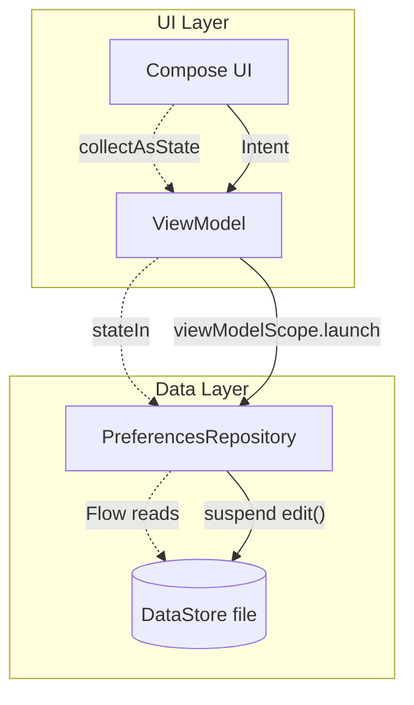

# DataStore

## Overview

`DataStore` is the modern, Coroutine-powered data storage solution that officially replaces `SharedPreferences`. It is designed strictly for small, simple datasets like user settings, onboarding flags, or authentication tokens.

A Staff Engineer must understand exactly *why* `SharedPreferences` was deprecated. `SharedPreferences` was a notorious source of Application Not Responding (ANR) crashes due to its synchronous, blocking disk I/O. `DataStore` solves this by forcing all operations to be asynchronous via Kotlin `Flow` and `suspend` functions.

## Why It Matters

In older Android architectures, developers frequently called `sharedPreferences.getBoolean("isLoggedIn", false)` directly on the Main Thread. 

While reading from memory is fast, reading from a physical flash storage drive takes milliseconds. If the OS was under heavy load, reading `SharedPreferences` could block the Main Thread long enough to trigger an ANR. Writing to `SharedPreferences` via `.apply()` also caused hidden blocking issues during Activity `onStop()`, leading to mysterious background crashes.

`DataStore` makes it mathematically impossible to block the Main Thread.

## Historical Context

For a decade, `SharedPreferences` was the only built-in way to save simple key-value pairs.

The fundamental flaws of `SharedPreferences`:
1.  **Synchronous API:** It looked like memory access, but it was disk I/O.
2.  **No Type Safety:** You could save a `String` under the key "age", and later try to read it as an `Int`, causing a runtime `ClassCastException`.
3.  **No Signaling:** You couldn't easily "observe" changes. You had to register a brittle `OnSharedPreferenceChangeListener` which frequently leaked memory.
4.  **ANRs:** The `apply()` method asynchronously wrote to disk, but the Android OS `ActivityThread` explicitly waited for all pending `apply()` writes to finish before allowing an Activity to stop, causing massive ANRs in production.

Google introduced `DataStore` in 2020 to solve all of these issues.

## First Principles

There are two implementations of DataStore:

1.  **Preferences DataStore:** The direct equivalent to `SharedPreferences`. It stores simple key-value pairs. No type safety.
2.  **Proto DataStore:** The Enterprise solution. Stores data as a custom object, serialized using Protocol Buffers (Protobuf). Provides strict Type Safety.

Both implementations share the same core rules:
- **Asynchronous Reads:** Data is read via a `Flow`.
- **Transactional Writes:** Data is written via a `suspend` function (`edit()`).
- **Thread-Safe:** Safe to call from anywhere; DataStore shifts the actual disk I/O to a background dispatcher (`Dispatchers.IO`).

## Mental Model

Think of `SharedPreferences` as an **Unsecured File Cabinet**.
- Anyone can walk up to it and yank open a drawer (blocking).
- Anyone can shove papers into it, even in the wrong folder (no type safety).
- If two people try to yank the same drawer open at the same time, it jams.

Think of `DataStore` as a **Bank Teller Window**.
- You cannot touch the money directly.
- You submit a request ticket (Coroutine).
- The Teller (the background dispatcher) goes to the vault safely, preventing collisions, and eventually hands you the money via the counter slot (`Flow`).

## Internal Mechanics

### How Preferences DataStore Works

```kotlin
// 1. Defining the Key (Type is attached to the Key!)
val IS_LOGGED_IN = booleanPreferencesKey("is_logged_in")

// 2. Reading (Flow)
val isLoggedInFlow: Flow<Boolean> = dataStore.data
    .map { preferences ->
        preferences[IS_LOGGED_IN] ?: false
    }

// 3. Writing (Suspend)
suspend fun setLoggedIn(loggedIn: Boolean) {
    dataStore.edit { preferences ->
        preferences[IS_LOGGED_IN] = loggedIn
    }
}
```

When you call `edit()`, DataStore uses a `Mutex` under the hood. It ensures that if two different Coroutines call `edit()` at the exact same millisecond, they are queued sequentially. The disk write is atomic.

### How Proto DataStore Works

With Proto DataStore, you define a `.proto` schema file.

```protobuf
// user_prefs.proto
syntax = "proto3";

option java_package = "com.example.app";
option java_multiple_files = true;

message UserPreferences {
  bool is_logged_in = 1;
  string user_id = 2;
}
```

The Protobuf compiler generates a strongly-typed Java class. You write a `Serializer` that tells DataStore how to convert this object to bytes and read it back.

```kotlin
// Reading (Flow)
val userPrefsFlow: Flow<UserPreferences> = dataStore.data
    // It's a real object! No Strings, no Keys!
    .map { prefs -> prefs } 

// Writing (Suspend)
suspend fun setLoggedIn(loggedIn: Boolean) {
    dataStore.updateData { currentPrefs ->
        currentPrefs.toBuilder().setIsLoggedIn(loggedIn).build()
    }
}
```

## Architecture



## Production Example

**The Single Source of Truth for Settings**

A Staff-level architecture uses a Repository to hide the `DataStore` implementation entirely. The ViewModel should not know that `DataStore` exists.

```kotlin
@Singleton
class SettingsRepository @Inject constructor(
    private val dataStore: DataStore<Preferences>
) {
    // We pivot the cold flow to a Hot StateFlow here in the Repository? 
    // Usually no, we let the ViewModel do the pivot. The Repo returns Cold.
    val isDarkMode: Flow<Boolean> = dataStore.data
        .catch { exception ->
            if (exception is IOException) {
                // If the file is corrupted or unreadable, emit empty
                emit(emptyPreferences()) 
            } else {
                throw exception
            }
        }
        .map { prefs ->
            prefs[DARK_MODE_KEY] ?: false
        }

    suspend fun toggleDarkMode() {
        dataStore.edit { prefs ->
            val current = prefs[DARK_MODE_KEY] ?: false
            prefs[DARK_MODE_KEY] = !current
        }
    }
}
```

## Tradeoffs

**Preferences DataStore vs Proto DataStore**

- **Preferences:**
    - *Pros:* Extremely fast to set up. No plugins required. Familiar key-value syntax.
    - *Cons:* No type safety (keys can be reused with wrong types). No default values defined at the schema level.
- **Proto:**
    - *Pros:* Ultimate Type Safety. Extremely fast parsing (Protobuf is faster than XML/JSON).
    - *Cons:* Requires setting up the Protobuf Gradle plugin. Steep learning curve for the `.proto` syntax.

*Staff Note:* Use Preferences DataStore for simple apps or migrating legacy `SharedPreferences`. If the application stores complex hierarchical settings (e.g., a massive `NotificationSettings` tree), use Proto DataStore. Never use DataStore (of any kind) to store large lists of objects—that is what [Room](room.md) is for.

## Failure Modes

- **The `runBlocking` Trap:**
  Developers migrating from `SharedPreferences` often panic when they realize they can't return a value synchronously. To fix compiler errors, they wrap the DataStore read in `runBlocking { dataStore.data.first() }`.
  *(Fix: This completely defeats the purpose of DataStore. It blocks the thread while waiting for disk I/O. If called on the Main Thread, it will cause ANRs. You must refactor your architecture to observe the `Flow` reactively).*
- **Creating Multiple Instances:**
  If you create two instances of `DataStore` pointing to the exact same physical file on disk (e.g., `Context.dataStore` called without a Singleton wrapper), they will corrupt each other's data and throw `IllegalStateException`.
  *(Fix: The `DataStore` instance must be a Singleton, usually provided by [Dependency Injection](dependency-injection.md)).*
- **Storing Large Data:**
  If you attempt to store a 5MB JSON string or a list of 10,000 cached network objects in DataStore, the app will stutter massively. DataStore reads the *entire file* into memory on initialization.
  *(Fix: DataStore is strictly for small primitives. Use Room for relational or large datasets).*

## Schema Evolution and Corruption Handling

DataStore looks simple, but it still needs migration discipline. A bad settings migration can disable notifications, skip onboarding, break auth bootstrap, or permanently hide a feature.

### Preferences DataStore migrations

When moving from `SharedPreferences`, treat the migration as production code:

```kotlin
val Context.userPrefsDataStore by preferencesDataStore(
    name = "user_prefs",
    produceMigrations = { context ->
        listOf(
            SharedPreferencesMigration(
                context = context,
                sharedPreferencesName = "legacy_user_prefs",
                keysToMigrate = setOf("dark_mode", "notification_level")
            )
        )
    }
)
```

Review questions:
- Are legacy keys mapped to new keys with explicit defaults?
- Is the migration idempotent if the app process dies during startup?
- Do analytics prove the migration ran before deleting legacy reads?
- Is there a rollback plan if a release writes bad values?

### Proto DataStore evolution

Proto schemas evolve by field number. Field names can change; field numbers are the wire contract.

```protobuf
message UserPreferences {
  bool dark_mode = 1;
  string notification_level = 2;

  reserved 3;
  reserved "old_experiment_bucket";
}
```

Rules:
- Never reuse a removed field number.
- Reserve removed field numbers and names.
- Add fields with safe defaults.
- Prefer additive enum values with an `UNKNOWN` fallback.
- Do not change a field's type in place; add a new field and migrate in code.

### Corruption handler

Use a corruption handler when a safe default is better than crashing at startup:

```kotlin
DataStoreFactory.create(
    serializer = UserPreferencesSerializer,
    corruptionHandler = ReplaceFileCorruptionHandler {
        UserPreferences.getDefaultInstance()
    },
    produceFile = { context.dataStoreFile("user_prefs.pb") }
)
```

This is appropriate for non-critical preferences. It is not appropriate for data that represents unsynced user work, payment state, or security-sensitive recovery material. For those, record telemetry, preserve the corrupted bytes if policy allows, and route the user through a repair path.

## Staff Engineer Thinking

When reviewing data persistence, a Staff engineer focuses on access patterns:

1.  **Is it truly reactive?** If a developer reads the DataStore value inside a `launch` block just to check a flag (`if (dataStore.data.first() == true)`), I push back. The UI should inherently be observing the `Flow` of that setting. If the setting changes, the UI should automatically recompose, rather than imperatively checking the state.
2.  **Migration Strategy:** `SharedPreferences` to `DataStore` migration is handled beautifully by the `SharedPreferencesMigration` object. I ensure that the migration code is present and that the old SharedPreferences file is actively deleted after successful migration to prevent orphaned data.
3.  **Synchronous Legacy Needs:** Very rarely, you absolutely *must* read a value synchronously (e.g., initializing a legacy 3rd party SDK in `Application.onCreate()`). In these extreme cases, I allow `runBlocking`, but strictly enforce that it happens on a background thread during app startup, never blocking the Main Thread.

## Common Misconceptions

- **"DataStore is a replacement for Room."** False. DataStore replaces `SharedPreferences`. It does not support partial updates, relationships, or complex querying. If you need to write `SELECT * WHERE age > 18`, you must use Room.
- **"I can just use Room for everything and skip DataStore."** You can, but it's overkill. Spinning up a SQLite database just to save `isDarkMode = true` is an unnecessary performance hit on app startup. DataStore is optimized specifically for tiny datasets.

## Probing Questions

1.  What was the specific performance flaw in `SharedPreferences.apply()` that caused Application Not Responding (ANR) errors during Activity lifecycle transitions?
2.  Explain how `DataStore` utilizes Kotlin Coroutines to guarantee that disk I/O never blocks the calling thread.
3.  What is the fundamental difference between Preferences DataStore and Proto DataStore regarding Type Safety?
4.  Why is it an architectural disaster to use `runBlocking` to read a value from `DataStore` on the Main Thread?
5.  What exception will be thrown if you instantiate multiple `DataStore` objects that point to the exact same underlying file on disk?
6.  Describe a scenario where you would choose to use `Room` instead of `DataStore` to save application data.
7.  How does `DataStore` guarantee that multiple coroutines attempting to write data simultaneously do not corrupt the file? (Hint: Think about `edit()`).
8.  When observing a `DataStore` flow in a Repository, why is it critical to include a `.catch { }` block? What specific `Exception` are you looking for?
9.  Explain the concept of "Migration" in DataStore and how you can seamlessly transfer existing `SharedPreferences` data into a new DataStore file.
10. Why does storing a massive list of 10,000 strings in `DataStore` cause significant memory and performance issues compared to storing them in `Room`?

## Answer Key

1. **What was the specific performance flaw in `SharedPreferences.apply()` that caused Application Not Responding (ANR) errors during Activity lifecycle transitions?**
   `apply()` schedules an asynchronous disk write, but during lifecycle events like `onStop()`, the OS `ActivityThread` explicitly blocks the main thread to wait for all queued `apply()` operations to finish ensuring data persistence, which causes an ANR if I/O is slow.
2. **Explain how `DataStore` utilizes Kotlin Coroutines to guarantee that disk I/O never blocks the calling thread.**
   DataStore delegates all read and write operations to a background dispatcher (`Dispatchers.IO`). It exposes reads as cold asynchronous `Flow`s and writes as `suspend` functions, forcing the developer to handle them non-blockingly within Coroutine scopes.
3. **What is the fundamental difference between Preferences DataStore and Proto DataStore regarding Type Safety?**
   Preferences DataStore relies on dynamically typed keys where runtime `ClassCastException`s can occur if types mismatch. Proto DataStore uses Protobuf to enforce a predefined schema, generating strictly typed classes at compile time.
4. **Why is it an architectural disaster to use `runBlocking` to read a value from `DataStore` on the Main Thread?**
   `runBlocking` halts the calling thread until the enclosed suspend function completes. Calling it on the Main Thread for DataStore completely defeats the purpose of the library, forcing synchronous disk I/O on the UI thread and likely causing UI freezes or ANRs.
5. **What exception will be thrown if you instantiate multiple `DataStore` objects that point to the exact same underlying file on disk?**
   It will throw an `IllegalStateException` indicating that multiple DataStores are active for the same file, to prevent silent data corruption from concurrent, unsynchronized writes.
6. **Describe a scenario where you would choose to use `Room` instead of `DataStore` to save application data.**
   Any scenario involving large datasets, lists of items, relational mapping, or the need to query, filter, or partially update data (e.g., caching a feed of thousands of social media posts).
7. **How does `DataStore` guarantee that multiple coroutines attempting to write data simultaneously do not corrupt the file? (Hint: Think about `edit()`).**
   Under the hood, DataStore uses a Kotlin `Mutex`. When multiple coroutines call `edit()` concurrently, the mutex queues the updates sequentially, ensuring that each read-modify-write cycle is atomic.
8. **When observing a `DataStore` flow in a Repository, why is it critical to include a `.catch { }` block? What specific `Exception` are you looking for?**
   It is critical to catch `IOException`. This exception is thrown if the file is corrupted, unreadable, or not found on disk. Catching it allows you to gracefully emit an empty/default preference object instead of crashing the app.
9. **Explain the concept of "Migration" in DataStore and how you can seamlessly transfer existing `SharedPreferences` data into a new DataStore file.**
   DataStore accepts a `SharedPreferencesMigration` object during creation. On the first read, DataStore intercepts the call, copies the specified keys from the legacy XML file into the new DataStore file, saves it, deletes the old XML file, and proceeds, ensuring a safe, one-shot transition.
10. **Why does storing a massive list of 10,000 strings in `DataStore` cause significant memory and performance issues compared to storing them in `Room`?**
    DataStore must read the entire file into memory as a single object, and every modification requires serializing and writing the entire file back to disk. Room uses SQLite, allowing targeted, partial updates and reading only the necessary chunks without loading the whole dataset into memory.

## Further Reading

- [`room.md`](room.md) — The tool for complex, relational data.
- [`flow.md`](../architecture/flow.md) — The reactive stream that powers DataStore reads.
- [Android Developers: DataStore](https://developer.android.com/topic/libraries/architecture/datastore)
