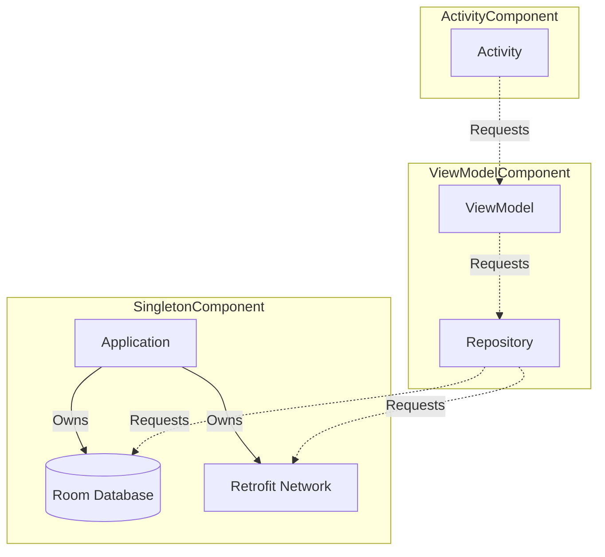

# Dependency Injection (Hilt & Dagger)

## Overview

Dependency Injection (DI) is a core structural pattern used to implement the Inversion of Control (IoC) principle. It separates the creation of an object from the usage of an object.

On Android, a Staff Engineer must understand that DI is not just "making things easier to test." It is the fundamental mechanism for managing the **Scope and Lifespan** of instances in memory, particularly across complex Navigation Graphs and varying Android Lifecycles. The standard for modern Android development is **Hilt** (which is built directly on top of **Dagger**).

## Why It Matters

Without DI, classes manually instantiate their dependencies: `val api = RetrofitApi()`.
This tightly couples the class to `RetrofitApi`. You cannot swap it for a `MockApi` during unit tests. You cannot easily change the initialization parameters.

Worse, if `RetrofitApi` is expensive to create, or holds a socket connection, you don't want 5 different ViewModels instantiating 5 different `RetrofitApi` objects. You want a single "Singleton" instance shared across the entire app. 

DI frameworks like Dagger and Hilt manage this object graph automatically at compile time, guaranteeing that classes receive the correct, optimally-scoped instances of their dependencies.

## Historical Context

- **Pre-2015:** Developers used Service Locators, massive custom `Application` classes, or Reflection-based DI frameworks (like Roboguice), which were slow at runtime and crashed if you misspelled a string.
- **Dagger 2:** Google released Dagger 2, which used Annotation Processing to generate DI code at *compile time*. It was blazingly fast and perfectly safe. However, the boilerplate required to set up `Components`, `Subcomponents`, and `Modules` was notoriously horrific. It took weeks to set up Dagger in a new app.
- **Hilt (2020):** Google released Hilt. Hilt is literally just Dagger under the hood, but it automatically generates the `Components` and `Subcomponents` for you, mapping them perfectly to the standard Android OS Lifecycles (Application, Activity, ViewModel, Fragment).

## First Principles

1.  **Dependency (`@Inject constructor`):** Telling the framework: "I need you to build me one of these, and here are the ingredients I need."
2.  **Module (`@Module`):** The instruction manual for the framework. Used when you don't own the constructor (e.g., building a `Retrofit` instance from a 3rd party library).
3.  **Component:** The container. It holds the objects in memory.
4.  **Scope (`@Singleton`, `@ViewModelScoped`):** Tells the framework *how long* to keep an object alive. If unscoped, the framework builds a brand new instance every single time it is requested.

## Mental Model

Think of DI as a **High-End Restaurant Kitchen**.
- **The ViewModel:** The Waiter. They need a perfectly plated steak to give to the UI. They don't know *how* to cook it, they just ask the Kitchen for it (`@Inject`).
- **The Module:** The Recipe Book. It tells the kitchen exactly how to combine ingredients (meat, salt, fire) to create a `Steak`.
- **The Component:** The Kitchen itself. `SingletonComponent` is the main kitchen that stays open all day. `ActivityComponent` is a pop-up kitchen that is torn down when the event ends.
- **The Scope:** If a `Steak` is `@Singleton`, the kitchen cooks one massive steak in the morning and slices off a piece for every waiter all day (Shared State). If it is unscoped, they cook a brand new steak from scratch every time a waiter asks.

## Internal Mechanics

### Hilt Components and Scopes

Hilt automatically generates specific Dagger Components that perfectly mirror the Android OS lifecycle.

| Hilt Component | Scope Annotation | Created At | Destroyed At |
| :--- | :--- | :--- | :--- |
| `SingletonComponent` | `@Singleton` | `Application.onCreate()` | App is killed |
| `ActivityRetainedComponent` | `@ActivityRetainedScoped` | `Activity.onCreate()` | Activity is *permanently* destroyed (survives rotation) |
| `ViewModelComponent` | `@ViewModelScoped` | ViewModel created | ViewModel `onCleared()` |
| `ActivityComponent` | `@ActivityScoped` | `Activity.onCreate()` | Activity destroyed (dies on rotation) |

When you annotate a module with `@InstallIn(SingletonComponent::class)`, you are telling Hilt to put those recipes in the Application-wide kitchen.

## Architecture



## Production Example

**The Hilt Setup**

```kotlin
// 1. Mark the Application to trigger Hilt Code Generation
@HiltAndroidApp
class MyApplication : Application()

// 2. Create a Module to tell Hilt how to build 3rd party classes
@Module
@InstallIn(SingletonComponent::class)
object NetworkModule {
    
    @Provides
    @Singleton // We only want ONE Retrofit instance in the entire app
    fun provideRetrofit(): Retrofit {
        return Retrofit.Builder().baseUrl("https://api.com/").build()
    }
    
    @Provides
    @Singleton
    fun provideApi(retrofit: Retrofit): NetworkApi {
        return retrofit.create(NetworkApi::class.java)
    }
}

// 3. Inject into your own classes
// We don't need a Module for Repository because we own the constructor!
@Singleton
class Repository @Inject constructor(
    private val api: NetworkApi
)

// 4. Inject into the ViewModel
@HiltViewModel
class MainViewModel @Inject constructor(
    private val repository: Repository
) : ViewModel()

// 5. Inject into the Android OS component
@AndroidEntryPoint
class MainActivity : AppCompatActivity() {
    // Hilt automatically finds the ViewModelFactory and builds it!
    private val viewModel: MainViewModel by viewModels() 
}
```

## Tradeoffs

**Hilt vs Koin vs Pure Dagger**

- **Hilt:**
    - *Pros:* Compile-time safety (if a dependency is missing, the app fails to compile, not crash at runtime). Zero boilerplate. Officially backed by Google.
    - *Cons:* Slows down build times due to KAPT/KSP annotation processing. Very rigid structure.
- **Koin:**
    - *Pros:* A pure Kotlin Service Locator. No annotation processing, meaning blazing fast build times. Extremely easy to learn.
    - *Cons:* Runtime resolution. If you misconfigure the graph, the app compiles perfectly but crashes with a `NoBeanDefFoundException` the exact moment the user navigates to the screen.
- **Pure Dagger 2:**
    - *Pros:* Ultimate flexibility. You can create insanely complex, dynamic multi-module component graphs (e.g., dynamic feature modules).
    - *Cons:* The learning curve is notoriously brutal. The boilerplate is immense. 

*Staff Note:* Use Hilt for 95% of standard Android apps. If you are building a massive multi-app monolithic codebase with 500+ modules and extreme dynamic feature delivery requirements, you might need to drop down to Pure Dagger.

## Failure Modes

- **The Context Leak:**
  ```kotlin
  @Singleton
  class LocationTracker @Inject constructor(
      @ActivityContext private val context: Context // DISASTER
  )
  ```
  *(Fix: If a class is `@Singleton`, it lives forever. If it injects an `@ActivityContext`, it now holds a hard reference to an Activity that was destroyed 5 minutes ago. Massive memory leak. Hilt usually catches this at compile time. Always use `@ApplicationContext` for Singletons).*
- **Over-Scoping:**
  Developers often slap `@Singleton` on every single class "just to be safe." This forces the app to instantiate and hold every repository, use case, and utility class in RAM from the moment the app boots until it dies, severely bloating memory.
  *(Fix: Most classes should be **Unscoped** (no annotation). Unscoped classes are garbage collected the moment they are no longer needed).*
- **The Interface Binding Error:**
  If you have an `interface Analytics` and a class `FirebaseAnalytics : Analytics`, Hilt doesn't magically know that `Analytics` should map to `FirebaseAnalytics`.
  *(Fix: You must use `@Binds` in a Module to explicitly tell Hilt which implementation to use for the interface).*
- **Eager Initialization Bottlenecks:**
  Injecting heavy dependencies directly into the `Application` or a startup Activity blocks the main thread.
  *(Fix: Use `dagger.Lazy<T>` or `javax.inject.Provider<T>` to defer initialization until the object is actually accessed. `Lazy<T>` computes once and caches, while `Provider<T>` returns a new instance per call if unscoped).*

## Staff Engineer Thinking

When reviewing DI architecture, a Staff engineer focuses on module boundaries and interface abstraction:

1.  **DIP (Dependency Inversion Principle):** I check if ViewModels are injecting concrete Repositories (`UserRepositoryImpl`) or Interfaces (`UserRepository`). A true Staff-level architecture injects interfaces. The Hilt Module binds the concrete implementation to the interface. This allows us to instantly swap to a `MockUserRepository` for UI testing without touching the ViewModel code.
2.  **Assisted Injection:** Sometimes you need a ViewModel to take a dependency from the DI graph (like `Api`), but also a runtime parameter (like a `userId` passed from the previous screen). I ensure the team understands how to use `@AssistedInject` and `@AssistedFactory` rather than passing the `userId` via a generic `init(id: String)` method later.
3.  **Module Organization:** I enforce that Modules are organized by feature or layer, not by type. I reject massive `AppModule.kt` files that contain 50 `@Provides` functions for databases, networking, and analytics all mixed together.
4.  **Optional Dependencies (`@BindsOptionalOf`):** For modular apps where a feature might exist in some build variants but not others, I use `@BindsOptionalOf`. This injects an `Optional<Service>`, gracefully handling the missing dependency without breaking the graph or requiring stub modules.

## Common Misconceptions

- **"Hilt makes my app slower."** False. Hilt makes your *build times* slower. At runtime, the generated Java code is as fast as if you had written the manual `new Repository(new Api())` instantiation yourself.
- **"I need to use `@Provides` for everything."** False. You only need a Module and `@Provides` if you do not own the class (like `Retrofit` or `RoomDatabase`), or if you are binding an interface to an implementation (`@Binds`). For your own classes, just put `@Inject constructor` on the class itself!

## Probing Questions

1.  What is the fundamental difference between a Dependency Injection framework like Hilt and a Service Locator pattern like Koin regarding compile-time safety?
2.  Explain the exact lifecycle difference between a dependency scoped with `@Singleton` versus one scoped with `@ViewModelScoped`.
3.  Why is it a catastrophic memory leak to inject an `@ActivityContext` into a class annotated with `@Singleton`?
4.  If you write a class `MyRepository @Inject constructor()`, do you need to write an `@Provides` method for it in a Hilt Module? Why or why not?
5.  What is the purpose of the `@Binds` annotation in a Hilt Module, and how does it relate to the Dependency Inversion Principle (SOLID)?
6.  Describe the memory profiling tradeoff of annotating every single class in your project with `@Singleton`. What should you do instead?
7.  How does Hilt solve the massive boilerplate problem that existed in Pure Dagger 2? (Hint: Think about Component generation).
8.  If a ViewModel needs a runtime argument (like a `productId` from Navigation) in addition to its DI dependencies, how do you handle that in Hilt?
9.  Why does Hilt require you to annotate the `Application` class with `@HiltAndroidApp`? What is happening under the hood?
10. Describe a scenario where Pure Dagger 2 would be a better architectural choice than Hilt.

## Answer Key

1. **What is the fundamental difference between a Dependency Injection framework like Hilt and a Service Locator pattern like Koin regarding compile-time safety?**
   Hilt validates the entire dependency graph during compilation; if a dependency is missing or misconfigured, the build fails immediately. A Service Locator like pure Koin resolves dependencies at runtime, meaning a misconfiguration will compile perfectly but crash with an exception when the user navigates to the affected screen.
2. **Explain the exact lifecycle difference between a dependency scoped with `@Singleton` versus one scoped with `@ViewModelScoped`.**
   `@Singleton` objects are created once and live in memory until the OS kills the app process. `@ViewModelScoped` objects are created when a ViewModel is instantiated and are explicitly garbage collected when that specific ViewModel is cleared (when the user completely backs out of the screen).
3. **Why is it a catastrophic memory leak to inject an `@ActivityContext` into a class annotated with `@Singleton`?**
   Because the `@Singleton` class lives forever for the life of the app process, it will permanently hold a hard reference to the specific Activity instance it was injected with. That Activity (and its entire View hierarchy) can never be garbage collected, even after it is destroyed.
4. **If you write a class `MyRepository @Inject constructor()`, do you need to write an `@Provides` method for it in a Hilt Module? Why or why not?**
   No. The `@Inject constructor` annotation explicitly tells Hilt how to instantiate the class. `@Provides` methods in Modules are only necessary for classes where you don't own the constructor (like 3rd-party libraries such as `Retrofit`) or when returning a specific implementation for an interface.
5. **What is the purpose of the `@Binds` annotation in a Hilt Module, and how does it relate to the Dependency Inversion Principle (SOLID)?**
   `@Binds` tells Hilt which concrete implementation to provide when an interface is requested (e.g., binding `UserRepositoryImpl` to `UserRepository`). This enables Dependency Inversion because classes depend only on abstract interfaces rather than concrete implementations, allowing for easy substitution (e.g., mocks during testing).
6. **Describe the memory profiling tradeoff of annotating every single class in your project with `@Singleton`. What should you do instead?**
   Annotating everything `@Singleton` forces the app to keep every class in RAM indefinitely, leading to massive memory bloat and slower startup times. Instead, most classes should be unscoped (so they can be garbage collected when the referencing component dies) or scoped tightly to the ViewModel (`@ViewModelScoped`).
7. **How does Hilt solve the massive boilerplate problem that existed in Pure Dagger 2? (Hint: Think about Component generation).**
   In Pure Dagger 2, developers had to manually write interfaces for Components and Subcomponents, and manually wire them to the Android Lifecycle. Hilt pre-generates all standard Android components (`SingletonComponent`, `ActivityComponent`, etc.) and automatically handles the injection lifecycle via annotations like `@AndroidEntryPoint`.
8. **If a ViewModel needs a runtime argument (like a `productId` from Navigation) in addition to its DI dependencies, how do you handle that in Hilt?**
   You use Assisted Injection. You annotate the runtime parameter with `@Assisted`, annotate the constructor with `@AssistedInject`, and define an `@AssistedFactory` interface inside the ViewModel. You then use `hiltViewModel()` with a `creationCallback` in the UI to pass the runtime argument to the factory.
9. **Why does Hilt require you to annotate the `Application` class with `@HiltAndroidApp`? What is happening under the hood?**
   `@HiltAndroidApp` acts as the trigger for Hilt's annotation processor. Under the hood, it generates a base Application class that initializes the `SingletonComponent` (the root of the DI graph) at the very start of the app's lifecycle, which all other components attach to.
10. **Describe a scenario where Pure Dagger 2 would be a better architectural choice than Hilt.**
    Pure Dagger 2 is better for massive enterprise mono-repos (500+ modules) with extremely complex, custom scoping requirements, or projects utilizing heavy Dynamic Feature Modules where components need to be manually instantiated and attached to the graph long after the app has started.

## Further Reading

- [`viewmodel.md`](../architecture/viewmodel.md) — The consumer of `@HiltViewModel`.
- [`room.md`](room.md) — How databases are provided via `@Singleton`.
- [Android Developers: Hilt](https://developer.android.com/training/dependency-injection/hilt-android)
