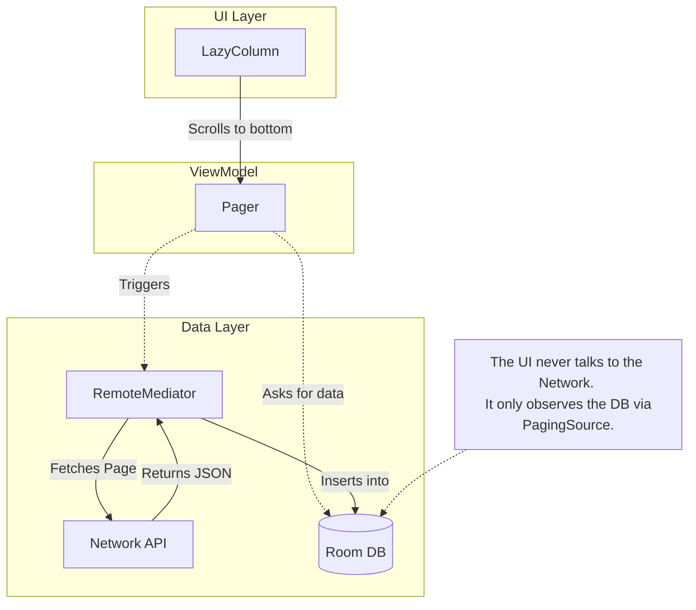

# Paging

## Overview

`Paging 3` is the Jetpack library for loading and displaying massive datasets in small, manageable chunks (pages). 

If you are querying a database with 100,000 rows, or fetching an infinite feed from a network API, you cannot load the entire dataset into memory at once. It will crash the app with an `OutOfMemoryError` (OOM). 

A Staff Engineer must understand how the Paging library coordinates the infinite scroll, prevents duplicate network requests, and integrates a network-backed database cache using `RemoteMediator` for a true Offline-First architecture.

## Why It Matters

Implementing an "Infinite Scroll" manually is notoriously difficult. 
- The user scrolls to the bottom. You trigger a network request for Page 2. 
- While Page 2 is downloading, the user scrolls up and down slightly, hitting the bottom again. You accidentally trigger a second network request for Page 2. 
- When both requests finish, you have duplicate items in your list. 
- The user rotates the phone. The activity restarts, and you lose your place in the list.

`Paging 3` mathematically solves the duplicate request problem, handles configuration changes automatically via Coroutine `Flow`, and tracks the scrolling state seamlessly.

## Historical Context

- **Paging 1 & 2:** Relied heavily on `LiveData` and the `PagedListAdapter`. It was tightly coupled to the UI layer and very difficult to test. Handling network errors (like "No Internet" on Page 4) required messy, manual retry logic.
- **Paging 3:** A complete rewrite in pure Kotlin. It is built entirely on top of Coroutines and `Flow`. It natively supports Error states, Loading states (headers/footers), and `RxJava`/`Guava` interoperability. It decouples the fetching logic from the UI completely.

## First Principles

1.  **`PagingSource`:** The engine. This class defines *how* to load a single chunk of data (e.g., calling `api.getUsers(page = 2)`).
2.  **`Pager`:** The orchestrator. It takes the `PagingSource` and returns a `Flow<PagingData<T>>`.
3.  **`PagingData`:** A container for the paginated data. It is *not* a standard Kotlin `List`. You cannot iterate over it manually. It is designed to be consumed directly by the UI (e.g., `collectAsLazyPagingItems()` in Compose).
4.  **`RemoteMediator`:** The synchronization bridge. It sits between a Network API and a local [Room Database](room.md) to implement offline caching.

## Mental Model

Think of Paging as a **Library Archive and a Dumbwaiter**.
- **The User:** Standing on the top floor, reading books on a table (The Screen).
- **The Dumbwaiter (`Pager`):** A small elevator that can only hold 20 books at a time.
- **The Archivist (`PagingSource`):** Down in the basement. When the user gets near the end of their pile, the Dumbwaiter goes down, asks the Archivist for "Books 21-40," and brings them up automatically.

If the Archivist is the Network, the books disappear when the power goes out. 
If we use a `RemoteMediator`, we add a **Local Bookshelf** (Room Database) next to the user. The Dumbwaiter now brings books from the Archivist, puts them on the local shelf, and the user *only ever reads from the local shelf*.

## Internal Mechanics

### 1. The PagingSource
You must implement `load()` and `getRefreshKey()`.

```kotlin
class UserPagingSource(
    private val api: NetworkApi
) : PagingSource<Int, User>() { // <KeyType, ValueType>

    override suspend fun load(params: LoadParams<Int>): LoadResult<Int, User> {
        return try {
            // If key is null, load Page 1
            val currentPage = params.key ?: 1
            
            // params.loadSize tells you how many items the Pager wants
            val response = api.getUsers(page = currentPage, limit = params.loadSize)
            
            LoadResult.Page(
                data = response.users,
                prevKey = if (currentPage == 1) null else currentPage - 1,
                nextKey = if (response.users.isEmpty()) null else currentPage + 1
            )
        } catch (e: Exception) {
            LoadResult.Error(e)
        }
    }
    // ... getRefreshKey omitted for brevity
}
```

### 2. The Pager and Flow
In the ViewModel, we construct the `Pager`.

```kotlin
val usersFlow: Flow<PagingData<User>> = Pager(
    config = PagingConfig(
        pageSize = 20,          // How many items per page
        prefetchDistance = 5,   // Trigger next page when 5 items from the bottom
        enablePlaceholders = false
    ),
    pagingSourceFactory = { UserPagingSource(api) }
).flow
 .cachedIn(viewModelScope) // CRITICAL: Survives rotation!
```

## Architecture



## Production Example

**The `RemoteMediator` (Offline-First Paging)**

This is the holy grail of Android data architecture. The Pager reads *only* from the local Room database. The `RemoteMediator` watches the Pager. When the Pager runs out of data in the DB, the Mediator fetches from the network and saves it to the DB.

```kotlin
@OptIn(ExperimentalPagingApi::class)
class UserRemoteMediator(
    private val api: NetworkApi,
    private val db: UserDatabase
) : RemoteMediator<Int, UserEntity>() {

    override suspend fun load(
        loadType: LoadType,
        state: PagingState<Int, UserEntity>
    ): MediatorResult {
        return try {
            val page = when (loadType) {
                LoadType.REFRESH -> 1
                LoadType.PREPEND -> return MediatorResult.Success(endOfPaginationReached = true)
                LoadType.APPEND -> {
                    // Calculate the next page based on the last item in the DB
                    val lastItem = state.lastItemOrNull()
                    if (lastItem == null) 1 else (lastItem.page + 1)
                }
            }

            val response = api.getUsers(page = page)

            db.withTransaction {
                if (loadType == LoadType.REFRESH) {
                    db.userDao().clearAll()
                }
                db.userDao().insertAll(response.users)
            }

            MediatorResult.Success(endOfPaginationReached = response.users.isEmpty())
        } catch (e: IOException) {
            MediatorResult.Error(e) // Network error
        } catch (e: HttpException) {
            MediatorResult.Error(e) // Server error
        }
    }
}
```

*To use this, you pass it to the `Pager` constructor along with a Room-generated `PagingSource`.*

## Tradeoffs

**Paging 3 vs Manual Pagination**

- **Paging 3:**
    - *Pros:* Handles edge cases (rapid scrolling, debouncing) perfectly. Built-in error states. `cachedIn` solves rotation loss instantly. `RemoteMediator` makes offline-first robust.
    - *Cons:* Extremely steep learning curve. `PagingData` is a black box (you cannot easily filter or sort a `PagingData` stream on the fly without using specialized operators like `.map` or `.filter` on the flow, which cannot modify the underlying Room database).
- **Manual Pagination (e.g., maintaining a `List` in a `StateFlow`):**
    - *Pros:* Total control over the data structure. Easy to mutate, sort, and filter locally.
    - *Cons:* You must write the debouncing logic manually. You must track the `nextPageToken` manually. You will likely introduce bugs when dealing with loading states and errors at the bottom of the list.

## Failure Modes

- **Missing `cachedIn(viewModelScope)`:**
  If you return the `Pager().flow` directly to the UI without calling `.cachedIn(viewModelScope)`, every time the user rotates their phone or navigates away and back, the entire flow restarts from Page 1. This destroys API quotas.
- **Modifying Items In-Place:**
  Because `PagingData` is fundamentally immutable and highly optimized, you cannot easily say `pagingList[5].isLiked = true`.
  *(Fix: If using `RemoteMediator`, you update the underlying Room Database (`db.userDao().updateLikeStatus()`). The database `InvalidationTracker` will instantly trigger the `PagingSource` to re-emit the updated page, and the UI will reflect the change automatically).*
- **Jumping/Flickering on Refresh:**
  When using Room and `RemoteMediator`, if you `clearAll()` and then `insertAll()` during a REFRESH, the PagingSource might emit an empty list for 1 frame before emitting the new data, causing the UI to flicker.
  *(Fix: Ensure all DB operations during a refresh happen inside a strict `db.withTransaction { }` block).*

## Staff Engineer Thinking

When reviewing Paging architecture, a Staff engineer focuses on the physical boundaries and data mutation:

1.  **The Source of Truth:** I actively reject PRs where a developer tries to use `PagingSource` directly against a Network API if the app requires offline support. For anything other than a simple search screen, we must use the DB as the single source of truth via `RemoteMediator`.
2.  **Item Mutations:** A common pain point is "Liking" a post in a paginated feed. Junior developers will try to hack the `PagingData` flow to mutate the UI state. I enforce that the UI only ever sends an Intent (`likePost(id)`). The ViewModel updates the Database. The Database pushes the new state through the Pager. Unidirectional Data Flow must be preserved.
3.  **Keys vs Offsets:** Does the API use Page Numbers (1, 2, 3), Offsets (0, 20, 40), or Cursors (`next_token=abc`)? The `PagingSource` must handle the Key Type (`Key` in `<Key, Value>`) correctly. Cursor-based pagination is vastly superior to offset-based pagination to prevent duplicated items if items are added to the top of the feed on the server.

## Common Misconceptions

- **"I can just convert `PagingData` to a `List` to sort it."** You cannot. `PagingData` is an asynchronous stream of updates. If you try to collect it into a static list, you destroy the pagination logic.
- **"Paging 3 requires Room."** False. You can use a network-only `PagingSource` if you do not need offline caching. Room is only required if you use `RemoteMediator`.

## Probing Questions

1.  What is the "Duplicate Request" problem in manual infinite scrolling, and how does the `Pager` naturally prevent it?
2.  Explain the architectural role of the `RemoteMediator` when compared to the `PagingSource`.
3.  Why is it mathematically impossible to extract a complete `List<T>` directly from a `PagingData<T>` object?
4.  Describe the catastrophic network and UX behavior that occurs if you forget to append `.cachedIn(viewModelScope)` to your Paging Flow.
5.  If a user clicks a "Like" button on an item in a `Paging 3` list backed by Room, what is the exact flow of data required to update the heart icon on the screen?
6.  Why is Cursor-based pagination from a backend server preferred over Offset-based (Page 1, Page 2) pagination for highly dynamic social feeds?
7.  In a `RemoteMediator`, why must the `clearAll()` and `insertAll()` operations for a `REFRESH` load type be wrapped inside a `db.withTransaction` block?
8.  How does the `prefetchDistance` configuration parameter improve the user's perception of speed when scrolling?
9.  If the network fails while the user is scrolling down and requesting Page 4, how does `Paging 3` expose that specific error to the UI layer?
10. Describe the architectural tradeoff between using a simple Network-backed `PagingSource` versus implementing a full `RemoteMediator` with a Room database.

## Further Reading

- [`room.md`](room.md) — The database that powers the `RemoteMediator`.
- [`flow.md`](../architecture/flow.md) — The reactive stream that delivers `PagingData`.
- [Android Developers: Paging 3](https://developer.android.com/topic/libraries/architecture/paging/v3-overview)
