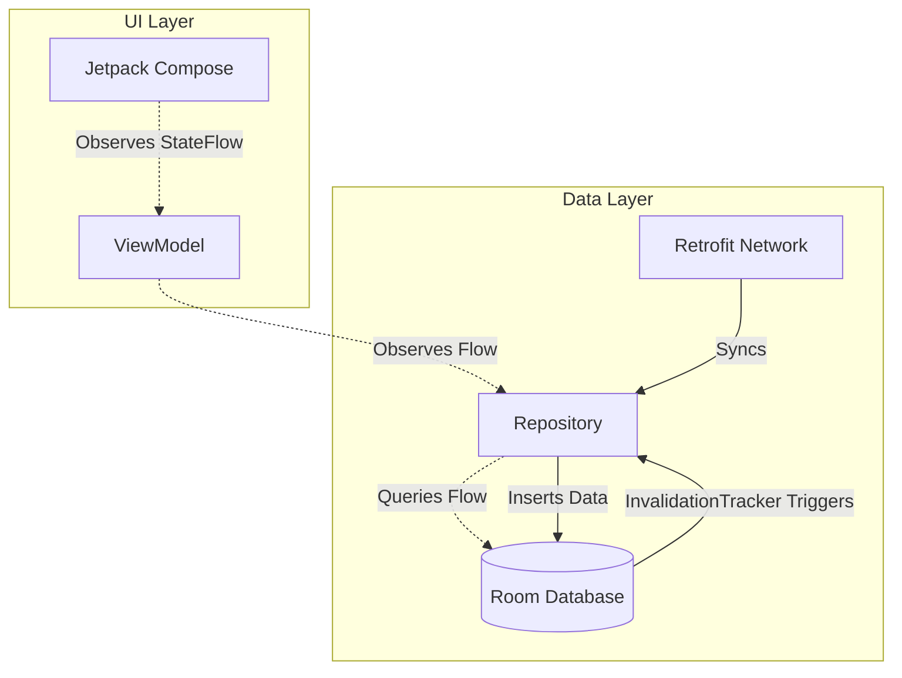

# Room

## Overview

`Room` is an abstraction layer over SQLite. It is the Google-recommended architectural component for all structured data persistence on Android.

While junior engineers treat Room as a simple ORM (Object-Relational Mapping) tool, a Staff Engineer treats Room as the **Single Source of Truth** for an offline-first architecture. Mastering Room requires understanding its deeply integrated compiler checks, its native support for Kotlin Coroutines/Flow, and the performance implications of complex SQL Joins vs Multi-Map relations.

## Why It Matters

Before Room, Android developers used `SQLiteOpenHelper`. It required writing raw SQL queries as strings. If you misspelled a column name in a `SELECT` statement, it compiled perfectly, but crashed instantly at runtime in the user's hands.

Extracting data required iterating through a `Cursor` manually, extracting data via `cursor.getString(cursor.getColumnIndex("name"))`. It was a boilerplate-heavy, error-prone disaster.

Room solves this by utilizing KSP (Kotlin Symbol Processing). It validates SQL queries at *compile time* and automatically generates the boilerplate cursor-iteration code.

## Historical Context

When Google introduced the Jetpack Architecture Components in 2017, Room was the foundational piece of the "Offline-First" movement. 

The architecture shift was profound: the UI should *never* observe the Network. The UI observes the Database (via `Flow`). The Network updates the Database. This pattern guarantees that if the user loses connectivity on a train, the UI immediately renders the cached data from the Database without any complex "If online do this, else do that" logic in the View layer.

## First Principles

1.  **The Database (`@Database`):** The main access point for the underlying connection. Must extend `RoomDatabase`.
2.  **The Entity (`@Entity`):** Represents a single table within the database. 
3.  **The DAO (`@Dao`):** Data Access Object. Contains the methods used for accessing the database. This is where you write your SQL queries.

## Mental Model

Think of Room as a **Translation API between Kotlin and SQLite**.
- You write Kotlin Data Classes (`@Entity`).
- Room translates them into SQLite `CREATE TABLE` commands.
- You write Kotlin functions (`@Query`).
- Room translates them into SQLite `Cursor` operations and maps the results back into your Data Classes.

## Internal Mechanics

### 1. Compile-Time Verification
When you build your app, KSP scans your `@Dao` interfaces.
```kotlin
@Query("SELECT name, age FROM users WHERE id = :userId")
fun getUser(userId: String): User
```
Room opens a temporary, in-memory SQLite database during compilation. It runs the SQL statement against the schema it generated from your `@Entity` classes. 
- If `age` is spelled `aeg`, compilation fails. 
- If the SQL returns `name` and `age`, but your `User` data class also requires `email`, compilation fails.

### 2. The Reactive Trigger (Flow integration)
Room has native integration with `Flow`.
```kotlin
@Query("SELECT * FROM users")
fun observeUsers(): Flow<List<User>>
```
Under the hood, Room wraps this query in an `InvalidationTracker`. Whenever an `INSERT`, `UPDATE`, or `DELETE` is executed against the `users` table, the `InvalidationTracker` notices the table was modified and instantly re-runs the `SELECT` query, pushing the new `List<User>` into the Flow. This is the magic that powers real-time UI updates.

## Architecture



## Production Example

**Multi-Map Relationships (The Modern Approach)**

Historically, defining relationships (1-to-N) in Room required creating complex `@Relation` classes. In modern Room (2.4+), we use standard Kotlin Multi-Maps, which drastically reduces boilerplate and allows complex JOIN queries.

```kotlin
@Entity(tableName = "users")
data class User(
    @PrimaryKey val id: String,
    val name: String
)

@Entity(tableName = "playlists")
data class Playlist(
    @PrimaryKey val playlistId: String,
    val ownerId: String, // Foreign Key linking to User
    val title: String
)

@Dao
interface MusicDao {
    // We join the tables and Room automatically groups them into a Kotlin Map!
    @Query(
        """
        SELECT * FROM users 
        JOIN playlists ON users.id = playlists.ownerId
        """
    )
    fun getUsersWithPlaylists(): Flow<Map<User, List<Playlist>>>
}
```

## Tradeoffs

**Room vs Realm / ObjectBox / SQLDelight**

- **Room:**
    - *Pros:* First-party Google support. Massive community. Compile-time SQL checks. Seamless Flow integration.
    - *Cons:* It is strictly a relational (SQL) database. It requires mapping objects to tables, which is inherently slower than pure Object databases for deep, complex graphs.
- **Realm / ObjectBox (NoSQL / Object Databases):**
    - *Pros:* Incredibly fast for deep relationship graphs. Zero object-mapping overhead.
    - *Cons:* Bloats APK size (requires shipping an entire C++ database engine). Steep learning curve. Harder to migrate schemas.
- **SQLDelight (Cash App):**
    - *Pros:* Kotlin Multiplatform (KMP) natively supported. You write pure `.sq` files and it generates Kotlin code, rather than writing Kotlin and generating SQL.
    - *Cons:* Requires learning the SQLDelight specific syntax/plugin. Less tutorial material compared to Room.

*Staff Note:* As of late 2023, Room introduced Kotlin Multiplatform (KMP) support, effectively removing SQLDelight's main competitive advantage for many teams.

## Failure Modes

- **The Database Migration Crash:**
  ```kotlin
  // V1 Schema: User(id, name)
  // V2 Schema: User(id, name, email)
  ```
  If you add the `email` column to the `User` entity, increment the database version to 2, but forget to provide a `Migration` object, Room will completely wipe the user's database (if `fallbackToDestructiveMigration` is enabled) or instantly crash the app with an `IllegalStateException`.
  *(Fix: Always write migration tests using `MigrationTestHelper` to verify that upgrading from V1 to V2 preserves data).*
- **The N+1 Query Problem:**
  If a developer uses the older `@Relation` system to load a list of `Users` and their associated `Playlists`, Room executes 1 query to get the Users, and then potentially N queries to get the playlists for each user.
  *(Fix: Always look at the generated `Dao_Impl.java` code, or utilize modern Multi-Map returns which force a single `JOIN` statement).*
- **Blocking the Main Thread:**
  If you attempt to call `dao.insert(user)` on the Main Thread, Room throws an exception and crashes the app.
  *(Fix: Always mark DAO methods as `suspend` (e.g., `suspend fun insert(user: User)`). Room will automatically route the database I/O to a custom background dispatcher, ensuring the Main thread is never blocked).*

## Staff Engineer Thinking

When reviewing Room architecture, a Staff engineer focuses heavily on Migrations and Query Efficiency:

1.  **Schema Export:** I ensure `exportSchema = true` is set in the `@Database` annotation, and that the generated `.json` files are committed to Git. This provides an exact historical record of the database schema for migration testing.
2.  **Flow Granularity:** A major architectural flaw is exposing a `Flow<List<HeavyObject>>` when the UI only needs the ID and Title. Every time a minor field (like `lastLoginDate`) changes, the `InvalidationTracker` re-emits the entire massive list, causing the Compose UI to stutter. I enforce specific Projection classes (e.g., `@Query("SELECT id, title FROM items") fun getLightItems(): Flow<List<LightItem>>`).
3.  **Transactions:** If a Use Case inserts a User, and then inserts their Preferences, I ensure the DAO exposes a `@Transaction` function. If the second insert fails, the first one must rollback to prevent corrupted database state.

## Common Misconceptions

- **"Room hides SQL from me."** False. Room is an ORM in name only. It does not abstract away the relational nature of the database. You are still required to write raw SQL `SELECT` statements. You must understand SQL `INNER JOIN`, `LEFT JOIN`, and indexes to use Room effectively.
- **"I should use `@RawQuery` if my query is complex."** Highly discouraged. `@RawQuery` disables compile-time verification. It should only be used if the query structure itself is dynamically generated at runtime (which is very rare in mobile apps).

## Probing Questions

1.  What is the architectural pattern of the "Single Source of Truth", and how does Room's `Flow` integration enable it?
2.  Explain how Room achieves compile-time verification of your SQL statements.
3.  Why does Room throw a fatal exception if you attempt to call a standard (non-suspending) DAO method on the Main Thread?
4.  If you add a new column to an `@Entity`, what three steps must you take to prevent the app from crashing on users' phones?
5.  What is the `InvalidationTracker`, and how does it power Room's reactive `Flow` streams?
6.  Describe the performance implications of fetching an entire `@Entity` object via a `Flow` when the UI only displays one specific column.
7.  What is a Multi-Map return type in Room, and how does it improve upon the older `@Relation` annotation system?
8.  Why is it critical to commit Room's exported schema JSON files to your version control system (Git)?
9.  Explain the purpose of the `@Transaction` annotation in Room. What data corruption scenario does it prevent?
10. Describe the architectural tradeoff between using Room (a relational database) versus a NoSQL database like Realm for an Android application.

## Further Reading

- [`flow.md`](../architecture/flow.md) — How the UI observes the database reactive streams.
- [`paging.md`](paging.md) — How to handle Room queries that return 100,000+ rows without crashing the device.
- [Android Developers: Room](https://developer.android.com/training/data-storage/room)
