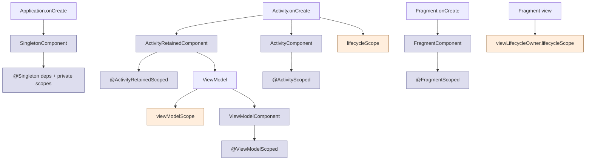

# Scopes — Hilt DI Scopes vs Coroutine Scopes

> Both Hilt and coroutines call them "scopes," but they govern completely different things. A **Hilt scope** controls *how many instances* of a dependency exist (one per Activity? one per ViewModel?). A **coroutine scope** controls *how long async work runs* and when it's cancelled. The same UI feature uses both — sometimes for the same lifecycle, sometimes not. Staff-level mastery means knowing which is which on sight, when they line up, and when they intentionally don't.

---

## Two Different "Scope" Concepts

| Aspect | Hilt scope | Coroutine scope |
|---|---|---|
| **Controls** | Instance sharing — how many objects exist | Async lifetime — when launched work is cancelled |
| **Examples** | `@Singleton`, `@ViewModelScoped`, `@ActivityScoped` | `viewModelScope`, `lifecycleScope`, `GlobalScope` (avoid) |
| **Created by** | Hilt at compile time + the Android lifecycle | A `CoroutineScope` value held by a class |
| **Destroyed by** | The corresponding Android lifecycle event | `scope.cancel()` (manual or automatic via lifecycle) |
| **You annotate with** | `@Scope`-annotation class | Nothing — you call `scope.launch { ... }` |
| **Affects** | Object graph (DI) | Coroutine cancellation tree |

A `@Singleton` and `viewModelScope` are not comparable concepts. Saying "this is scoped to the activity" is ambiguous — Hilt-scoped or coroutine-scoped? Always say which.

---

## Hilt Scopes Recap

(Detailed coverage in [`components.md`](components.md); summarized here for context.)

A Hilt scope annotation tells the DI graph: "share one instance for the lifetime of the matching Hilt **component**."

```kotlin
@Singleton
class Analytics @Inject constructor(): /* one instance for whole app */

@ViewModelScoped
class CartFilterState @Inject constructor(): /* one instance per ViewModel */

@ActivityScoped
class ToolbarController @Inject constructor(): /* one instance per Activity */
```

If a dep is **unscoped** (no annotation), Hilt creates a new instance every time it's injected.

Matching components:

| Scope annotation | Component | Lifetime |
|---|---|---|
| `@Singleton` | `SingletonComponent` | App process |
| `@ActivityRetainedScoped` | `ActivityRetainedComponent` | Activity finished (not rotation) |
| `@ActivityScoped` | `ActivityComponent` | Activity destroyed (incl. rotation) |
| `@ViewModelScoped` | `ViewModelComponent` | ViewModel cleared |
| `@FragmentScoped` | `FragmentComponent` | Fragment destroyed |
| `@ViewScoped` | `ViewComponent` | View destroyed |
| `@ServiceScoped` | `ServiceComponent` | Service destroyed |

---

## Coroutine Scopes Recap

(Detailed coverage in [`../../kotlin/coroutines-and-flow/coroutines.md`](../../kotlin/coroutines-and-flow/coroutines.md); summarized here for context.)

A coroutine scope holds a `CoroutineContext` (mostly `Job` + `CoroutineDispatcher`). Every `launch { ... }` or `async { ... }` becomes a child of the scope's `Job`. Cancelling the scope cancels every child.

Android provides four ready-made scopes:

| Scope | Lifetime | Default dispatcher | Use for |
|---|---|---|---|
| `viewModelScope` | Cleared with the ViewModel | `Main.immediate` | Most async work in ViewModels |
| `lifecycleScope` | Activity/Fragment destroyed | `Main.immediate` | UI animations, one-off side effects |
| `viewLifecycleOwner.lifecycleScope` | Fragment **view** destroyed (`onDestroyView`) | `Main.immediate` | Flow collection inside Fragments |
| `GlobalScope` | App process | `Default` | Almost never — always wrong for app code |

Plus your own:

```kotlin
class Repository {
    private val scope = CoroutineScope(SupervisorJob() + Dispatchers.IO)
    fun cleanup() = scope.cancel()
}
```

---

## How They Interact (or Don't)

The interesting cases are where a `@Singleton`-scoped object holds a coroutine scope, or where a `@ViewModelScoped` object launches work in `viewModelScope`.

### Case 1: `@Singleton` + custom `CoroutineScope`

```kotlin
@Singleton
class SyncEngine @Inject constructor() {
    private val scope = CoroutineScope(SupervisorJob() + Dispatchers.IO)

    fun startSync(): Job = scope.launch {
        while (isActive) {
            try { sync() } catch (e: Exception) { /* log */ }
            delay(60_000)
        }
    }

    // Nothing cancels this scope automatically.
    // SingletonComponent never dies → scope never cancels → coroutine runs forever.
}
```

The Hilt scope (`@Singleton`) is correct — one engine for the app. The coroutine scope is unbounded — it survives even if you "stop syncing." If you don't manage it explicitly, you've leaked a background coroutine for the app's lifetime.

Fix:

```kotlin
@Singleton
class SyncEngine @Inject constructor() {
    private val scope = CoroutineScope(SupervisorJob() + Dispatchers.IO)
    private var currentJob: Job? = null

    fun start() {
        currentJob?.cancel()
        currentJob = scope.launch { /* … */ }
    }

    fun stop() {
        currentJob?.cancel()
    }
}
```

Take-away: **Hilt scope ≠ coroutine scope**. A `@Singleton` engine still needs an explicit Job lifecycle for its background work.

### Case 2: `@ViewModelScoped` + `viewModelScope`

```kotlin
@HiltViewModel
class CheckoutViewModel @Inject constructor(
    private val pricingState: PricingState,   // @ViewModelScoped
) : ViewModel() {

    fun applyPromo(code: String) = viewModelScope.launch {
        pricingState.recompute(code)
    }
}
```

These DO line up:

- `PricingState` lives as long as the ViewModel (Hilt's `ViewModelComponent` is tied to the ViewModel's lifetime).
- `viewModelScope` is cancelled when the ViewModel is cleared.
- Both die together.

This is the cleanest combination — Hilt scope and coroutine scope tied to the same lifecycle.

### Case 3: `@Singleton` repository called from `viewModelScope`

```kotlin
@Singleton
class CartRepository @Inject constructor(private val api: Api) {
    suspend fun checkout(): Order = api.checkout()
}

@HiltViewModel
class CartViewModel @Inject constructor(
    private val repo: CartRepository,
) : ViewModel() {

    fun checkout() = viewModelScope.launch {
        val order = repo.checkout()    // suspend call — but in which scope?
        // ...
    }
}
```

The work runs in **`viewModelScope`**, not in any scope the singleton holds. When the user backs out:

1. ViewModel cleared.
2. `viewModelScope.cancel()` fires.
3. `repo.checkout()` is cancelled mid-flight.
4. The singleton's network call is aborted.

This is correct — **the caller's scope owns the lifetime**. Suspend functions run in the *caller's* coroutine, not in some scope held by the receiver.

### Case 4: `@Singleton` repository with internal coroutine scope (fire-and-forget)

```kotlin
@Singleton
class AnalyticsRepository @Inject constructor() {
    private val scope = CoroutineScope(SupervisorJob() + Dispatchers.IO)

    fun track(event: Event) {
        scope.launch { /* upload */ }   // fire-and-forget; survives caller cancellation
    }
}
```

Analytics should *survive* the caller — if the user navigates away during a "log out" upload, we still want the event sent. The repository holds its own scope.

Trade-off: this is a slow leak if the work hangs. Use a `WorkManager` for truly long-running operations; use a process-lifetime scope only for fast fire-and-forget.

---

## The Lifecycle Map



The blue boxes are Hilt components; the orange ones are coroutine scopes. They share lifecycle anchors (Activity start, ViewModel clear) but are separately managed.

---

## Practical Decisions

### "Where should I put this state?"

| Lifetime needed | Hilt scope | Coroutine scope |
|---|---|---|
| App-wide cache | `@Singleton` | Engine-internal `CoroutineScope` |
| Logged-in user session | Custom `@LoggedUserScoped` (`@DefineComponent`) | Custom scope created on login, cancelled on logout |
| Per-screen state | `@ViewModelScoped` | `viewModelScope` |
| Per-feature flow collection | unscoped (recreated) | `viewLifecycleOwner.lifecycleScope` with `repeatOnLifecycle` |
| One-off animation | unscoped | `lifecycleScope` |
| Background sync | `@Singleton` | Singleton-internal scope OR WorkManager |
| Trip-bound location updates | Custom `@TripScoped` | Custom scope tied to the trip |

### "When does `viewModelScope` cancel?"

When `ViewModel.onCleared()` runs. That happens when:
- The Activity is finished (truly, not rotated).
- The Fragment is removed permanently.
- The user navigates away in a way that destroys the scope (depends on navigation host).

It does NOT cancel on rotation. ViewModels and their coroutine scopes survive configuration changes.

### "When does `lifecycleScope` cancel?"

When the LifecycleOwner (Activity/Fragment) reaches `DESTROYED`. Includes:
- Activity destroyed (incl. rotation).
- Fragment destroyed.

For Fragments, prefer `viewLifecycleOwner.lifecycleScope` for anything tied to the view (binding, view-bound flow collection) — it cancels on `onDestroyView`, not on Fragment destroy.

---

## The `repeatOnLifecycle` Pattern

Combining a coroutine scope with lifecycle-aware Flow collection:

```kotlin
class CartFragment : Fragment() {
    private val viewModel: CartViewModel by viewModels()

    override fun onViewCreated(view: View, savedInstanceState: Bundle?) {
        viewLifecycleOwner.lifecycleScope.launch {
            viewLifecycleOwner.repeatOnLifecycle(Lifecycle.State.STARTED) {
                viewModel.state.collect { render(it) }
            }
        }
    }
}
```

- `viewLifecycleOwner.lifecycleScope.launch` — outer scope; cancels on `onDestroyView`.
- `repeatOnLifecycle(STARTED)` — inner block; **cancels the Flow collection when the lifecycle drops below STARTED** (e.g., screen hidden), and restarts when it returns.

The collection actively stops while the screen is invisible (e.g., behind another fragment or app backgrounded). No wasted work; battery saved.

Compose has the equivalent:

```kotlin
@Composable
fun CartScreen(viewModel: CartViewModel) {
    val state by viewModel.state.collectAsStateWithLifecycle()
    // collectAsStateWithLifecycle auto-pauses when lifecycle isn't STARTED
}
```

Both honor the same rule: **don't waste cycles collecting flows while invisible**.

---

## Cross-Module Scope Concerns

### `:feature:checkout:impl` → `:feature:profile:api`

```kotlin
// :feature:profile:api
interface UserSession { val userId: String }

// :feature:profile:impl
@Module @InstallIn(SingletonComponent::class)
abstract class UserSessionModule {
    @Binds @Singleton
    abstract fun bind(impl: UserSessionImpl): UserSession
}
```

Module installed in the same component across `:impl` modules; `UserSession` injectable everywhere. The Hilt scope decision is global; module boundaries don't restrict it.

### Coroutine scope across modules

```kotlin
// :core:network
class NetworkClient @Inject constructor() {
    suspend fun fetch(): Data = /* … */
}
```

Suspend functions don't carry their own scope — the *caller's* coroutine scope owns the work. A `:feature:cart` ViewModel calling `network.fetch()` is running it in `viewModelScope`. Modules don't change that.

---

## Custom Hilt Scope + Custom Coroutine Scope Together

The classic "logged-in user session" pattern:

```kotlin
@Scope @Retention(AnnotationRetention.BINARY)
annotation class LoggedUserScoped

@DefineComponent(parent = SingletonComponent::class)
@LoggedUserScoped
interface UserComponent

@LoggedUserScoped
class UserSessionState @Inject constructor(@UserId val userId: String) {
    // Tied to the LoggedUser component lifetime.
}

class SessionManager @Inject constructor(
    componentBuilder: UserComponent.Builder,
) {
    private var component: UserComponent? = null
    private var scope: CoroutineScope? = null   // matched coroutine scope

    fun login(userId: String) {
        component = componentBuilder.userId(userId).build()
        scope = CoroutineScope(SupervisorJob() + Dispatchers.IO)
    }

    fun logout() {
        scope?.cancel()
        scope = null
        component = null     // drops all @LoggedUserScoped instances
    }
}
```

Both scopes start and end at the same time (login/logout). This is the right shape: each lifetime has both a Hilt scope and a coroutine scope, in parallel.

---

## Failure Modes

| Symptom | Cause | Fix |
|---|---|---|
| Background coroutine leaks for app's lifetime | `@Singleton` holding a `CoroutineScope` never cancelled | Cancel explicitly on `stop()` / `dispose()`; or use WorkManager |
| ViewModel state lost on rotation | Misunderstood "Activity-scoped" — used `@ActivityScoped` | Use `@ViewModelScoped` or `@HiltViewModel` |
| Flow keeps collecting on hidden screen | Plain `lifecycleScope.launch { collect }` | Use `repeatOnLifecycle(STARTED)` or `collectAsStateWithLifecycle` |
| Coroutine crashes singleton when one job fails | `Job()` not `SupervisorJob()` in singleton scope | Always `SupervisorJob()` for shared scopes |
| `@Singleton` holds an `Activity` | Reference stored after init | Use `applicationContext`; never persist Activity refs in Singleton |
| ViewModel reuses `lifecycleScope` from previous Activity | Mixed up the scope ownership | Always use `viewModelScope` from within ViewModel |
| `applyPromo` runs after user navigated away | Caller stopped, but suspend block kept going | Suspend blocks ARE cancelled with caller scope; check no `withContext(NonCancellable)` blocks |
| `viewModelScope.launch { GlobalScope.launch { ... } }` orphans inner coroutine | Used `GlobalScope` inside structured concurrency | Drop `GlobalScope`; rely on parent scope |
| Two coroutine scopes for the same lifetime | Created custom scope when `viewModelScope` would do | Reuse provided scopes |
| `@ViewModelScoped` instance shared across multiple ViewModels | Misunderstanding — each ViewModel gets its own | This is by design; pick `@ActivityRetainedScoped` if sharing is needed |
| Coroutine launched in `lifecycleScope` runs in background after Activity destroyed | `Dispatchers.IO` work continues briefly | `cancel()` is cooperative; long IO calls don't terminate mid-flight |
| `repeatOnLifecycle(CREATED)` collects forever | `CREATED` includes invisible states | Use `STARTED` for typical UI |
| New Hilt scope creates duplicate state | Wrong component → instances aren't shared | Verify `@InstallIn` matches |
| `WorkManager` job runs after user logs out | Process-bound; survives logout | Cancel WorkManager work explicitly on logout |
| Custom `@TripScoped` doesn't end on trip-complete | Forgot to null out the component | Explicit lifecycle management for custom components |

---

## Common Pitfalls

- **Saying "scoped to the activity" without specifying which kind.** Always say "Hilt-scoped" or "coroutine-scoped."
- **Assuming `@Singleton` cancels work on app background.** It doesn't. Process death cancels work; backgrounding doesn't.
- **Putting a `lifecycleScope.launch { repository.startSync() }` in `onCreate`.** Sync survives across screens because the singleton holds its own scope, but the launch site is misleading. Move the call to the singleton's `init`.
- **Mixing `viewModelScope` and `lifecycleScope` for the same flow.** Pick one; usually `viewModelScope` for state, `viewLifecycleOwner.lifecycleScope` for view-bound effects.
- **`@ViewModelScoped` and `viewModelScope` confused for the same thing.** They share a lifetime by coincidence, but one is DI (instance count) and the other is concurrency (cancellation).
- **Creating new `CoroutineScope` per use.** Defeats structured concurrency — orphaned coroutines proliferate.
- **`@Singleton class X(private val scope: CoroutineScope = CoroutineScope(...))` from constructor.** The scope created at constructor time lives for the singleton's lifetime — no way to recreate it. Fine if you want that; risky if you'd ever need to restart it.
- **Using `Dispatchers.Main` for `@Singleton` background scope.** Defeats the purpose. Use `Dispatchers.IO` or `Dispatchers.Default`.
- **Forgetting `WorkManager` for long-running background work.** Coroutines in scopes don't survive process death; WorkManager does.

---

## Probing Questions

1. State the difference between a Hilt scope and a coroutine scope in one sentence each.
2. Why does `@Singleton class Engine` + `private val scope = CoroutineScope(...)` create a leak risk? Walk through the fix.
3. A `@ViewModelScoped FilterState` and `viewModelScope` — when do they line up, and is that coincidence or design?
4. Walk through what happens to a `suspend` function call when its caller's coroutine scope is cancelled.
5. `repeatOnLifecycle(STARTED)` vs plain `lifecycleScope.launch { collect }` — what specifically does the former save?
6. Singleton-scoped repository calls `api.checkout()`. The user navigates away mid-call. Does the network request continue? Why?
7. A logged-in user session needs both shared state (DI) and background work (coroutine). Design the scope strategy.
8. `GlobalScope.launch { … }` is always wrong. Walk through why, with a concrete failure scenario.
9. A `@Singleton` holds a `Context`. Walk through which context types are safe vs which leak.
10. `viewModelScope` doesn't cancel on rotation — explain the lifecycle reasoning.
11. Why is `Dispatchers.Main` the default for `viewModelScope` instead of `IO`?
12. Compare `@ActivityScoped` + `lifecycleScope` vs `@ViewModelScoped` + `viewModelScope` for managing checkout flow state. Which to pick?

---

## Further Reading

- [`components.md`](components.md) — Hilt component hierarchy in detail.
- [`hilt-vs-koin-vs-manual-di.md`](hilt-vs-koin-vs-manual-di.md) — DI framework choice.
- [`dependency-injection.md`](dependency-injection.md) — DI patterns canonical.
- [`../../kotlin/coroutines-and-flow/coroutines.md`](../../kotlin/coroutines-and-flow/coroutines.md) — coroutine scope mechanics (Job, SupervisorJob, structured concurrency).
- [`../architecture/viewmodel.md`](../architecture/viewmodel.md) — `viewModelScope` lifetime.
- [`../concurrency/coroutines-under-the-hood.md`](../concurrency/coroutines-under-the-hood.md) — bytecode-level continuation mechanics.
- [`../concurrency/workmanager.md`](../concurrency/workmanager.md) — for work that must outlive the process.
- [`../concurrency/shared-flow-and-state-flow.md`](../concurrency/shared-flow-and-state-flow.md) — scope-aware flow collection.
- [Android Developers — Coroutine scopes](https://developer.android.com/topic/libraries/architecture/coroutines) — official.
- [Hilt — Component scopes](https://developer.android.com/training/dependency-injection/hilt-android#component-scopes) — official.
- [Manuel Vivo — Cancellation in coroutines](https://medium.com/androiddevelopers/cancellation-in-coroutines-aa6b90163629) — what cancellation really means.
