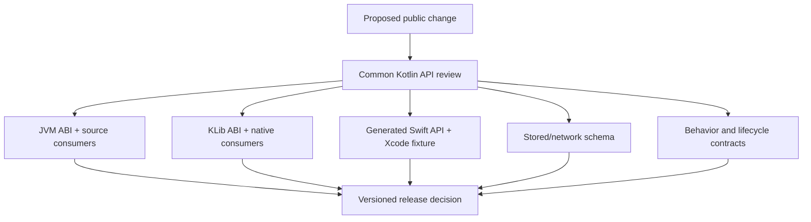

# Binary Compatibility and API Evolution

A shared Kotlin module becomes a contract for Kotlin/JVM, Kotlin/Native, Swift, persisted data, and product behavior. A change can be harmless for one consumer and breaking for another. Staff-level API evolution therefore starts by naming the consumer and compatibility promise, then applying a separate gate for each artifact.

---

## Compatibility Is Multidimensional

| Dimension | Promise | Example break | Primary gate |
|---|---|---|---|
| Source | Existing consumer source recompiles unchanged | Removing a default, renaming a parameter used by named calls | Compile representative source consumers |
| Binary / ABI | A previously compiled consumer links and runs with the new library | Changing a JVM method descriptor or removing a native symbol | Kotlin ABI validation plus old-client/new-library tests |
| Behavioral | Existing calls retain documented semantics | Changing retry, ordering, cancellation, replay, or error mapping | Contract and compatibility tests |
| Serialization | Old stored/network data remains readable and new data obeys rollout rules | Renaming a discriminator or reusing a field meaning | Golden payloads and mixed-version tests |
| Swift-facing API | Generated Swift call sites retain names, types, ownership, and error behavior | Changing `@ObjCName`, nullability, sealed cases, or export tooling | Generated API snapshot plus compiling Swift fixture |
| Distribution | Consumers resolve and link the same product contract | Renaming a framework, raising minimum OS, or changing static linkage | Package-resolution, archive, and launch tests |

Source compatibility does not imply binary compatibility. Behavioral compatibility cannot be inferred from an API dump. “The Kotlin project compiles” proves none of the consumer promises above by itself.



The takeaway: compatibility is an evidence bundle. A release is safe only when every promised consumer path is checked.

---

## Define the Public Surface First

### Enable explicit API mode

Explicit API mode requires public visibility and public types to be intentional:

```kotlin
kotlin {
    explicitApi()
}
```

It prevents inferred implementation types from silently becoming published return types and makes accidental public declarations visible in review. It does not judge whether the API is well designed or compatible.

### Keep boundary types evolvable

Prefer:

- final, purpose-named facade classes;
- small immutable DTOs;
- explicit return and error types;
- read-only collections;
- factory functions when construction may evolve;
- opt-in markers for genuinely unstable contracts;
- `internal` or platform-hiding annotations for implementation details.

Avoid leaking database entities, HTTP client exceptions, mutable state, coroutine scopes, platform objects, nested generic graphs, or implementation-specific library types.

```kotlin
public class CheckoutReceipt private constructor(
    public val receiptId: String,
    public val total: Money,
) {
    public companion object {
        public fun create(
            receiptId: String,
            total: Money,
        ): CheckoutReceipt = CheckoutReceipt(receiptId, total)
    }
}
```

A private constructor plus factory does not make every future change compatible, but it avoids committing consumers to a generated primary-constructor and `copy` signature.

### Public inline code expands the ABI surface

A public inline function is compiled into consumer code. If it calls an `internal` declaration annotated `@PublishedApi`, that declaration is effectively part of the binary contract and must evolve like public API.

```kotlin
@PublishedApi
internal fun normalizedKey(raw: String): String = raw.trim().lowercase()

public inline fun <reified T> cacheKey(raw: String): String =
    "${T::class.simpleName}:${normalizedKey(raw)}"
```

The inlined consumer body contains a reference to `normalizedKey`, so removing it or changing its signature can break previously compiled clients. Separately, changing the body of `cacheKey` does not update clients until they recompile, which can create mixed old/new behavior. Treat public inline and `@PublishedApi` changes as both ABI and behavioral migrations.

---

## Use Kotlin Gradle Plugin ABI Validation

Starting with Kotlin 2.2, binary compatibility validation is included in the Kotlin Gradle plugin. Kotlin 2.4 streamlines its DSL. For current projects, use the built-in `abiValidation` block and its current tasks rather than documenting only the older standalone plugin workflow.

```kotlin
kotlin {
    @OptIn(org.jetbrains.kotlin.gradle.dsl.abi.ExperimentalAbiValidation::class)
    abiValidation()
}
```

The DSL remains experimental, so re-check the official documentation during Kotlin upgrades.
Calling `abiValidation()` enables validation and creates the corresponding tasks in Kotlin 2.4.

### Reference workflow

1. Enable validation in every published/shared module that owns a public contract.
2. Generate or intentionally update the reference ABI:

   ```shell
   ./gradlew updateKotlinAbi
   ```

3. Commit the generated ABI reference files.
4. Check the current build against those references:

   ```shell
   ./gradlew checkKotlinAbi
   ```

5. Run the normal `check` task in CI; it includes `checkKotlinAbi` when validation is enabled.
6. Review the ABI diff before updating the reference. Never “fix CI” by blindly regenerating it.

ABI validation identifies signature changes. The reviewer still decides whether an addition is source-ambiguous, behaviorally incompatible, invalid for Swift, or inappropriate for a minor release.

### Multiplatform and KLib nuance

KLib ABI validation needs target-aware CI. By default, the plugin can infer changes for targets unsupported by the current host. A project that prefers failure over inference can configure:

```kotlin
kotlin {
    @OptIn(org.jetbrains.kotlin.gradle.dsl.abi.ExperimentalAbiValidation::class)
    abiValidation {
        keepLocallyUnsupportedTargets.set(false)
    }
}
```

In Kotlin 2.4, disabling locally unsupported-target retention makes `checkKotlinAbi` fail when the current host cannot produce a complete dump. This is a useful guard against accepting an inferred or incomplete result, but it is not a substitute for target-capable CI. Run the authoritative Apple-target ABI and generated-Swift checks on macOS, and make that host matrix a required gate.

KLib binaries are backward compatible from Kotlin 1.9.20 onward: newer supported compilers can read older KLibs. Forward compatibility is not guaranteed. Cinterop KLib binaries remain Beta, with no specific compatibility guarantee between Kotlin versions. Publish the supported compiler range and test it; ABI dumps do not replace compiler-compatibility policy.

---

## High-Risk Kotlin Changes

### Adding a defaulted parameter

This looks source compatible:

```kotlin
public fun fetchUser(id: String): User = TODO()

// Later
public fun fetchUser(
    id: String,
    forceRefresh: Boolean = false,
): User = TODO()
```

Previously compiled JVM callers still reference the original no-boolean method descriptor, so replacing it can produce `NoSuchMethodError`.

The portable, explicit solution is to keep the old overload:

```kotlin
public fun fetchUser(id: String): User =
    fetchUser(id, forceRefresh = false)

public fun fetchUser(id: String, forceRefresh: Boolean): User = TODO()
```

Current Kotlin also provides experimental version overloading through `@IntroducedAt` for newly introduced optional parameters. Adopt it only after verifying target/toolchain support and generated JVM/Native/Swift APIs. For this exact JVM change, putting `@JvmOverloads` on the replacement generates a one-argument JVM overload with the old descriptor, so previously compiled Kotlin/JVM callers can still link. That mechanism is JVM-specific and does not preserve equivalent Native/Swift APIs or every change to Kotlin default-argument stubs; manual overloads remain the most explicit cross-target contract.

### Changing a return type

Narrowing `Number` to `Int` may preserve source usage but changes the JVM method descriptor. Widening `List` to `Collection` can break both source assumptions and binary linkage. Keep the old function and add a new name/signature when the return contract must change.

### Publishing a data class

Data classes generate constructor, `copy`, `componentN`, `equals`, and `hashCode` APIs. Adding a defaulted property changes constructor and `copy` descriptors; reordering properties changes destructuring behavior.

Use data classes freely for internal models. For a long-lived published boundary, either accept those generated methods as supported API or expose a regular class/factory and map internally.

### Evolving sealed classes and enums

Adding a sealed subtype or enum entry can break source consumers that use exhaustive `when`. Objective-C export does not preserve sealed exhaustiveness, while SKIE-generated wrappers can make a Swift exhaustive switch fail on recompilation. Server-driven states may also introduce unknown values before an app updates.

Policies should state:

- whether the case set is closed for a release line;
- whether additions require a major version or coordinated consumer update;
- whether an `Unknown(raw)` representation is appropriate for wire values;
- how old consumers behave when a new server value arrives;
- which Kotlin and Swift exhaustive fixtures compile in CI.

Do not add `Unknown` reflexively to a truly closed domain such as a compiler-owned state machine; it weakens exhaustiveness without providing rollout value.

### Changing annotation targets

Adding `AnnotationTarget.PROPERTY` to an annotation that previously allowed only `FIELD` can change where an unqualified annotation lands after recompilation. Reflection, Java processors, and code generation may stop seeing it. Treat annotation target/retention changes as API changes and use explicit use-site targets where required.

---

## Swift and Apple Compatibility

The Objective-C header, SKIE wrappers, or Alpha Swift export output is a consumer API. Snapshot and compile it; do not infer it only from Kotlin declarations.

Changes that deserve explicit Swift review include:

- framework/module/base names and package flattening;
- `@ObjCName`, `@ShouldRefineInSwift`, and hidden declarations;
- nullability, primitive width, collection, and generic shape;
- `@Throws` and generated error behavior;
- default arguments and generated overloads;
- sealed/enum cases;
- suspend and Flow lifecycle;
- exported dependency set and static/dynamic linkage;
- minimum Apple OS and supported XCFramework variants.

Swift export is Alpha in Kotlin 2.4 and currently has incomplete type/integration coverage. A compiler or export-tool upgrade can change generated API even when application Kotlin source does not. Pin the toolchain, diff generated output, and compile a representative Xcode consumer on every upgrade.

---

## Serialization and Mixed-Version Evolution

Binary API compatibility does not protect persisted or network data. Mobile rollouts are inherently mixed-version: old and new apps, services, caches, database rows, and queued work coexist.

For serialized contracts:

- keep stable field and discriminator names;
- add fields with safe defaults only when old and new readers agree on absence;
- never reuse a removed field/case meaning;
- define unknown-field and unknown-enum behavior;
- migrate durable local storage before code assumes the new shape;
- test old reader/new writer and new reader/old writer combinations;
- retain golden payloads from real released versions.

An `Unknown(raw)` case can preserve forward compatibility for server-owned enums, but the application must still define safe behavior rather than silently treating unknown as success.

---

## Behavioral Compatibility

ABI checks cannot detect changes such as:

- retry count, timeout, cache freshness, or ordering;
- `StateFlow` initial value or equality suppression;
- `SharedFlow` replay/buffer/overflow behavior;
- cancellation ownership or dispatcher choice;
- exception-to-domain-error mapping;
- locale, clock, or time-zone interpretation;
- idempotency and duplicate-request handling.

Protect these with contract tests that run against both the last released implementation and the candidate when possible:

```kotlin
@Test
fun timeout_remains_a_retryable_domain_failure() {
    val result = mapper.map(SocketTimeoutException())

    assertEquals(
        NetworkFailure.Timeout(retryable = true),
        result,
    )
}
```

Name the behavior being promised. A test that only asserts “no exception” is not a compatibility contract.

---

## Deprecate Across Release Windows

```kotlin
@Deprecated(
    message = "Use submitOrder(request) so idempotency is explicit.",
    replaceWith = ReplaceWith("submitOrder(OrderRequest.from(order))"),
    level = DeprecationLevel.WARNING,
)
public fun submitOrder(order: Order): Receipt =
    submitOrder(OrderRequest.from(order))
```

A deliberate cycle is:

1. add and document the replacement;
2. keep the old implementation delegating to it;
3. release a warning and measure/migrate consumers;
4. move to `ERROR` in a later communicated release;
5. use `HIDDEN` when source removal is desired while retaining a binary bridge;
6. physically remove the declaration only in the promised breaking window.

`DeprecationLevel.HIDDEN` can preserve binary linkage while hiding the declaration from new source code. Verify this on every exported platform; Swift-generated and serialized contracts may need separate adapters.

---

## Release Policy and Evidence

Every public module should declare:

- versioning scheme and what major/minor/patch promise;
- supported Kotlin, Gradle, JDK, Xcode, and minimum OS range;
- public/experimental/internal package policy;
- deprecation duration and breaking-change window;
- serialization compatibility window;
- Swift export path and generated API owner;
- rollback strategy for behavior and schema changes.

### Pull-request gate

1. `checkKotlinAbi` passes against the last approved reference.
2. Any reference update is reviewed as a consumer-facing schema diff.
3. old compiled JVM/native consumers run against the candidate when binary replacement is promised.
4. Kotlin source fixtures compile against the candidate.
5. generated Objective-C/Swift API is diffed and an Xcode fixture compiles.
6. golden/mixed-version serialization tests pass.
7. behavioral contracts cover errors, ordering, cancellation, and state semantics.
8. package coordinates, framework names, targets, minimum versions, symbols, and licenses are verified.
9. release notes name additions, deprecations, removals, behavior/schema changes, migration, and rollback.

Updating the ABI dump is the beginning of compatibility review, not evidence that the change is safe.

---

## Probing Questions

1. **Compatibility dimensions:** A change recompiles cleanly for Android but an old installed app crashes with `NoSuchMethodError`. Which promise was broken, and why did source compilation miss it?
2. **ABI workflow:** `checkKotlinAbi` fails after a public change. When is `updateKotlinAbi` appropriate, and what evidence is required before committing its output?
3. **Optional parameter:** You need to add `forceRefresh=false` to a published KMP function. Compare replacement, manual overload, `@JvmOverloads`, and experimental `@IntroducedAt` strategies across consumers.
4. **KLib hosts:** Why can an ABI check on Linux be insufficient for a library exporting iOS targets, and what does `keepLocallyUnsupportedTargets=false` change?
5. **Sealed evolution:** A new payment status is added while old mobile clients and a SKIE Swift consumer are still active. Which source, runtime, and rollout failures must be addressed?
6. **Deprecation:** How can `DeprecationLevel.HIDDEN` help binary compatibility, and why is it not a complete cross-platform removal strategy?

## Answer Key

1. Binary compatibility was broken: the old app still links the method descriptor produced by the previous library. Recompiling a source fixture proves only that the new declaration can satisfy current source; it does not exercise a previously compiled caller. Run old-client/new-library replacement tests and ABI validation.
2. Update the reference only after the API change is intentional, versioned correctly, and reviewed for every consumer. The PR should include the ABI diff, Kotlin source/old-binary tests, generated Swift API and fixture results, serialization/behavior evidence, migration notes, and release classification. Regenerating solely to make CI green erases the guardrail.
3. Replacing the function with a defaulted parameter preserves many source calls but breaks existing binaries unless a compatible entry point is retained. A manual old overload delegating to the new function is explicit across target boundaries. For this trailing-parameter JVM case, `@JvmOverloads` generates the original one-argument descriptor and preserves previously compiled Kotlin/JVM linkage, but it does not create an equivalent Native/Swift contract or solve every default-stub evolution. `@IntroducedAt` can generate version-aware hidden overloads but is experimental and must be verified on the exact toolchain/export paths before it replaces manual compatibility code.
4. Apple KLibs and generated frameworks require a macOS-capable target build; a non-Apple host cannot compile every target. In Kotlin 2.4, setting `keepLocallyUnsupportedTargets=false` makes `checkKotlinAbi` reject that incomplete local target set instead of retaining or inferring unsupported-target declarations. It is a fail-fast guard, not Apple ABI coverage: use macOS as the required authoritative Apple ABI and generated-Swift gate.
5. Recompiled Kotlin exhaustive `when` and SKIE-generated exhaustive Swift switches can fail when the new case appears. Plain Objective-C Swift may compile with a fallback yet mishandle the runtime subtype, and old apps may receive a new server value they cannot decode or safely interpret. Coordinate source migration, generated Swift compilation, wire unknown-case behavior, mixed-version tests, and server rollout/version gating.
6. `HIDDEN` removes a declaration from new Kotlin source resolution while retaining a binary bridge for already compiled callers. It does not automatically preserve Swift wrapper shape, serialization names, behavior, framework exports, or every target's generated artifact. Keep adapters as needed, compile old consumers on all promised platforms, and remove physically only in the announced breaking window.

---

## Official Sources and Further Reading

- [Kotlin backward compatibility guidelines for library authors](https://kotlinlang.org/docs/api-guidelines-backward-compatibility.html)
- [Binary compatibility validation in the Kotlin Gradle plugin](https://kotlinlang.org/docs/gradle-binary-compatibility-validation.html)
- [Kotlin API guidelines: explicit API mode](https://kotlinlang.org/docs/api-guidelines-simplicity.html#use-explicit-api-mode)
- [Kotlin evolution principles and KLib compatibility](https://kotlinlang.org/docs/kotlin-evolution-principles.html)
- [Kotlin opt-in requirements](https://kotlinlang.org/docs/opt-in-requirements.html)
- [Kotlin Swift export status and limitations](https://kotlinlang.org/docs/native-swift-export.html)
- [Kotlin Swift/Objective-C interop mappings](https://kotlinlang.org/docs/native-objc-interop.html)
- [`kmp-decision-matrix.md`](kmp-decision-matrix.md) — selecting a sharing and distribution boundary.
- [`shared-domain-boundaries.md`](shared-domain-boundaries.md) — domain contract ownership.
- [`tooling/swift-interop.md`](tooling/swift-interop.md) — Objective-C export, SKIE, and Swift export behavior.
- [`tooling/ios-distribution.md`](tooling/ios-distribution.md) — framework/package compatibility and immutable releases.
- [`versioning-and-backward-compatibility.md`](../../mobile-system-design/versioning-and-backward-compatibility.md) — network/schema rollout across mobile versions.
