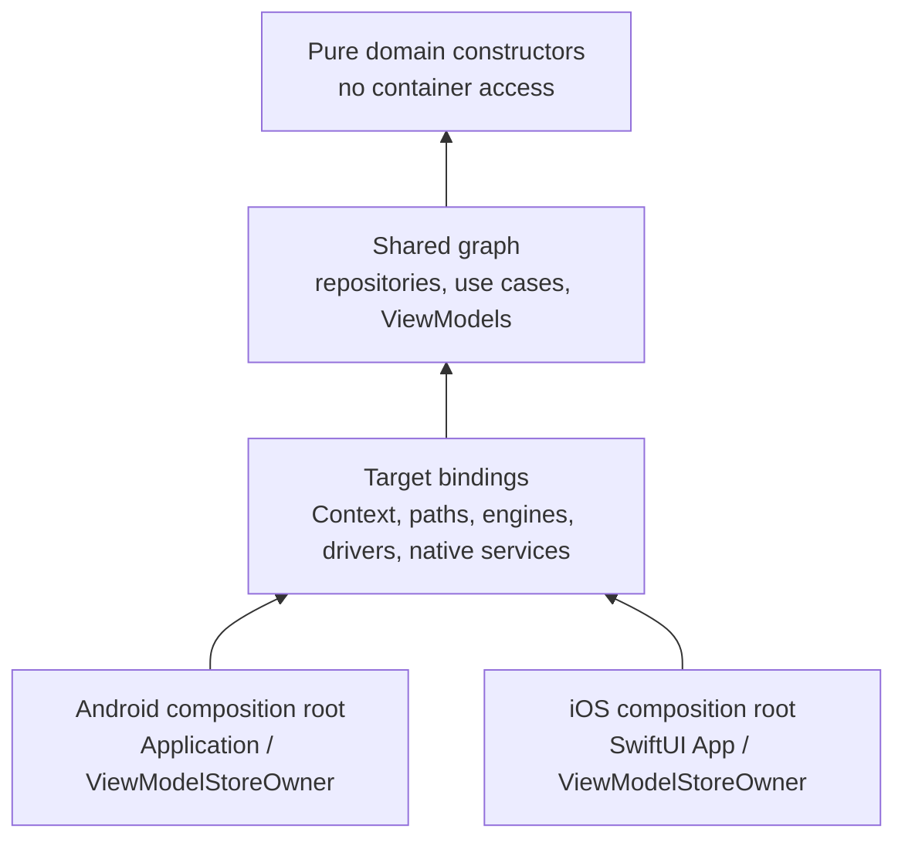

# Dependency Injection in KMP

> Dependency injection connects portable business logic to target-owned resources such as Android `Context`, Apple file locations, HTTP engines, databases, and lifecycle owners. The architectural goal is not “use Koin everywhere”; it is a composition root per application, constructor-injected shared code, explicit platform bindings, and a graph whose safety is verified in proportion to the mechanism used.

---

## Overview: Choose the Wiring Mechanism Deliberately

| Approach | Where it fits | Safety boundary | Important tradeoff |
|---|---|---|---|
| Manual constructor wiring | Small or stable graphs; library code | Kotlin compiler checks constructor calls and types | Factories, scopes, overrides, and graph organization are handwritten |
| Koin classic DSL | Dynamic/custom builders and teams already using Koin | Definitions resolve at runtime; JVM `verify()` can check supported declarations | Missing/ambiguous target bindings can survive compilation |
| Koin compiler plugin DSL or annotations | Koin 4.2+ projects willing to adopt the compatible K2 compiler plugin | Plugin validates visible definitions, bindings, qualifiers, and call sites during compilation | The compiler plugin is currently RC; pin compatible Koin/Kotlin/plugin versions and test platform composition |
| Dagger/Hilt | Android application graph | Dagger validates a JVM/Android component and generates Java-compatible implementation code | Dagger/Hilt is not a KMP/iOS container; keep it at the Android composition root if retained |

Dagger does **not** depend on reflection for ordinary injection; generated code is one of its defining properties. The KMP limitation is product/target support: its compiler, runtime types, and generated component model are designed for Java/JVM/Android, not Kotlin/Native frameworks. An Android app may still use Hilt to construct a shared API while the iOS app uses manual DI or Koin.

Do not choose a framework from dependency count alone. Record required targets, startup and scope semantics, Swift API shape, test overrides, build-tool maturity, graph validation, debugging, and ownership in an ADR.

---

## 1. Put the Composition Boundary at the Platform Edge



The platform application owns container startup and teardown. Shared classes receive dependencies through constructors and should not call a global container to hide undeclared dependencies.

### Shared and Platform Modules

Use classic DSL lambdas for external builders that need custom code. Compiler-plugin declarations can be mixed in after the team validates the plugin/toolchain.

```kotlin
// commonMain/di/Modules.kt
val dataModule = module {
    single<HttpClient> {
        createHttpClient(
            engine = get(),
            baseUrl = getProperty("baseUrl"),
            authTokenProvider = { get<AuthRepository>().token() }
        )
    }
    single<AppDatabase> { AppDatabase(driver = get()) }
    single<AuthRepository> { AuthRepositoryImpl(database = get()) }
    single<ProductApi> { ProductApi(get()) }
    single<ProductRepository> { ProductRepositoryImpl(get(), get()) }
}

val featureModule = module {
    factory { HomeViewModel(get()) }
}

expect val platformModule: Module

fun applicationModules(): List<Module> = listOf(
    dataModule,
    featureModule,
    platformModule
)
```

```kotlin
// androidMain/di/PlatformModule.android.kt
actual val platformModule = module {
    single<SqlDriver> {
        AndroidSqliteDriver(
            schema = AppDatabase.Schema,
            context = get(),
            name = "app.db"
        )
    }
    single<HttpClientEngine> { OkHttp.create() }
    single<LocationService> { AndroidLocationService(context = get()) }
}
```

```kotlin
// iosMain/di/PlatformModule.ios.kt
actual val platformModule = module {
    single<SqlDriver> {
        NativeSqliteDriver(
            schema = AppDatabase.Schema,
            name = "app.db"
        )
    }
    single<HttpClientEngine> { Darwin.create() }
    single<LocationService> { IosLocationService() }
}
```

Koin indexes all loaded definitions before lazy resolutions are requested; this is not a “load Android first, then core” dependency sequence. Module order matters when definitions collide because overrides can replace earlier definitions. Prefer `allowOverride(false)` in production and explicit test overrides.

---

## 2. Initialize Once Per Application Process

```kotlin
// commonMain/di/KoinInit.kt
fun initKoin(
    config: KoinAppDeclaration? = null
): KoinApplication = startKoin {
    allowOverride(false)
    includes(config)
    modules(applicationModules())
}
```

Android supplies `Context` at its application root:

```kotlin
class MainApplication : Application() {
    override fun onCreate() {
        super.onCreate()
        initKoin {
            androidContext(this@MainApplication)
            androidLogger()
            properties(mapOf("baseUrl" to BuildConfig.API_BASE_URL))
        }
    }
}
```

iOS exports a non-generic entry point and retains the initialized graph:

```kotlin
// iosMain/di/KoinInitIos.kt
private lateinit var iosKoin: Koin

fun initKoinIos(baseUrl: String) {
    check(!::iosKoin.isInitialized) { "Koin is already initialized" }
    iosKoin = initKoin {
        properties(mapOf("baseUrl" to baseUrl))
    }.koin
}

fun createHomeViewModel(): HomeViewModel = iosKoin.get()
```

```swift
@main
struct IOSApp: App {
    init() {
        KoinInitIosKt.initKoinIos(baseUrl: AppConfiguration.apiBaseURL)
    }

    var body: some Scene {
        WindowGroup { HomeScreen() }
    }
}
```

Swift cannot call an inline Kotlin function whose generic type is supplied only through `reified T`; inline/reified declarations do not form an exportable Objective-C method contract. Export concrete, typed factories instead. For shared AndroidX ViewModels, connect those factories to the SwiftUI `IosViewModelStoreOwner` pattern so the `ViewModelStore`—not an arbitrary Swift view render—owns clearance.

---

## 3. Understand What “Compile-Time Safe” Covers

### Current Koin Compiler Plugin

The current Koin compiler plugin runs in Kotlin IR, supports KMP, and replaces the deprecated Koin Annotations KSP processor. As of the documented 4.2 generation, the plugin itself is an RC and requires a compatible Kotlin 2.3 toolchain. Treat the versions below as an example compatibility set to pin and update together—not timeless “latest” values:

```kotlin
plugins {
    id("org.jetbrains.kotlin.multiplatform")
    id("io.insert-koin.compiler.plugin") version "1.0.0-RC3.8"
}

kotlin {
    sourceSets.commonMain.dependencies {
        implementation(platform("io.insert-koin:koin-bom:4.2.0"))
        implementation("io.insert-koin:koin-core")
        implementation("io.insert-koin:koin-annotations")
    }
}
```

Compiler-plugin DSL can resolve constructors without repeated `get()` calls:

```kotlin
import org.koin.plugin.module.dsl.*

val repositoryModule = module {
    single<ProductRepositoryImpl>() bind ProductRepository::class
    factory<HomeViewModel>()
}
```

The plugin can report missing definitions, qualifier mismatches, bad bindings, and circular dependencies visible to its analysis. It does not remove the need to:

- Compile every configured KMP target and application composition.
- Test classic DSL lambdas that construct third-party builders or consume runtime properties/parameters.
- Test scope creation/closure and SwiftUI/Android lifecycle integration.
- Run clean builds in CI while the RC plugin documents incremental-cache false-positive/false-negative cases.
- Verify startup behavior, duplicate definitions, target-specific side effects, and production configuration.

If the compiler plugin is not an acceptable production dependency yet, use classic DSL plus targeted graph tests. Koin's `Module.verify()` API is JVM-only, so it cannot by itself prove an iOS actual module; compile Apple targets and exercise the iOS composition in native tests.

---

## 4. Manual DI Is a First-Class Option

```kotlin
class SharedContainer(
    private val sqlDriver: SqlDriver,
    httpEngine: HttpClientEngine,
    baseUrl: String
) : AutoCloseable {
    private val database = AppDatabase(sqlDriver)
    private val httpClient = createHttpClient(httpEngine, baseUrl) { null }
    private val productApi = ProductApi(httpClient)
    private val productRepository = ProductRepositoryImpl(productApi, database)

    fun homeViewModel(): HomeViewModel = HomeViewModel(productRepository)

    override fun close() {
        httpClient.close()
        sqlDriver.close()
    }
}
```

Manual DI gives direct compile errors and transparent ownership. It does **not** automatically solve lifecycle, concurrency, lazy initialization, cleanup order, test replacement, or feature-module encapsulation—the container design must make those policies explicit.

Move to a DI tool when measured wiring churn, repeated scope code, multi-module visibility, overrides, or graph diagnostics cost more than the toolchain and runtime complexity. “Thirty dependencies” is not an architectural threshold.

---

## 5. Production Checks

- Start exactly one root graph per intended application/process context; make duplicate initialization fail visibly.
- Keep secrets out of DI properties and logs. Inject a platform vault abstraction, not a token string with process lifetime.
- Define ownership for `HttpClient`, database drivers, native delegates, and scopes; close resources deterministically where their APIs require it.
- Avoid global `get()` calls inside shared domain/data classes. Constructor signatures are the dependency contract.
- Test each platform module with the same repository/use-case contract suite and add target-native startup smoke tests.
- Fail on accidental overrides in production; use explicit test modules or isolated Koin applications for tests.
- Measure startup allocation and initialization rather than assuming eager singletons or reflection are the bottleneck.

---

## Probing Questions

1. **Dagger boundary:** Why is “Dagger cannot run on iOS because it uses reflection” incorrect? Where can Hilt/Dagger remain in a KMP product, and what boundary must it not cross?
2. **Reified bridge:** Why can Swift not call `inline fun <reified T> get(): T`, and why does a concrete Kotlin factory solve the export problem?
3. **Platform resolution:** How does the shared `HttpClient` receive OkHttp on Android and Darwin on iOS? Does module loading order perform dependency injection?
4. **Compiler safety:** What does the Koin compiler plugin validate, and which KMP/runtime behaviors still require target builds and tests?
5. **Manual DI decision:** An application has eight feature modules. Which evidence—not a dependency-count threshold—would justify adopting Koin over manual containers?

## Answer Key

1. **Dagger boundary:** Dagger's normal model is generated implementation code with compile-time graph validation, not reflective constructor lookup. It remains valid in the Android application module to create Android objects and pass constructor-ready shared APIs across the boundary. Its Java/JVM/Android compiler/runtime/component model is not a Kotlin/Native container, so Dagger annotations/components must not become the required construction mechanism of `commonMain` or the iOS framework.
2. **Reified bridge:** `reified T` exists because an inline Kotlin call substitutes a concrete type at the Kotlin call site; there is no ordinary exported method that accepts an Objective-C/Swift runtime generic type and performs that substitution. Unsupported inline/reified declarations are therefore not a usable Swift API. A non-inline Kotlin function such as `createHomeViewModel(): HomeViewModel` has concrete parameter/return types that the framework exporter can describe and resolves `get<HomeViewModel>()` on the Kotlin side.
3. **Platform resolution:** Each target compiles the corresponding `actual platformModule`. Android registers an `HttpClientEngine` created by OkHttp; iOS registers the same service type created by Darwin. `applicationModules()` loads that target module alongside the shared definitions, and Koin resolves by type/qualifier when `HttpClient` is created. Ordering does not satisfy dependencies; it only affects collisions/overrides, which production configuration should reject.
4. **Compiler safety:** The plugin analyzes visible plugin-DSL/annotated definitions, bindings, qualifiers, constructor requirements, call sites, and cycles during the relevant Kotlin compilations. Still build every target and test classic DSL/external builders, runtime properties and parameters, scopes, duplicate startup, native side effects, cleanup, and SwiftUI/Android ownership. An RC compiler plugin plus successful common compilation is not proof of a working Apple application graph.
5. **Manual DI decision:** Measure constructor/factory churn per change, duplicated scope/cleanup logic, cross-module visibility problems, test-override boilerplate, startup incidents, and time spent tracing missing or ambiguous bindings. Adopt Koin when those costs repeatedly exceed its runtime, build-plugin, upgrade, and debugging costs and a pilot improves the team baseline. Keep manual DI when wiring remains explicit, stable, easily tested, and operationally cheaper.

## Further Reading

- [Koin KMP setup](https://insert-koin.io/docs/reference/koin-core/kmp-setup/) — Current platform modules, initialization, and DSL choices.
- [Koin compiler plugin setup](https://insert-koin.io/docs/setup/compiler-plugin/) and [compile-time safety](https://insert-koin.io/docs/reference/koin-compiler/compile-safety/) — Toolchain requirements, validation scope, and documented limitations.
- [Koin module verification](https://insert-koin.io/docs/reference/koin-test/verify/) — JVM-only `verify()` boundary and deprecated `checkModules()`.
- [Dagger developer guide](https://dagger.dev/dev-guide/) — Generated-code design and compile-time component validation.
- [Kotlin Swift/Objective-C interoperability](https://kotlinlang.org/docs/native-objc-interop.html) — Exported API constraints and typed bridge design.
- [`../../data-and-di/hilt-vs-koin-vs-manual-di.md`](../../data-and-di/hilt-vs-koin-vs-manual-di.md) — Android DI tradeoffs at the Android application boundary.
- [`architecture-and-module-boundaries.md`](../foundations/architecture-and-module-boundaries.md) — Inversion of Control and target-owned adapters.
- [`persistence.md`](persistence.md) and [`networking-with-ktor.md`](networking-with-ktor.md) — Platform driver/engine bindings used by the examples.
- [`../production/adoption-and-migration.md`](../production/adoption-and-migration.md) — SwiftUI `ViewModelStoreOwner`, rollout, and rollback guidance.
