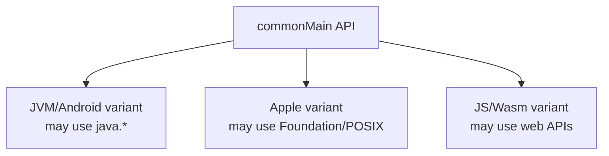

# KMP Libraries & Ecosystem Evaluation

> A library's implementation language does not determine whether it belongs in `commonMain`; its published variants, API surface, transitive dependencies, and behavior on every required target do. The ecosystem changes quickly, so Staff engineers need a repeatable evaluation method rather than a permanent “Android library → KMP replacement” cheat sheet.

---

## The Actual `commonMain` Constraint

Code compiled from `commonMain` may use APIs available to every target compilation that includes that source set. For a dependency, Gradle must be able to select compatible published variants for those compilations.

This is more precise than “a dependency containing any `java.*` call cannot be common.” A multiplatform library may legitimately use `java.*` in its JVM implementation and Foundation/POSIX APIs in Native implementations while publishing one common API. What cannot happen is compiling a JVM-only implementation or exposing a JVM-only type to a Native compilation.



Evaluate the coordinates and metadata for the **exact version** under consideration. “Written in Kotlin,” “has a multiplatform Gradle plugin,” and “the repository contains Native tests” are not proof that the artifact your module uses publishes all required targets.

## Why Static Replacement Tables Age Badly

Several statements that were once common migration advice are no longer generally true:

- Room supports KMP from 2.7.0, though some Android APIs are unavailable in common code.
- DataStore supports KMP from 1.1.0; currently only Preferences DataStore is supported for KMP.
- Coil 3 is multiplatform across Android, JVM, Apple, JS, and Wasm, while some decoder artifacts remain Android-only.
- OkHttp's current project documentation still targets Android/JVM (and GraalVM), so the OkHttp client itself is not a portable iOS `commonMain` transport even though Okio and parts of its build are multiplatform.
- A code-generated library is not automatically JVM-only. Room uses KSP for each configured KMP target; `kotlinx.serialization` uses a Kotlin compiler plugin across targets.

The right question is not “What is the canonical replacement?” It is:

> Which library version supports our target matrix and product semantics, and what does it cost us to own?

## Current Decision Map

Examples below are starting points, not mandates. Verify current target support and limitations in each project's official documentation.

| Capability | Common candidates | Boundary decision |
|---|---|---|
| HTTP | Ktor Client | Put protocol/retry/auth policy in common; choose target engines separately |
| Serialization | `kotlinx.serialization` | Compiler-generated serializers; validate wire compatibility and format maturity |
| SQLite | Room KMP, SQLDelight | Compare migration model, query generation, supported APIs, and existing team investment |
| Preferences | DataStore KMP, Multiplatform Settings | Compare storage format, extension sharing, transaction semantics, and native interoperability |
| Date/calendar/time zones | Kotlin `kotlin.time`, `kotlinx-datetime` | Use `kotlin.time` for instants/durations where sufficient; validate platform time-zone behavior |
| Images in shared Compose UI | Coil 3 | Select a multiplatform network artifact/engine; some media decoders remain platform-specific |
| Dependency injection | Manual composition, Koin, compile-time KMP tools | Choose based on Swift entry points, graph verification, startup, and debugging needs |
| Logging/telemetry | Domain facade plus platform exporters | Avoid leaking vendor types; preserve privacy/redaction and platform lifecycle requirements |

An Android-only library can still be the correct `androidMain` implementation. KMP does not require every implementation dependency to become multiplatform.

## Reflection, Code Generation, and Platform Support

Avoid simplistic explanations such as “KSP means JVM-only” or “Dagger uses runtime reflection.” These are separate concerns:

- Java annotation processors and generated Java source require a Java/JVM toolchain.
- KSP can process Kotlin for multiple targets when both KSP and the processor support those targets and the build wires every target configuration.
- A Kotlin compiler plugin can transform or generate target-independent Kotlin/IR behavior, but plugin compatibility must track Kotlin releases.
- Runtime reflection may be absent or more limited on non-JVM targets, but reflection-free generated code can still depend on JVM-only runtime libraries.
- `javax.inject` annotations themselves are not proof of runtime reflection; inspect generated/runtime code and published variants.

Room KMP demonstrates why the full chain matters: Room runtime artifacts support KMP, its compiler must run through KSP for each target, DAO APIs have common restrictions, and SQLite must be configured for each platform.

## Deep Dive: Reflection-Free Serialization

`kotlinx.serialization` combines:

1. A Kotlin compiler plugin that recognizes `@Serializable` declarations and generates serialization code.
2. A common runtime API (`KSerializer`, descriptors, encoders, and decoders).
3. Format libraries such as JSON, CBOR, and ProtoBuf with their own stability/behavior choices.

```kotlin
@Serializable
data class User(
    @SerialName("user_id") val id: String,
    val displayName: String,
    val active: Boolean = true
)

val json = Json {
    ignoreUnknownKeys = true
    explicitNulls = false
}

val user = json.decodeFromString<User>(payload)
val encoded = json.encodeToString(user)
```

The generated serializer exposes a `SerialDescriptor` for the schema and encode/decode logic that calls the runtime's encoder/decoder APIs. It does not discover fields through `java.lang.reflect` at runtime. The exact generated classes and backend IR are compiler implementation details; test wire behavior and compatibility rather than teaching an unstable IR shape.

Migration review must cover more than annotation names:

- Missing versus explicit `null` values.
- Defaults and `encodeDefaults`.
- Unknown keys and enum values.
- Polymorphic discriminators and sealed hierarchies.
- Numeric coercion/precision.
- Custom serializers and error diagnostics.
- Backward/forward compatibility using recorded payload fixtures.

## Time APIs and the Time-Zone Trap

Do not assume `kotlinx-datetime` has “zero JVM impact” or that every Native target always bundles one fixed IANA database. Current implementations are platform-dependent. For example, the documented system-default lookup uses `java.time.ZoneId` on JVM, `NSTimeZone` on Darwin, operating-system files/APIs on Linux and Windows, browser facilities on JS/Wasm when available, and UTC for Wasm/WASI where the platform cannot supply a system zone.

This affects semantics as well as size:

- Time-zone database versions can differ by OS/device.
- A zone identifier available on one platform may not behave identically on another old OS.
- Browser/Wasm deployments may need an additional time-zone dependency or a product constraint.
- `kotlin.time.Instant`/`Clock` now cover use cases that older guidance assigned entirely to `kotlinx-datetime`; calendar and time-zone operations remain a separate concern.

Measure the linked, stripped, architecture-thinned app artifact before and after a dependency change. An uncompressed KLIB or XCFramework directory does not represent App Store download size, and a guessed time-zone-database number is not evidence.

## A Staff-Level Dependency Evaluation

### 1. Freeze the Target Matrix

List current and plausible near-term targets: Android, `iosArm64`, `iosSimulatorArm64`, desktop JVM, JS, `wasmJs`, `wasmWasi`, and any watch/TV targets. “Native” is not one target.

### 2. Inspect Published Variants and Dependency Scope

- Resolve the exact coordinate/version from `commonMain` in a small fixture.
- Inspect Gradle module metadata and `dependencyInsight` for every target compilation.
- Confirm intermediate source-set variants match your hierarchy.
- Inspect transitive dependencies; one unsupported transitive artifact is enough to fail a target.
- Place platform engines/drivers in their compatible target source sets.

### 3. Check Support Level, Not Just Artifact Presence

Use the Kotlin/Native [target support tiers](https://kotlinlang.org/docs/native-target-support.html) and the library's own policy. Check whether the target is compiled, tested, released, and covered by maintainers—not merely present in a Gradle file.

### 4. Validate API and Behavior

- Does the public API use common types or leak JVM/Android types?
- Are cancellation, threading, file paths, locale/time-zone rules, and persistence guarantees equivalent enough?
- Is the Swift/Objective-C export usable, or should the module hide the library behind a facade?
- Can the library be faked without starting a platform runtime?

### 5. Measure Operational Cost

- Clean and incremental build time per target.
- Native link time, memory, and cache behavior.
- Final app size and startup, using release artifacts.
- Crash symbolication and debugging quality.
- Security advisories, release cadence, license, maintainers, and upgrade compatibility.

### 6. Build an Exit Boundary

Prefer domain-owned interfaces when a vendor may change or a capability differs materially by platform. Do not wrap stable value types reflexively, but do prevent transport, storage, analytics, and security SDKs from becoming domain vocabulary.

## Platform Escape Hatches

```kotlin
// commonMain
interface CrashReporter {
    fun record(throwable: Throwable, attributes: Map<String, String> = emptyMap())
}

class CheckoutService(
    private val crashReporter: CrashReporter
) {
    suspend fun checkout() {
        try {
            // Domain work
        } catch (cancelled: CancellationException) {
            throw cancelled // Cancellation is control flow, not an operational crash.
        } catch (failure: Exception) {
            crashReporter.record(failure)
            throw failure
        }
    }
}
```

Android can implement the interface with Crashlytics in `androidMain` or the Android app. iOS can implement it with a native SDK through an iOS adapter. The domain does not depend on either SDK's exception, breadcrumb, user, or lifecycle types. Construct the correct adapter in each app's composition root; `expect`/`actual` is optional, not required.

## Future-Target Failure Modes

When adding Wasm or another target, an unsupported `commonMain` dependency creates choices:

1. Upgrade to a version that publishes and supports the target.
2. Replace it with a library supporting the full matrix.
3. Move its use behind a common interface and keep implementations in narrower source sets.
4. Split the source-set hierarchy so only supporting targets share that implementation, while deliberately preserving/replacing the default hierarchy template.
5. Implement the missing target adapter in-house or contribute upstream, accepting ownership cost.
6. Defer/drop the target if the product value does not justify the dependency migration.

Do not add a fake no-op merely to make compilation green when the capability is required for correctness or security. Model unsupported capability explicitly and test the product behavior.

## Probing Questions

1. **The “written in Kotlin” paradox:** OkHttp is implemented largely in Kotlin, yet its current documented runtime targets are Android/JVM rather than Kotlin/Native iOS. Why does implementation language not make its client artifact valid in `commonMain`, and where can it still belong in a KMP app?
2. **Serialization internals:** How does `kotlinx.serialization` avoid Java reflection, what stable serializer contract is generated for `User`, and why is memorizing its exact backend IR the wrong review criterion?
3. **Date/time evaluation:** A proposal claims `kotlinx-datetime` is free on JVM and always bundles a full IANA database on iOS. What is wrong with that claim, and how would you evaluate semantics and binary impact correctly?
4. **Legacy Android dependency:** The team proposes `com.jakewharton.threetenabp:threetenabp` in `commonMain`. Walk through the target/metadata/API evaluation and recommend an architecture.
5. **The Wasm expansion:** A proven Android/iOS shared module adds `wasmJs`, but one `commonMain` dependency publishes no compatible Wasm variant. What options do you evaluate, and when is a no-op implementation unacceptable?

## Answer Key

1. Kotlin source can call JVM APIs and be published only as JVM bytecode. Gradle decides portability from the selected artifact's variants/attributes and transitive graph, not the repository's language percentage. OkHttp can remain the Ktor engine or a direct client inside `androidMain`/an Android adapter. Shared HTTP policy should use a common client/API or a domain interface, with a different iOS implementation.
2. The Kotlin serialization compiler plugin generates a `KSerializer<User>` path with a `SerialDescriptor` plus encode/decode logic that calls common `Encoder`/`Decoder` contracts. Runtime field discovery through `java.lang.reflect` is unnecessary, so compatible runtime/format variants work across JVM, Native, JS, and supported Wasm targets. Generated class names and IR lowering can change with compiler/plugin versions; verify descriptors, recorded wire fixtures, defaults/nulls, polymorphism, and backward/forward compatibility instead.
3. Both halves are unsupported absolutes. The library has real code/dependency cost on every platform, while time-zone lookup and rules are platform-dependent: current documentation describes `java.time` on JVM, `NSTimeZone` on Darwin, OS facilities elsewhere, and special JS/Wasm behavior. Define required identifiers/DST behavior, test representative transitions on every target/oldest OS, inspect transitive dependencies, and compare linked/stripped/thinned release app artifacts—not raw KLIB/XCFramework directories.
4. ThreeTenABP is an Android backport and publishes an Android/JVM-oriented API/artifact, so Native compilations cannot select it for `commonMain`. First determine whether modern `kotlin.time` covers instants/durations; use `kotlinx-datetime` for shared calendar/time-zone work when its semantics fit. If legacy Android code still requires ThreeTenABP, isolate it in `androidMain` behind a common domain clock/date interface and provide other target implementations. Do not expose its types in the shared API.
5. Try a supported library upgrade, replacement, narrower interface plus platform implementations, or a custom source-set split that excludes Wasm from that implementation. Upstream/in-house a Wasm implementation only when the maintenance cost is justified; otherwise revisit the target or feature scope. A no-op is unacceptable when silently omitting persistence, authentication, cryptography, billing, telemetry required by policy, or any behavior whose absence corrupts correctness; expose an unsupported capability or fail safely instead.

## Further Reading

- [`networking-with-ktor.md`](networking-with-ktor.md) — Shared HTTP policy and platform engines.
- [`persistence.md`](persistence.md) — Room KMP, SQLDelight, DataStore, and settings tradeoffs.
- [`dependency-injection.md`](dependency-injection.md) — Composition choices and Swift-facing entry points.
- [`build-system-and-source-sets.md`](../tooling/build-system-and-source-sets.md) — Variant-aware dependency resolution and source-set placement.
- [KMP dependencies](https://kotlinlang.org/docs/multiplatform/multiplatform-add-dependencies.html) — Official dependency placement and variant behavior.
- [Kotlin/Native target support](https://kotlinlang.org/docs/native-target-support.html) — Target tiers and support guarantees.
- [Kotlin serialization compiler plugin](https://kotlinlang.org/docs/compiler-plugins-overview.html) — Reflection-free generated serialization.
- [Room for KMP](https://developer.android.com/kotlin/multiplatform/room) — Supported versions, KSP setup, and missing common APIs.
- [DataStore for KMP](https://developer.android.com/kotlin/multiplatform/datastore) — Current KMP storage support and platform construction.
- [Coil 3 multiplatform migration](https://coil-kt.github.io/coil/upgrading_to_coil3/) — Supported targets and platform-specific components.
- [OkHttp project requirements](https://github.com/square/okhttp#requirements) — Current documented runtime targets.
- [`kotlinx-datetime` system time-zone behavior](https://kotlinlang.org/api/kotlinx-datetime/kotlinx-datetime/kotlinx.datetime/-time-zone/-companion/current-system-default.html) — Platform-specific lookup semantics.
