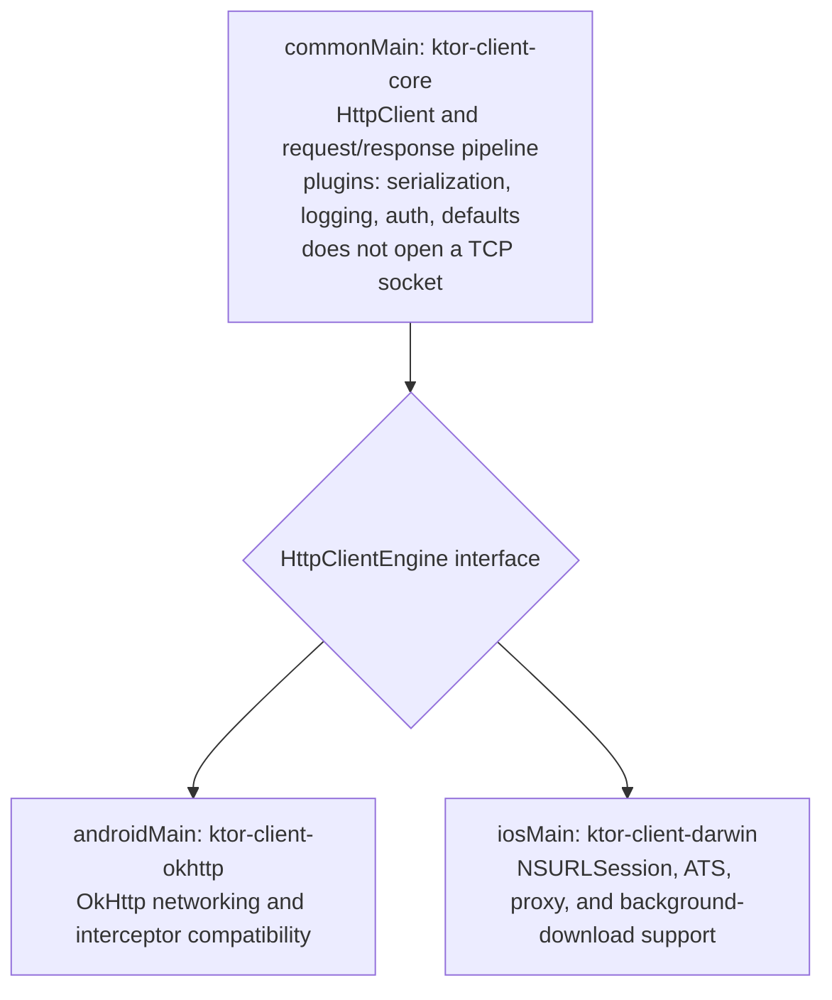

# Networking with Ktor in KMP

> Retrofit + OkHttp remains a common Android stack, but it is not an iOS KMP client. Ktor Client is a common choice when one client contract must run across Android and Apple targets. A Staff engineer must understand Ktor's core/engine separation, choose engines against verified requirements, and migrate interceptor behavior deliberately into shared plugins or platform configuration.

---

## Overview

Ktor Client is architecturally split into two independent halves:



The shared client owns policy and serialization; the injected engine owns target-specific transport behavior and makes the same client testable with `MockEngine`.

---

## 1. Setting Up the HttpClient

### The Shared Client Factory (Staff Pattern)

Ktor can select an engine when the matching target dependency is present, but explicit engine injection makes platform selection and `MockEngine` tests visible at the composition root:

```kotlin
// shared/src/commonMain/kotlin/com/example/network/HttpClientFactory.kt

import io.ktor.client.*
import io.ktor.client.engine.*
import io.ktor.client.plugins.*
import io.ktor.client.plugins.contentnegotiation.*
import io.ktor.client.plugins.logging.*
import io.ktor.client.request.*
import io.ktor.http.*
import io.ktor.serialization.kotlinx.json.*
import kotlinx.serialization.json.Json

fun createHttpClient(
    engine: HttpClientEngine,
    baseUrl: String,
    authTokenProvider: suspend () -> String?
): HttpClient {
    return HttpClient(engine) {
        
        // 1. JSON serialization (replaces MoshiConverterFactory)
        install(ContentNegotiation) {
            json(Json {
                ignoreUnknownKeys = true       // Don't crash on unknown fields
                isLenient = true               // Accept malformed JSON gracefully
                encodeDefaults = false         // Don't serialize default values
                explicitNulls = false          // Omit null fields from output
                coerceInputValues = true       // Use defaults for missing fields
            })
        }
        
        // 2. Logging (replaces HttpLoggingInterceptor)
        install(Logging) {
            logger = object : Logger {
                override fun log(message: String) {
                    // Route to Kermit or platform logger
                    co.touchlab.kermit.Logger.d { message }
                }
            }
            level = LogLevel.HEADERS  // NONE, INFO, HEADERS, BODY, ALL
            sanitizeHeader { header ->
                header == HttpHeaders.Authorization
            }
        }
        
        // 3. Default request configuration (replaces Retrofit baseUrl)
        defaultRequest {
            url(baseUrl)
            contentType(ContentType.Application.Json)
        }
        
        // 4. Authentication (replaces OkHttp AuthInterceptor)
        install(HttpRequestRetry) {
            retryOnServerErrors(maxRetries = 3)
            exponentialDelay()
        }
        
        // 5. Auth token injection
        install(createClientPlugin("AuthPlugin") {
            onRequest { request, _ ->
                val token = authTokenProvider()
                if (token != null) {
                    request.bearerAuth(token)
                }
            }
        })
        
        // 6. Timeout configuration
        install(HttpTimeout) {
            requestTimeoutMillis = 30_000
            connectTimeoutMillis = 10_000
            socketTimeoutMillis = 30_000
        }
        
        // 7. Response validation (replaces Retrofit's built-in error handling)
        expectSuccess = true  // Throw on non-2xx responses
        HttpResponseValidator {
            handleResponseExceptionWithRequest { exception, request ->
                val clientException = exception as? ClientRequestException
                    ?: return@handleResponseExceptionWithRequest
                val errorBody = clientException.response.bodyAsText()
                throw ApiException(
                    statusCode = clientException.response.status.value,
                    errorBody = errorBody,
                    url = request.url.toString()
                )
            }
        }
    }
}

class ApiException(
    val statusCode: Int,
    val errorBody: String,
    val url: String
) : Exception("API error $statusCode on $url: $errorBody")
```

### Platform Engine Configuration

**Android (`androidMain`):**
```kotlin
// shared/src/androidMain/kotlin/com/example/network/PlatformEngine.kt

import io.ktor.client.engine.okhttp.*
import okhttp3.OkHttpClient
import java.util.concurrent.TimeUnit

fun createPlatformEngine(): OkHttpEngine {
    return OkHttp.create {
        config {
            // Access the raw OkHttpClient.Builder for Android-specific features
            connectTimeout(10, TimeUnit.SECONDS)
            readTimeout(30, TimeUnit.SECONDS)
            
            // Add Chucker for debugging (only in debug builds)
            if (BuildConfig.DEBUG) {
                addInterceptor(ChuckerInterceptor(appContext))
            }
            
            // Add certificate pinning
            certificatePinner(
                CertificatePinner.Builder()
                    .add("api.example.com", "sha256/AAAAAAAAAAAAAAAAAAAAAAAAAAAAAAAAAAAAAAAAAAA=")
                    .build()
            )
        }
    }
}
```

**iOS (`iosMain`):**
```kotlin
// shared/src/iosMain/kotlin/com/example/network/PlatformEngine.kt

import io.ktor.client.engine.darwin.*
import platform.Foundation.*

fun createPlatformEngine(): DarwinClientEngine {
    return Darwin.create {
        configureRequest {
            // Access raw NSMutableURLRequest for iOS-specific features
            setAllowsCellularAccess(true)
            setTimeoutInterval(30.0)
        }
        
        configureSession {
            // Access raw NSURLSessionConfiguration for target-specific policy.
            setURLCache(
                NSURLCache(
                    memoryCapacity = 10 * 1024 * 1024,   // 10MB memory cache
                    diskCapacity = 50 * 1024 * 1024,      // 50MB disk cache
                    diskPath = "ktor_cache"
                )
            )
        }
    }
}
```

---

## 2. Retrofit → Ktor Migration (Side-by-Side)

### Simple GET with Query Parameters

**Retrofit:**
```kotlin
interface ProductApi {
    @GET("api/v1/products")
    suspend fun getProducts(
        @Query("category") category: String,
        @Query("page") page: Int,
        @Query("limit") limit: Int = 20
    ): ProductListResponse
}
```

**Ktor:**
```kotlin
class ProductApi(private val client: HttpClient) {
    suspend fun getProducts(
        category: String,
        page: Int,
        limit: Int = 20
    ): ProductListResponse {
        return client.get("api/v1/products") {
            parameter("category", category)
            parameter("page", page)
            parameter("limit", limit)
        }.body()
    }
}
```

### POST with JSON Body

**Retrofit:**
```kotlin
@POST("api/v1/orders")
suspend fun submitOrder(@Body request: OrderRequest): OrderResponse
```

**Ktor:**
```kotlin
suspend fun submitOrder(request: OrderRequest): OrderResponse {
    return client.post("api/v1/orders") {
        contentType(ContentType.Application.Json)
        setBody(request)
    }.body()
}
```

### Multipart File Upload

**Retrofit:**
```kotlin
@Multipart
@POST("api/v1/upload")
suspend fun uploadFile(
    @Part file: MultipartBody.Part,
    @Part("description") description: RequestBody
): UploadResponse
```

**Ktor:**
```kotlin
suspend fun uploadFile(
    fileBytes: ByteArray,
    fileName: String,
    description: String
): UploadResponse {
    return client.submitFormWithBinaryData(
        url = "api/v1/upload",
        formData = formData {
            append("file", fileBytes, Headers.build {
                append(HttpHeaders.ContentDisposition, "filename=\"$fileName\"")
            })
            append("description", description)
        }
    ).body()
}
```

### Streaming / SSE

**Retrofit + OkHttp:**
```kotlin
// Complex — requires custom OkHttp EventSource
```

**Ktor:**
```kotlin
suspend fun streamUpdates(onEvent: (ServerEvent) -> Unit) {
    client.prepareGet("api/v1/events/stream").execute { response ->
        val channel: ByteReadChannel = response.body()
        while (!channel.isClosedForRead) {
            val line = channel.readUTF8Line() ?: break
            if (line.startsWith("data:")) {
                val event = Json.decodeFromString<ServerEvent>(line.removePrefix("data:"))
                onEvent(event)
            }
        }
    }
}
```

---

## 3. Error Handling Architecture

In Retrofit, error handling is implicit — a non-2xx response throws `HttpException`. In Ktor, you must design your error handling explicitly.

### The Sealed Result Wrapper (Staff Pattern)

```kotlin
// shared/src/commonMain/kotlin/com/example/network/NetworkResult.kt

sealed interface NetworkResult<out T> {
    data class Success<T>(val data: T) : NetworkResult<T>
    data class Error(
        val code: Int,
        val message: String,
        val errorBody: String? = null
    ) : NetworkResult<Nothing>
    data class NetworkError(val exception: Throwable) : NetworkResult<Nothing>
}

// Extension function to wrap Ktor calls
suspend inline fun <reified T> safeApiCall(
    crossinline block: suspend () -> T
): NetworkResult<T> {
    return try {
        NetworkResult.Success(block())
    } catch (e: ClientRequestException) {
        // 4xx errors
        NetworkResult.Error(
            code = e.response.status.value,
            message = e.response.status.description,
            errorBody = e.response.bodyAsText()
        )
    } catch (e: ServerResponseException) {
        // 5xx errors
        NetworkResult.Error(
            code = e.response.status.value,
            message = "Server error",
            errorBody = e.response.bodyAsText()
        )
    } catch (e: IOException) {
        // Network connectivity errors
        NetworkResult.NetworkError(e)
    } catch (e: SerializationException) {
        // JSON parsing errors
        NetworkResult.Error(code = -1, message = "Failed to parse response: ${e.message}")
    }
}

// Usage in Repository
class ProductRepository(private val api: ProductApi) {
    suspend fun getProducts(category: String): NetworkResult<List<Product>> {
        return safeApiCall { api.getProducts(category, page = 1).products }
    }
}
```

---

## 4. Testing Ktor in `commonTest`

Ktor provides a **MockEngine** that intercepts HTTP requests and returns pre-defined responses. This runs identically on JVM and Native:

```kotlin
// shared/src/commonTest/kotlin/com/example/network/ProductApiTest.kt

class ProductApiTest {
    
    @Test
    fun `getProducts returns parsed products`() = runTest {
        val mockEngine = MockEngine { request ->
            assertEquals("/api/v1/products", request.url.encodedPath)
            assertEquals("electronics", request.url.parameters["category"])
            
            respond(
                content = """
                    {
                        "products": [
                            {"id": "1", "name": "Laptop", "price_cents": 99900},
                            {"id": "2", "name": "Phone", "price_cents": 79900}
                        ],
                        "total": 2
                    }
                """.trimIndent(),
                status = HttpStatusCode.OK,
                headers = headersOf(HttpHeaders.ContentType, "application/json")
            )
        }
        
        val client = createHttpClient(
            engine = mockEngine,
            baseUrl = "https://api.example.com",
            authTokenProvider = { "test-token" }
        )
        val api = ProductApi(client)
        
        val response = api.getProducts("electronics", page = 1)
        
        assertEquals(2, response.products.size)
        assertEquals("Laptop", response.products[0].name)
        assertEquals(99900, response.products[0].priceCents)
    }
    
    @Test
    fun `getProducts handles 401 error`() = runTest {
        val mockEngine = MockEngine {
            respond(
                content = """{"error": "Token expired"}""",
                status = HttpStatusCode.Unauthorized,
                headers = headersOf(HttpHeaders.ContentType, "application/json")
            )
        }
        
        val client = createHttpClient(
            engine = mockEngine,
            baseUrl = "https://api.example.com",
            authTokenProvider = { "expired-token" }
        )
        val api = ProductApi(client)
        val repository = ProductRepository(api)
        
        val result = repository.getProducts("electronics")
        
        assertTrue(result is NetworkResult.Error)
        assertEquals(401, (result as NetworkResult.Error).code)
    }
}
```

---

## 5. Choosing the Apple Engine with Evidence

The Darwin engine delegates transport to `NSURLSession`; the OkHttp engine delegates to OkHttp on Android. That architectural fact does not prove that one app will use less energy or that every native transport feature is exposed through Ktor.

| Concern | Android / OkHttp | Apple / Darwin |
|---|---|---|
| Transport backend | OkHttp | `NSURLSession` |
| Shared capabilities | Ktor plugins for auth, content negotiation, retries, logging, and validation | Same shared Ktor plugins |
| Platform configuration | OkHttp builder, Android Network Security Configuration, and Android tooling | Darwin request/session configuration, ATS policy, and Apple tooling |
| Protocols | Depends on engine version, server negotiation, and configuration | Depends on OS version, server negotiation, and session configuration |
| Background work | Use Android's supported background-transfer/scheduling APIs for the requirement | Use Apple's supported background `URLSession` lifecycle when transfer must outlive the process; do not assume an ordinary client call does |
| Performance and energy | Measure representative traffic with Android profiling tools | Measure representative traffic with Instruments, including constrained-network and Low Power Mode cases |

Default to Darwin when the Apple client should follow `NSURLSession` behavior, but treat engine choice as a requirements decision. Verify timeouts, proxies, TLS challenges, streaming, cancellation, background execution, protocol negotiation, and observability on the exact Ktor and OS versions you ship.

---

## Probing Questions

1.  **Engine Architecture:** Why does Ktor separate the `HttpClient` from the `HttpClientEngine`? What problem does this inversion solve for testing and for KMP?
2.  **Interceptor Migration:** You have an OkHttp interceptor that adds `X-Request-ID: UUID` to every request, logs the request/response time, and retries on 503 with exponential backoff. Write the equivalent Ktor plugin configuration.
3.  **Engine Evidence:** Your iOS app makes 50 API calls per minute with Darwin while Android uses OkHttp. Can engine names alone tell you which app consumes less energy? What must you measure before making that claim?
4.  **Error Handling:** In Retrofit, a 404 response returns a `Response<T>` object with `isSuccessful = false`. In Ktor, what happens by default when you set `expectSuccess = true`? What happens when you set it to `false`?
5.  **MockEngine:** You write a test using `MockEngine` in `commonTest`. This test runs on JVM (fast). You then run `./gradlew iosSimulatorArm64Test`. Does the `MockEngine` test also run on iOS? What runtime differences might cause it to fail?

## Answer Key

1. **Engine architecture:** `HttpClient` and its plugins express portable request policy, serialization, validation, and API behavior; `HttpClientEngine` performs transport work for a supported target. The inversion lets common code use OkHttp on Android and Darwin on iOS without platform APIs leaking into it, while tests inject `MockEngine` and exercise the same client configuration without a network.
2. **Interceptor migration:** Use `defaultRequest` or an `onRequest` hook in a custom client plugin to call an injected request-ID provider and append `X-Request-ID`. Record a monotonic start mark in request attributes and report elapsed time from an `onResponse` hook, with authorization headers sanitized. Install `HttpRequestRetry`, restrict `retryIf` to `503 Service Unavailable`, set a bounded retry count, and use `exponentialDelay()` (which includes jitter and can respect `Retry-After` in current Ktor). Retry only replayable/idempotent operations unless the API supplies an idempotency key; test the policy with `MockEngine`.
3. **Engine evidence:** No. Darwin's use of `NSURLSession` and OkHttp's Android implementation describe the transport boundary, not the energy result of a workload. Measure the same request mix, payloads, connection reuse, radio conditions, retries, app lifecycle, and server behavior on representative devices. Use Android profiling tools and Apple Instruments, explicitly testing Low Power Mode and constrained networks; reduce unnecessary call frequency before attributing a difference to the engine.
4. **Error handling:** With `expectSuccess = true`, Ktor throws `RedirectResponseException` for 3xx, `ClientRequestException` for 4xx, and `ServerResponseException` for 5xx before normal success handling. With it `false` (the default), status alone does not throw: the caller receives `HttpResponse` and must branch on `status`. Body decoding, I/O, and custom validators can still throw in either mode.
5. **MockEngine:** The test belongs to `commonTest`, but it runs on iOS only when the iOS test compilation includes `ktor-client-mock` and the `iosSimulatorArm64Test` task actually selects that source set. `MockEngine` removes socket differences, not Kotlin/Native differences: unavailable main dispatchers, native-only initialization, file/locale assumptions, coroutine scheduling, and accidental JVM APIs can still fail. Keep engine-free policy in common code and run both fast host tests and target-native tests in CI.

## Further Reading

- [Ktor client engines](https://ktor.io/docs/client-engines.html) — Current platform matrix, capabilities, configuration, and limitations.
- [Ktor request retries](https://ktor.io/docs/client-request-retry.html) — Retry conditions, backoff, and request mutation.
- [Ktor response validation](https://ktor.io/docs/client-response-validation.html) — `expectSuccess` defaults and status exceptions.
- [Testing Ktor clients](https://ktor.io/docs/client-testing.html) — Injecting and configuring `MockEngine`.
- [`libraries-ecosystem.md`](libraries-ecosystem.md) — How to verify published target variants and keep platform-only clients behind shared boundaries.
- [`../../android/networking-and-security/ktor-vs-retrofit.md`](../../networking-and-security/ktor-vs-retrofit.md) — The detailed Android-focused decision file comparing Retrofit and Ktor.
- [`dependency-injection.md`](dependency-injection.md) — How to inject the platform-specific `HttpClientEngine` via Koin.
- [`build-system-and-source-sets.md`](../tooling/build-system-and-source-sets.md) — Where to put `ktor-client-okhttp` (androidMain) vs `ktor-client-darwin` (iosMain) dependencies.
