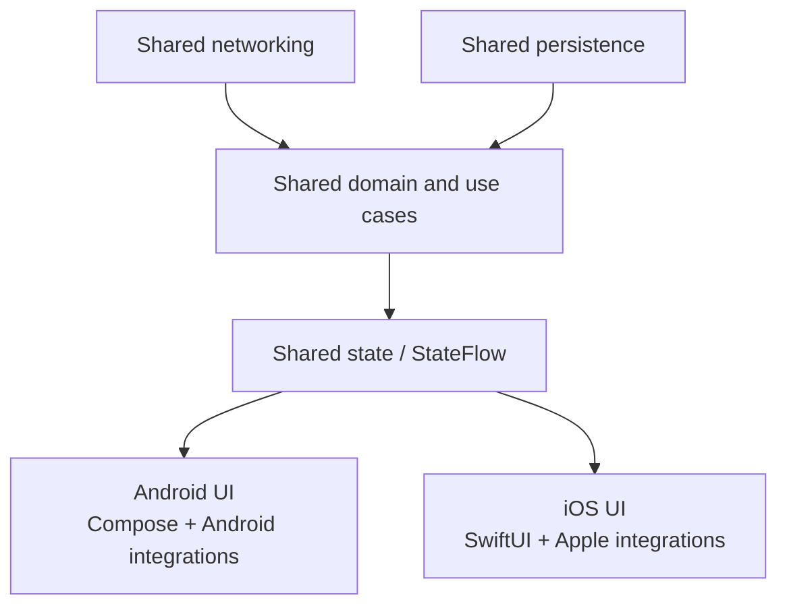
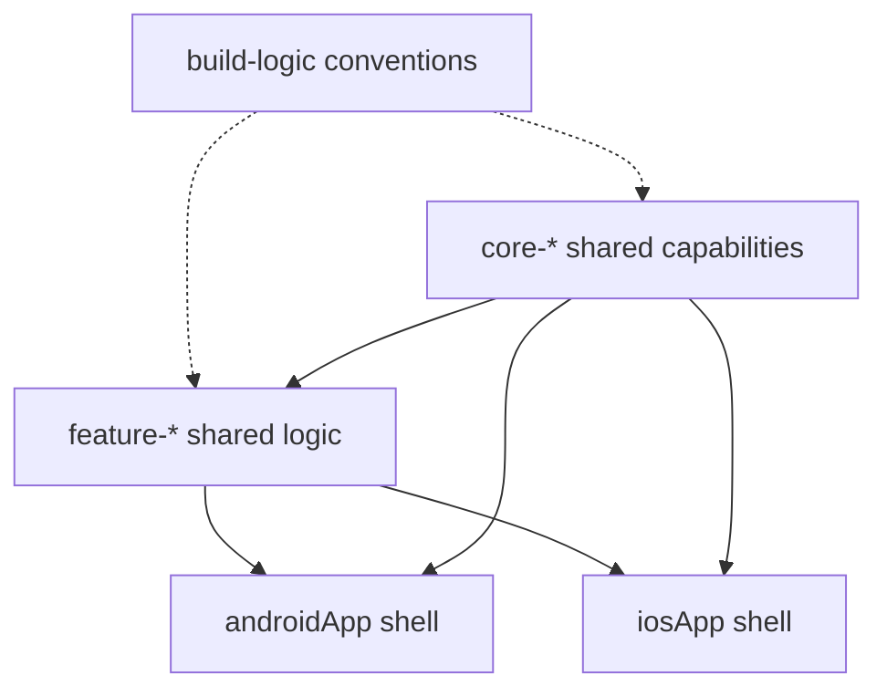

# KMP Architecture & Module Boundaries

> The single most impactful architectural decision in a KMP project is where you draw the line between shared code and platform-native code. Get this wrong, and you either end up with a "lowest common denominator" app that feels alien on iOS, or a thin shared layer that doesn't save enough effort to justify the KMP tooling overhead. This file teaches you how to evaluate that boundary with Staff-level rigor.

---

## Overview

There are two fundamentally different KMP paradigms. Every team must choose one (or a hybrid). The choice shapes the entire project structure, the iOS team's workflow, the testing strategy, and the CI cost.

---

## Paradigm A: Shared Business Logic (Logic-Only Sharing)

In this model, KMP is used strictly for the "headless" portion of the app. The UI is fully native on each platform.



Logic-only sharing centralizes contracts and state transitions while each platform retains native UI, navigation, lifecycle, dependency injection, and platform SDK ownership.

### What Gets Shared

| Layer | Shared? | Why |
|---|---|---|
| **Data Models / DTOs** | ✅ Strong candidate | Share when both apps consume the same wire/domain contract; keep platform presentation models local |
| **API Client (Ktor)** | ✅ Strong candidate | Share when transport, authentication, retries, and serialization policies should match |
| **Database (SQLDelight)** | ✅ Usually | Schema + queries are SQL — platform provides the driver |
| **Repository** | ✅ Usually | Orchestrates API + DB with caching logic |
| **Domain / Use Cases** | ✅ Strong candidate | Pure cross-platform business rules usually provide the clearest return |
| **ViewModels / state holders** | ⚠️ Context-dependent | AndroidX ViewModel supports KMP; iOS still needs explicit storage, lifecycle, and Flow interop |
| **Navigation** | ⚠️ Usually platform-owned | Destinations/policy may be shared while platform stacks and presentation remain native |
| **UI** | ⚠️ Product decision | Keep native UI in this paradigm; choose Compose Multiplatform deliberately if sharing UI |
| **Hardware (Camera, BLE, NFC)** | ⚠️ Platform adapters | Share policy/state machines where useful; keep SDK calls and lifecycle integration platform-side |

### Concrete Example: A Checkout Feature (Paradigm A)

**Shared module (`commonMain`):**

```kotlin
// 1. The DTO — shared JSON parsing
@Serializable
data class CartItem(
    val productId: String,
    val name: String,
    val priceInCents: Long,
    val quantity: Int
)

// 2. The API — shared networking
class CheckoutApi(private val client: HttpClient) {
    suspend fun fetchPricing(productIds: List<String>): PricingResponse {
        return client.post("api/v1/pricing") {
            contentType(ContentType.Application.Json)
            setBody(PricingRequest(productIds))
        }.body()
    }

    suspend fun submitOrder(items: List<CartItem>): OrderResult {
        return client.post("api/v1/orders") {
            contentType(ContentType.Application.Json)
            setBody(OrderRequest(items))
        }.body()
    }
    
    suspend fun validatePromo(code: String): PromoResult {
        return client.get("api/v1/promo/$code").body()
    }
}

// 3. The Repository — shared caching + business logic
class CheckoutRepository(
    private val api: CheckoutApi,
    private val cartDb: CartDatabase   // SQLDelight
) {
    suspend fun getCartWithPricing(): CartPricing {
        val localItems = cartDb.cartQueries.selectAll().executeAsList()
        val pricing = api.fetchPricing(localItems.map { it.productId })
        return CartPricing(
            items = localItems,
            subtotalCents = pricing.subtotal,
            taxCents = pricing.tax,
            totalCents = pricing.total
        )
    }

    suspend fun validatePromo(code: String): PromoResult = api.validatePromo(code)
}

// 4. The ViewModel — shared state machine
class CheckoutViewModel(
    private val repository: CheckoutRepository
) : ViewModel() {
    private val _state = MutableStateFlow(CheckoutState())
    val state: StateFlow<CheckoutState> = _state.asStateFlow()

    fun onApplyPromo(code: String) {
        viewModelScope.launch {
            _state.update { it.copy(isApplyingPromo = true) }
            val result = repository.validatePromo(code)
            _state.update { current ->
                when (result) {
                    is PromoResult.Valid -> current.copy(
                        isApplyingPromo = false,
                        discount = result.discountCents,
                        promoCode = code
                    )
                    is PromoResult.Invalid -> current.copy(
                        isApplyingPromo = false,
                        error = "Invalid promo code"
                    )
                }
            }
        }
    }
}

data class CheckoutState(
    val items: List<CartItem> = emptyList(),
    val subtotalCents: Long = 0,
    val taxCents: Long = 0,
    val discount: Long = 0,
    val promoCode: String? = null,
    val isApplyingPromo: Boolean = false,
    val error: String? = null
) {
    val totalCents: Long get() = subtotalCents + taxCents - discount
}
```

**Android consumer (`androidApp`):**

```kotlin
@Composable
fun CheckoutScreen(viewModel: CheckoutViewModel = koinViewModel()) {
    val state by viewModel.state.collectAsStateWithLifecycle()
    
    Column(modifier = Modifier.padding(16.dp)) {
        LazyColumn {
            items(state.items) { item ->
                CartItemRow(item)
            }
        }
        PromoCodeField(
            isLoading = state.isApplyingPromo,
            onApply = viewModel::onApplyPromo
        )
        OrderSummary(
            subtotal = state.subtotalCents,
            tax = state.taxCents,
            discount = state.discount,
            total = state.totalCents
        )
    }
}
```

**iOS consumer (`iosApp` — SwiftUI, using one possible Flow adapter):**

```swift
struct CheckoutScreen: View {
    @StateObject private var observer = CheckoutViewModelObserver()
    
    var body: some View {
        VStack {
            List(observer.state.items, id: \.productId) { item in
                CartItemRow(item: item)
            }
            PromoCodeField(
                isLoading: observer.state.isApplyingPromo,
                onApply: { code in observer.viewModel.onApplyPromo(code: code) }
            )
            OrderSummary(
                subtotal: observer.state.subtotalCents,
                tax: observer.state.taxCents,
                discount: observer.state.discount,
                total: observer.state.totalCents
            )
        }
    }
}

// This example assumes SKIE is configured to expose StateFlow as AsyncSequence.
// KMP-NativeCoroutines or a hand-written adapter are alternatives on the
// default Objective-C export path; Kotlin Swift export is a separate Alpha path.
@MainActor
class CheckoutViewModelObserver: ObservableObject {
    let viewModel = ViewModelProviders.shared.getCheckoutViewModel()
    @Published var state = CheckoutState.companion.default
    private var observationTask: Task<Void, Never>?
    
    init() {
        let states = viewModel.state
        observationTask = Task { [weak self] in
            for await newState in states {
                guard !Task.isCancelled else { return }
                self?.state = newState
            }
        }
    }

    deinit {
        observationTask?.cancel()
    }
}
```

Cancelling observation is only half of ownership. Production iOS code must also retain an AndroidX `ViewModelStoreOwner` for the intended navigation lifetime and clear its store when that owner is deinitialized; the official KMP ViewModel guide shows that bridge.

---

## Paradigm B: Shared UI (Compose Multiplatform)

In this model, you share the entire UI using Compose Multiplatform (CMP). See [`compose-multiplatform.md`](../ui-sharing/compose-multiplatform.md) for the deep dive on how CMP renders via Skia on iOS.

### When to Use Paradigm B

| Factor | Paradigm A (Logic Only) | Paradigm B (Shared UI) |
|---|---|---|
| **iOS team expertise** | iOS team writes SwiftUI | iOS team willing to learn Compose |
| **App type** | Platform-specific experience is central | Consistent cross-platform product UI is valuable |
| **Platform fidelity** | Native controls/behavior are a hard requirement | Team can validate shared rendering and interaction |
| **Development velocity** | 2 UI codebases to maintain | 1 UI codebase |
| **Binary/performance budget** | Shared logic still has a cost to measure | Rendering/runtime cost must be measured on target devices |
| **Accessibility** | Native framework behavior still needs testing | Shared UI semantics and platform integration need testing |

> **Staff recommendation:** Run a representative vertical slice before standardizing. Measure accessibility, startup/binary impact, scrolling/input behavior, platform integrations, testability, and the skills/ownership model. User count alone does not select an architecture, and no universal development-time percentage applies.

---

## The Boundary Pattern: Inversion of Control

Regardless of paradigm, you will encounter features that require platform-specific APIs (GPS, camera, Bluetooth, biometrics). These boundaries usually benefit from **Inversion of Control** — shared code defines *what* it needs; the platform provides *how*.

### The Full Pattern (GPS Example)

**Step 1: Define the contract in `commonMain`**

```kotlin
// shared/src/commonMain/kotlin/com/example/location/LocationService.kt

data class Coordinates(val latitude: Double, val longitude: Double)

sealed interface LocationOutcome {
    data class Success(val coordinates: Coordinates) : LocationOutcome
    data class PermissionDenied(val isPermanent: Boolean) : LocationOutcome
    data class Error(val message: String) : LocationOutcome
}

/**
 * Abstraction over platform-specific location providers.
 * Android: FusedLocationProviderClient
 * iOS: CLLocationManager
 */
interface LocationService {
    /** One-shot location fetch. Suspends until location is available or error occurs. */
    suspend fun getCurrentLocation(): LocationOutcome
    
    /** Continuous updates; each platform chooses an appropriate sampling policy. */
    fun trackLocation(): Flow<LocationOutcome>
}
```

**Step 2: Consume it in the shared ViewModel**

```kotlin
// shared/src/commonMain/kotlin/com/example/weather/WeatherViewModel.kt

class WeatherViewModel(
    private val locationService: LocationService,
    private val weatherApi: WeatherApi
) : ViewModel() {
    private val _state = MutableStateFlow(WeatherState())
    val state: StateFlow<WeatherState> = _state.asStateFlow()

    fun onRefresh() {
        viewModelScope.launch {
            _state.update { it.copy(isLoading = true) }
            
            when (val location = locationService.getCurrentLocation()) {
                is LocationOutcome.Success -> {
                    val weather = weatherApi.getWeather(
                        lat = location.coordinates.latitude,
                        lng = location.coordinates.longitude
                    )
                    _state.update { it.copy(isLoading = false, weather = weather) }
                }
                is LocationOutcome.PermissionDenied -> {
                    _state.update { it.copy(
                        isLoading = false,
                        error = if (location.isPermanent) 
                            "Open Settings to grant location permission" 
                        else 
                            "Location permission required"
                    )}
                }
                is LocationOutcome.Error -> {
                    _state.update { it.copy(isLoading = false, error = location.message) }
                }
            }
        }
    }
}
```

**Step 3: Implement on Android**

```kotlin
// androidApp/src/main/kotlin/com/example/location/AndroidLocationService.kt

class AndroidLocationService(
    private val context: Context
) : LocationService {

    private val fusedClient = LocationServices.getFusedLocationProviderClient(context)

    @SuppressLint("MissingPermission")
    override suspend fun getCurrentLocation(): LocationOutcome {
        return try {
            val location = fusedClient.getCurrentLocation(
                Priority.PRIORITY_HIGH_ACCURACY,
                CancellationTokenSource().token
            ).await()
            
            if (location != null) {
                LocationOutcome.Success(Coordinates(location.latitude, location.longitude))
            } else {
                LocationOutcome.Error("Location unavailable")
            }
        } catch (e: SecurityException) {
            LocationOutcome.PermissionDenied(isPermanent = false)
        }
    }

    @SuppressLint("MissingPermission")
    override fun trackLocation(): Flow<LocationOutcome> = callbackFlow {
        val request = LocationRequest.Builder(10_000L)
            .setPriority(Priority.PRIORITY_HIGH_ACCURACY)
            .build()
            
        val callback = object : LocationCallback() {
            override fun onLocationResult(result: com.google.android.gms.location.LocationResult) {
                result.lastLocation?.let { loc ->
                    trySend(LocationOutcome.Success(Coordinates(loc.latitude, loc.longitude)))
                }
            }
        }
        
        fusedClient.requestLocationUpdates(request, callback, Looper.getMainLooper())
        awaitClose { fusedClient.removeLocationUpdates(callback) }
    }
}
```

**Step 4: Implement on iOS (Kotlin code in `iosMain`)**

```kotlin
// shared/src/iosMain/kotlin/com/example/location/IOSLocationService.kt

class IOSLocationService : LocationService {
    override suspend fun getCurrentLocation(): LocationOutcome = trackLocation().first()

    override fun trackLocation(): Flow<LocationOutcome> = callbackFlow {
        val manager = CLLocationManager()
        val delegate = object : NSObject(), CLLocationManagerDelegateProtocol {
            override fun locationManager(
                manager: CLLocationManager,
                didUpdateLocations: List<*>
            ) {
                val location = didUpdateLocations.lastOrNull() as? CLLocation ?: return
                trySend(LocationOutcome.Success(
                    Coordinates(location.coordinate.latitude, location.coordinate.longitude)
                ))
            }

            override fun locationManager(
                manager: CLLocationManager,
                didFailWithError: NSError
            ) {
                trySend(LocationOutcome.Error(didFailWithError.localizedDescription))
            }

            fun close() {
                manager.stopUpdatingLocation()
                manager.delegate = null
            }
        }

        manager.delegate = delegate
        manager.requestWhenInUseAuthorization()
        manager.startUpdatingLocation()

        // Capturing the delegate strongly here matters: CLLocationManager.delegate is weak.
        awaitClose { delegate.close() }
    }.flowOn(Dispatchers.Main)
}
```

The iOS collector retains its manager and delegate until `awaitClose`; cancellation from `first()` or the downstream collector stops updates. Production adapters must also map authorization changes (including permanently denied state) and document accuracy/power policy. The contract intentionally does not promise an exact update interval because Core Location and Android location providers have different scheduling guarantees.

**Step 5: Wire via Koin DI**

```kotlin
// shared/src/androidMain/kotlin/di/PlatformModule.kt
fun androidPlatformModule() = module {
    single<LocationService> { AndroidLocationService(get()) }
}

// shared/src/iosMain/kotlin/di/PlatformModule.kt
fun iosPlatformModule() = module {
    single<LocationService> { IOSLocationService() }
}
```

---

## Multi-Module KMP Project Structure

A growing KMP project can mirror modularization strategies from native apps, but module boundaries should follow ownership and change patterns. A small codebase may be healthier as one shared module until build measurements or dependency boundaries justify a split.



Shared feature modules depend on reusable core capabilities, and platform apps remain composition roots; platform shells must not become dependencies of shared code.

### Why Multi-Module Matters for Build Time

In a monolithic `shared` module, changing one file in `commonMain` triggers recompilation of the entire module for all targets. In a multi-module project:

- Changing `feature-auth` only recompiles `feature-auth` for all targets.
- `core-network`, `core-database`, `feature-checkout`, etc. are cached and skipped.
- Gradle's parallel task execution can compile `feature-auth:compileKotlinIosArm64` and `feature-checkout:compileKotlinAndroid` simultaneously.

The benefit is workload-dependent: every KMP module also adds configuration and target tasks. Establish a build-report baseline, split along stable API boundaries, and verify clean and incremental builds after the change. Do not assume more modules automatically make builds faster.

---

## Common Pitfalls

### 1. Treating a Shared ViewModel as Self-Owning
AndroidX Lifecycle ViewModel supports KMP in version 2.8.0 and later, so a `commonMain` class can extend `ViewModel` and use `viewModelScope`. The remaining problem is ownership: SwiftUI has no built-in AndroidX `ViewModelStoreOwner`.

**Fix:** On Android, scope the ViewModel to the intended activity, navigation entry, or other owner. On iOS, retain a `ViewModelStoreOwner` from an appropriate SwiftUI owner and clear its store when that owner is deinitialized. Separately configure Flow observation on the default Objective-C export path. The [official KMP ViewModel guide](https://developer.android.com/kotlin/multiplatform/viewmodel) shows the current setup and limitations.

### 2. The "Share Everything" Fallacy
Sharing navigation, hardware APIs, or deep OS integrations behind a lowest-common-denominator facade can cost more than native adapters. Share domain policy and deterministic state transitions when they are genuinely common; keep SDK calls, permissions, lifecycle, and platform UX at an explicit edge.

### 3. The iOS Engineer Alienation
KMP adoption changes iOS API design, debugging, build tooling, and ownership even when UI stays native. Make the decision collaboratively, require iOS review of exported APIs, budget training and tooling work, and keep platform escape hatches rather than treating sharing percentage as the success metric.

---

## Probing Questions

1.  **Boundary Decision:** Your team is building a ride-hailing app. The map view requires Google Maps on Android and MapKit on iOS. The real-time driver location updates use WebSockets. Where exactly do you draw the KMP boundary — does the WebSocket connection live in `commonMain` or in native code?
2.  **Paradigm Selection:** You are tasked with building a company-internal expense reporting tool used by 500 employees. It has forms, camera receipt capture, and approval workflows. Would you choose Paradigm A or B? What factors would change your answer?
3.  **Inversion of Control:** Why is it better to define `interface LocationService` in `commonMain` rather than `expect class LocationService`? What happens when you need to add a `wasmJsMain` target later?
4.  **Module Boundaries:** In the multi-module structure above, `feature-auth` needs to call `core-network` and `core-database`. How do you prevent `feature-auth` from directly depending on `feature-checkout`? How does this mirror Android's `:feature:api` / `:feature:impl` pattern?
5.  **ViewModel Lifecycle:** If a shared ViewModel launches a coroutine in `viewModelScope`, who cancels that scope when the iOS SwiftUI view disappears? How is this different from Android's `onCleared()`?

## Answer Key

1. Keep Google Maps/MapKit views, location-permission integration, and platform presentation in their apps. A Ktor WebSocket client, message DTOs, reconnection/backoff policy, repository, and driver-location state machine can live in `commonMain` if both platforms need identical behavior and the library supports every target. Expose platform-neutral location updates; keep app-background policy and rendering platform-side. Move the socket native only when a platform SDK, background contract, or independent ownership outweighs shared behavior.
2. Paradigm B is a plausible starting hypothesis because forms and workflows can benefit from one UI implementation, but camera capture still needs a platform edge. Validate it with a vertical slice covering camera permissions, image handoff, accessibility, file upload, navigation, tests, binary/startup cost, and iOS team ownership. Choose A if native UX/integrations, separate release velocity, or Swift expertise dominate; choose B if consistent UI and one product team dominate and the measured quality is acceptable.
3. A regular interface supports constructor injection, fakes, multiple implementations, and an unsupported/no-op capability without requiring language-level target declarations. Adding Wasm only requires an implementation if the composition root actually constructs this feature. An `expect class` instead forces every target compilation to provide a matching `actual`; that is useful when implementation on every target is a required invariant, not automatically wrong.
4. Encode dependency direction in Gradle convention plugins and module dependencies: `feature-auth` depends only on stable `core-network`/`core-database` APIs, while no dependency on `feature-checkout` is declared. CI can enforce the graph. If features must collaborate, extract a small contract/event into a neutral API module and have the app composition root connect implementations, mirroring Android's API/implementation separation.
5. Android automatically calls `clear()`/`onCleared()` when the owning `ViewModelStore` is cleared, which cancels `viewModelScope`. SwiftUI has no automatic AndroidX owner. The iOS integration must retain a `ViewModelStoreOwner` for the desired screen/flow lifetime and clear its store on teardown; it must also cancel any Swift Flow-observation task. A view's transient disappearance is not always deallocation, so choose the owner based on the intended navigation lifetime and test it.

## Further Reading

- [`overview-and-k1-vs-k2.md`](overview-and-k1-vs-k2.md) — The compiler targets that make this architecture possible.
- [`swift-interop.md`](../tooling/swift-interop.md) — How the iOS SwiftUI consumer actually observes `StateFlow` from the shared ViewModel.
- [`dependency-injection.md`](../ecosystem/dependency-injection.md) — How Koin wires the `LocationService` implementations across the boundary.
- [`compose-multiplatform.md`](../ui-sharing/compose-multiplatform.md) — Deep dive into Paradigm B (Shared UI via CMP).
- [`../architecture/modularization-strategies.md`](../../architecture/modularization-strategies.md) — The Android modularization principles that directly apply to KMP modules.
- [Set up ViewModel for KMP](https://developer.android.com/kotlin/multiplatform/viewmodel) — AndroidX dependencies, SwiftUI ownership, and current limitations.
- [Kotlin Multiplatform API guidelines](https://kotlinlang.org/docs/api-guidelines-build-for-multiplatform.html) — Official boundary and API design guidance.
- [Swift export](https://kotlinlang.org/docs/native-swift-export.html) — Alpha Swift-native export mappings and concurrency support.
