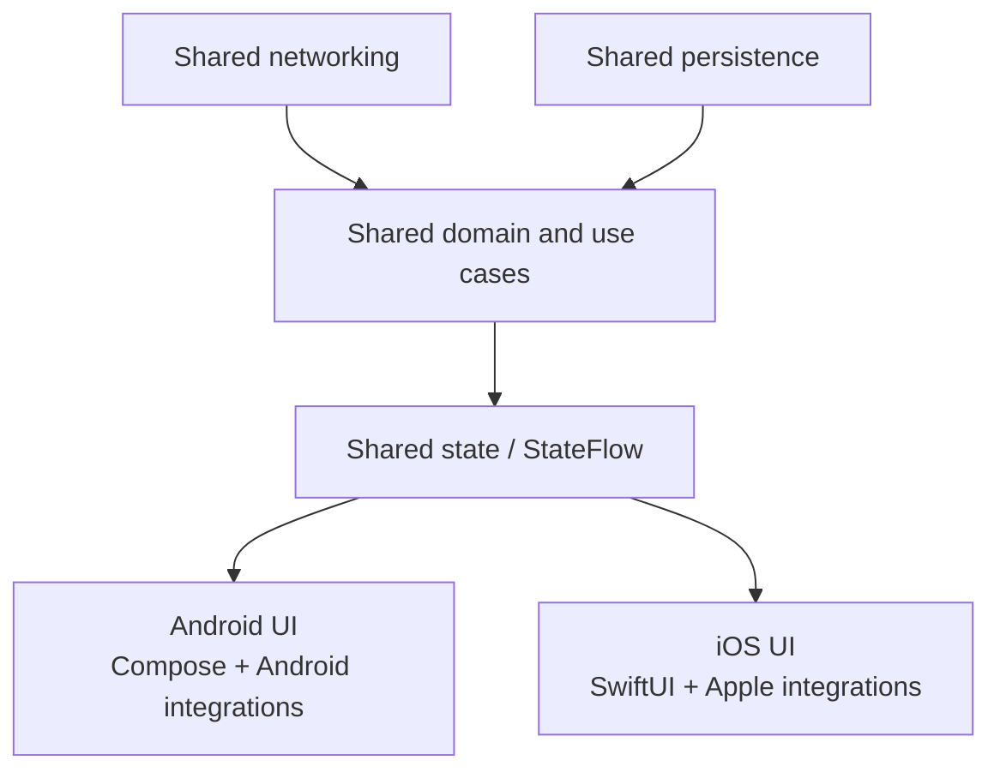
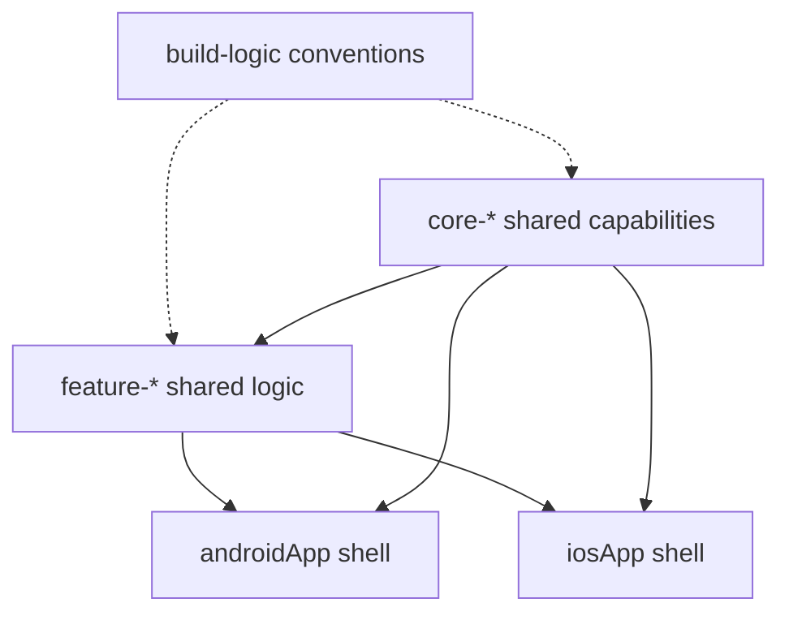

# KMP Architecture & Module Boundaries

> The single most impactful architectural decision in a KMP project is where you draw the line between shared code and platform-native code. Get this wrong, and you either end up with a "lowest common denominator" app that feels alien on iOS, or a thin shared layer that doesn't save enough effort to justify the KMP tooling overhead. This file teaches you how to evaluate that boundary with Staff-level rigor.

---

## Overview

There are two fundamentally different KMP paradigms. Every team must choose one (or a hybrid). The choice shapes the entire project structure, the iOS team's workflow, the testing strategy, and the CI cost.

---

## Paradigm A: Shared Business Logic (Logic-Only Sharing)

In this model, KMP is used strictly for the "headless" portion of the app. The UI is fully native on each platform.



Logic-only sharing centralizes contracts and state transitions while each platform retains native UI, navigation, lifecycle, dependency injection, and platform SDK ownership.

### What Gets Shared

| Layer | Shared? | Why |
|---|---|---|
| **Data Models / DTOs** | ✅ Always | `data class User(val id: String, val name: String)` — identical JSON parsing on both platforms |
| **API Client (Ktor)** | ✅ Always | Network calls are pure I/O — no platform dependency |
| **Database (SQLDelight)** | ✅ Usually | Schema + queries are SQL — platform provides the driver |
| **Repository** | ✅ Usually | Orchestrates API + DB with caching logic |
| **Domain / Use Cases** | ✅ Always | Pure business rules — zero platform dependency |
| **ViewModels** | ⚠️ Sometimes | If shared, iOS consumes `StateFlow` via SKIE. If not shared, each platform writes its own ViewModel |
| **Navigation** | ❌ Never | Android uses NavHost, iOS uses NavigationStack — fundamentally different paradigms |
| **UI** | ❌ Never | Compose on Android, SwiftUI on iOS |
| **Hardware (Camera, BLE, NFC)** | ❌ Never | CameraX vs AVCaptureSession — zero overlap |

### Concrete Example: A Checkout Feature (Paradigm A)

**Shared module (`commonMain`):**

```kotlin
// 1. The DTO — shared JSON parsing
@Serializable
data class CartItem(
    val productId: String,
    val name: String,
    val priceInCents: Long,
    val quantity: Int
)

// 2. The API — shared networking
class CheckoutApi(private val client: HttpClient) {
    suspend fun submitOrder(items: List<CartItem>): OrderResult {
        return client.post("api/v1/orders") {
            contentType(ContentType.Application.Json)
            setBody(OrderRequest(items))
        }.body()
    }
    
    suspend fun validatePromo(code: String): PromoResult {
        return client.get("api/v1/promo/$code").body()
    }
}

// 3. The Repository — shared caching + business logic
class CheckoutRepository(
    private val api: CheckoutApi,
    private val cartDb: CartDatabase   // SQLDelight
) {
    suspend fun getCartWithPricing(): CartPricing {
        val localItems = cartDb.cartQueries.selectAll().executeAsList()
        val pricing = api.fetchPricing(localItems.map { it.productId })
        return CartPricing(
            items = localItems,
            subtotalCents = pricing.subtotal,
            taxCents = pricing.tax,
            totalCents = pricing.total
        )
    }
}

// 4. The ViewModel — shared state machine
class CheckoutViewModel(
    private val repository: CheckoutRepository
) {
    private val _state = MutableStateFlow(CheckoutState())
    val state: StateFlow<CheckoutState> = _state.asStateFlow()

    fun onApplyPromo(code: String) {
        viewModelScope.launch {
            _state.update { it.copy(isApplyingPromo = true) }
            val result = repository.validatePromo(code)
            _state.update { current ->
                when (result) {
                    is PromoResult.Valid -> current.copy(
                        isApplyingPromo = false,
                        discount = result.discountCents,
                        promoCode = code
                    )
                    is PromoResult.Invalid -> current.copy(
                        isApplyingPromo = false,
                        error = "Invalid promo code"
                    )
                }
            }
        }
    }
}

data class CheckoutState(
    val items: List<CartItem> = emptyList(),
    val subtotalCents: Long = 0,
    val taxCents: Long = 0,
    val discount: Long = 0,
    val promoCode: String? = null,
    val isApplyingPromo: Boolean = false,
    val error: String? = null
) {
    val totalCents: Long get() = subtotalCents + taxCents - discount
}
```

**Android consumer (`androidApp`):**

```kotlin
@Composable
fun CheckoutScreen(viewModel: CheckoutViewModel = koinViewModel()) {
    val state by viewModel.state.collectAsStateWithLifecycle()
    
    Column(modifier = Modifier.padding(16.dp)) {
        LazyColumn {
            items(state.items) { item ->
                CartItemRow(item)
            }
        }
        PromoCodeField(
            isLoading = state.isApplyingPromo,
            onApply = viewModel::onApplyPromo
        )
        OrderSummary(
            subtotal = state.subtotalCents,
            tax = state.taxCents,
            discount = state.discount,
            total = state.totalCents
        )
    }
}
```

**iOS consumer (`iosApp` — SwiftUI, using SKIE):**

```swift
struct CheckoutScreen: View {
    @StateObject private var observer = CheckoutViewModelObserver()
    
    var body: some View {
        VStack {
            List(observer.state.items, id: \.productId) { item in
                CartItemRow(item: item)
            }
            PromoCodeField(
                isLoading: observer.state.isApplyingPromo,
                onApply: { code in observer.viewModel.onApplyPromo(code: code) }
            )
            OrderSummary(
                subtotal: observer.state.subtotalCents,
                tax: observer.state.taxCents,
                discount: observer.state.discount,
                total: observer.state.totalCents
            )
        }
    }
}

// SKIE makes this trivial — StateFlow becomes AsyncSequence
@MainActor
class CheckoutViewModelObserver: ObservableObject {
    let viewModel = ViewModelProviders.shared.getCheckoutViewModel()
    @Published var state = CheckoutState.companion.default
    
    init() {
        Task {
            for await newState in viewModel.state {
                self.state = newState
            }
        }
    }
}
```

---

## Paradigm B: Shared UI (Compose Multiplatform)

In this model, you share the entire UI using Compose Multiplatform (CMP). See [`compose-multiplatform.md`](../ui-sharing/compose-multiplatform.md) for the deep dive on how CMP renders via Skia on iOS.

### When to Use Paradigm B

| Factor | Paradigm A (Logic Only) | Paradigm B (Shared UI) |
|---|---|---|
| **iOS team expertise** | iOS team writes SwiftUI | iOS team willing to learn Compose |
| **App type** | Consumer-facing (brand-critical) | Internal tools, B2B, dashboards |
| **Platform fidelity** | Must feel 100% native iOS | 95% native feel is acceptable |
| **Development velocity** | 2 UI codebases to maintain | 1 UI codebase |
| **Binary size** | Shared framework ~2-5 MB | Shared framework ~10-15 MB (Skia included) |
| **Accessibility** | Native UIKit VoiceOver | CMP accessibility bridge (improving) |

> **Staff Recommendation:** For any app with >1M users on iOS, start with **Paradigm A**. The risk of iOS users detecting non-native scrolling physics or accessibility regressions is too high. For internal tooling, admin panels, and B2B apps, **Paradigm B** can cut development time by 40%.

---

## The Boundary Pattern: Inversion of Control

Regardless of paradigm, you will encounter features that require platform-specific APIs (GPS, camera, Bluetooth, biometrics). The boundary must use **Inversion of Control** — the shared code defines *what* it needs; the platform provides *how*.

### The Full Pattern (GPS Example)

**Step 1: Define the contract in `commonMain`**

```kotlin
// shared/src/commonMain/kotlin/com/example/location/LocationService.kt

data class Coordinates(val latitude: Double, val longitude: Double)

sealed interface LocationResult {
    data class Success(val coordinates: Coordinates) : LocationResult
    data class PermissionDenied(val isPermanent: Boolean) : LocationResult
    data class Error(val message: String) : LocationResult
}

/**
 * Abstraction over platform-specific location providers.
 * Android: FusedLocationProviderClient
 * iOS: CLLocationManager
 */
interface LocationService {
    /** One-shot location fetch. Suspends until location is available or error occurs. */
    suspend fun getCurrentLocation(): LocationResult
    
    /** Continuous location tracking as a Flow. */
    fun trackLocation(intervalMs: Long): Flow<LocationResult>
}
```

**Step 2: Consume it in the shared ViewModel**

```kotlin
// shared/src/commonMain/kotlin/com/example/weather/WeatherViewModel.kt

class WeatherViewModel(
    private val locationService: LocationService,
    private val weatherApi: WeatherApi
) {
    private val _state = MutableStateFlow(WeatherState())
    val state: StateFlow<WeatherState> = _state.asStateFlow()

    fun onRefresh() {
        viewModelScope.launch {
            _state.update { it.copy(isLoading = true) }
            
            when (val location = locationService.getCurrentLocation()) {
                is LocationResult.Success -> {
                    val weather = weatherApi.getWeather(
                        lat = location.coordinates.latitude,
                        lng = location.coordinates.longitude
                    )
                    _state.update { it.copy(isLoading = false, weather = weather) }
                }
                is LocationResult.PermissionDenied -> {
                    _state.update { it.copy(
                        isLoading = false,
                        error = if (location.isPermanent) 
                            "Open Settings to grant location permission" 
                        else 
                            "Location permission required"
                    )}
                }
                is LocationResult.Error -> {
                    _state.update { it.copy(isLoading = false, error = location.message) }
                }
            }
        }
    }
}
```

**Step 3: Implement on Android**

```kotlin
// androidApp/src/main/kotlin/com/example/location/AndroidLocationService.kt

class AndroidLocationService(
    private val context: Context
) : LocationService {

    private val fusedClient = LocationServices.getFusedLocationProviderClient(context)

    @SuppressLint("MissingPermission")
    override suspend fun getCurrentLocation(): LocationResult {
        return try {
            val location = fusedClient.getCurrentLocation(
                Priority.PRIORITY_HIGH_ACCURACY,
                CancellationTokenSource().token
            ).await()
            
            if (location != null) {
                LocationResult.Success(Coordinates(location.latitude, location.longitude))
            } else {
                LocationResult.Error("Location unavailable")
            }
        } catch (e: SecurityException) {
            LocationResult.PermissionDenied(isPermanent = false)
        }
    }

    @SuppressLint("MissingPermission")
    override fun trackLocation(intervalMs: Long): Flow<LocationResult> = callbackFlow {
        val request = LocationRequest.Builder(intervalMs)
            .setPriority(Priority.PRIORITY_HIGH_ACCURACY)
            .build()
            
        val callback = object : LocationCallback() {
            override fun onLocationResult(result: LocationResult) {
                result.lastLocation?.let { loc ->
                    trySend(LocationResult.Success(Coordinates(loc.latitude, loc.longitude)))
                }
            }
        }
        
        fusedClient.requestLocationUpdates(request, callback, Looper.getMainLooper())
        awaitClose { fusedClient.removeLocationUpdates(callback) }
    }
}
```

**Step 4: Implement on iOS (Kotlin code in `iosMain`)**

```kotlin
// shared/src/iosMain/kotlin/com/example/location/IOSLocationService.kt

class IOSLocationService : LocationService {
    
    override suspend fun getCurrentLocation(): LocationResult = suspendCancellableCoroutine { cont ->
        val manager = CLLocationManager()
        val delegate = object : NSObject(), CLLocationManagerDelegateProtocol {
            override fun locationManager(manager: CLLocationManager, didUpdateLocations: List<*>) {
                val location = didUpdateLocations.lastOrNull() as? CLLocation
                if (location != null && cont.isActive) {
                    cont.resume(LocationResult.Success(
                        Coordinates(location.coordinate.latitude, location.coordinate.longitude)
                    ))
                }
                manager.stopUpdatingLocation()
            }
            
            override fun locationManager(manager: CLLocationManager, didFailWithError: NSError) {
                if (cont.isActive) {
                    cont.resume(LocationResult.Error(didFailWithError.localizedDescription))
                }
            }
        }
        
        manager.delegate = delegate
        manager.requestWhenInUseAuthorization()
        manager.startUpdatingLocation()
        
        cont.invokeOnCancellation { manager.stopUpdatingLocation() }
    }

    override fun trackLocation(intervalMs: Long): Flow<LocationResult> = callbackFlow {
        // CLLocationManager continuous tracking implementation
        // Similar to above but doesn't stop after first result
        awaitClose { /* cleanup */ }
    }
}
```

**Step 5: Wire via Koin DI**

```kotlin
// shared/src/androidMain/kotlin/di/PlatformModule.kt
actual fun platformModule() = module {
    single<LocationService> { AndroidLocationService(get()) }
}

// shared/src/iosMain/kotlin/di/PlatformModule.kt
actual fun platformModule() = module {
    single<LocationService> { IOSLocationService() }
}
```

---

## Multi-Module KMP Project Structure

A Staff-level KMP project does not use a single monolithic `shared` module. It mirrors the modularization strategies from pure Android projects.



Shared feature modules depend on reusable core capabilities, and platform apps remain composition roots; platform shells must not become dependencies of shared code.

### Why Multi-Module Matters for Build Time

In a monolithic `shared` module, changing one file in `commonMain` triggers recompilation of the entire module for all targets. In a multi-module project:

- Changing `feature-auth` only recompiles `feature-auth` for all targets.
- `core-network`, `core-database`, `feature-checkout`, etc. are cached and skipped.
- Gradle's parallel task execution can compile `feature-auth:compileKotlinIosArm64` and `feature-checkout:compileKotlinAndroid` simultaneously.

**Concrete impact:** A 300-file monolithic `shared` module takes ~40s to incrementally build. The same code split into 8 modules takes ~12s because only the changed module is recompiled.

---

## Common Pitfalls

### 1. The Android ViewModel Trap
If you put your ViewModels in `commonMain`, you cannot extend `androidx.lifecycle.ViewModel`. You must either:
- Write your own `CoroutineScope` lifecycle management (risky).
- Use a KMP ViewModel library like **moko-mvvm** or **KMPViewModel** that wraps `CoroutineScope` on iOS and delegates to `androidx.lifecycle.ViewModel` on Android.

### 2. The "Share Everything" Fallacy
Teams that try to share navigation, hardware APIs, or deep OS integrations in `commonMain` always regret it. The maintenance cost of `expect/actual` for complex platform APIs (like Bluetooth scanning) exceeds the cost of just writing it twice natively.

### 3. The iOS Engineer Alienation
If you force iOS engineers to write their UI in Kotlin (Paradigm B) without their consent, they will leave the team. KMP adoption must be a collaborative decision.

---

## Probing Questions

1.  **Boundary Decision:** Your team is building a ride-hailing app. The map view requires Google Maps on Android and MapKit on iOS. The real-time driver location updates use WebSockets. Where exactly do you draw the KMP boundary — does the WebSocket connection live in `commonMain` or in native code?
2.  **Paradigm Selection:** You are tasked with building a company-internal expense reporting tool used by 500 employees. It has forms, camera receipt capture, and approval workflows. Would you choose Paradigm A or B? What factors would change your answer?
3.  **Inversion of Control:** Why is it better to define `interface LocationService` in `commonMain` rather than `expect class LocationService`? What happens when you need to add a `wasmJsMain` target later?
4.  **Module Boundaries:** In the multi-module structure above, `feature-auth` needs to call `core-network` and `core-database`. How do you prevent `feature-auth` from directly depending on `feature-checkout`? How does this mirror Android's `:feature:api` / `:feature:impl` pattern?
5.  **ViewModel Lifecycle:** If a shared ViewModel launches a coroutine in `viewModelScope`, who cancels that scope when the iOS SwiftUI view disappears? How is this different from Android's `onCleared()`?

## Further Reading

- [`overview-and-k1-vs-k2.md`](overview-and-k1-vs-k2.md) — The compiler targets that make this architecture possible.
- [`swift-interop.md`](../tooling/swift-interop.md) — How the iOS SwiftUI consumer actually observes `StateFlow` from the shared ViewModel.
- [`dependency-injection.md`](../ecosystem/dependency-injection.md) — How Koin wires the `LocationService` implementations across the boundary.
- [`compose-multiplatform.md`](../ui-sharing/compose-multiplatform.md) — Deep dive into Paradigm B (Shared UI via CMP).
- [`../architecture/modularization-strategies.md`](../../architecture/modularization-strategies.md) — The Android modularization principles that directly apply to KMP modules.
