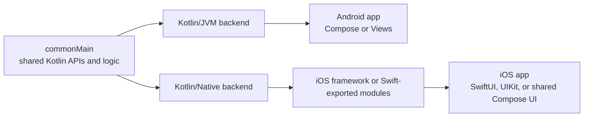
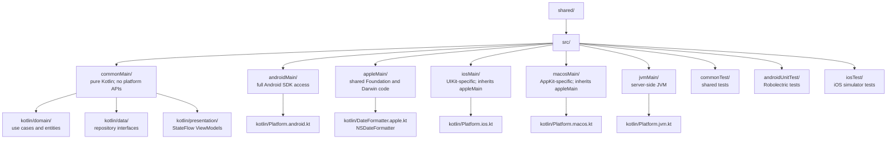

# Kotlin Multiplatform: Overview & The K2 Compiler

> Kotlin Multiplatform (KMP) lets a project share Kotlin code while compiling each target with its appropriate backend: JVM bytecode for Android, native binaries for iOS, and JavaScript or WebAssembly for web targets. Understanding compiler targets, source-set visibility, `expect`/`actual`, and K2 is the foundation of every other KMP topic.

---

## Overview

Kotlin is not "an Android language." It is a **frontend language with pluggable backend targets**. When you write a `.kt` file, the Kotlin compiler frontend parses it into an intermediate representation. Then a *backend* translates that IR into a platform-specific output:

| Backend | Output | Runtime | Use Case |
|---|---|---|---|
| Kotlin/JVM | `.class` bytecode in `.jar` | JVM (Android ART, server JVMs) | Android apps, Spring servers |
| Kotlin/Native | LLVM-based native binary | Kotlin/Native runtime and garbage collector; no JVM | iOS, macOS, Linux, Windows |
| Kotlin/JS | JavaScript source | Browser V8 / Node.js | Web frontends |
| Kotlin/Wasm | WebAssembly binary | Browser or WASI runtime | Web and WASI targets; verify current target stability |

When you write KMP code in `commonMain`, the compiler validates it against common Kotlin APIs and the multiplatform dependencies declared for that source set — no `java.io.File`, `android.content.Context`, or `platform.Foundation.NSURL`. Those APIs belong in compatible platform-specific source sets.

### KMP's Architectural Choice

KMP is primarily a **code-sharing tool**, not a prescribed UI stack. A team can share domain/data code and keep Compose on Android plus SwiftUI on iOS, or also share UI with Compose Multiplatform.



For iOS, Kotlin/Native produces native code plus the Kotlin/Native runtime. Swift normally consumes that code through the default Objective-C export path; Kotlin 2.4 also offers an **Alpha** Swift export path. Calls do cross a language interoperability boundary, even though they do not require a JavaScript/JSON bridge. Treat generated Swift API shape, ownership, exceptions, and concurrency as architecture concerns rather than claiming interop is cost-free.

---

## The `expect` / `actual` Mechanism

KMP's core language-level tool for platform abstraction is `expect`/`actual`. During compilation, the compiler verifies that each target can find a matching `actual` declaration through its source-set hierarchy and links uses of the expected API to that target implementation.

### The Problem It Solves

You need a UUID in `commonMain`. You cannot use `java.util.UUID` (JVM-only) or `platform.Foundation.NSUUID` (iOS-only). You need a compile-time guarantee that every platform *will* provide an implementation.

### Step 1: The Contract (`commonMain`)

```kotlin
// shared/src/commonMain/kotlin/com/example/Platform.kt
package com.example

/**
 * Platform-specific metadata. Every target MUST provide an [actual] implementation.
 * If any target is missing an [actual], the project will not compile.
 */
expect class Platform() {
    val osName: String
    val osVersion: String
    fun generateUUID(): String
}

// You can also expect top-level functions and properties:
expect fun currentTimeMillis(): Long
```

### Step 2: The Android Implementation (`androidMain`)

```kotlin
// shared/src/androidMain/kotlin/com/example/Platform.android.kt
package com.example

import android.os.Build
import java.util.UUID

actual class Platform actual constructor() {
    actual val osName: String = "Android ${Build.VERSION.SDK_INT}"
    actual val osVersion: String = Build.VERSION.RELEASE

    actual fun generateUUID(): String = UUID.randomUUID().toString()
}

actual fun currentTimeMillis(): Long = System.currentTimeMillis()
```

### Step 3: The iOS Implementation (`iosMain`)

```kotlin
// shared/src/iosMain/kotlin/com/example/Platform.ios.kt
package com.example

import platform.UIKit.UIDevice
import platform.Foundation.NSUUID
import platform.Foundation.NSDate
import platform.Foundation.timeIntervalSince1970

actual class Platform actual constructor() {
    actual val osName: String = UIDevice.currentDevice.systemName
    actual val osVersion: String = UIDevice.currentDevice.systemVersion

    actual fun generateUUID(): String = NSUUID().UUIDString()
}

actual fun currentTimeMillis(): Long =
    (NSDate().timeIntervalSince1970 * 1000).toLong()
```

### What You Can `expect`

| Declaration | Example | Notes |
|---|---|---|
| `expect class` | `expect class Platform()` | Must match the expected API; expected classes are Beta and warn unless `-Xexpect-actual-classes` is configured |
| `expect fun` | `expect fun log(msg: String)` | Top-level function |
| `expect val` / `var` | `expect val isDebug: Boolean` | Top-level property |
| `expect object` | `expect object Analytics` | Singleton |
| `expect annotation` | `expect annotation class Parcelize()` | Used for Android Parcelable |
| `expect interface` | `expect interface PlatformApi` | Valid, though a regular interface may be easier to fake and inject |

### When `expect`/`actual` Is Wrong

`expect`/`actual` is a **compile-time** mechanism — every target must find a compatible `actual` declaration in its source-set hierarchy, or the build fails. That guarantee is useful, but a large platform surface can become expensive to evolve:

```kotlin
// BAD: You just created a maintenance burden for every new target
expect class DatabaseDriver()          // Now you MUST write actuals for JVM, iOS, JS, Wasm...
expect class HttpEngine()              // Same problem
expect class AnalyticsTracker()        // Same problem
expect class CrashReporter()           // 50 expect classes = unmaintainable
```

Choose based on the contract, not a universal rule:

- `expect`/`actual` fits declarations that are inherently platform-defined and for which every target must provide an implementation.
- A regular interface fits behavior that needs multiple implementations, runtime selection, easy fakes, or constructor injection.
- A multiplatform library is often better than maintaining either abstraction yourself.

Dependency injection does not require Koin; manual composition roots and other KMP-capable DI tools are also valid.

```kotlin
// Interface in commonMain, implementation supplied by each app's composition root
interface DatabaseDriver {
    fun execute(sql: String)
}

// In androidMain: class AndroidDriver(context: Context) : DatabaseDriver { ... }
// In iosMain:     class IOSDriver : DatabaseDriver { ... }
// At the Android composition root: DatabaseRepository(AndroidDriver(context))
```

The semantic difference matters:
- `expect`/`actual` = **compile-time polymorphism**, enforced by the compiler.
- `interface` + DI = **runtime polymorphism**, enforced by the DI graph.

---

## The K2 Compiler Revolution

K2 is a rewrite of the Kotlin compiler frontend and has been enabled by default since Kotlin 2.0. Its frontend uses a unified semantic representation (FIR) for analysis, call resolution, and type inference. That architecture improves consistency, IDE analysis, and compiler maintainability and can improve compilation performance.

### K2's FIR Frontend

At a conceptual level, both generations have a frontend that analyzes source and a backend that emits target-specific output. K2 replaces K1's frontend data structures and analysis architecture with FIR:

```text
K1: source → K1 frontend analysis → Kotlin IR → target backend
K2: source → FIR analysis → Kotlin IR → target backend
```

Do not translate that diagram into “`commonMain` is analyzed exactly once regardless of target.” Gradle still creates target compilations, source-set visibility differs by compilation, and each backend still has target work. Measure a real repository with Kotlin build reports rather than promising a universal speedup. During migration, review the [documented K2 behavior changes](https://kotlinlang.org/docs/k2-compiler-migration-guide.html), KSP/compiler-plugin compatibility, and newly surfaced diagnostics.

### K2 and Swift Export

Before Swift export, generated Apple frameworks exposed Kotlin to Swift indirectly through Objective-C headers. That mapping cannot express every Kotlin or Swift feature: for example, sealed hierarchies are not exhaustive Swift enums, Objective-C generics lose information, and suspending/Flow APIs need careful lifecycle integration.

K2's architecture enables Kotlin's newer **Swift export** pipeline. In Kotlin 2.4, Swift export is Alpha. Instead of exposing Kotlin only through Objective-C headers, the compiler can generate Swift-facing modules with cleaner package/module structure and better Swift concurrency interop.

What it improves today:

- Kotlin packages and modules can map more cleanly to Swift modules.
- Kotlin type aliases can be preserved.
- Nullable primitive types map more naturally.
- Overloads are easier to call from Swift.
- `suspend fun` exports as Swift `async`.
- `kotlinx.coroutines` Flow exports as Swift `AsyncSequence`.

It is still Alpha and incomplete. Generic type parameters are still erased to upper bounds, cross-language inheritance is unsupported, and teams must review the generated Swift API before treating it as a production contract.

---

## Hierarchical Project Structure

A modern KMP project uses a hierarchy to share code between *similar* platforms without duplicating `actual` implementations.

### The Full Hierarchy



### Why `appleMain` Exists

Without `appleMain`, you would have to duplicate Apple-specific `actual` implementations in both `iosMain` and `macosMain`:

```kotlin
// WITHOUT appleMain — duplicated code in iosMain AND macosMain
actual fun formatDate(epochMillis: Long): String {
    val date = NSDate(timeIntervalSince1970 = epochMillis / 1000.0)
    val formatter = NSDateFormatter()
    formatter.dateFormat = "yyyy-MM-dd"
    return formatter.stringFromDate(date)
}
```

With `appleMain`, you write this `actual` once, and both `iosMain` and `macosMain` inherit it automatically. The Kotlin compiler resolves the hierarchy at compile time — `iosMain` "sees" all declarations from `appleMain` and `commonMain`.

### Custom Intermediate Source Sets

Prefer the [default hierarchy template](https://kotlinlang.org/docs/multiplatform/multiplatform-hierarchy.html), which creates sets such as `appleMain` when the declared targets need them. Create a custom intermediate set only when the template does not express the required target group. Explicit `dependsOn()` edges disable automatic application of the default template, so reapply it before adding custom edges:

```kotlin
// build.gradle.kts
kotlin {
    jvm()
    macosArm64()
    iosArm64()
    iosSimulatorArm64()

    applyDefaultHierarchyTemplate()

    sourceSets {
        // An uncommon group shared by JVM and macOS targets.
        val jvmAndMacosMain by creating {
            dependsOn(commonMain.get())
        }
        jvmMain.get().dependsOn(jvmAndMacosMain)
        macosArm64Main.get().dependsOn(jvmAndMacosMain)
    }
}
```

A source set may use only APIs available to every target to which it compiles. If one target lacks an API, move that code to a narrower source set or define a platform abstraction.

---

## Common Pitfalls

### 1. The "It works on Android" Trap
You run only Android tasks and assume that proves the shared module. A misplaced file, a custom hierarchy, or a target-specific dependency can leave code outside the iOS compilation; the failure then appears only when an Apple target is built.

**Fix:** Run the relevant Android and Apple compilation/tests in CI, including `:shared:iosSimulatorArm64Test` when that is the project's test task. Confirm questionable files in the Gradle source-set graph instead of relying on their apparent folder name.

### 2. Assuming Native Means “No Runtime”
Kotlin/Native produces a native binary, but Kotlin code still relies on a runtime and garbage collector. Object lifetime, Swift/Objective-C interop, freezing advice from old Kotlin/Native material, and binary size therefore deserve explicit validation against the Kotlin version in use.

**Fix:** Treat the current Kotlin/Native memory-management documentation and measurements from the app as the source of truth; do not infer Swift semantics merely because both toolchains emit native code.

### 3. Assuming Every Coroutine API Has Identical Target Semantics
A declaration being available in `commonMain` does not prove that its scheduling, parallelism, or integration with a platform event loop is identical on every target.

**Fix:** Pin a supported `kotlinx-coroutines` version, consult its API documentation for each target, inject dispatchers when scheduling policy matters, and test cancellation and thread-affinity at platform boundaries.

---

## Probing Questions

1.  **Compiler Architecture:** Walk through what happens when you run `./gradlew :shared:linkReleaseFrameworkIosArm64`. What compiler phases execute, what intermediate representations are produced, and what is the final output artifact?
2.  **`expect`/`actual` vs Interfaces:** You have a `CrashReporter` that sends crashes to Firebase on Android and Sentry on iOS. Should you use `expect class CrashReporter` or `interface CrashReporter` with DI? Justify your answer with concrete tradeoffs (compile-time safety, testability, adding a Wasm target later).
3.  **K2 FIR:** What did K2 replace in the compiler frontend, which benefits does the Kotlin migration guide claim, and why should you still measure each target compilation instead of assuming `commonMain` is analyzed exactly once?
4.  **Hierarchical Source Sets:** Your project supports iOS, macOS, and tvOS. You need to call `AVFoundation` APIs that exist on all three Apple platforms. Where do you put the code — in `iosMain`, `appleMain`, or a custom source set? What happens if `tvOS` doesn't support a specific `AVFoundation` API that the other two do?
5.  **The "It works on Android" trap:** A formatting helper uses `String.format("%.2f", price)` and works in the Android app. Should it compile in a correctly configured `commonMain` source set? If the iOS build never saw it, what source-set or dependency mistake would you investigate?

## Answer Key

1. Gradle selects the `iosArm64` compilation and its dependency/source-set hierarchy. The K2 frontend parses and semantically analyzes the applicable Kotlin sources into FIR, Kotlin lowers the result to its backend IR, and Kotlin/Native uses LLVM-based tooling to produce and link a release framework for arm64. The final consumable artifact for that task is an Apple framework; packaging multiple architectures into an XCFramework is a separate task. Exact internal phases and task names vary by Kotlin Gradle plugin version, so inspect the build report rather than memorizing an implementation detail.
2. Prefer a `CrashReporter` interface in `commonMain` with injected Firebase and Sentry adapters. It is easy to fake, permits multiple/no-op implementations, and adding Wasm does not create a mandatory `actual` declaration. `expect`/`actual` would add a useful compile-time guarantee that every target supplies one implementation, but it couples the declaration to the target hierarchy and is less flexible for tests or runtime selection. Neither choice mandates a DI framework.
3. K2 replaced the K1 frontend with FIR, a unified semantic representation used for analysis, call resolution, and type inference. JetBrains documents more consistent analysis, easier compiler evolution, potential compile-time improvements, and better IDE behavior. That does not collapse a multiplatform Gradle build into one compilation: target compilations have different visible APIs and backends. Compare clean and incremental Kotlin build reports on the repository's actual target matrix.
4. Start with the default hierarchy template's `appleMain` when the API is available to every Apple target in that source set. If the particular AVFoundation declaration is unavailable on tvOS, it cannot live in a set compiled for tvOS. Put it in a narrower existing set, define a custom set for only the supporting targets (while deliberately preserving/replacing the default hierarchy), or hide the difference behind an abstraction with a tvOS implementation.
5. It should not compile in a correctly configured `commonMain`: `String.format` is a JVM `java.lang.String` API, not a common Kotlin API. If Android succeeds and iOS never reports the import, verify that the file is actually under `commonMain`, participates in the iOS compilation, and does not depend on a JVM-only source set or library. Use a multiplatform formatting API or inject platform formatting where locale behavior matters.

## Further Reading

- [`architecture-and-module-boundaries.md`](architecture-and-module-boundaries.md) — How to decide what goes in `commonMain` vs the native apps.
- [`build-system-and-source-sets.md`](../tooling/build-system-and-source-sets.md) — The Gradle configuration that defines the source set hierarchy.
- [`ios-distribution.md`](../tooling/ios-distribution.md) — How the Kotlin/Native output (the `.xcframework`) is consumed by Xcode.
- [`concurrency-and-memory.md`](../production/concurrency-and-memory.md) — How the JVM GC and the Kotlin/Native GC differ fundamentally.
- [`swift-interop.md`](../tooling/swift-interop.md) — Objective-C bridge limitations and the Kotlin 2.4 Swift export path.
- [K2 compiler migration guide](https://kotlinlang.org/docs/k2-compiler-migration-guide.html) — Official K2 architecture, compatibility, and behavior changes.
- [`expect` and `actual` declarations](https://kotlinlang.org/docs/multiplatform/multiplatform-expect-actual.html) — Supported declaration kinds and matching rules.
- [Hierarchical project structure](https://kotlinlang.org/docs/multiplatform/multiplatform-hierarchy.html) — Default hierarchy template and custom source-set guidance.
- [Swift export](https://kotlinlang.org/docs/native-swift-export.html) — Current status, supported mappings, and limitations.
