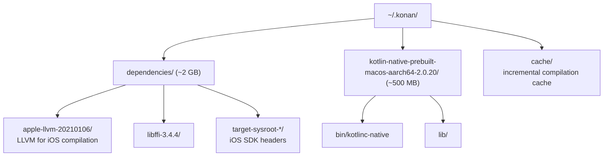

# CI/CD for Kotlin Multiplatform

> A standard Android CI pipeline uses a cheap Ubuntu Linux runner. KMP fundamentally changes this: Kotlin/Native *cannot compile for iOS on Linux*. It requires macOS with Xcode installed. macOS GitHub Action runners cost 10x more than Linux. A Staff engineer must architect a split CI pipeline that runs cheap JVM checks on Linux for every PR, reserves expensive macOS builds for merge-to-main, and automates the `.xcframework` publishing to Swift Package Manager.

---

## Overview

The fundamental constraint:

> **The Apple toolchain (LLVM for iOS, `xcrun`, the iOS Simulator) only runs on macOS. You cannot compile Kotlin/Native iOS targets on Linux or Windows.**

This means any CI step that touches iOS — compiling the `.xcframework`, running `iosSimulatorArm64Test`, signing the framework — must run on a macOS runner.

---

## 1. The Split Pipeline Architecture

### Pipeline A: PR Checks (Fast & Cheap)

Every Pull Request runs these checks to catch regressions before review:

```yaml
# .github/workflows/pr-check.yml

name: PR Check
on: [pull_request]

jobs:
  # ──────────────────────────────────────────
  # Job 1: JVM Tests + Lint (Linux — cheap)
  # ──────────────────────────────────────────
  jvm-tests:
    runs-on: ubuntu-latest
    timeout-minutes: 15
    steps:
      - uses: actions/checkout@v4
      
      - name: Set up JDK 17
        uses: actions/setup-java@v4
        with:
          distribution: 'zulu'
          java-version: 17
      
      - name: Setup Gradle
        uses: gradle/actions/setup-gradle@v3
        with:
          cache-read-only: true
      
      - name: Run shared module JVM tests
        run: ./gradlew :shared:testDebugUnitTest
      
      - name: Run Android app lint
        run: ./gradlew :androidApp:lint
      
      - name: Check Kotlin formatting
        run: ./gradlew ktlintCheck

  # ──────────────────────────────────────────
  # Job 2: iOS Native Tests (macOS — expensive)
  # Only runs if commonMain or iosMain changed
  # ──────────────────────────────────────────
  ios-tests:
    runs-on: macos-14  # Apple Silicon runner (M1)
    timeout-minutes: 30
    # Only run if shared code changed (save $$$)
    if: |
      contains(github.event.pull_request.labels.*.name, 'ios-test') ||
      github.event.pull_request.changed_files > 0
    steps:
      - uses: actions/checkout@v4
      
      - name: Set up JDK 17
        uses: actions/setup-java@v4
        with:
          distribution: 'zulu'
          java-version: 17
      
      # Cache the massive Kotlin/Native compiler toolchain
      - name: Cache Kotlin/Native compiler
        uses: actions/cache@v4
        with:
          path: ~/.konan
          key: konan-${{ runner.os }}-${{ hashFiles('**/*.gradle.kts', 'gradle/libs.versions.toml') }}
          restore-keys: konan-${{ runner.os }}-
      
      - name: Setup Gradle
        uses: gradle/actions/setup-gradle@v3
      
      - name: Run iOS Simulator tests
        run: ./gradlew :shared:iosSimulatorArm64Test
      
      - name: Upload test report
        if: failure()
        uses: actions/upload-artifact@v4
        with:
          name: ios-test-report
          path: shared/build/reports/tests/iosSimulatorArm64Test/
```

### Pipeline B: Release Build (Merge to Main)

When code merges to `main`, build the XCFramework and publish it:

```yaml
# .github/workflows/release.yml

name: Release
on:
  push:
    branches: [main]

jobs:
  publish-framework:
    runs-on: macos-14
    timeout-minutes: 45
    steps:
      - uses: actions/checkout@v4
      
      - name: Set up JDK 17
        uses: actions/setup-java@v4
        with:
          distribution: 'zulu'
          java-version: 17
      
      - name: Cache Kotlin/Native
        uses: actions/cache@v4
        with:
          path: ~/.konan
          key: konan-${{ runner.os }}-${{ hashFiles('**/*.gradle.kts', 'gradle/libs.versions.toml') }}
      
      - name: Setup Gradle
        uses: gradle/actions/setup-gradle@v3
      
      # Step 1: Build the XCFramework
      - name: Build XCFramework
        run: ./gradlew :shared:assembleSharedCodeReleaseXCFramework
      
      # Step 2: Zip it
      - name: Package XCFramework
        run: |
          cd shared/build/XCFrameworks/release/
          zip -r SharedCode.xcframework.zip SharedCode.xcframework
          echo "CHECKSUM=$(shasum -a 256 SharedCode.xcframework.zip | awk '{print $1}')" >> $GITHUB_ENV
      
      # Step 3: Create GitHub Release with the zip
      - name: Create Release
        uses: softprops/action-gh-release@v1
        with:
          tag_name: v${{ github.run_number }}
          files: shared/build/XCFrameworks/release/SharedCode.xcframework.zip
        env:
          GITHUB_TOKEN: ${{ secrets.GITHUB_TOKEN }}
      
      # Step 4: Update the Package.swift in the SPM repo
      - name: Update SPM Package
        run: |
          git clone https://x-access-token:${{ secrets.SPM_REPO_TOKEN }}@github.com/your-org/shared-kmp-spm.git spm-repo
          cd spm-repo
          
          cat > Package.swift << EOF
          // swift-tools-version: 5.9
          import PackageDescription
          let package = Package(
              name: "SharedCode",
              platforms: [.iOS(.v15)],
              products: [.library(name: "SharedCode", targets: ["SharedCode"])],
              targets: [
                  .binaryTarget(
                      name: "SharedCode",
                      url: "https://github.com/your-org/shared-kmp/releases/download/v${{ github.run_number }}/SharedCode.xcframework.zip",
                      checksum: "${{ env.CHECKSUM }}"
                  )
              ]
          )
          EOF
          
          git add Package.swift
          git commit -m "Update SharedCode to v${{ github.run_number }}"
          git push
```

---

## 2. Cost Analysis

### GitHub Actions Pricing (2024)

| Runner Type | Per-Minute Cost | Typical KMP Use |
|---|---|---|
| `ubuntu-latest` | $0.008 | JVM tests, lint, formatting |
| `macos-14` (M1) | $0.08 | iOS compilation, simulator tests |
| `macos-13` (Intel) | $0.08 | Legacy, avoid if possible |

### Cost Scenario: 50 PR Commits/Day

| Strategy | Daily Cost | Monthly Cost |
|---|---|---|
| **Naive:** Run everything on macOS for every commit | 50 × 15min × $0.08 = **$60/day** | **$1,800/month** |
| **Split:** JVM on Linux + iOS only on merge | (50 × 5min × $0.008) + (5 × 15min × $0.08) = **$8/day** | **$240/month** |
| **Smart Split:** JVM on Linux + iOS only when shared code changes | Even lower — iOS tests skip for pure Android/UI changes | **~$120/month** |

> **The split pipeline saves ~$1,500/month.** This is not a premature optimization — it's a mandatory architectural decision.

---

## 3. Caching the Kotlin/Native Compiler (`.konan`)

The Kotlin/Native compiler toolchain is stored in `~/.konan`. On a fresh macOS runner, the first build downloads:



**Without caching:** First build downloads ~2.5 GB, taking 5-10 minutes just for setup.
**With caching:** Subsequent builds skip the download entirely, saving 5-10 minutes per run.

```yaml
- name: Cache Kotlin/Native compiler
  uses: actions/cache@v4
  with:
    path: ~/.konan
    key: konan-${{ runner.os }}-${{ hashFiles('**/*.gradle.kts', 'gradle/libs.versions.toml') }}
    restore-keys: |
      konan-${{ runner.os }}-
```

**Cache invalidation:** The cache key includes the hash of all `build.gradle.kts` files and `libs.versions.toml`. When you upgrade Kotlin (e.g., from 2.0.10 to 2.0.20), the key changes and a fresh download occurs.

---

## 4. Gradle Build Cache for KMP

Beyond caching the compiler, you should cache **compilation outputs** (the actual `.klib` and `.o` files):

```yaml
- name: Setup Gradle
  uses: gradle/actions/setup-gradle@v3
  with:
    cache-read-only: ${{ github.ref != 'refs/heads/main' }}
```

**`cache-read-only: true` on PRs:** PR builds read from the cache populated by `main` builds but don't write to it. This prevents cache pollution from feature branches while still benefiting from cached dependencies.

### Local Build Cache

For local development, enable the Gradle local build cache in `gradle.properties`:

```properties
org.gradle.caching=true
kotlin.incremental.compilation.enabled=true
kotlin.native.cacheKind.iosX64=static
kotlin.native.cacheKind.iosArm64=static
kotlin.native.cacheKind.iosSimulatorArm64=static
```

The `cacheKind=static` setting tells Kotlin/Native to cache compiled static libraries. On incremental builds, only changed source sets are recompiled.

---

## 5. KMMBridge (Automating the Entire Pipeline)

**KMMBridge** (by Touchlab) is a Gradle plugin that automates Steps 1-4 of the release pipeline (build XCFramework → zip → upload → update Package.swift):

```kotlin
// shared/build.gradle.kts
plugins {
    id("co.touchlab.kmmbridge") version "0.6.1"
}

kmmbridge {
    // Choose artifact hosting
    githubReleaseArtifacts()  // or: s3PublicArtifacts("bucket-name")
    
    // Generate SPM Package.swift
    spm()
    
    // Version strategy
    gitTagVersions()  // or: timestampVersions(), manualVersions("1.2.3")
}
```

**With KMMBridge, the release workflow becomes:**
```yaml
- name: Publish KMP Framework
  run: ./gradlew kmmBridgePublish
  env:
    GITHUB_TOKEN: ${{ secrets.GITHUB_TOKEN }}
```

One command handles XCFramework compilation, zipping, GitHub Release creation, SHA256 computation, and Package.swift update.

---

## 6. Advanced: Conditional iOS CI

To avoid running expensive macOS jobs when only Android code changed:

```yaml
ios-tests:
  runs-on: macos-14
  needs: detect-changes
  if: needs.detect-changes.outputs.shared-changed == 'true'
  # ...

detect-changes:
  runs-on: ubuntu-latest
  outputs:
    shared-changed: ${{ steps.filter.outputs.shared }}
  steps:
    - uses: actions/checkout@v4
    - uses: dorny/paths-filter@v3
      id: filter
      with:
        filters: |
          shared:
            - 'shared/**'
            - 'gradle/**'
            - '*.gradle.kts'
```

This uses `dorny/paths-filter` to detect if files in the `shared/` directory changed. If only `androidApp/` files changed, the iOS test job is skipped entirely.

---

## Common Pitfalls

### 1. Xcode Version Mismatch
macOS runners come with a specific Xcode version. If your `build.gradle.kts` targets iOS 17 features but the runner has Xcode 14 (which only supports iOS 16 SDK), the build fails with cryptic LLVM errors.

**Fix:** Pin the Xcode version:
```yaml
- name: Select Xcode version
  run: sudo xcode-select -s /Applications/Xcode_15.4.app
```

### 2. iOS Simulator Not Booted
If no simulator runtime is installed on the runner, `iosSimulatorArm64Test` fails silently:
```
error: Unable to find a destination matching the provided destination specifier
```

**Fix:** Verify available simulators:
```yaml
- name: List available simulators
  run: xcrun simctl list devices available
```

### 3. Gradle Daemon Memory on macOS
Kotlin/Native compilation is memory-hungry. The default Gradle daemon heap (512MB) is insufficient:

```properties
# gradle.properties
org.gradle.jvmargs=-Xmx4g -XX:+UseParallelGC
```

Without this, you'll see `OutOfMemoryError: Java heap space` during framework linking.

---

## Probing Questions

1.  **Physical Constraint:** Explain at the toolchain level why Kotlin/Native cannot compile an iOS framework on a Linux runner. What specific Apple-proprietary binaries are required?
2.  **Cost Optimization:** Your team opens 40 PRs per day. Each PR averages 3 commits. Currently, every commit triggers a 15-minute macOS build. Propose a CI architecture that reduces macOS runner costs by 80% without sacrificing code quality.
3.  **Cache Invalidation:** You upgrade Kotlin from 2.0.10 to 2.0.20 in `libs.versions.toml`. The `.konan` cache key changes. On the next CI run, what downloads from the Kotlin servers, and how long does it take?
4.  **SPM Checksum:** In the release workflow, `shasum -a 256` computes the SHA256 of the `.xcframework.zip`. If CI computes one checksum but the actual uploaded file has a different checksum (e.g., due to a network corruption during upload), what error does the iOS engineer see in Xcode?
5.  **KMMBridge vs Manual:** What are the tradeoffs between using KMMBridge (a third-party Gradle plugin) versus writing your own CI release script? When would you choose manual over KMMBridge?

## Further Reading

- [`ios-distribution.md`](../tooling/ios-distribution.md) — The three distribution methods (CocoaPods, SPM, Direct Xcode) that CI must support.
- [`testing-and-mocking.md`](testing-and-mocking.md) — The `iosSimulatorArm64Test` task that runs in Pipeline A.
- [`build-system-and-source-sets.md`](../tooling/build-system-and-source-sets.md) — The `framework {}` block configuration that produces the XCFramework.
- [`../../release-engineering/ci-cd-for-mobile.md`](../../../release-engineering/ci-cd-for-mobile.md) — General mobile CI/CD practices (Fastlane, code signing).
