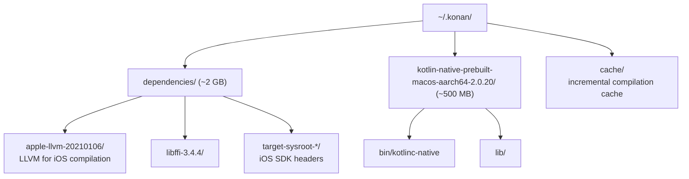

# CI/CD for Kotlin Multiplatform

> Split CI by required evidence: fast host tests can run on Linux, while Apple cinterop, final framework builds and simulator/device tests require macOS/Xcode. Apple-target klib production has broader host support. Run necessary Apple checks before merge; choose cost controls from actual workload measurements.

---

## Overview

The fundamental constraint:

> Apple-target klibs can be produced on other supported hosts; cinterop, CocoaPods integration and final Apple binaries/tests require macOS and the matching Apple toolchain.

Final XCFramework linking and simulator tests require a compatible macOS/Xcode runner; distinguish those jobs from host-portable metadata/klib compilation.

---

## 1. The Split Pipeline Architecture

### Pipeline A: PR Checks (Fast & Cheap)

Every Pull Request runs these checks to catch regressions before review:

```yaml
# .github/workflows/pr-check.yml

name: PR Check
on: [pull_request]

jobs:
  # ──────────────────────────────────────────
  # Job 1: JVM Tests + Lint (Linux — cheap)
  # ──────────────────────────────────────────
  jvm-tests:
    runs-on: ubuntu-latest
    timeout-minutes: 15
    steps:
      - uses: actions/checkout@v4
      
      - name: Set up JDK 17
        uses: actions/setup-java@v4
        with:
          distribution: 'zulu'
          java-version: 17
      
      - name: Setup Gradle
        uses: gradle/actions/setup-gradle@v3
        with:
          cache-read-only: true
      
      - name: Run shared module JVM tests
        run: ./gradlew :shared:jvmTest # this example declares a jvm() target
      
      - name: Run Android app lint
        run: ./gradlew :androidApp:lint
      
      - name: Check Kotlin formatting
        run: ./gradlew ktlintCheck

  # ──────────────────────────────────────────
  # Job 2: iOS Native Tests (macOS — expensive)
  # Required Apple checks run on every PR in this example.
  # ──────────────────────────────────────────
  ios-tests:
    runs-on: macos-15 # pin and verify the matching Xcode image
    timeout-minutes: 30
    # Required pre-merge Apple evidence; cancellation can discard superseded runs.
    steps:
      - uses: actions/checkout@v4
      
      - name: Set up JDK 17
        uses: actions/setup-java@v4
        with:
          distribution: 'zulu'
          java-version: 17
      
      # Cache the massive Kotlin/Native compiler toolchain
      - name: Cache Kotlin/Native compiler
        uses: actions/cache@v4
        with:
          path: ~/.konan
          key: konan-${{ runner.os }}-${{ hashFiles('**/*.gradle.kts', 'gradle/libs.versions.toml') }}
          restore-keys: konan-${{ runner.os }}-
      
      - name: Setup Gradle
        uses: gradle/actions/setup-gradle@v3
      
      - name: Run iOS Simulator tests
        run: ./gradlew :shared:iosSimulatorArm64Test
      
      - name: Upload test report
        if: failure()
        uses: actions/upload-artifact@v4
        with:
          name: ios-test-report
          path: shared/build/reports/tests/iosSimulatorArm64Test/
```

### Pipeline B: Versioned Release Build

After required checks pass, create an approved semantic release tag. The example publishes immutable framework bytes and tags the Swift-package manifest commit with the same semantic version; configure runner/Xcode compatibility and repository authentication for the real project.

```yaml
name: Release Shared Framework
on:
  push:
    tags: ['v*.*.*']
permissions:
  contents: write
jobs:
  release:
    runs-on: macos-15
    steps:
      - uses: actions/checkout@v4
      - uses: actions/setup-java@v4
        with:
          distribution: zulu
          java-version: 17
      - uses: gradle/actions/setup-gradle@v4
      - name: Validate semantic version
        run: '[[ "$GITHUB_REF_NAME" =~ ^v[0-9]+\.[0-9]+\.[0-9]+$ ]]'
      - name: Test Apple target and build release framework
        run: ./gradlew :shared:iosSimulatorArm64Test :shared:assembleSharedCodeReleaseXCFramework
      - name: Package framework
        run: |
          cd shared/build/XCFrameworks/release
          zip -r SharedCode.xcframework.zip SharedCode.xcframework
          echo "CHECKSUM=$(shasum -a 256 SharedCode.xcframework.zip | awk '{print $1}')" >> "$GITHUB_ENV"
      - uses: softprops/action-gh-release@v2
        with:
          tag_name: ${{ github.ref_name }}
          files: shared/build/XCFrameworks/release/SharedCode.xcframework.zip
      - name: Version the Swift package manifest
        env:
          GH_TOKEN: ${{ secrets.SPM_REPO_TOKEN }}
        run: |
          # SPM_REPO_TOKEN needs contents: write on the SPM repository.
          gh auth setup-git # let the plain git push below use GH_TOKEN
          gh repo clone your-org/shared-kmp-spm spm-repo
          cd spm-repo
          cat > Package.swift <<EOF
          // swift-tools-version: 5.9
          import PackageDescription
          let package = Package(
            name: "SharedCode", platforms: [.iOS(.v15)],
            products: [.library(name: "SharedCode", targets: ["SharedCode"])],
            targets: [.binaryTarget(name: "SharedCode",
              url: "https://github.com/your-org/shared-kmp/releases/download/$GITHUB_REF_NAME/SharedCode.xcframework.zip",
              checksum: "$CHECKSUM")])
          EOF
          git config user.name "release-bot"
          git config user.email "release-bot@users.noreply.github.com"
          git add Package.swift
          git commit -m "Release $GITHUB_REF_NAME"
          git tag "$GITHUB_REF_NAME"
          git push origin HEAD "$GITHUB_REF_NAME"
```

---

## 2. Cost Analysis

### GitHub Actions Pricing (2024)

| Runner Type | Per-Minute Cost | Typical KMP Use |
|---|---|---|
| `ubuntu-latest` | $0.008 | JVM tests, lint, formatting |
| `macos-14` (M1) | $0.08 | iOS compilation, simulator tests |
| `macos-13` (Intel) | $0.08 | Legacy, avoid if possible |

### Cost Scenario: 50 PR Commits/Day

| Strategy | Daily Cost | Monthly Cost |
|---|---|---|
| **Naive:** Run everything on macOS for every commit | 50 × 15min × $0.08 = **$60/day** | **$1,800/month** |
| **Split:** JVM on Linux + iOS only on merge | (50 × 5min × $0.008) + (5 × 15min × $0.08) = **$8/day** | **$240/month** |
| **Smart Split:** JVM on Linux + iOS only when shared code changes | Even lower — iOS tests skip for pure Android/UI changes | **~$120/month** |

The table is an illustrative calculation using its stated historical prices and assumed workload, not a measured saving or mandatory architecture. Preserve required Apple checks before merge; measure cancellation, batching and runner choices against the team's actual workload.

---

## 3. Caching the Kotlin/Native Compiler (`.konan`)

The .konan directory contains version/host-specific downloaded toolchains and caches. The following older directory layout and sizes are historical illustrations, not the layout or download time guaranteed by Kotlin 2.4.21.



**Without caching:** The build downloads the components required by its host/compiler/targets. Record actual bytes and duration; the older 2.5GB/5–10-minute example is not a universal setup cost.
**With caching:** Compatible components can be reused. Missing/changed components still download, and exact-key versus prefix restores have different outcomes; measure the resulting build rather than promising a fixed saving.

```yaml
- name: Cache Kotlin/Native compiler
  uses: actions/cache@v4
  with:
    path: ~/.konan
    key: konan-${{ runner.os }}-${{ hashFiles('**/*.gradle.kts', 'gradle/libs.versions.toml') }}
    restore-keys: |
      konan-${{ runner.os }}-
```

Cache key changes cause an exact miss, but a restore-keys prefix can restore an older entry. The toolchain then downloads any missing compatible components; not every version change means a full cold download or a fixed elapsed time.

---

## 4. Gradle Build Cache for KMP

Beyond caching the compiler, you should cache **compilation outputs** (the actual `.klib` and `.o` files):

```yaml
- name: Setup Gradle
  uses: gradle/actions/setup-gradle@v3
  with:
    cache-read-only: ${{ github.ref != 'refs/heads/main' }}
```

**`cache-read-only: true` on PRs:** PR builds read from the cache populated by `main` builds but don't write to it. This prevents cache pollution from feature branches while still benefiting from cached dependencies.

### Local Build Cache

For local development, enable the Gradle local build cache in `gradle.properties`:

```properties
org.gradle.caching=true
kotlin.incremental=true
kotlin.incremental.native=true
kotlin.native.cacheKind.iosX64=static
kotlin.native.cacheKind.iosArm64=static
kotlin.native.cacheKind.iosSimulatorArm64=static
```

Compiler/library caches and incremental compilation are distinct. Use documented kotlin.incremental/kotlin.incremental.native for the supported compiler setup; cacheKind does not promise that only changed source sets compile.

### Remote caching versus Remote Build Execution (RBE)

Develocity provides a **remote build cache**: a Gradle/KMP build can reuse a cacheable task's output when identical inputs have already produced an available entry. It does not move a cache miss or a Kotlin/Native compiler process from Gradle onto a remote macOS worker.

True **Remote Build Execution** requires a build system and execution service that model work as hermetic, remotely executable actions, distribute the required Kotlin/Native toolchain, and provide compatible macOS workers for Apple targets. Bazel can supply that model when the repository has suitable KMP/Kotlin rules and a macOS-capable remote-execution backend, but enabling Bazel or Develocity beside an existing Gradle build is not sufficient. Treat RBE as a separate build-system investment and benchmark it against a well-tuned remote cache before adopting it.

---

## 5. KMMBridge (Automating the Entire Pipeline)

**KMMBridge** (by Touchlab) is a Gradle plugin that automates Steps 1-4 of the release pipeline (build XCFramework → zip → upload → update Package.swift):

```kotlin
// shared/build.gradle.kts
plugins {
    id("co.touchlab.kmmbridge") version "0.6.1"
}

kmmbridge {
    // Choose artifact hosting
    githubReleaseArtifacts()  // or: s3PublicArtifacts("bucket-name")
    
    // Generate SPM Package.swift
    spm()
    
    // Version strategy
    // Use the selected KMMBridge release's current version configuration; project.version supplies the release version.
}
```

**With KMMBridge, the release workflow becomes:**
```yaml
- name: Publish KMP Framework
  run: ./gradlew kmmBridgePublish
  env:
    GITHUB_TOKEN: ${{ secrets.GITHUB_TOKEN }}
```

One command handles XCFramework compilation, zipping, GitHub Release creation, SHA256 computation, and Package.swift update.

---

## 6. Advanced: Conditional iOS CI

To avoid running expensive macOS jobs when only Android code changed:

```yaml
ios-tests:
  runs-on: macos-15
  needs: detect-changes
  if: needs.detect-changes.outputs.shared-changed == 'true'
  # ...

detect-changes:
  runs-on: ubuntu-latest
  outputs:
    shared-changed: ${{ steps.filter.outputs.shared }}
  steps:
    - uses: actions/checkout@v4
    - uses: dorny/paths-filter@v3
      id: filter
      with:
        filters: |
          shared:
            - 'shared/**'
            - 'gradle/**'
            - '*.gradle.kts'
```

This uses `dorny/paths-filter` to detect if files in the `shared/` directory changed. If only `androidApp/` files changed, the iOS test job is skipped entirely.

---

## Common Pitfalls

### 1. Xcode Version Mismatch
macOS runners come with a specific Xcode version. If your `build.gradle.kts` targets iOS 17 features but the runner has Xcode 14 (which only supports iOS 16 SDK), the build fails with cryptic LLVM errors.

**Fix:** Pin the Xcode version:
```yaml
- name: Select Xcode version
  run: xcodebuild -version # verify the runner's documented Xcode image against the pinned Kotlin/SDK requirements
```

### 2. iOS Simulator Not Booted
If no compatible simulator runtime is installed, the test task reports a failure; inspect its diagnostic and the installed runner image rather than calling it silent:
```
error: Unable to find a destination matching the provided destination specifier
```

**Fix:** Verify available simulators:
```yaml
- name: List available simulators
  run: xcrun simctl list devices available
```

### 3. Gradle Daemon Memory on macOS
Kotlin/Native compilation is memory-hungry. The default Gradle daemon heap (512MB) is insufficient:

```properties
# gradle.properties
org.gradle.jvmargs=-Xmx4g -XX:+UseParallelGC
```

Choose heap settings from the workload and runner memory. Insufficient heap can cause OOM, but the error is not universal without this particular setting.

---

## Probing Questions

1.  **Physical Constraint:** Explain at the toolchain level why Kotlin/Native cannot compile an iOS framework on a Linux runner. What specific Apple-proprietary binaries are required?
2.  **Cost Optimization:** Your team opens 40 PRs per day. Each PR averages 3 commits. Currently, every commit triggers a 15-minute macOS build. Propose a CI architecture that reduces macOS runner costs by 80% without sacrificing code quality.
3.  **Cache Invalidation:** You upgrade Kotlin from 2.0.10 to 2.0.20 in `libs.versions.toml`. The `.konan` cache key changes. On the next CI run, what downloads from the Kotlin servers, and how long does it take?
4.  **SPM Checksum:** In the release workflow, `shasum -a 256` computes the SHA256 of the `.xcframework.zip`. If CI computes one checksum but the actual uploaded file has a different checksum (e.g., due to a network corruption during upload), what error does the iOS engineer see in Xcode?
5.  **KMMBridge vs Manual:** What are the tradeoffs between using KMMBridge (a third-party Gradle plugin) versus writing your own CI release script? When would you choose manual over KMMBridge?
## Answer Key

1. Apple-target klibs can be produced on supported non-Apple hosts; final Apple binaries, cinterop/CocoaPods and simulator tests need macOS/Xcode. Gate the target evidence actually required by the change.
2. Cancel superseded runs and use a merge queue or another required pre-merge Apple gate. Path selection must cover shared code, platform code, build logic and dependency changes. The savings depend on actual run distribution; no universal 80% bound follows from a PR count alone.
3. Exact-key misses may restore an older compatible prefix entry. Missing version-specific components are downloaded as needed; bundle layout, sizes and duration vary by Kotlin/host version. Measure the actual cache and download path.
4. Xcode will refuse to resolve the package dependency and display a checksum mismatch error (e.g., "checksum of downloaded artifact does not match"). Swift Package Manager strictly verifies the SHA256 in `Package.swift` against the downloaded binary to prevent supply-chain tampering and corruption.
5. KMMBridge abstracts away SPM packaging, GitHub Releases, zipping, and versioning inside a single Gradle plugin. The tradeoff is adding a third-party dependency (from Touchlab) that dictates the publishing flow and might lag behind major Kotlin tooling bumps. Manual scripting (bash/yaml) provides absolute control over the XCFramework ZIP structure, custom hosting (e.g., private Artifactory/S3), and internal versioning policies.


## Further Reading

- [`ios-distribution.md`](../tooling/ios-distribution.md) — The three distribution methods (CocoaPods, SPM, Direct Xcode) that CI must support.
- [`testing-and-mocking.md`](testing-and-mocking.md) — The `iosSimulatorArm64Test` task that runs in Pipeline A.
- [`build-system-and-source-sets.md`](../tooling/build-system-and-source-sets.md) — The `framework {}` block configuration that produces the XCFramework.
- [`../../release-engineering/ci-cd-for-mobile.md`](../../../release-engineering/ci-cd-for-mobile.md) — General mobile CI/CD practices (Fastlane, code signing).

### Official verification references

- [Primary documentation or owning implementation](https://developer.apple.com/documentation/xcode/distributing-binary-frameworks-as-swift-packages)
- [Primary documentation or owning implementation](https://docs.github.com/en/actions/reference/runners/github-hosted-runners)
- [Primary documentation or owning implementation](https://docs.github.com/en/actions/reference/workflows-and-actions/events-that-trigger-workflows#pull_request)
- [Primary documentation or owning implementation](https://docs.github.com/en/actions/using-jobs/using-concurrency)
- [Primary documentation or owning implementation](https://docs.github.com/en/actions/writing-workflows/choosing-what-your-workflow-does/caching-dependencies-to-speed-up-workflows)
- [Primary documentation or owning implementation](https://docs.github.com/en/billing/reference/actions-runner-pricing)
- [Primary documentation or owning implementation](https://docs.gradle.org/current/userguide/build_environment.html)
- [Primary documentation or owning implementation](https://kmmbridge.touchlab.co/docs/PORTING_0.3.x)
- [Primary documentation or owning implementation](https://kotlinlang.org/docs/multiplatform/multiplatform-publish-lib-setup.html)
- [Primary documentation or owning implementation](https://kotlinlang.org/docs/native-improving-compilation-time.html)
