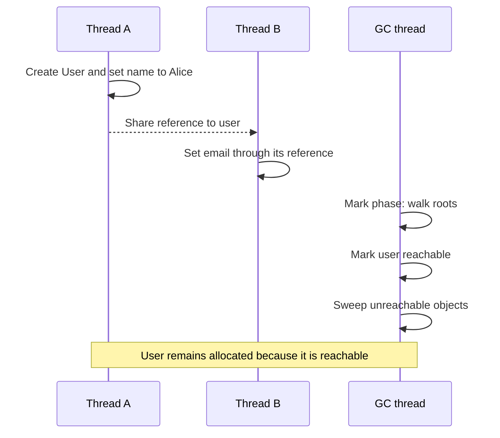
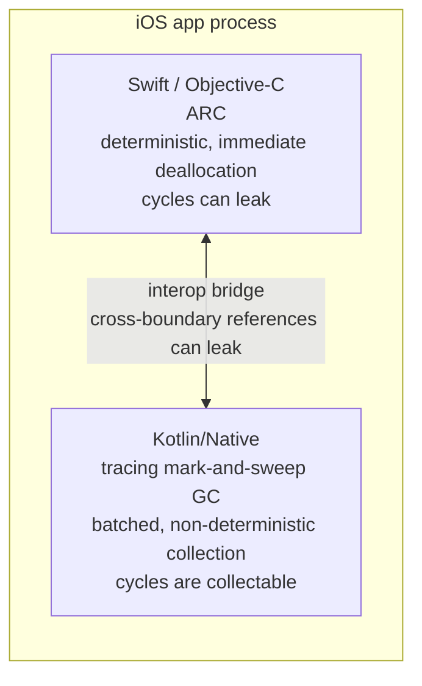

# Concurrency & The Kotlin/Native Memory Model

> Concurrency in KMP is the single most dangerous topic for production stability. On Android, coroutines run on JVM threads managed by ART's garbage collector. On iOS, coroutines run on native threads managed by Kotlin/Native's own GC — a completely separate memory management system that coexists with Swift's ARC. If you don't understand the dual-GC architecture and the historical evolution of the K/Native memory model, you will ship apps that leak memory, deadlock on the iOS main thread, or crash with `ConcurrentModificationException` on release day.

---

## Overview

The Kotlin/Native memory model went through three distinct eras. Understanding all three is necessary because you will encounter legacy code from each era, and because the current model's design decisions only make sense in the context of what came before.

---

## 1. Era 1: Thread Confinement (2017-2022) — The Dark Ages

### The Rule
Kotlin/Native 1.0 through 1.6 enforced a strict rule:

> **Mutable objects cannot be shared between threads. If you want to pass an object to another thread, you must freeze it first.**

"Freezing" an object made it deeply immutable — the entire object graph became read-only. Any attempt to mutate a frozen object threw `InvalidMutabilityException` and crashed the app.

### Why This Existed
Kotlin/Native didn't have a concurrent garbage collector. If two threads modified the same object simultaneously, the reference counting system (similar to Swift's ARC) would corrupt the reference count, leading to use-after-free crashes or memory leaks. JetBrains chose to prevent this entirely at the language level.

### What This Looked Like in Practice

```kotlin
// Era 1 code — DO NOT WRITE THIS IN MODERN KMP

data class User(var name: String, var email: String)

fun brokenExample() {
    val user = User("Alice", "alice@example.com")
    
    // Freeze the user so it can cross thread boundaries
    user.freeze()
    
    CoroutineScope(Dispatchers.Default).launch {
        // This crash is INTENTIONAL — you cannot mutate a frozen object
        user.name = "Bob"  // 💥 InvalidMutabilityException
    }
}
```

### The Aftermath
This model was so painful that many early KMP adopters abandoned the platform entirely. Common complaints:
- Any object passed to a coroutine background thread was auto-frozen.
- `ViewModel` patterns were impossible — ViewModels need mutable state.
- `AtomicReference<T>` was the only way to hold mutable state across threads — ugly, error-prone, and unfamiliar to Android engineers.

**Verdict:** If you encounter `.freeze()`, `isFrozen`, `ensureNeverFrozen()`, or `AtomicReference<T>` in a KMP codebase, you are looking at legacy code. Migrate immediately.

---

## 2. Era 2: The New Memory Model (Kotlin 1.7.20+) — The Fix

### What Changed
In October 2022, JetBrains shipped the **New Memory Model** as the default. The key changes:

1. **No more freezing.** Objects can be shared between threads freely, just like on the JVM.
2. **A new concurrent Garbage Collector.** The GC can now trace and collect objects that are referenced by multiple threads simultaneously.
3. **Thread-local storage is optional.** `@ThreadLocal` and `@SharedImmutable` annotations are deprecated.

### How the New GC Works

The Kotlin/Native GC uses a **tracing garbage collector** with concurrent marking:



**Comparison with JVM collectors:** both Kotlin/Native and JVM collectors use safepoints and barriers as implementation tools. The current Kotlin/Native collector is non-generational concurrent mark-and-sweep; application threads can participate in marking and short stop-the-world phases still exist. Do not use "Native has barriers, JVM has safepoints" as the distinction.

### GC Configuration

You can tune the K/Native GC via `gradle.properties`:

```properties
# Current default is concurrent mark-and-sweep (CMS).
# Use PMCS only as a measured fallback when diagnosing a CMS regression.
kotlin.native.binary.gc=pmcs

# Disable allocator paging only after profiling memory behavior.
kotlin.native.binary.pagedAllocator=false

# Emit Apple-platform GC safepoints to Instruments.
kotlin.native.binary.enableSafepointSignposts=true
```

Allocator selection such as mimalloc is a compiler option (`-Xallocator=mimalloc`), not the obsolete `kotlin.native.allocator` property. These knobs evolve; verify them against the Kotlin/Native memory-manager documentation for the Kotlin version you ship.

**Staff Rule:** Do not tune the GC unless you have profiled a specific memory problem. The defaults are well-chosen for typical mobile apps.

---

## 3. The Dual-GC Architecture (The Real Danger)

An iOS app running KMP has **two garbage collection systems running simultaneously**:



### Cross-Boundary Reference Leaks

When Swift holds a reference to a Kotlin object:
- Swift ARC increments its own reference count for the Kotlin object.
- The Kotlin GC sees this as an external root — it will NOT collect the Kotlin object until Swift releases it.

When Kotlin holds a reference to a Swift object:
- Kotlin GC adds the Swift object to its root set.
- Swift ARC thinks the Swift object is still in use and won't deallocate it.

**The Leak Scenario:**
```kotlin
// Kotlin code
class KotlinViewModel {
    // This holds a strong reference to whatever Swift passes in
    var onStateChange: ((String) -> Unit)? = null
    
    fun start() {
        viewModelScope.launch {
            while (true) {
                delay(1000)
                onStateChange?.invoke("tick")
            }
        }
    }
}
```

```swift
// Swift code — THIS LEAKS!
class SwiftViewController: UIViewController {
    let viewModel = KotlinViewModel()
    
    override func viewDidLoad() {
        super.viewDidLoad()
        
        // Passing `self` into Kotlin creates a strong cross-boundary reference
        viewModel.onStateChange = { [self] state in
            self.label.text = state
            // `self` (UIViewController) is captured by the Kotlin closure
            // Kotlin GC holds `self` → ARC thinks VC is still alive
            // VC is never deallocated, even after user navigates away
        }
        viewModel.start()
    }
}
```

**The Fix:**
```swift
// Use [weak self] to prevent the strong cross-boundary reference
viewModel.onStateChange = { [weak self] state in
    self?.label.text = state
}
```

---

## 4. Coroutine Dispatchers on iOS

### Dispatchers.Main (The iOS Main Thread)

On iOS, `Dispatchers.Main` maps to Apple's **Main Dispatch Queue** (GCD). This is the same queue that SwiftUI and UIKit use for UI updates.

```kotlin
// This is safe — updates happen on the iOS main thread
viewModelScope.launch(Dispatchers.Main) {
    _state.value = UiState.Loading  // ✅ Safe for UI observation
    val data = withContext(Dispatchers.IO) {
        api.fetchData()  // Background thread
    }
    _state.value = UiState.Success(data)  // ✅ Back on main thread
}
```

### Dispatchers.IO on iOS

As of `kotlinx-coroutines` 1.7.0, `Dispatchers.IO` is available on Kotlin/Native. It creates a background thread pool.

**Before 1.7.0:** `Dispatchers.IO` did not exist on Native. Engineers had to use `Dispatchers.Default`, which has a fixed thread pool size equal to the number of CPU cores. If all cores were occupied with CPU-intensive work and you also needed I/O concurrency, the app would deadlock.

**After 1.7.0:** `Dispatchers.IO` exists on Native with an elastic thread pool (similar to JVM), so I/O-bound operations can scale independently of CPU-bound work.

### Dispatchers.Default Behavior Differences

| Property | JVM (Android) | Native (iOS) |
|---|---|---|
| Thread pool size | = CPU cores (typically 4-8) | = CPU cores (typically 4-6) |
| Thread parking | JVM parks idle threads | Native destroys idle threads |
| Thread creation cost | ~1ms (JVM reuses) | ~5-10ms (OS-level thread creation) |
| Stack size per thread | 512KB-1MB configurable | 512KB (Apple default) |

**Implication:** If your coroutine code rapidly creates and cancels thousands of short-lived tasks on `Dispatchers.Default`, iOS will pay a higher penalty than Android because Native threads are more expensive to create/destroy.

---

## 5. `StateFlow` Observation Across the Bridge

The most common concurrency pattern in KMP is emitting state from a shared ViewModel and observing it in Swift:

```kotlin
// commonMain — The Kotlin side
class ProfileViewModel {
    private val _state = MutableStateFlow(ProfileState())
    val state: StateFlow<ProfileState> = _state.asStateFlow()
    
    fun loadProfile(userId: String) {
        viewModelScope.launch {
            _state.update { it.copy(isLoading = true) }
            
            val result = withContext(Dispatchers.IO) {
                repository.getProfile(userId)
            }
            
            _state.update { it.copy(isLoading = false, profile = result) }
        }
    }
}
```

### Without SKIE (Manual Collection)

```swift
@MainActor
class ProfileViewModelObserver: ObservableObject {
    private let kotlinVM = ProfileViewModel()
    @Published var state = ProfileState.companion.initial
    private var collector: Closeable? = nil
    
    func startObserving() {
        // Create a collector on a Kotlin background thread
        collector = FlowCollector.collect(
            flow: kotlinVM.state,
            onEach: { [weak self] newState in
                guard let state = newState as? ProfileState else { return }
                // CRITICAL: Must dispatch to main thread for SwiftUI
                DispatchQueue.main.async {
                    self?.state = state
                }
            }
        )
    }
    
    deinit {
        // If you forget this, the Kotlin coroutine runs forever!
        collector?.close()  // Cancels the Kotlin Job
    }
}
```

**The dangers:**
1. If `deinit` doesn't call `collector?.close()`, the Kotlin coroutine continues running after the Swift view is deallocated → **memory leak**.
2. If you forget `DispatchQueue.main.async`, SwiftUI crashes because you're updating `@Published` from a background thread.
3. The `[weak self]` is mandatory. Without it, the closure captures `self` strongly → cross-boundary reference cycle → neither the Swift object nor the Kotlin Job is ever freed.

### With SKIE or Kotlin 2.4 Swift Export

```swift
struct ProfileScreen: View {
    let viewModel = ProfileViewModel()
    @State private var state = ProfileState.companion.initial
    
    var body: some View {
        VStack {
            if state.isLoading {
                ProgressView()
            } else if let profile = state.profile {
                Text(profile.name)
            }
        }
        .task {
            do {
                // Kotlin 2.4 Swift Export exposes StateFlow/Flow
                // as Swift AsyncSequence via asAsyncSequence().
                // .task automatically cancels when the View disappears,
                // which cancels the Kotlin collection job through the bridge.
                for try await newState in viewModel.state.asAsyncSequence() {
                    self.state = newState
                }
            } catch is CancellationError {
                // Normal SwiftUI view-disappearance cancellation.
            } catch {
                // Surface as state or telemetry in production code.
            }
        }
        .onAppear {
            viewModel.loadProfile(userId: "123")
        }
    }
}
```

**What the AsyncSequence bridge does internally:**
1. Exposes the Kotlin `Flow`/`StateFlow` as a Swift `AsyncSequence`.
2. Starts a Kotlin coroutine that calls `Flow.collect`.
3. When Swift's `Task` is cancelled (e.g., View disappears), the bridge cancels the Kotlin collection job.
4. The Kotlin coroutine throws `CancellationException`, which unwinds the coroutine stack and releases references.

Kotlin 2.4 Swift export enables Flow-to-`AsyncSequence` export by default and preserves public Flow element types. It is still Alpha, so production teams may keep SKIE or explicit wrappers when they need a mature generated Swift API. One important dispatcher detail remains: exported suspend functions and `asAsyncSequence()` use a Kotlin coroutine context backed by `Dispatchers.Default` unless the Kotlin implementation switches context explicitly.

```kotlin
suspend fun loadProfileOnMain(): Profile =
    withContext(Dispatchers.Main) {
        repository.loadProfile()
    }
```

---

## Common Pitfalls

### 1. The `GlobalScope` Leak
```kotlin
// BAD — This coroutine NEVER gets cancelled
GlobalScope.launch {
    while (true) {
        delay(1000)
        analytics.track("heartbeat")
    }
}
```
On Android, `GlobalScope` leaks are bad but survivable (the process is killed on app close). On iOS, a `GlobalScope` coroutine runs *indefinitely* until the app is killed by the OS. If it holds references to UI objects, memory grows unbounded.

### 2. The Main Thread Deadlock
```kotlin
// DANGEROUS on iOS
runBlocking(Dispatchers.Main) {
    val data = api.fetchData()  // This suspends...
}
// runBlocking BLOCKS the Main thread while waiting for fetchData()
// fetchData() needs to resume on Main thread (to update StateFlow)
// → DEADLOCK: Main thread is blocked, waiting for work that needs Main thread
```

### 3. The `Dispatchers.Main.immediate` Assumption
On Android, `Dispatchers.Main.immediate` skips dispatch if you're already on the main thread. On Kotlin/Native, this behavior exists but with a subtle difference: the "main thread" check uses Apple's `pthread_main_np()` function, which can return false during app initialization before `UIApplicationMain` is called.

---

## Probing Questions

1.  **Legacy Migration:** You inherit a KMP codebase that uses `AtomicReference<MutableList<User>>` to share state between threads. This was written for the old memory model. How do you refactor this for the new memory model?
2.  **Dual-GC Leak:** Draw the reference graph for the `SwiftViewController → KotlinViewModel → closure → SwiftViewController` leak scenario. Which GC system (ARC or K/Native) would need to break the cycle, and why can't it?
3.  **Dispatcher Starvation:** Your KMP app on iOS has 8 concurrent `Dispatchers.Default` coroutines doing CPU-heavy image processing. A 9th coroutine needs to run a 5ms database query. What happens, and how do you fix it?
4.  **StateFlow Collection:** Without SKIE, trace the exact sequence of events when a SwiftUI `View` disappears while a Kotlin `StateFlow` is being collected via a manual `FlowCollector`. What object is leaked if `close()` isn't called?
5.  **GC Tuning:** Your KMP app on iOS shows 15ms GC pauses in Instruments. These pauses cause dropped frames in a scrolling list. What K/Native GC configuration options are available, and what tradeoff does each represent?

## Answer Key

1. Replace the atomic container-of-mutable-state with immutable snapshots exposed through `StateFlow`, and serialize mutations with a `Mutex`, actor, or single owner. Atomics remain useful only for genuinely lock-free scalar coordination.
2. Swift retains the Kotlin object, Kotlin retains the closure, and the closure retains Swift. ARC cannot see through Kotlin GC ownership and Kotlin GC cannot release an externally retained Swift object; explicitly break the closure/reference cycle.
3. CPU-bound work can occupy the Default pool and delay the short query. Bound image parallelism, move blocking database calls to an appropriate dispatcher, and prioritize/partition workloads instead of launching unbounded jobs.
4. Manual bridging continues until its collection job is cancelled. If `close()` is omitted, the collector/bridge and captured Swift view model can remain reachable after the view disappears.
5. Measure before tuning. The supported default is the `pmcs` collector; allocator paging can be disabled with `kotlin.native.binary.pagedAllocator=false`, safepoint signposts aid Instruments analysis, and `-Xallocator=mimalloc` changes allocator behavior. Each option trades pause/throughput/memory characteristics and must be benchmarked on target devices.

## Further Reading

- [`swift-interop.md`](../tooling/swift-interop.md) — How SKIE bridges Kotlin `Job` cancellation to Swift `Task` cancellation.
- [`../../kotlin/coroutines-and-flow/coroutines.md`](../../../kotlin/coroutines-and-flow/coroutines.md) — Deep dive into Job hierarchies, SupervisorJob, and cancellation propagation.
- [`../../kotlin/runtime-and-jvm/memory-model.md`](../../../kotlin/runtime-and-jvm/memory-model.md) — The JVM memory model (compare with the K/Native GC described here).
- [Kotlin/Native memory management](https://kotlinlang.org/docs/native-memory-manager.html) — current collector behavior and supported binary options.
- [Swift/Objective-C ARC integration](https://kotlinlang.org/docs/native-arc-integration.html) — cross-runtime lifecycle and retain-cycle behavior.
- [`testing-and-mocking.md`](testing-and-mocking.md) — How to test concurrent code in `commonTest` across both runtimes.
