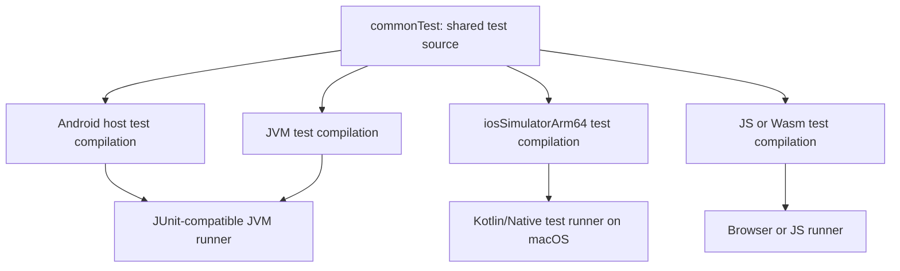

# Testing and Test Doubles in Kotlin Multiplatform

> A test in `commonTest` is shared source, not proof that every target runtime was exercised. A production KMP test strategy compiles shared tests into each supported target's test binary, runs target-capable CI jobs, and adds native-consumer tests where Kotlin's test boundary ends.

---

## Why This Matters

Shared code can still fail differently across JVM, Kotlin/Native, JavaScript, and Wasm because it crosses different runtimes, schedulers, filesystems, serializers, clocks, and platform adapters. The useful question is therefore not “do we have common tests?” but:

> Which contract is being tested, on which runtime, through which public boundary, and on which required host?

A strong suite separates four concerns:

1. deterministic business behavior in `commonTest`;
2. target-specific adapters and `actual` implementations in target test source sets;
3. exported API behavior from Swift, Java, or another real consumer;
4. UI and device behavior on the platforms that ship it.

---

## 1. Understand What `commonTest` Means

`commonTest` is the root of the shared test source-set hierarchy. Its source is compiled into the test compilation of each declared target. It is not a separate runtime and it does not run automatically on every platform merely because the file exists.



Only declared and invoked target tasks produce runtime evidence. A green JVM test does not prove the iOS test binary compiled or ran.

### Current source-set names

| Purpose | Current Android-KMP library plugin | Legacy Android target layout | Other KMP targets |
|---|---|---|---|
| Shared tests | `commonTest` | `commonTest` | `commonTest` |
| Android local/host tests | `androidHostTest` (opt in) | `androidUnitTest` | — |
| Android device tests | `androidDeviceTest` (opt in) | `androidInstrumentedTest` | — |
| JVM-only tests | — | — | `jvmTest` |
| Shared Apple-family tests | — | — | commonly `appleTest` or `iosTest` |
| Executable iOS simulator tests | — | — | `iosSimulatorArm64Test` task |

The `iosTest` source set is usually an intermediate source set shared by iOS targets. The executable task belongs to a concrete target such as `iosSimulatorArm64`.

### Minimal common test dependencies

```kotlin
kotlin {
    sourceSets {
        commonTest.dependencies {
            implementation(kotlin("test"))
            implementation(libs.kotlinx.coroutines.test)
            implementation(libs.ktor.client.mock)
        }
    }
}
```

Use `kotlin.test` annotations and assertions in common tests. The target maps that API to an appropriate test framework or runner; JUnit-specific rules and extensions remain JVM-only.

---

## 2. Prefer Explicit Test Seams and Fakes

MockK's published implementation currently targets JVM/Android. It cannot be treated as a `commonTest` or Kotlin/Native mocking solution simply because the consuming project is multiplatform.

For shared domain and data code, prefer small interfaces plus stateful fakes. They are compiled by every target, make behavior visible, and expose oversized interfaces early.

```kotlin
@Serializable
data class Product(val id: String, val category: String)

class ProductTransportException(message: String) : Exception(message)

interface ProductApi {
    suspend fun fetch(category: String): List<Product>
}

interface ProductStore {
    suspend fun read(category: String): List<Product>
    suspend fun replace(category: String, products: List<Product>)
}

class FakeProductApi : ProductApi {
    var result: Result<List<Product>> = Result.success(emptyList())
    val requestedCategories = mutableListOf<String>()

    override suspend fun fetch(category: String): List<Product> {
        requestedCategories += category
        return result.getOrThrow()
    }
}

class FakeProductStore : ProductStore {
    private val values = mutableMapOf<String, List<Product>>()

    override suspend fun read(category: String): List<Product> =
        values[category].orEmpty()

    override suspend fun replace(category: String, products: List<Product>) {
        values[category] = products.toList()
    }
}

class ProductRepository(
    private val api: ProductApi,
    private val store: ProductStore,
) {
    suspend fun products(category: String): List<Product> = try {
        api.fetch(category).also { store.replace(category, it) }
    } catch (_: ProductTransportException) {
        store.read(category)
    }
}
```

The fake should model only behavior the test owns. Avoid recreating a production database, HTTP stack, or scheduler inside the fake.

```kotlin
class ProductRepositoryTest {
    @Test
    fun fallsBackToCachedProductsWhenRefreshFails() = runTest {
        val api = FakeProductApi().apply {
            result = Result.failure(ProductTransportException("offline"))
        }
        val store = FakeProductStore().apply {
            replace("books", listOf(Product("cached-1", "books")))
        }
        val repository = ProductRepository(api, store)

        val products = repository.products("books")

        assertEquals(listOf("books"), api.requestedCategories)
        assertEquals(listOf("cached-1"), products.map(Product::id))
    }
}
```

Fallback catches only the failure class that the API boundary defines as recoverable. `CancellationException` and programming defects must propagate; converting cancellation into cached success breaks structured concurrency and can update a screen after its owner has stopped.

### When a generated mocking library is justified

A code-generation library such as Mockative can support Kotlin/Native without JVM runtime proxying. It adds compiler-plugin/KSP and version-alignment risk, however. Before adopting one:

1. verify every required target in the library's current publication;
2. pin a version compatible with the project's Kotlin and KSP versions;
3. compile and run a small proof on JVM and Apple CI;
4. keep generated mocks out of public production APIs;
5. retain fakes for behavior-rich dependencies where state is clearer than call scripts.

The decision is per boundary, not “fakes everywhere” or “mocks everywhere.”

---

## 3. Test Coroutines With One Scheduler

`runTest` works across Kotlin/JVM, Kotlin/Native, JS, and Wasm targets supported by `kotlinx-coroutines-test`. It returns `TestResult`, skips delays controlled by its `TestCoroutineScheduler`, reports uncaught child-coroutine failures, and has a default real-time timeout.

Use the expression-body form so the `TestResult` is returned immediately; this is required for common tests that may run on JavaScript.

```kotlin
enum class RefreshState { Idle, Loading, Ready }

class RefreshCoordinator(
    private val scope: CoroutineScope,
    private val workerDispatcher: CoroutineDispatcher,
) {
    val state = MutableStateFlow(RefreshState.Idle)

    fun startRefresh() {
        state.value = RefreshState.Loading
        scope.launch(workerDispatcher) {
            delay(1_000)
            state.value = RefreshState.Ready
        }
    }
}

@Test
fun refreshPublishesTheNewValue() = runTest {
    val dispatcher = StandardTestDispatcher(testScheduler)
    val subject = RefreshCoordinator(this, dispatcher)

    subject.startRefresh()
    assertEquals(RefreshState.Loading, subject.state.value)

    advanceUntilIdle()

    assertEquals(RefreshState.Ready, subject.state.value)
}
```

### Dispatcher ownership rule

Production code that hard-codes `Dispatchers.Default`, `Dispatchers.IO`, or an unrelated scope escapes the test scheduler. Delays in those dispatchers are not automatically skipped, and ordering becomes harder to control.

Inject the dispatcher or scope at the concurrency boundary, as `RefreshCoordinator` does above.

When several `TestDispatcher` instances are needed, create them with the same `testScheduler`. Use `runCurrent()`, `advanceTimeBy(...)`, and `advanceUntilIdle()` deliberately; do not rely on real sleeps.

---

## 4. Test HTTP Contracts With Ktor `MockEngine`

Ktor's `MockEngine` simulates HTTP calls without opening a socket. Put `ktor-client-mock` in `commonTest` when the published artifact supports all of the project's test targets.

Test the request and response contract together:

```kotlin
@Serializable
data class ProductsResponse(val products: List<Product>)

class ProductService(private val client: HttpClient) {
    suspend fun fetch(category: String): ProductsResponse =
        client.get("https://api.example.test/v1/products") {
            parameter("category", category)
        }.body()
}

@Test
fun sendsTheCategoryAndDecodesTheResponse() = runTest {
    val engine = MockEngine { request ->
        assertEquals("/v1/products", request.url.encodedPath)
        assertEquals("books", request.url.parameters["category"])

        respond(
            content = ByteReadChannel(
                """{"products":[{"id":"p1","category":"books"}]}"""
            ),
            status = HttpStatusCode.OK,
            headers = headersOf(
                HttpHeaders.ContentType,
                ContentType.Application.Json.toString(),
            ),
        )
    }
    val client = HttpClient(engine) {
        install(ContentNegotiation) { json() }
    }

    try {
        val response = ProductService(client).fetch("books")
        assertEquals("p1", response.products.single().id)
    } finally {
        client.close()
    }
}
```

`MockEngine` verifies client behavior, serialization configuration, headers, status handling, and retry decisions. It does not prove DNS, TLS, proxy, cellular, or the real server's wire behavior. Cover those with staging contract tests and production telemetry.

For numeric edge cases, assert the serializer contract on every shipped runtime. Do not infer parity from one JVM result.

---

## 5. Test `expect`/`actual` at Two Levels

A shared contract test proves every `actual` implementation meets the same invariant:

```kotlin
// commonTest
class PlatformClockContractTest {
    @Test
    fun monotonicTimeNeverMovesBackward() {
        val first = monotonicNow()
        val second = monotonicNow()

        assertTrue(second >= first)
    }
}
```

Target-specific tests then cover platform semantics that cannot be expressed in common code:

- Android host/device tests: resources, SQLite driver configuration, Android keystore adapter, lifecycle integration.
- `iosTest`: Foundation mappings, file protection, Darwin networking, locale/calendar behavior.
- JVM tests: Java interop, JVM-only libraries, desktop or server adapters.
- JS/Wasm tests: browser storage, JavaScript number and event-loop behavior.

Avoid weak contracts such as “UUID is non-empty.” Assert the property consumers rely on: parseability, uniqueness domain, case normalization, persistence behavior, or stable serialization.

---

## 6. Test Compose Multiplatform UI on Real Targets

Compose Multiplatform's common UI test API is experimental. In Compose Multiplatform 1.11, use the v2 package:

```kotlin
import androidx.compose.ui.test.ExperimentalTestApi
import androidx.compose.ui.test.assertTextEquals
import androidx.compose.ui.test.onNodeWithTag
import androidx.compose.ui.test.performClick
import androidx.compose.ui.test.v2.runComposeUiTest
import kotlin.test.Test

class LoginScreenTest {
    @OptIn(ExperimentalTestApi::class)
    @Test
    fun submitShowsLoadingState() = runComposeUiTest {
        setContent { LoginScreen() }

        onNodeWithTag("submit").performClick()
        onNodeWithTag("status").assertTextEquals("Loading")
    }
}
```

The same common test source can be compiled for multiple UI targets, but you must invoke the corresponding tasks. Current official examples use:

```shell
./gradlew :shared:iosSimulatorArm64Test
./gradlew :shared:connectedAndroidTest
./gradlew :shared:jvmTest
./gradlew :shared:wasmJsTest
```

Android device tests require explicit Android-KMP test configuration. A JVM/desktop UI pass is not a replacement for Android or iOS input, accessibility, windowing, IME, and rendering checks.

---

## 7. Add Native Consumer Tests

Kotlin tests stop before some of the most important consumer contracts:

- generated Objective-C or Swift names;
- nullability and collection mappings;
- suspend cancellation from Swift;
- `Flow` observation wrappers;
- framework linkage and minimum deployment target;
- package installation and resource loading.

Build a small Swift/XCTest fixture against the produced XCFramework or package. Test the API as an iOS team receives it, not only as Kotlin declares it. This Swift XCTest consumption proves that your KMP Monorepo or Polyrepo distribution (e.g. SPM binary target) is structurally sound, linking correctly, and exposing the intended surface area to native developers.

Likewise, published JVM libraries should compile a Java/Kotlin consumer fixture, and JavaScript libraries should test their exported JS surface when it is part of the compatibility promise.

---

## 8. Build a Required CI Matrix

Do not assume `allTests` includes every Android host/device task or every custom target. Inspect the Gradle task graph and declare important target tasks explicitly.

| Gate | Typical host | Required evidence |
|---|---|---|
| Common logic on JVM/Android host | Linux | Fast unit/property tests; Android host adapter tests |
| Kotlin/Native and Apple adapters | macOS | `iosSimulatorArm64Test` plus target-specific contract tests |
| Android device integration | Linux/macOS with managed device or emulator | Instrumentation, resources, SQLite/keystore/lifecycle behavior |
| Shared Compose UI | Target-capable jobs | Android device, iOS simulator, and any shipped desktop/web target |
| Swift consumer | macOS with Xcode | Framework/package integration and XCTest fixture |
| Staging service contract | Controlled environment | Real TLS/auth/schema compatibility without production mutation |

### Cost-aware policy

Use change-aware scheduling without removing the merge guard:

1. run common/JVM tests on every pull-request update;
2. run affected Android device and iOS simulator suites before merge;
3. run the complete target matrix nightly and before release;
4. require the full matrix for shared runtime, serialization, concurrency, or build-tool changes;
5. quarantine only with an owner, expiry, issue, and replacement signal.

Running an expensive target only after merge shortens feedback but permits known-bad changes onto `main`. If `main` is protected, the required pre-merge suite must match the repository's stated compatibility promise.

---

## Common Failure Modes

### “The common tests passed” means only JVM passed

Check which Gradle tasks actually ran and retain per-target reports. Shared source coverage is not runtime coverage.

### A fake has different semantics from production

Keep fakes small and back critical adapters with contract tests that run the same assertions against both fake and real implementations where practical.

### Virtual time does not advance

The code escaped to a dispatcher that does not share `testScheduler`, or the test did not yield/drain scheduled work. Inject concurrency dependencies.

### Assertions depend on order or global state

Test runners may schedule tests differently. Reset global overrides, close clients/databases, use isolated temporary storage, and never depend on declaration order.

### Floating-point assertions are exact

IEEE 754 values such as `0.1 + 0.2` are not exactly `0.3` on JVM or Native. Use an explicit tolerance derived from the domain, or use integer minor units/decimal types for money.

### Simulator-only coverage is treated as device proof

Simulators are valuable for fast native-runtime coverage, but they do not reproduce every device capability, performance profile, keychain state, background mode, or hardware behavior.

---

## Review Checklist

1. Does every supported target have an explicit test task and compatible CI host?
2. Are `commonTest` dependencies actually published for every target that compiles them?
3. Are schedulers, clocks, randomness, and dispatchers injectable where determinism matters?
4. Do fakes model owned behavior without reproducing the production system?
5. Are network tests split into `MockEngine`, staging contract, and failure-path coverage?
6. Are `actual` implementations tested on their target runtime?
7. Does a Swift/XCTest fixture protect the exported iOS API and distribution path?
8. Do shared Compose tests run on each shipped UI target?
9. Are reports retained per target so missing execution is visible?
10. Does quarantine have an owner and expiry?

---

## Probing Questions

1. **Shared source versus runtime:** A `commonTest` test passes in `testAndroidHostTest`. What additional evidence is required before claiming iOS support?
2. **Test doubles:** When is a concrete fake better than a generated mock, and when can a generated mock be reasonable?
3. **Coroutine scheduling:** Why might `runTest` still wait in real time or produce nondeterministic ordering?
4. **HTTP scope:** What does Ktor `MockEngine` prove, and which production risks remain outside it?
5. **Android layouts:** How do current `androidHostTest`/`androidDeviceTest` source sets differ from the legacy Android target names?
6. **Compose coverage:** Does placing a UI test in `commonTest` make one successful target run sufficient?
7. **CI economics:** How should a team reduce macOS/device-test cost without allowing untested shared-runtime changes onto `main`?

## Answer Key

1. `commonTest` is compiled into target test compilations, but the Android host result exercised only a JVM runtime. Compile and run `iosSimulatorArm64Test` on macOS, run iOS-specific adapter tests, retain the native report, and test the exported Swift/framework boundary when that is part of the product contract.
2. A fake is better when behavior and state are important, the interface is small, and the same double must compile everywhere. A generated mock can be reasonable for interaction-heavy, low-state collaborators when its current release supports every required target and Kotlin/KSP version. Prove that compatibility in CI and avoid leaking the tool into production APIs.
3. `runTest` skips delays only for dispatchers controlled by its `TestCoroutineScheduler`. Hard-coded `Dispatchers.Default`/`IO`, unmanaged scopes, real callbacks, or multiple unrelated schedulers escape virtual time. Inject dispatchers/scopes, share `testScheduler`, and explicitly yield or drain scheduled tasks.
4. `MockEngine` proves the configured Ktor client's request construction, response decoding, status/error handling, and related policy without a socket. It does not prove DNS, TLS, proxies, real-server schema deployment, cellular behavior, or backend availability; use staging contracts, device tests, and telemetry for those.
5. With the current Android-KMP library plugin, host and device tests are opt-in and use `androidHostTest` and `androidDeviceTest`. The legacy Android target layout uses `androidUnitTest` and `androidInstrumentedTest`. Do not copy task/source-set names between plugin generations without checking the configured Gradle tasks.
6. No. The source is reusable, but each target has a different runner and platform behavior. Invoke and require the Android device, iOS simulator, JVM/desktop, and web tasks that correspond to shipped targets; add platform-specific tests for semantics the common API cannot express.
7. Keep fast common/JVM tests on every update, use affected-path selection for expensive suites, but require the relevant macOS/device jobs before merge. Run a complete nightly/release matrix and force it for concurrency, serialization, runtime, and build-tool changes. Post-merge-only coverage is acceptable as an additional signal, not the sole protection for a guarded compatibility promise.

---

## Official Sources and Further Reading

- [Kotlin Multiplatform test tutorial](https://kotlinlang.org/docs/multiplatform/multiplatform-run-tests.html)
- [Kotlin Multiplatform project structure and test integration](https://kotlinlang.org/docs/multiplatform/multiplatform-discover-project.html#integration-with-tests)
- [`kotlin.test` API](https://kotlinlang.org/api/core/kotlin-test/)
- [`kotlinx-coroutines-test` API](https://kotlinlang.org/api/kotlinx.coroutines/kotlinx-coroutines-test/)
- [Ktor client testing with `MockEngine`](https://ktor.io/docs/client-testing.html)
- [Compose Multiplatform UI testing](https://kotlinlang.org/docs/multiplatform/compose-test.html)
- [Android-KMP library plugin and test source sets](https://developer.android.com/kotlin/multiplatform/plugin)
- [MockK source and published target configuration](https://github.com/mockk/mockk)
- [Mockative source and releases](https://github.com/mockative/mockative)
- [`ci-cd-for-kmp.md`](ci-cd-for-kmp.md) — target-capable build agents, caches, and release pipelines.
- [`concurrency-and-memory.md`](concurrency-and-memory.md) — Kotlin/Native scheduling, memory, and lifecycle behavior.
- [`../tooling/swift-interop.md`](../tooling/swift-interop.md) — generated API and Swift consumer contracts.
- [`../ecosystem/networking-with-ktor.md`](../ecosystem/networking-with-ktor.md) — production Ktor configuration and engine ownership.
- [`../../testing/testing-strategy.md`](../../testing/testing-strategy.md) — repository-wide Android test layers and device strategy.
